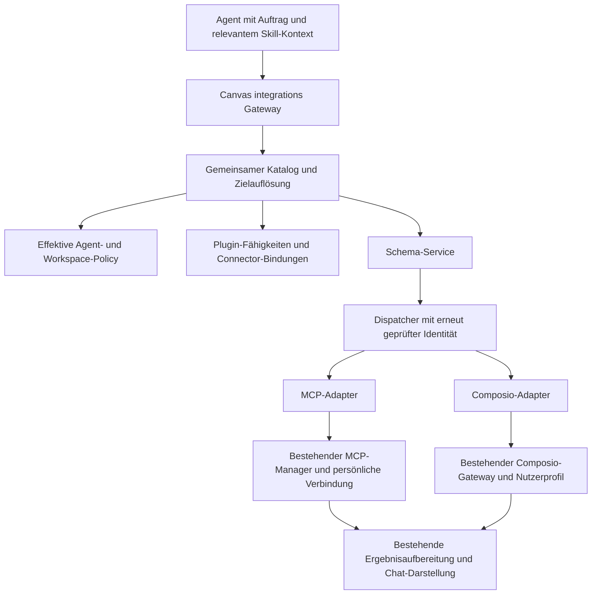

# Canvas Plugin Tool Gateway

Stand: 2026-10-05, auf Basis von `409897b9d`.
Status: Architekturvorschlag. Die gemeinsame Schicht ist noch nicht implementiert.

## Ziel und Entscheidungsvorschlag

Der Agent erhält einen gemeinsamen Zugang `integrations` für externe Tools. Canvas übernimmt die Suche, eindeutige Zielauflösung, Schema-Bereitstellung und Weiterleitung. Zwei Adapter führen die Aufrufe aus: direkt konfigurierte MCP-Verbindungen und Composio-Apps. Canvas-Plugins ergänzen diese Integrationen um Skills, fachliche Fähigkeiten und nachvollziehbare Connector-Bindungen.

Der Standardablauf lautet:

**Integrationen finden → Anbieter auswählen → passende Tools finden → Schema laden → Skill-Kontext lesen, falls relevant → ausführen.**

Composio bleibt das Backend für seinen App-Katalog, die verbundenen Accounts und deren Authentifizierung. Die erste Umsetzung verwendet die vorhandene SDK-/Gateway-Anbindung; sie benötigt weder eine SDK-Migration noch die Umwandlung aller MCP-Verbindungen in Composio-Verbindungen. Composio bietet sowohl direkte Tool-APIs als auch Session-/MCP-Zugänge. Diese Transportdetails gehören in den Adapter, nicht in den Aufrufvertrag des Canvas-Agenten. Siehe [Composio Tools API](https://docs.composio.dev/reference/v3/api-reference/tools) und [Composio Sessions](https://docs.composio.dev/docs/how-composio-works).

Eigenständig konfigurierte MCP-Server und Composio-Apps bleiben nutzbar, auch wenn kein entsprechendes Plugin installiert ist. Ein Plugin verbindet fachlichen Kontext und Integrationen, ist aber keine Voraussetzung für jeden externen Aufruf.

## Verifizierter Status quo

| Bereich | Heute vorhanden | Lücke für das Zielbild |
| --- | --- | --- |
| Plugin-Pakete | `canvas-plugin-manifest.ts`: Skills, Skill-Referenzen und getrennte Connector-Einträge für MCP, Composio und E-Mail | Kein gemeinsamer ausführbarer Tool-Katalog und keine ausdrücklichen Alternativgruppen für gleichwertige Connectoren |
| Plugin-/Skill-Policy | `capabilities/catalog.ts`, `capabilities/types.ts`: effektive, bereichsgebundene Plugins und Skills; Organisations-Vorrang, Aktivierung und Konflikte | Der Capability-Katalog führt Ressourcen vom Typ `skill` und `plugin`, keine externen Provider oder Tool-Routen |
| Plugin-Kontext | `plugin-reference-context.ts`: `/plugin` ergänzt Workflow- und Connector-Hinweise | Hinweise werden nicht zu eindeutig aufgelösten Tool-Routen |
| Skill-Kontext | `skill-context.ts`: kurze Beschreibungen im Prompt; relevante `SKILL.md` wird bei Bedarf gelesen | Keine gemeinsame maschinenlesbare Bindung zwischen einem Workflow und seinen MCP-/Composio-Alternativen |
| MCP | `mcp/proxy-tool.ts`: `list_servers`, `search_tools`, `describe_tool`, `call_tool` und OAuth-Aktionen | Eigener Vertrag und eigene Trefferstruktur |
| Direkte MCP-Tools | `mcp/direct-tools.ts`: ausdrücklich ausgewählte Tools erhalten eigene Modell-Schemas | Kompatibilitätsweg mit eigenen Berechtigungen; darf beim Gateway-Umbau nicht verschwinden oder mehr Rechte erhalten |
| Composio | `composio-tools.ts`, `composio-gateway.ts`: Suche, Schemas, Ausführung und Verbindungsstatus; lokale und Managed-Anbindung | Eigener Gateway-Vertrag; keine einfache Agentenliste aller verbundenen/verfügbaren Apps |
| Identität | MCP hat persönliche `connectionId` und Eigentümerprüfung; Composio hat nutzereigene Profile mit Workspace-Auswahl | Gemeinsame Schicht muss diese unterschiedlichen Bindungen erhalten und darf Anzeigenamen nicht als Identitäten verwenden |
| Registrierung | `tool-registry.ts`: MCP, direkte MCP-Tools und Composio werden getrennt registriert und nach Agent-Konfiguration gefiltert | Gemeinsamer Eintrittspunkt fehlt; alte Präferenzen müssen auf interne Adapter-Rechte abgebildet werden |
| UI-Readiness | `plugin-connection-readiness.ts`: getrennte Prüfung der Connectoren | MCP-Readiness prüft Konfiguration/Aktivierung und bei Bedarf OAuth; sie beweist allein keine erfolgreiche Tool-Abfrage oder Erreichbarkeit |
| Ergebnisdarstellung | `mcp/tool-result.ts`, `pi/tool-output-preparation.ts`: Output-Budgets, gespeicherte Ergebnisse und MCP-App-Metadaten | Diese Verträge müssen beim neuen Routing erhalten bleiben |

### Abgeschlossener allgemeiner Composio-Fix

- `d8cb779df`: Bei App-Namen ohne Treffer in den Gateway-Operationsnamen werden die erlaubten Operationen angezeigt. Die Anleitung führt zur tatsächlichen App-Tool-Suche. Ein solcher Suchausgang wird nicht als fehlende Konfiguration oder Verbindung interpretiert.
- Die Gateway-Filter sind monoton: Eine spätere Filterung stellt zuvor gesperrte Operationen nicht wieder her; das effektive Manifest zeigt nur die erlaubten Operationen.
- `e83f7cdcc`: Nur `ACTIVE` wird als verbundener Account gemeldet; Status und aktueller Profil-/Workspace-Bezug werden ausgegeben.
- `409897b9d`: Gemeinsamer SDK-/HTTP-Test mit fünf App-Katalogen: Canva, Gmail, GitHub, Slack und Google Drive. Unterschiedliche Parameterschemas, OAuth-Callback-Routen, appbezogene Berechtigungen, zwei Nutzer, Profilwechsel und Verbindungszustände sind abgedeckt.
- Fokussierte Tests, ESLint und `npm run build` sind erfolgreich. Playwright prüfte die normale UI-Verbindung und einen tatsächlichen Agentenlauf mit Gmail; zuvor wurde der Canva-Ablauf geprüft. Die Browserläufe verwenden kontrollierte Provider-Antworten und sind keine Live-Abnahme echter Drittanbieter-Accounts.
- Der Gmail-Agentenlauf erreichte die korrekte Ausführung, machte vorher aber vermeidbare Gateway-Fehlversuche. Das ist konkrete Motivation für einen einheitlichen, weniger verschachtelten Vertrag.
- Die Fixes sind lokal committet, nicht gepusht oder ausgerollt. Die zusätzliche App-Listenfunktion und die gemeinsame Schicht sind Bestandteil dieses Plans.

## Zielarchitektur



Die Schicht ist ein fachlicher Tool-Proxy. Sie ist kein frei konfigurierbarer HTTP-Proxy: Der Agent übergibt eine von Canvas gelieferte Referenz, keine beliebige Ziel-URL, kein Provider-User-ID-Feld und keine Credentials.

### Verantwortlichkeiten und vorgeschlagene Module

| Modul | Verantwortung |
| --- | --- |
| `app/lib/integration-tools/contracts.ts` | Versionierte öffentliche Descriptoren, Request-Union und Ergebnis-/Fehlervertrag |
| `app/lib/integration-tools/catalog.ts` | Sichtbare MCP-Verbindungen, verfügbare Composio-Apps und aktuelle Zustände zusammenführen |
| `app/lib/integration-tools/search.ts` | Deterministische Suche, App-Aliase, Ranking, Pagination und Teilfehler |
| `app/lib/integration-tools/bindings.ts` | Plugin-/Skill-Fähigkeiten auf tatsächliche Verbindungen abbilden |
| `app/lib/integration-tools/schema.ts` | Vollständiges Provider-Schema, Versionsbindung und Argumentvalidierung |
| `app/lib/integration-tools/dispatcher.ts` | Aktuellen Kontext und Rechte prüfen; genau einen Adapter aufrufen |
| `app/lib/integration-tools/adapters/mcp.ts` | MCP-Katalog und Aufrufe über vorhandenen Manager; bestehende OAuth-/MCP-App-Verträge erhalten |
| `app/lib/integration-tools/adapters/composio.ts` | Bestehende lokale/Managed-Gateway-Funktionen und Profilauflösung verwenden |
| `app/lib/pi/integration-tool-gateway.ts` | Schlankes AgentTool für den öffentlichen Vertrag; keine zweite Kopie der Provider-Logik |

Die bisherigen Plugin-/Skill-Policy-Dienste bleiben die Autorität für Plugin-Ressourcen. Der neue Provider-Katalog wird daraus und aus den Verbindungsdiensten abgeleitet. Es entsteht keine zweite unabhängige Speicherung von API-Keys, OAuth-Tokens oder Verbindungsstatus.

## Ein öffentlicher Agentenvertrag

`integrations` erhält eine diskriminierte Request-Union. Jede Aktion besitzt ihre eigenen Pflichtfelder. Der Agent muss keine Operation wie `COMPOSIO_SEARCH_TOOLS` innerhalb einer weiteren Gateway-Operation kennen.

| Aktion | Zweck | Pflichtfelder |
| --- | --- | --- |
| `list`, Ziel `providers` | Alle in diesem Kontext sichtbaren MCP-Verbindungen und Composio-Apps, mit Zustand; paginiert | `action`, `target` |
| `search`, Ziel `providers` | App/Integration finden, etwa „Canva“; optional Quellenfilter | `action`, `target`, `query` |
| `list`, Ziel `tools` | Kurze Tool-Beschreibungen eines ausgewählten Providers | `action`, `target`, `providerRef` |
| `search`, Ziel `tools` | Passendes Tool für einen Auftrag innerhalb des Providers finden | `action`, `target`, `providerRef`, `query` |
| `describe` | Vollständiges Input-Schema, Version und relevante Skill-Verweise laden | `action`, `toolRef` |
| `call` | Genau dieses Tool mit schema-konformen Argumenten aufrufen | `action`, `toolRef`, `schemaRef`, `arguments` |

Optionale Filter: Quelle `mcp`/`composio`, Zustand, Plugin-/Capability-Referenz und Cursor. `list` kann auch unverbundene, aber im eigenen Kontext verfügbare Apps zeigen. Sie werden eindeutig als verbindungsbedürftig markiert. Organisationsfreigegebene MCP-Vorlagen können als einrichtbare Kandidaten erscheinen; erst eine nutzereigene Verbindung ist ausführbar.

### Treffer und Referenzen

Ein Provider-Treffer enthält mindestens:

```json
{
  "providerRef": "mcp:<connection-id>",
  "source": "mcp",
  "application": "canva",
  "displayName": "Canva – persönlicher Account",
  "state": "ready",
  "configured": true,
  "requiresAuth": true,
  "authorized": true,
  "health": "healthy",
  "canExecute": true,
  "pluginRefs": [],
  "skillRefs": [],
  "matchReasons": ["application_exact"],
  "nextActions": []
}
```

Beispiele sind Vertragsvorschläge, keine heutigen API-Antworten. `application` ist nur gesetzt, wenn App-Metadaten oder ein validierter Connector sie belegen. Ein frei benannter MCP-Server ist nicht automatisch einem Anbieter zuzuordnen.

Weitere Zustände: `setup_required`, `auth_required`, `disabled`, `degraded` und `unknown`. Konfiguration, Authentifizierung, Erreichbarkeit und Ausführungsrecht sind getrennte Informationen. No-auth-Apps können ohne verbundenen Account ausführbar sein; hierfür wird die bestehende Composio-Toolkit-Access-Auflösung verwendet.

`checkedAt` und die Herkunft einer Zustandsprüfung kennzeichnen die Aktualität. Eine konfigurierte MCP-Verbindung ohne erfolgreiche aktuelle oder gültig gecachte Prüfung erhält keinen erfundenen Gesundheitsstatus. Die spätere Tool-Abfrage aktualisiert diesen Zustand, ohne dass die erste Provider-Liste sämtliche Server starten muss.

Tool-Treffer liefern `toolRef`, `providerRef`, Namen, Kurzbeschreibung und verfügbare Hinweise zur Wirkung. Vollständige Schemas kommen erst durch `describe`. Tool-Referenzen werden aus Backend-Identität und exaktem Tool-Namen abgeleitet; der Agent muss sie weder konstruieren noch zerlegen.

MCP-Referenzen verwenden `connectionId`, nicht Server-Anzeigenamen. Composio-Referenzen verwenden den Toolkit-Slug; die konkrete Account-/Profilbindung kommt ausschließlich aus dem serverseitigen Ausführungskontext. Für Legacy-MCP-Konfigurationen ohne stabile ID braucht der Adapter eine kompatible, bereichsgebundene Referenzauflösung.

`schemaRef` bindet das geladene Schema an Tool-Version, Verbindungs-/Profilrevision und effektive Policy. Ein Profilwechsel oder ein anderes Schema zwischen `describe` und `call` liefert `binding_changed` beziehungsweise `schema_changed` mit einem konkreten nächsten Schritt. Der Aufruf wird nicht stillschweigend unter einem anderen Account ausgeführt.

### Beispiel: Canva ist über MCP und Composio verfügbar

```json
{"action":"search","target":"providers","query":"Canva"}
```

Canvas liefert zwei getrennte Treffer mit Quelle und Zustand: beispielsweise einen nutzereigenen Canva-MCP und die Composio-App `canva`. Danach:

```json
{"action":"search","target":"tools","providerRef":"mcp:<connection-id>","query":"eigene Designs auflisten"}
```

```json
{"action":"describe","toolRef":"<toolRef aus dem Treffer>"}
```

```json
{"action":"call","toolRef":"<derselbe toolRef>","schemaRef":"<schemaRef aus describe>","arguments":{}}
```

Die tatsächlichen `arguments` ergeben sich aus dem geladenen Schema. Bei Composio ist der Agentenvertrag identisch; allein die Referenz und der interne Adapter unterscheiden sich. Jede Antwort enthält passende `nextActions` mit vollständigen Beispielargumenten für den nächsten Gateway-Aufruf.

## Suche und Routing

1. Eine ausdrückliche Nutzervorgabe wie „über Composio“ hat Vorrang.
2. Danach gilt eine validierte, bereits ausgewählte Connector-Bindung eines Plugins/Workflows.
3. Ohne Bindung werden passende, ausführbare Kandidaten höher eingestuft als Kandidaten mit fehlender Verbindung. Bei gleicher Eignung steht der konfigurierte MCP vor Composio, entsprechend dem gewünschten Beispiel.
4. Innerhalb dieser Regeln zählen exakte App-/Toolkit-/Verbindungs-Identität, deklarierte Aliase und Tool-Funktion stärker als lose Beschreibungswörter. Komplexe App-Namen wie „Google Drive“ werden über Katalog-Metadaten und Aliase aufgelöst, nicht allein durch Slug-Raten.
5. Die Reihenfolge ist eine Empfehlung. Gleiche App-Namen garantieren nicht, dass MCP und Composio dieselben Funktionen bieten. Fehlt eine benötigte Funktion, wird neu gesucht; Alternativen bleiben sichtbar.

Die ersten Treffer enthalten kleine Beschreibungen und Zustände. Provider-Tool-Kataloge werden bedarfsgerecht geladen; `list providers` öffnet nicht vorsorglich jeden MCP-Server und lädt nicht alle Composio-Tools. Bounded parallel discovery, Timeout pro Provider, Cache und Cursor begrenzen Laufzeit und Promptgröße.

Ein Suchergebnis weist aus, welche Quellen erfolgreich abgefragt wurden. Ein ausgefallener Provider erzeugt einen Teilfehler, keine Behauptung „keine Integrationen vorhanden“. `complete`, `providerErrors`, `nextCursor` und `matchReasons` machen das Ergebnis nachvollziehbar. Bestehende absichtlich ausgeblendete Composio-Toolkits und MCP-App-interne Tools bleiben ausgeblendet.

Es gibt keinen automatischen Wechsel des Providers nach einem unsicher abgeschlossenen Schreibaufruf. Bei `outcome_unknown` muss zuerst der Provider-Zustand geprüft werden. Auch normale Aufrufe werden nicht vorsorglich an beide Anbieter gesendet.

## Plugin- und Skill-Zusammenspiel

Ein Plugin beschreibt fachliche Fähigkeiten statt nur eine Liste unabhängiger Verbindungen. Dafür wird der heutige Manifest-Vertrag abwärtskompatibel um optionale `integrationCapabilities` erweitert. Beispiel:

```json
{
  "integrationCapabilities": [
    {
      "id": "designs",
      "application": "canva",
      "required": true,
      "alternatives": [
        {"source":"mcp","connector":"canva-mcp"},
        {"source":"composio","toolkit":"canva"}
      ],
      "skillRefs": ["canva-design-workflow"]
    }
  ]
}
```

`connector` verweist auf einen im Paket validierten MCP-Connector; Canvas löst ihn auf eine tatsächliche persönliche Verbindung beziehungsweise eine freigegebene Definition auf. Paket-Manifeste speichern keine fremden Nutzer-Verbindungs-IDs. Composio-Tool-Hinweise können die Suche eingrenzen, ersetzen aber nicht die reale Schema-Abfrage.

Innerhalb einer Fähigkeit reicht eine passende Alternative aus. Ein Workflow mit Canva **und** Slack beschreibt zwei benötigte Fähigkeiten. So wird nicht versehentlich gleichzeitig Canva-MCP **und** Canva über Composio vorgeschrieben.

Die bestehenden `connectors`, `mcpServers` und `composioToolkits` behalten ohne neue Felder ihre heutige Bedeutung. Eine Migration interpretiert alte Pflichtfelder nicht nachträglich als Alternativen. Neue Referenzen und Alternativen werden bei Installation/Update auf Existenz, Typ und Zyklen geprüft.

Discovery liefert passende Plugin-/Skill-Referenzen und deren effektive Verfügbarkeit. Beim ausgewählten Workflow erhält der Agent zunächst die kurze Beschreibung und liest dann die relevanten Skill-Inhalte über den vorhandenen, bereichsgeprüften Weg. Optional kann `agents/canvas.yaml` für eigenständige Skills Referenzen auf Integrationsfähigkeiten erhalten; das Standard-Frontmatter von `SKILL.md` bleibt kompatibel.

Skills liefern Arbeitsablauf, fachliche Parameterhinweise und Beispiele. Aktuelle Tool-Schemas bleiben maßgeblich. Ein Skill oder Plugin kann keine abgeschaltete Integration freischalten und keine Credentials oder Eigentümerbindung überschreiben. Organisations-Vorrang und Schutz vor persönlicher Schatten-Aktivierung bleiben bestehen.

## Ausführung, Identität und Ergebnisse

- Der Dispatcher verwendet den serverseitig aufgelösten Nutzer-, Agent-, Session- und Workspace-Kontext. MCP wird erneut über die bestehenden Zugriffsprüfungen aufgelöst; Composio über das aktuelle oder für die Automation bereits gebundene, nutzereigene Profil.
- Bestehende Agent-Präferenzen für `mcp`, einzelne direkte MCP-Tools und die einzelnen Composio-Operationen werden intern erhalten. Nur die Erlaubnis zum Suchen gewährt keine Erlaubnis zum Ausführen. Ein neues sichtbares Gateway darf gesperrte Backend-Funktionen nicht reaktivieren.
- Delegierte Worker behalten ihre Toolset-Grenzen. E-Mail-getriggerte Automationen erhalten dadurch keine externen Integrationen. Sonstige Automationen übernehmen ihren gebundenen Identitätsvertrag.
- Im Planungsmodus bleiben externe Ausführung und OAuth-/Verbindungsänderungen gesperrt. Discovery kann in einer späteren geprüften Variante ausschließlich vorhandene Metadaten/Caches lesen; fehlende Caches dürfen dabei keine Serverstarts oder versteckten Tool-Aufrufe auslösen.
- Canvas validiert Argumente gegen das vollständige Provider-Schema. MCP liefert JSON Schema, einschließlich optionaler Output-Schemas; Validator und Tests müssen die unterstützten Schema-Dialekte und Referenzen ausdrücklich abdecken. Nicht unterstützte Schemas erhalten einen klaren Fehler statt einer vereinfachten, falschen Validierung. Siehe [MCP Tools Specification](https://modelcontextprotocol.io/specification/2025-11-25/server/tools).
- Provider-Hinweise wie `readOnlyHint` beschreiben Verhalten, erteilen aber keine Canvas-Rechte und reichen allein nicht zum Freischalten im Planungsmodus.
- Die vorhandene konkrete Composio-Tool-Version bleibt gebunden. Canvas-eigene Wrapper mit Namen wie `COMPOSIO_SEARCH_TOOLS` werden nicht mit ähnlich benannten Composio-Session-Metatools vermischt; deren Argumente und Session-Anforderungen sind unterschiedlich.
- Ergebnisse behalten Text, strukturierte Daten und die vorhandenen sicheren Multimodal-/Resource-Wege. `prepareMcpToolInvocation` erhält die aktuellen MCP-App-Metadaten; `prepareToolOutput` übernimmt Budgets und gespeicherte Originale. Die Schicht darf daraus nicht pauschal einen JSON-Text machen und damit die Darstellung verlieren.
- Fehler werden einheitlich klassifiziert: fehlende Verbindung, Provider-Ausfall, fehlendes Tool, fehlende Berechtigung, ungültige Argumente, geänderte Bindung/Schema und unbekannter Ausführungszustand. Provider-Retry-Regeln bleiben erhalten; keine automatischen Wiederholungen unsicherer Schreibaufrufe.
- Caches sind nach Nutzer, Workspace/Organisation, Verbindung beziehungsweise Composio-Profil und relevanten Revisionen getrennt. Verbindungs-, Profil-, Policy- und Schema-Änderungen invalidieren betroffene Einträge. MCP-Tool-Listen können Änderungsbenachrichtigungen liefern; ihre Verarbeitung wird im Adapter berücksichtigt.

## UI und Runtime

Plugins-Seite, Integrationen/MCP-Settings und Agenten-Discovery verwenden dieselben normalisierten Zustände, sobald der gemeinsame Service eingeführt ist. Provider-Konfigurationsformulare und die bestehenden OAuth-Flows bleiben bestehen.

Bei einer fehlenden Verbindung liefert Canvas einen eindeutigen Einrichtungsschritt für die ausgewählte Quelle. Nach OAuth-Rückkehr oder Profilwechsel werden der Katalog und der nächste Agententurn aktualisiert. Im heutigen Browserlauf zeigte die OAuth-Rückkehrseite den neuen Account, während die ursprüngliche Settings-Seite erst nach Neuladen aktualisiert wurde; dieses Rückkehr-/Invalidierungsverhalten gehört in die gemeinsame UX-Abnahme.

Der Chat zeigt App, Quelle, Aktion und verwendetes Profil in verständlicher Form, etwa „Canva über MCP · Designs auflisten“. Technische IDs bleiben in den Details. Konflikte, Teilfehler und notwendige Verbindungsschritte verwenden die bestehenden UI-Muster. Mobile muss dieselben Status-/Rückkehrverträge konsumieren; Änderungen am separaten Mobile-Client werden vor Umsetzung dort geprüft.

In der ersten Migration bleibt die direkte MCP-Tool-Auswahl eine ausdrückliche Ausnahme. Die bisherigen `mcp`-/`composio`-Gateways werden im neuen Agentenmodus durch `integrations` ersetzt, während der Kompatibilitätsmodus die heutigen Schemas beibehält. Doppelte Standard-Anleitungen im Modell-Prompt werden vermieden. Eine spätere Entfernung der Kompatibilitätswege ist eine eigene Entscheidung.

## Umsetzung in abgeschlossenen Schritten

Jeder Schritt erhält einen eigenen Commit und ein Abnahme-Gate. Der nächste beginnt nach erfolgreicher Abnahme des vorherigen.

| Schritt | Ergebnis | Abnahme-Gate |
| --- | --- | --- |
| 0 — abgeschlossen | Allgemeiner Composio-Fix und dokumentierte Ausgangsbasis | Fünf-App-SDK-Test, User-/Profil-Trennung, Build und Browser-Agentenlauf grün; lokale Veröffentlichungssituation klar |
| 1 — Vertrag und Katalog | Öffentliche Descriptoren; kleine Provider-Liste/-Suche; MCP- und Composio-Katalog-Adapter; Status und Referenzen | Beide Canva-Quellen separat; mehrere gleich benannte MCP-Verbindungen; keine Auth-/Nutzerverwechslung; No-auth-App; Teilfehler und Pagination; keine pauschale Remote-Tool-Vorladung |
| 2 — Schema und Dispatcher | Tool-Suche/-Liste, `describe`, `call`, Schema-/Bindungsrevision; vorhandene Ergebnisaufbereitung | Realer lokaler MCP-Fixture-Server und echtes Composio-SDK gegen HTTP-Fixture; Argumente/Versionen korrekt; stale Schema, Profilwechsel und `outcome_unknown` ohne falsche Ausführung |
| 3 — Agenten-Runtime | Neuer Eintrittspunkt hinter Feature-Flag; alte Rechte auf Adapter-Funktionen abgebildet; kompakter Prompt und konkrete nächste Aufrufe | Flag aus: heutige Schemas/Rechte unverändert. Flag an: ein Discovery-Vertrag. Registry-/Policy-/Delegations-/Automation-Tests und Browser-Chat für beide Quellen grün |
| 4 — Plugin-/Skill-Bindungen | Validierte Fähigkeitsgruppen, alternative Connectoren, passende Skill-Referenzen und gemeinsame Readiness | Alte Pakete unverändert; ein erfüllter Alternativ-Connector genügt; Canva+Slack braucht beide Fähigkeiten; fehlender/gesperrter Skill und Organisations-Vorrang korrekt |
| 5 — UI und Rückkehr | Gemeinsame Statusdarstellung, Einrichtungsschritte und Invalidierung nach Verbindung/Profilwechsel; Mobile-Vertrag | Playwright auf Desktop und schmalem Viewport; OAuth-Rückkehr, gleicher Chat nach Profilwechsel, beide Quellen und Fehlerzustände; separater Mobile-Client-Vertrag geprüft |
| 6 — kontrollierter Rollout | Standardmodus umstellen, Telemetrie vergleichen, Rückfall über Flag testen, Produktdokumentation aktualisieren | Vollständige relevante Regression und `npm run build`; Produktionsabnahme beider Provider mit tatsächlichen Accounts; keine Veröffentlichung ohne passenden Auftrag |

Feature-Flag: vorläufiger Name `integrationToolGatewayEnabled`, standardmäßig aus bis Schritt 6. Die Flag ändert den Agenten-Eintrittspunkt, nicht den Besitz von Verbindungen oder die bestehenden Rechte. Die genaue Einbindung verwendet den vorhandenen Policy-/Feature-Mechanismus.

### Besonders betroffene bestehende Stellen

GitNexus-Auswirkungsanalyse des Ausgangsstands:

| Symbol | Direkte Aufrufer | Erfasste betroffene Symbole | Risiko / betroffene Bereiche |
| --- | --- | --- | --- |
| `buildPiToolRegistryAsync` | 2 | 11 | HIGH: PI, Agents, Mobile und Automationen |
| `getPiTools` | 4 | 15 | CRITICAL: PI, Mobile, Browser, Telegram und Automationen |
| `resolvePluginConnectionReadiness` | 3 | 13 | CRITICAL: Plugins, Skills, Capability-Katalog und Store |

Der Index meldet für diese Abfragen keine zugeordneten Prozessketten; das ist kein Beleg für fehlende Runtime-Auswirkungen. Vor jedem Umsetzungsschritt werden die konkrete Symbolanalyse und der reale Diff erneut geprüft. Der Runtime-Umbau wird erst nach separat getesteten Katalog-/Adapter-Verträgen begonnen.

## Test- und Abnahmematrix

Die neue Schicht benötigt eigene Contract-/Integrationstests. Bestehende wichtige Regressionen bleiben unter anderem `progressive-tool-gateway-test.ts`, `pi-tool-registry-test.ts`, `effective-tool-manifest-test.ts`, `workspace-tool-policy-test.ts`, `mcp-proxy-test.ts`, `mcp-direct-tools-test.ts`, `mcp-member-access-test.ts`, `mcp-connection-identity-test.ts`, `composio-agent-user-flow-test.ts`, `composio-user-scope-test.ts`, `composio-reliability-test.ts`, `canvas-plugin-runtime-test.ts` und `plugin-activation-protection-test.ts`.

Zusätzliche verpflichtende Szenarien:

1. Canva-MCP und Composio-Canva gleichzeitig: getrennte Treffer, klare Quelle, korrekt ausgewählter Aufruf.
2. Nur eine Quelle vorhanden; eine Quelle nicht verbunden; eine Quelle nicht erreichbar. Die funktionierende Quelle bleibt erkennbar.
3. Zwei persönliche MCP-Verbindungen mit gleichen Anzeigenamen; Composio-Profile mit unterschiedlichen Accounts; zwei Nutzer im selben Workspace.
4. Profil-/Policy-/Verbindungswechsel nach Discovery beziehungsweise `describe`: keine veraltete oder fremde Ausführung.
5. Mehrere Apps mit unterschiedlichen Schemas, Google-Drive-Anzeigename/Slug, No-auth-Toolkit und ein MCP-Tool mit verschachteltem Schema.
6. Neue/geänderte/entfernte MCP-Tools, Schema-Änderungen und explizit erlaubte direkte MCP-Tools.
7. Plugin-Workflow mit alternativen Connectoren sowie Workflow über zwei benötigte Apps; alte Manifeste und fehlende Skill-Referenzen.
8. MCP-App-Widget, strukturierter Output, Bild-/Resource-Ergebnis und großes Ergebnis mit gespeichertem Original.
9. Delegation, Planungsmodus und E-Mail-getriggerte Automationen: die bestehenden Grenzen bleiben wirksam.
10. Ein natürlicher Benutzerauftrag im Browser ohne technische Toolnamen erreicht Schema und korrekte Ausführung; Gateway-Fehlversuche und Anzahl der Discovery-Schritte werden protokolliert.

Vor Produktionsdeployment gilt der Repository-Gate `npm run test:all`. Container werden nur auf ausdrücklichen Auftrag gebaut und erst nach erfolgreichem Host-Build; die verwaltete lokale Umgebung verhindert parallele Teststacks.

Erfolgskriterien sind korrektes Routing, korrekte Identität und Schema-Verwendung, unveränderte Rechte, übereinstimmender UI-/Agentenstatus sowie weniger vermeidbare Gateway-Fehlversuche. Ein einzelner erfolgreicher Modelllauf beweist keine perfekte Zuverlässigkeit; deterministische Vertragstests und mehrere tatsächliche Agentenläufe mit unterschiedlichen Aufträgen ergänzen einander.

## Umfang der ersten Umsetzung

Der erste vollständig integrierte Stand umfasst MCP-Tools und Composio-App-Aktionen hinter `integrations`, Plugin-Fähigkeiten mit Alternativen, relevante Skill-Verweise und gemeinsame Status-/Rückkehrverträge. Bestehende E-Mail-/Studio-Fachtools behalten ihre eigenen Regeln; sie können später über weitere Adapter aufgenommen werden, wenn deren fachliche Verträge ausdrücklich abgebildet werden.

Ein neues öffentliches Canvas-MCP-Serverprodukt, eine generische HTTP-Proxy-API, ein Composio-SDK-Upgrade und die automatische Installation beliebiger externer MCP-Server sind eigene Vorhaben. Sie sind für den hier geplanten gemeinsamen Agenten-Zugang nicht erforderlich.

Empfohlener nächster Umsetzungsschritt: **Schritt 1 — gemeinsamer Vertrag und Provider-Katalog**, auf dem getesteten allgemeinen Composio-Fix aufbauend.
