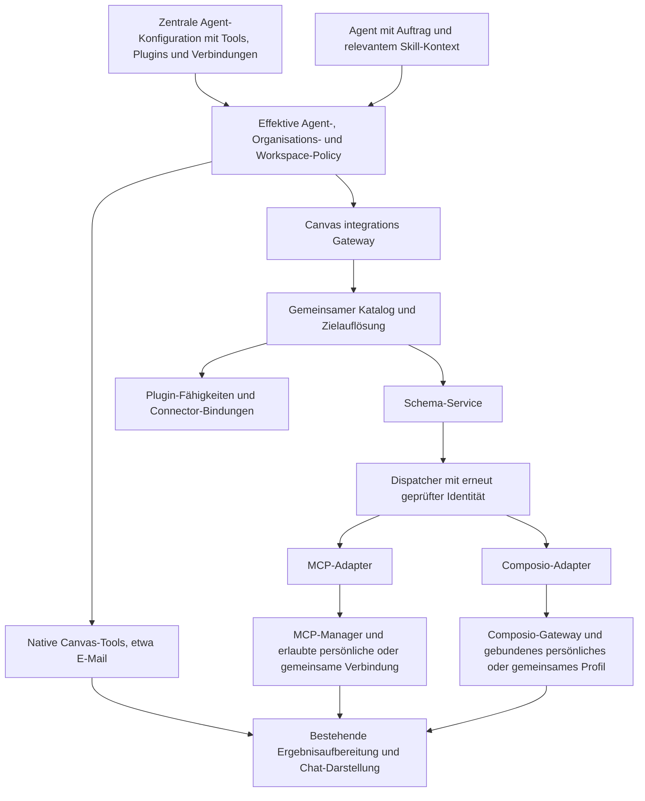

# Canvas Agent Tools und Plugin Gateway

Stand: 2026-10-06, auf Basis des Composio-Fixes `409897b9d` und der geprüften bestehenden Agent-/Skill-Verwaltung.
Status: Umsetzung auf `feat/plugin-integration-gateway`. Schritte 1 bis 3 (Vertrag, Policy, Provider-Katalog, Kontextauflösung, Schema-/Dispatcher-Strecke und öffentliche Agenten-Runtime hinter standardmäßig ausgeschalteter Feature-Flag), Schritt 4a (Ressourcenmetadaten, getrennte Rechte und gezielte Freigaben) und Schritt 4b (gemeinsame MCP-Verbindungen und Composio-Profile mit explizitem Organisations-/Team-Eigentum) sind implementiert und lokal geprüft. Versionierte Pakete, Workflow-Bindungen und das vollständige Plugin-Redesign folgen. Der verbindliche Fortschritt mit Abnahmebelegen steht in [implementation.json](implementation.json).

## Ziel und Entscheidungsvorschlag

Das zentrale Produktziel ist ein fertig konfigurierter Workflow-Agent: Eine berechtigte Verwaltung wählt Tools, Plugins, Skills und konkrete Verbindungen aus und stellt den Agenten bestimmten Nutzern oder einem Team bereit. Diese Nutzer können den Workflow ausführen, ohne die Integrationen selbst erneut einzurichten oder die Tool-Konfiguration ändern zu müssen. Gemeinsame Canva-Verbindungen sind ein ausdrücklicher Bestandteil des Zielbilds.

Die gemeinsame Steuerung umfasst Canvas-eigene Tools und externe Integrationen. Sie vereinheitlicht Auswahl, Berechtigungen, Bindungen und Readiness; sie ersetzt nicht die bestehenden Fachtools oder deren Ausführungsverträge. **E-Mail verwendet das vorhandene Canvas-E-Mail-Tool.** Composio-Gmail oder ein Gmail-MCP sind kein Standardweg für E-Mail-Workflows. Ein Design-Agent erhält nur die ihm zugewiesenen Design-Fähigkeiten; die Aktivierung eines allgemeinen Gateways darf ihm nicht automatisch sämtliche Apps eines Verbindungsprofils zugänglich machen.

Der Agent erhält einen gemeinsamen Zugang `integrations` für externe Tools. Canvas übernimmt die Suche, eindeutige Zielauflösung, Schema-Bereitstellung und Weiterleitung. Zwei Adapter führen die Aufrufe aus: direkt konfigurierte MCP-Verbindungen und Composio-Apps. Canvas-Plugins ergänzen diese Integrationen um Skills, fachliche Fähigkeiten und nachvollziehbare Connector-Bindungen.

Der Standardablauf lautet:

**Integrationen finden → Anbieter auswählen → passende Tools finden → Schema laden → Skill-Kontext lesen, falls relevant → ausführen.**

Composio bleibt das Backend für seinen App-Katalog, die verbundenen Accounts und deren Authentifizierung. Die erste Umsetzung verwendet die vorhandene SDK-/Gateway-Anbindung; sie benötigt weder eine SDK-Migration noch die Umwandlung aller MCP-Verbindungen in Composio-Verbindungen. Composio bietet sowohl direkte Tool-APIs als auch Session-/MCP-Zugänge. Diese Transportdetails gehören in den Adapter, nicht in den Aufrufvertrag des Canvas-Agenten. Siehe [Composio Tools API](https://docs.composio.dev/reference/v3/api-reference/tools) und [Composio Sessions](https://docs.composio.dev/docs/how-composio-works).

Eigenständig konfigurierte MCP-Server und Composio-Apps bleiben nutzbar, auch wenn kein entsprechendes Plugin installiert ist. Ein Plugin verbindet fachlichen Kontext und Integrationen, ist aber keine Voraussetzung für jeden externen Aufruf.

## Verifizierter Status quo

| Bereich | Heute vorhanden | Lücke für das Zielbild |
| --- | --- | --- |
| Plugin-Pakete | `canvas-plugin-manifest.ts`: Skills, Skill-Referenzen und getrennte Connector-Einträge für MCP, Composio und E-Mail | Kein gemeinsamer ausführbarer Tool-Katalog und keine ausdrücklichen Alternativgruppen für gleichwertige Connectoren |
| Plugin-/Skill-Policy | `capabilities/catalog.ts`, `capabilities/types.ts`: effektive Plugins und Skills; Organisations-Vorrang; optional, standardmäßig aktiv, verpflichtend oder gesperrt für Organisation, Rolle, Workspace, Projekt und Nutzer; Verwaltungs-UI und serverseitige Zielprüfung | Der Capability-Katalog führt Ressourcen vom Typ `skill` und `plugin`, keine externen Provider oder Tool-Routen; keine gemeinsame organisations-/workspacegebundene Connector-Auswahl |
| Plugin-Kontext | `plugin-reference-context.ts`: `/plugin` ergänzt Workflow- und Connector-Hinweise | Hinweise werden nicht zu eindeutig aufgelösten Tool-Routen |
| Skill-Kontext | `skill-context.ts`: kurze Beschreibungen im Prompt; relevante `SKILL.md` wird bei Bedarf gelesen | Keine gemeinsame maschinenlesbare Bindung zwischen einem Workflow und seinen MCP-/Composio-Alternativen |
| MCP | `mcp/proxy-tool.ts`: `list_servers`, `search_tools`, `describe_tool`, `call_tool` und OAuth-Aktionen | Eigener Vertrag und eigene Trefferstruktur |
| Direkte MCP-Tools | `mcp/direct-tools.ts`: ausdrücklich ausgewählte Tools erhalten eigene Modell-Schemas | Kompatibilitätsweg mit eigenen Berechtigungen; darf beim Gateway-Umbau nicht verschwinden oder mehr Rechte erhalten |
| Composio | `composio-tools.ts`, `composio-gateway.ts`: Suche, Schemas, Ausführung und Verbindungsstatus; lokale und Managed-Anbindung | Eigener Gateway-Vertrag; keine einfache Agentenliste aller verbundenen/verfügbaren Apps |
| Identität | MCP hat persönliche `connectionId` und Eigentümerprüfung; Composio hat nutzereigene Profile mit Auswahl je Nutzer und Workspace; Organisationen können öffentliche MCP-Definitionen freigeben | Workspace-Auswahl teilt keinen Account mit Teammitgliedern; kein gemeinsames Modell für organisations-/teamweit verwendbare Accounts; Anzeigenamen dürfen keine Identitäten ersetzen |
| Mehrere Composio-Profile | `composio-profiles.ts`, `ComposioProfileSwitcher.tsx`: Erstellen, Umbenennen und Archivieren; eigene Provider-Identität pro Profil; Standardprofil und Auswahl je Nutzer/Workspace; gebundene Automationen und Behandlung betroffener Trigger bei Profilwechsel | Profile sind nutzereigen; keine gemeinsamen Organisations-/Team-Profile und keine feste Auswahl je Agent/Workflow-Fähigkeit |
| Agentenbereitstellung | `agents/access.ts`, `agents/grants.ts`: getrennte Nutzungs-, Bearbeitungs- und Verwaltungsrechte; Bereitstellung an Nutzer, Organisation, Rolle, Workspace und Projekt | Agent-Zugriff allein gewährt noch keinen Zugriff auf eine gemeinsame externe Verbindung |
| Agenten-Tool-/Plugin-Auswahl | `effective-runtime-config.ts`, `tool-registry.ts`: Tool-Auswahl pro Agent mit Vererbung; `agent_capability_bindings` speichert Plugin-/Skill-Referenzen; ausgewählte Skills werden im Prompt berücksichtigt | Namensbasierte `relevantConnections` sind noch keine validierten Account-Bindungen; Gateway-Operationen begrenzen noch nicht verbindlich Apps und Provider-Aktionen eines Workflow-Agenten |
| Skill-Bearbeitung | `agent-skill-workspace.ts`: vollständige persönliche Draft-Pakete, Forks, atomare Updates mit Version/Checksumme; Organisation-/Plugin-/Core-Quellen sind im Agent-Bearbeitungsweg schreibgeschützt | Kein vollständiger Admin-Draft-/Veröffentlichungsweg für gemeinsame Skills; Team-Zuordnung ist heute Policy-Ziel, kein eigener Skill-Eigentumsbereich |
| Skill-Installationsbereich | Store-/Plugin-Installation unterstützt persönliche und Organisationsbereiche; `skills/file` liefert lesbaren Paketinhalt | Der bestehende `skills/upload`-Weg speichert persönlich; eine neue gemeinsame Einrichtung darf nicht stillschweigend auf diesen Weg zurückfallen. Ein allgemeiner gemeinsamer Script-/Asset-Editor ist damit noch nicht gegeben. |
| Script-Ausführung | `effective-skill-read-roots.ts`, `agent-bash-runtime.ts`: ausgewählte Skill-Pakete als Lesewurzeln; bereinigte Prozessumgebung und begrenzter Scratch-Bereich; Dateisystem-Isolation | Keine durchgängige gemeinsame Skill-Code-/Integrationsberechtigung; bestehende Shell-Isolation ist ausdrücklich keine Netzwerk-Isolation und erzwingt allein keine App-/Tool-Allowlist |
| Plugin-Seite und Store | `PluginsPanel.tsx`, `plugin-navigation.ts`, `canvas-plugin-store.ts`: Store, installierte Pakete, Update-Ansicht, versionierte Downloads/Checksummen, Einrichtungsvorschau, Paket-/Skill-Status und Detailansicht; URL-gebundene Suche/Filter | Grundlegende Informationsarchitektur für drei Bereiche fehlt; aktuelle Navigation kennt persönlich/Organisation. Freigaben, Bearbeiter und nachträgliche Zielgruppenverwaltung fehlen als gemeinsamer Ressourcenvertrag. |
| Plugin-Verwaltungs-Tools | `createAgentPluginTools`, `agent-plugin-workspace.ts`: Draft, Inspect, Install, Update, Aktivierung und Entfernen mit persönlichem Nutzerbereich; Version-/Checksumme-Prüfung | Kein gemeinsamer Metadaten-/Freigabevertrag für UI und Agent; Inspect arbeitet namensbasiert und liefert keine vollständige Bereichs-/Rechte-/Bearbeiterinformation |
| Registrierung | `tool-registry.ts`: MCP, direkte MCP-Tools und Composio werden getrennt registriert und nach Agent-Konfiguration gefiltert | Gemeinsamer Eintrittspunkt fehlt; alte Präferenzen müssen auf interne Adapter-Rechte abgebildet werden |
| UI-Readiness | `plugin-connection-readiness.ts`: getrennte Prüfung der Connectoren | MCP-Readiness sucht den Konfigurationsschlüssel nach Connector-Namen statt einer stabilen Bindung; Prüfung von Konfiguration/Aktivierung und OAuth beweist keine erfolgreiche Tool-Abfrage, Freigabe oder Erreichbarkeit |
| Ergebnisdarstellung | `mcp/tool-result.ts`, `pi/tool-output-preparation.ts`: Output-Budgets, gespeicherte Ergebnisse und MCP-App-Metadaten | Diese Verträge müssen beim neuen Routing erhalten bleiben |

### Abgeschlossener allgemeiner Composio-Fix

- `d8cb779df`: Bei App-Namen ohne Treffer in den Gateway-Operationsnamen werden die erlaubten Operationen angezeigt. Die Anleitung führt zur tatsächlichen App-Tool-Suche. Ein solcher Suchausgang wird nicht als fehlende Konfiguration oder Verbindung interpretiert.
- Die Gateway-Filter sind monoton: Eine spätere Filterung stellt zuvor gesperrte Operationen nicht wieder her; das effektive Manifest zeigt nur die erlaubten Operationen.
- `e83f7cdcc`: Nur `ACTIVE` wird als verbundener Account gemeldet; Status und aktueller Profil-/Workspace-Bezug werden ausgegeben.
- `409897b9d`: Gemeinsamer SDK-/HTTP-Test mit fünf App-Katalogen: Canva, Gmail, GitHub, Slack und Google Drive. Unterschiedliche Parameterschemas, OAuth-Callback-Routen, appbezogene Berechtigungen, zwei Nutzer, Profilwechsel und Verbindungszustände sind abgedeckt.
- Fokussierte Tests, ESLint und `npm run build` sind erfolgreich. Playwright prüfte die normale UI-Verbindung und einen tatsächlichen Agentenlauf mit Gmail; zuvor wurde der Canva-Ablauf geprüft. Die Browserläufe verwenden kontrollierte Provider-Antworten und sind keine Live-Abnahme echter Drittanbieter-Accounts.
- Der Gmail-Agentenlauf erreichte die korrekte Ausführung, machte vorher aber vermeidbare Gateway-Fehlversuche. Das ist konkrete Motivation für einen einheitlichen, weniger verschachtelten Vertrag.
- Die Fixes sind lokal committet, nicht gepusht oder ausgerollt. Die zusätzliche App-Listenfunktion und die gemeinsame Schicht sind Bestandteil dieses Plans.

## Zielarchitektur



Die Schicht ist ein fachlicher Tool-Proxy. Sie ist kein frei konfigurierbarer HTTP-Proxy: Der Agent übergibt eine von Canvas gelieferte Referenz, keine beliebige Ziel-URL, kein Provider-User-ID-Feld und keine Credentials.

### Verantwortlichkeiten und vorgeschlagene Module

| Modul | Verantwortung |
| --- | --- |
| `app/lib/integration-tools/contracts.ts` | Versionierte öffentliche Descriptoren, Request-Union und Ergebnis-/Fehlervertrag |
| `app/lib/integration-tools/catalog.ts` | Sichtbare MCP-Verbindungen, verfügbare Composio-Apps und aktuelle Zustände zusammenführen |
| `app/lib/integration-tools/search.ts` | Deterministische Suche, App-Aliase, Ranking, Pagination und Teilfehler |
| `app/lib/integration-tools/bindings.ts` | Plugin-/Skill-Fähigkeiten auf tatsächliche Verbindungen abbilden |
| `app/lib/integration-tools/policy.ts` | Bestehende Capability-/Agent-Rechte und ergänzende organisations-/workspacegebundene Connector-Vorgaben auf sichtbare und ausführbare Routen anwenden |
| `app/lib/integration-tools/schema.ts` | Vollständiges Provider-Schema, Versionsbindung und Argumentvalidierung |
| `app/lib/integration-tools/dispatcher.ts` | Aktuellen Kontext und Rechte prüfen; genau einen Adapter aufrufen |
| `app/lib/integration-tools/adapters/mcp.ts` | MCP-Katalog und Aufrufe über vorhandenen Manager; bestehende OAuth-/MCP-App-Verträge erhalten |
| `app/lib/integration-tools/adapters/composio.ts` | Bestehende lokale/Managed-Gateway-Funktionen und Profilauflösung verwenden |
| `app/lib/pi/integration-tool-gateway.ts` | Schlankes AgentTool für den öffentlichen Vertrag; keine zweite Kopie der Provider-Logik |

Die bisherigen Plugin-/Skill-Policy-Dienste bleiben die Autorität für Plugin-Ressourcen. Der neue Provider-Katalog wird daraus und aus den Verbindungsdiensten abgeleitet. Es entsteht keine zweite unabhängige Speicherung von API-Keys, OAuth-Tokens oder Verbindungsstatus.

Die Agent-Konfiguration wird serverseitig zu einem effektiven Ausführungsumfang aufgelöst: native Tools, sichtbare Plugin-/Skill-Ressourcen, erlaubte externe Apps/Tools und konkrete Bindungen. Organisations-/Workspace-Vorgaben, Agent-Auswahl, Verbindungsfreigaben und Ausführungsmodus begrenzen diesen Umfang gemeinsam. Ein eingeschränkter Workflow-Agent erhält kein allgemeines App-Katalogrecht durch bloßes Aktivieren von `integrations`. Nicht zugewiesene Apps und Aktionen bleiben sowohl bei Discovery als auch bei `describe`/`call` ausgeschlossen. Bestehende Vererbungs-/Standardkonfigurationen werden nicht nachträglich in leere oder uneingeschränkte Allowlisten umgedeutet.

## Ein öffentlicher Agentenvertrag

`integrations` erhält eine diskriminierte Request-Union. Jede Aktion besitzt ihre eigenen Pflichtfelder. Der Agent muss keine Operation wie `COMPOSIO_SEARCH_TOOLS` innerhalb einer weiteren Gateway-Operation kennen.

| Aktion | Zweck | Pflichtfelder |
| --- | --- | --- |
| `list`, Ziel `providers` | Alle in diesem Kontext sichtbaren MCP-Verbindungen und Composio-Apps, mit Zustand; paginiert | `action`, `target` |
| `search`, Ziel `providers` | App/Integration finden, etwa „Canva“; optional Quellenfilter | `action`, `target`, `query` |
| `list`, Ziel `tools` | Kurze Tool-Beschreibungen eines ausgewählten Providers | `action`, `target`, `providerRef` |
| `search`, Ziel `tools` | Passendes Tool für einen Auftrag innerhalb des Providers finden | `action`, `target`, `providerRef`, `query` |
| `describe` | Vollständiges Input-Schema, Version und relevante Skill-Verweise laden | `action`, `toolRef` |
| `call` | Genau dieses Tool mit schema-konformen Argumenten aufrufen | `action`, `toolRef`, `schemaRef`, `arguments` |

Optionale Filter: Quelle `mcp`/`composio`, Zustand, Plugin-/Capability-Referenz und Cursor. `list` kann auch unverbundene, aber im eigenen Kontext verfügbare Apps zeigen. Sie werden eindeutig als verbindungsbedürftig markiert. Organisationsfreigegebene MCP-Vorlagen können als einrichtbare Kandidaten erscheinen; erst eine nutzereigene Verbindung ist ausführbar.

### Treffer und Referenzen

Ein Provider-Treffer enthält mindestens:

```json
{
  "providerRef": "mcp:<connection-id>",
  "source": "mcp",
  "application": "canva",
  "displayName": "Canva – persönlicher Account",
  "state": "ready",
  "configured": true,
  "requiresAuth": true,
  "authorized": true,
  "health": "healthy",
  "canExecute": true,
  "pluginRefs": [],
  "skillRefs": [],
  "matchReasons": ["application_exact"],
  "nextActions": []
}
```

Beispiele sind Vertragsvorschläge, keine heutigen API-Antworten. `application` ist nur gesetzt, wenn App-Metadaten oder ein validierter Connector sie belegen. Ein frei benannter MCP-Server ist nicht automatisch einem Anbieter zuzuordnen.

Weitere Zustände: `setup_required`, `auth_required`, `disabled`, `degraded` und `unknown`. Konfiguration, Authentifizierung, Erreichbarkeit und Ausführungsrecht sind getrennte Informationen. No-auth-Apps können ohne verbundenen Account ausführbar sein; hierfür wird die bestehende Composio-Toolkit-Access-Auflösung verwendet.

`checkedAt` und die Herkunft einer Zustandsprüfung kennzeichnen die Aktualität. Eine konfigurierte MCP-Verbindung ohne erfolgreiche aktuelle oder gültig gecachte Prüfung erhält keinen erfundenen Gesundheitsstatus. Die spätere Tool-Abfrage aktualisiert diesen Zustand, ohne dass die erste Provider-Liste sämtliche Server starten muss.

Tool-Treffer liefern `toolRef`, `providerRef`, Namen, Kurzbeschreibung und verfügbare Hinweise zur Wirkung. Vollständige Schemas kommen erst durch `describe`. Tool-Referenzen werden aus Backend-Identität und exaktem Tool-Namen abgeleitet; der Agent muss sie weder konstruieren noch zerlegen.

MCP-Referenzen verwenden `connectionId`, nicht Server-Anzeigenamen. Composio-App-Identität verwendet den Toolkit-Slug; eine ausführbare Referenz bindet zusätzlich die ausgewählte Profil-/Account-Verbindung. Die konkrete Provider-Identität kommt ausschließlich aus dem serverseitigen Ausführungskontext. Für Legacy-MCP-Konfigurationen ohne stabile ID braucht der Adapter eine kompatible, bereichsgebundene Referenzauflösung.

Bei mehreren persönlichen oder freigegebenen gemeinsamen Verbindungen derselben App unterscheiden Provider-Treffer auch die Bindung über eine opake Referenz. `composio:canva` allein identifiziert dann keinen Account. Der Treffer zeigt den verständlichen Verbindungs-/Profilnamen und Bereich; seine Referenz löst serverseitig auf genau diese zulässige Bindung auf. Der Agent darf weder eine fremde Profil-ID noch die Provider-Identität selbst wählen.

`schemaRef` bindet das geladene Schema an Tool-Version, Verbindungs-/Profilrevision und effektive Policy. Ein Wechsel der tatsächlich gebundenen Verbindung oder ein anderes Schema zwischen `describe` und `call` liefert `binding_changed` beziehungsweise `schema_changed` mit einem konkreten nächsten Schritt. Der Aufruf wird nicht stillschweigend unter einem anderen Account ausgeführt. Ein Wechsel eines unbeteiligten persönlichen Profils verändert eine feste gemeinsame Workflow-Bindung nicht.

### Beispiel: Canva ist über MCP und Composio verfügbar

```json
{"action":"search","target":"providers","query":"Canva"}
```

Canvas liefert zwei getrennte Treffer mit Quelle und Zustand: beispielsweise einen nutzereigenen Canva-MCP und die Composio-App `canva`. Danach:

```json
{"action":"search","target":"tools","providerRef":"mcp:<connection-id>","query":"eigene Designs auflisten"}
```

```json
{"action":"describe","toolRef":"<toolRef aus dem Treffer>"}
```

```json
{"action":"call","toolRef":"<derselbe toolRef>","schemaRef":"<schemaRef aus describe>","arguments":{}}
```

Die tatsächlichen `arguments` ergeben sich aus dem geladenen Schema. Bei Composio ist der Agentenvertrag identisch; allein die Referenz und der interne Adapter unterscheiden sich. Jede Antwort enthält passende `nextActions` mit vollständigen Beispielargumenten für den nächsten Gateway-Aufruf.

## Suche und Routing

Alle folgenden Auswahlregeln gelten ausschließlich innerhalb der aktuell erlaubten Quellen und Verbindungen. Eine Nutzervorgabe oder Plugin-Bindung kann keine Organisationssperre, Eigentümerprüfung oder Agent-Tool-Grenze überschreiben.

1. Ein zentral festgelegter Workflow-Agent verwendet seine validierte Connector-Bindung. Ist sie verbindlich, kann eine Nutzervorgabe sie nicht durch eine andere Verbindung ersetzen; Canvas zeigt die notwendige Konfigurationsänderung.
2. Bei erlaubter freier Auswahl hat eine ausdrückliche Nutzervorgabe wie „über Composio“ Vorrang; danach gilt eine bereits bestätigte Connector-Bindung eines Plugins/Workflows.
3. Ohne Bindung werden passende, ausführbare Kandidaten höher eingestuft als Kandidaten mit fehlender Verbindung. Bei gleicher Eignung steht der konfigurierte MCP vor Composio, entsprechend dem gewünschten Beispiel.
4. Innerhalb dieser Regeln zählen exakte App-/Toolkit-/Verbindungs-Identität, deklarierte Aliase und Tool-Funktion stärker als lose Beschreibungswörter. Komplexe App-Namen wie „Google Drive“ werden über Katalog-Metadaten und Aliase aufgelöst, nicht allein durch Slug-Raten.
5. Das Ranking bei freier Auswahl ist eine Empfehlung. Gleiche App-Namen garantieren nicht, dass MCP und Composio dieselben Funktionen bieten. Fehlt eine benötigte Funktion, werden erlaubte Alternativen gesucht; eine verbindliche Workflow-Bindung wird nicht automatisch ersetzt.

Die ersten Treffer enthalten kleine Beschreibungen und Zustände. Provider-Tool-Kataloge werden bedarfsgerecht geladen; `list providers` öffnet nicht vorsorglich jeden MCP-Server und lädt nicht alle Composio-Tools. Bounded parallel discovery, Timeout pro Provider, Cache und Cursor begrenzen Laufzeit und Promptgröße.

Ein Suchergebnis weist aus, welche Quellen erfolgreich abgefragt wurden. Ein ausgefallener Provider erzeugt einen Teilfehler, keine Behauptung „keine Integrationen vorhanden“. `complete`, `providerErrors`, `nextCursor` und `matchReasons` machen das Ergebnis nachvollziehbar. Bestehende absichtlich ausgeblendete Composio-Toolkits und MCP-App-interne Tools bleiben ausgeblendet.

Es gibt keinen automatischen Wechsel des Providers nach einem unsicher abgeschlossenen Schreibaufruf. Bei `outcome_unknown` muss zuerst der Provider-Zustand geprüft werden. Auch normale Aufrufe werden nicht vorsorglich an beide Anbieter gesendet.

## Plugin- und Skill-Zusammenspiel

Ein Plugin beschreibt fachliche Fähigkeiten statt nur eine Liste unabhängiger Verbindungen. Dafür wird der heutige Manifest-Vertrag abwärtskompatibel um optionale `integrationCapabilities` erweitert. Beispiel:

```json
{
  "integrationCapabilities": [
    {
      "id": "designs",
      "application": "canva",
      "required": true,
      "alternatives": [
        {"source":"mcp","connector":"canva-mcp"},
        {"source":"composio","toolkit":"canva"}
      ],
      "skillRefs": ["canva-design-workflow"]
    }
  ]
}
```

`connector` verweist auf einen im Paket validierten MCP-Connector; Canvas löst ihn auf eine erlaubte persönliche oder gemeinsame Verbindung beziehungsweise eine freigegebene Definition auf. Paket-Manifeste speichern keine installationsspezifischen Verbindungs-IDs. Composio-Tool-Hinweise können die Suche eingrenzen, ersetzen aber nicht die reale Schema-Abfrage.

Innerhalb einer Fähigkeit reicht eine passende Alternative aus. Ein Workflow mit Canva **und** Slack beschreibt zwei benötigte Fähigkeiten. So wird nicht versehentlich gleichzeitig Canva-MCP **und** Canva über Composio vorgeschrieben.

Die bestehenden `connectors`, `mcpServers` und `composioToolkits` behalten ohne neue Felder ihre heutige Bedeutung. Eine Migration interpretiert alte Pflichtfelder nicht nachträglich als Alternativen. Neue Referenzen und Alternativen werden bei Installation/Update auf Existenz, Typ und Zyklen geprüft.

Discovery liefert passende Plugin-/Skill-Referenzen und deren effektive Verfügbarkeit. Beim ausgewählten Workflow erhält der Agent zunächst die kurze Beschreibung und liest dann die relevanten Skill-Inhalte über den vorhandenen, bereichsgeprüften Weg. Optional kann `agents/canvas.yaml` für eigenständige Skills Referenzen auf Integrationsfähigkeiten erhalten; das Standard-Frontmatter von `SKILL.md` bleibt kompatibel.

Skills liefern Arbeitsablauf, fachliche Parameterhinweise und Beispiele. Aktuelle Tool-Schemas bleiben maßgeblich. Ein Skill oder Plugin kann keine abgeschaltete Integration freischalten und keine Credentials oder Eigentümerbindung überschreiben. Organisations-Vorrang und Schutz vor persönlicher Schatten-Aktivierung bleiben bestehen.

## Skill-Bereich, Bearbeitung und ausführbarer Code

Der Bereich ist auch bei Skills fachlich relevant. Er entscheidet über Eigentum, Sichtbarkeit, Bearbeitung und Veröffentlichung des gesamten Pakets. Die Verbindungsbindung entscheidet getrennt davon über den verwendeten Anbieter-Account. Ein Organisations-Skill kann in einem erlaubten Workflow mit einer persönlichen oder gemeinsamen Verbindung laufen; sein Bereich macht den ausführenden Nutzer nicht zum Organisationsadmin.

| Im UI sichtbarer Bereich | Eigentum und Verwendung | Bearbeitung im Zielbild |
| --- | --- | --- |
| Persönlich | Paket des Nutzers; Nutzung durch Eigentümer und ausdrücklich freigegebene Empfänger entsprechend Policy; keine automatische gemeinsame Organisationsressource | Eigentümer beziehungsweise ausdrücklich freigegebene persönliche Bearbeitung; persönlicher Draft-/Update-Weg bleibt erhalten |
| Team | Gemeinsame Ressource mit expliziter Zuordnung zum Team-Workspace innerhalb einer Organisation; nur für den freigegebenen Nutzerkreis | Organisationsverwaltung oder für diesen Team-Bereich ausdrücklich beauftragte Bearbeiter; getrennt vom Recht, den Skill/Agenten zu verwenden |
| Organisation | Gemeinsame Ressource der Organisation; Verwendung entsprechend Organisations-/Workspace-/Agent-Policy | Berechtigte Organisationsverwaltung beziehungsweise ausdrücklich freigegebene gemeinsame Bearbeitung |

Heute existieren `user`, `organization` und `system` als Capability-Speicherbereiche. Eine Team-Vorgabe kann bereits auf einen Organisations-Skill zielen. Für teameigene Ressourcen wird die Organisationsressource um eine ausdrückliche Workspace-Zuordnung und passende Sichtbarkeits-/Bearbeitungsrechte ergänzt. Das benötigt kein anderes `SKILL.md`-Format, muss aber Katalog, Ressourcenreferenz, Datei-/Asset-Zugriff und Runtime-Lesewurzeln konsistent abdecken. Eine Aktivierungs-Policy allein ist keine Team-Eigentums- oder Bearbeitungsprüfung. Teamspezifische Varianten erhalten eigene Ressourcenreferenzen; gesperrte oder verbindliche Organisationsressourcen werden nicht über gleich benannte Kopien verdrängt.

Persönlich erstellte Skills werden erst nach ausdrücklicher Veröffentlichung im gemeinsamen Zielbereich einem Team-/Organisationsagenten zugewiesen. Dabei entsteht eine gemeinsame Ressource mit Herkunftsreferenz und geprüfter Paketversion; das persönliche Original bleibt erhalten. Die bestehende Ablehnung persönlicher Skill-/Plugin-Ressourcen für Organisationsagenten bleibt bis zu einer solchen Veröffentlichung wirksam. Eine persönliche Kopie eines Organisations-Skills verwendet einen eigenen Namen und ersetzt keinen zentral zugewiesenen Workflow-Skill.

### Vollständige Pakete bearbeiten und versionieren

Ein Skill kann `SKILL.md`, Scripts, Referenzen, Assets und Konfigurationsvorlagen enthalten. Der Editor beziehungsweise Agent-Draft arbeitet am vollständigen Paket. Der vorhandene Ablauf `inspect_canvas_skill → create_canvas_skill_draft → vollständiges Paket bearbeiten → update_canvas_skill_from_workspace` mit erwarteter Version und Checksumme bleibt für persönliche Skills die Basis. Ein gemeinsamer Admin-Weg erweitert diese Mechanik mit geprüfter Zielressource, Bearbeitungsrecht und Veröffentlichungsrevision; er lockert nicht einfach den persönlichen Schreibschutz für alle Nutzer.

Im UI sind Entwurf, veröffentlichte Version und vom Workflow verwendete Version sichtbar. Berechtigte Personen können Text, Code und Assets ändern, validieren und als neue Version veröffentlichen. Persönliche Entwürfe dürfen nicht versehentlich ein gemeinsames Paket überschreiben. Plugin-eigene Skills werden als Teil einer bearbeiteten/veröffentlichten Plugin-Version übernommen oder ausdrücklich als eigene Variante ausgekoppelt; Updates des ursprünglichen Plugins überschreiben diese Variante nicht stillschweigend. Core-Skills bleiben gebündelte Quellen mit ausdrücklich benannten anpassbaren Varianten.

Zentral bereitgestellte Workflow-Agenten binden Ressourcen-ID und veröffentlichte Version/Checksumme. Der Admin legt fest, ob ein Workflow kontrolliert auf eine neue Version umgestellt wird oder dem veröffentlichten Stand folgt. Ein bereits gestarteter Lauf behält seine geprüfte Paketrevision und verwendet nicht während der Ausführung eine Mischung aus altem `SKILL.md` und neuen Scripts. Versions-/Abhängigkeitsänderungen aktualisieren Readiness und Runtime-Kontext. Nicht erfüllte Anforderungen liefern einen konkreten Einrichtungsschritt.

### Scripts im Kontext des auftraggebenden Nutzers ausführen

Die vorhandene Shell-Ausführung und Skill-Lesewurzeln sind ein Ausgangspunkt, kein automatisches Script-Recht durch Installation. Ein Skill-Paket muss benötigte Runtime, Abhängigkeiten, ausführbare Einstiegspunkte und fachliche Tool-/Verbindungsanforderungen deklarieren können. Für zentral eingeschränkte Workflow-Agenten wird ein bereichs- und versionsgebundener Script-Aufruf ergänzt, der nur freigegebene Einstiegspunkte mit validierten Argumenten startet; eine pauschale Freigabe beliebiger Shell-Kommandos ist kein Ersatz dafür.

Die veröffentlichte Paketrevision wird nur lesbar bereitgestellt. Arbeitsdateien und Outputs liegen im Scratch-Bereich der konkreten Nutzer-/Agent-/Workspace-Session. Ergebnisse gelangen über die bestehenden berechtigten Canvas-Dateioperationen in den Workspace. Gemeinsame Pakete erhalten keinen gemeinsamen beschreibbaren Arbeitsordner; ein Lauf verändert nicht den Skill anderer Teammitglieder. Ein persönlicher Skill, ein Team-Skill und ein Organisations-Skill verwenden dabei dasselbe Laufzeitmodell.

Code, der Canvas-Tools oder MCP-/Composio-Apps benötigt, verwendet eine eng begrenzte serverseitige Tool-Brücke mit denselben Agent-, Workspace- und Verbindungsrechten wie ein Modellaufruf. Die Brücke verwendet die bereits geprüften nativen Tool-Dienste beziehungsweise den gemeinsamen Dispatcher und dupliziert keine SDK-/Provider-Logik. Provider-Tokens und breit gültige Secrets werden nicht in Scripts oder den allgemeinen Prozess-ENV kopiert. Die Brücke darf native E-Mail-/Outbox-Regeln ebenso wenig umgehen wie Connector-Allowlisten. Ein allgemeines Script erhält keine zusätzliche Verbindungsberechtigung durch den Bereich seines Autors.

Für diesen eingeschränkten Script-Weg muss der Runner auch direkte Netzwerk-/Provider-Zugriffe entsprechend seiner ausdrücklichen Egress-Policy begrenzen. Die aktuelle Shell-Dateisystem-Isolation bietet das nicht; diese Lücke ist ein eigener Abnahme-Gate. Lokale Berechnungen, Tool-Aufrufe über die Brücke und ausdrücklich erlaubter zusätzlicher Netzwerkzugriff werden im Vertrag unterschieden. Fehlt die erforderliche Runtime oder Begrenzung, bleibt die Script-Fähigkeit nicht ausführbar; Canvas fällt nicht auf einen breiteren Shell-/Credential-Zugang zurück. Bestehende ausdrücklich gewährte allgemeine Shell-Rechte bleiben im Kompatibilitätsmodus ihrem eigenen Vertrag unterstellt.

Codegrundlage: `app/lib/skills/agent-skill-workspace.ts`, `skill-package-import.ts`, `effective-skill-read-roots.ts`, `app/lib/pi/scoped-tools.ts`, `agent-bash-runtime.ts`, `agent-shell-sandbox.ts`, `app/api/skills/file/route.ts`, `upload/route.ts` und `store/install/route.ts`. Die gemeinsame Veröffentlichung, Team-Ressourcenzuordnung und begrenzte Tool-Brücke sind geplante Ergänzungen.

## Plugin-Schema, Organisationsvorgaben und Team-Verbindungen

### Bereits vorhandene Governance

Plugin-Pakete und installierte Ressourcen sind getrennt: `CanvasPluginManifest` beschreibt Skills und Connectoren; `CanvasPluginInstallRecord` ergänzt Ressourcen-ID, Speicherbereich, Organisation beziehungsweise Eigentümer, Version und Revision. Das Manifest enthält bei Composio Toolkit-Slug, Tool-Hinweise und Pflicht-/Empfehlungsstatus; bei MCP Connector-Name, Konfigurationspfad, ENV-Schlüsselnamen und OAuth-Anforderung. Diese Deklarationen sind noch keine eindeutigen Account-Bindungen oder vollständigen Ausführungsrechte.

Organisationen können Plugins und Skills bereitstellen und über die bestehende Policy als `optional`, `default-enabled`, `required` oder `blocked` vorgeben. Ziele sind Organisation, Rolle, Workspace, Projekt und Nutzer. Verwaltungs-API und UI existieren; Änderungen prüfen Verwaltungsrecht, aktive Organisationszugehörigkeit des Ziels und Revision und erzeugen Audit-Ereignisse. Gesperrte Ressourcen und der geschützte Organisationsnamensraum dürfen nicht durch persönliche Installation/Aktivierung umgangen werden.

**Team bedeutet im heutigen Modell einen Workspace vom Typ `team`.** Eine Team-Vorgabe verwendet deshalb `targetType: workspace` und die zugehörige `workspaceId`. Es gibt keinen eigenen Capability-Speicherbereich oder Policy-Zieltyp `team`. Falls später ein Team mehrere Workspaces als eigenständige Mitgliedergruppe umfassen soll, benötigt dies einen eigenen, ausdrücklich geprüften Vertrag; es wird nicht aus gleich benannten Workspaces abgeleitet.

Bei MCP dürfen Organisationsadmins öffentliche HTTP-/OAuth-Definitionen einschließlich erlaubter OAuth-Metadaten und Scopes freigeben. Mitglieder erzeugen daraus persönliche Verbindungen mit `serverDefinitionId`, `connectionId` und Eigentümerbindung. Die Freigabe enthält keine persönlichen Tokens; Entfernung oder Änderung wird bei Aufrufen erneut geprüft. Composio-Profile gehören ebenfalls einem Nutzer. Der Workspace-Override ist durch **Nutzer plus Workspace** identifiziert und verweist ausschließlich auf ein eigenes aktives Profil. Zwei Personen im selben Team können dadurch verschiedene Accounts verwenden.

Codegrundlage: `plugins/canvas-plugin-manifest.ts`, `plugins/canvas-plugin-registry.ts`, `capabilities/types.ts`, `capabilities/management-actions.ts`, `capabilities/effective-resolver.ts`, `organization/policy-targets.ts`, `components/plugins/PluginsPanel.tsx`, `mcp/server-definitions.ts`, `mcp/personal-connections.ts`, `mcp/access.ts`, `composio/composio-profiles.ts`, `composio/composio-workspace-profile-change.ts`, `components/settings/ComposioProfileSwitcher.tsx`, `agents/capability-bindings.ts`, `agents/management-actions.ts`, `agents/effective-runtime-config.ts`, `agents/access.ts`, `agents/grants.ts`, `agents/system-prompt.ts`, `pi/tool-registry.ts` und `workspaces/types.ts` unter `app/` beziehungsweise `app/lib/`.

### Was die neue Schicht zusätzlich speichern und prüfen muss

Die erforderlichen Informationen verteilen sich auf fünf Verträge. Ein exportierbares Plugin-Paket wird nicht mit installations- oder nutzerspezifischen Accounts vermischt.

| Vertrag | Zu speichernde Informationen | Zuständigkeit |
| --- | --- | --- |
| Plugin-Manifest | Stabile logische Capability-/Connector-IDs, App, Pflichtfähigkeiten und Alternativen, Skill-Referenzen, benötigte Tool-Funktionen, öffentliche Konfigurations-/Authentifizierungsanforderungen und ENV-Schlüsselnamen | Paketautor; Installation validiert Struktur und Referenzen. Bestehende Connector-Felder bleiben kompatibel. Composio-Tool-Hinweise allein sind keine Allowlist. |
| Ressourceninstanz und Grants | Stabile Ressourcenreferenz, Eigentümer-/Team-Zuordnung, Quelle/Installation, verantwortliche Person, belegbare Bearbeiterhistorie, Nutzer-/Rollen-/Team-Freigaben mit Verwenden/Bearbeiten/Verwalten sowie getrennte Metadaten-/Grant-Revisionen | Gemeinsame Ressourcenverwaltung; UI und Agent-Tools verwenden dieselben Actions. Zugriffsrechte bleiben außerhalb des Paket-Manifests. |
| Organisations-/Workspace-Vorgaben | Plugin-Ressourcenreferenz und Capability-ID, erlaubte Quellen und Tool-Rechte, bevorzugte Quelle innerhalb der erlaubten Menge, freigegebene MCP-Definitionsreferenzen beziehungsweise Composio-Toolkit-/Auth-Konfigurationsreferenzen, Zielbereich, Revision und Änderungsakteur | Berechtigte Organisationsverwaltung; Team-Vorgaben über Workspace-Ziel. Auth-Konfigurationsreferenzen müssen vor Speicherung für den Bereich validiert werden. Bestehende Plugin-Aktivierungsregeln bleiben im Capability-Policy-Store. |
| Agent-/Workflow-Konfiguration | Agent-ID, erforderliche Plugin-/Skill-Ressourcen, erlaubte native Tools, erlaubte externe Apps und Provider-Aktionen, Bindungsreferenzen je Fähigkeit, verbindliche oder wählbare Verbindung, Revision | Bestehende Agent-Verwaltung und Zugriffsrechte werden erweitert. Plugin-Auswahl und Skill-Prompt sind keine alleinige Ausführungsberechtigung. |
| Konkrete Laufzeitbindung | Plugin-/Capability-/Connector-Referenz, Agent-/Workspace-Bezug und bei persönlichen Bindungen Nutzer, ausgewählte Quelle, MCP-`connectionId` oder Composio-`profileId` plus Toolkit und gegebenenfalls eindeutige Account-Referenz, Eigentumsbereich, Bindungsrevision | Persönliche Bindungen prüfen Eigentümer; gemeinsame Bindungen prüfen explizite Freigabe und den aktuellen ausführenden Nutzer/Agenten. Die Bindung speichert Referenzen, keine kopierten Tokens. |

Secrets bleiben in den bestehenden zentralen Secrets-/Credential-Diensten und ihrem tatsächlich unterstützten Berechtigungsbereich. Ein Auth-Konfigurations-Identifier oder eine Account-Referenz darf niemals als vom Agenten beliebig einsetzbare Provider-Identität behandelt werden. Fehlende OAuth-Scopes oder erforderliche Konfiguration liefern einen konkreten Verbindungsschritt; ein gespeicherter Soll-Zustand wird nicht als erfolgreiche Authentifizierung ausgegeben.

Für MCP muss die Zuordnung vom logischen Plugin-Connector über die freigegebene Definition zur tatsächlichen persönlichen `connectionId` erfolgen. Die heutige Suche über den Connector-Namen reicht nicht: aus einer freigegebenen Definition erzeugte Verbindungen erhalten individuelle Konfigurationsschlüssel. Bei mehreren passenden Verbindungen bleibt eine bestätigte Auswahl erhalten; Canvas rät nicht anhand des Anzeigenamens.

Composio führt heutige lokale Tool-Aufrufe mit der Identität des Nutzerprofils aus; der bestehende `/execute`-Vertrag im Managed-Weg erhält Aktion und Parameter. Eine explizite Auswahl zwischen mehreren Accounts desselben Toolkits ist dadurch noch nicht als gemeinsamer Vertrag umgesetzt. Der neue Adapter muss eine eindeutige Bindung nachweisen oder `binding_required` zurückgeben. Eine Erweiterung um konkrete Account-Auswahl ist vor Umsetzung gegen lokales SDK und den Control-Plane-Vertrag zu prüfen. Profilrevision allein beweist nicht, dass sich der aktive Toolkit-Account unverändert gehalten hat; auch Account-Wechsel und Widerruf invalidieren die Schema-/Bindungsreferenz.

Vorgaben können erlaubte Alternativen einschränken: Ein Plugin mag Canva über MCP oder Composio unterstützen, während die Organisation in einem Team nur eine freigegebene MCP-Verbindung erlaubt. Die Policy wird vor Discovery und erneut vor Ausführung angewandt. Einschränkende Connector-/Tool-Vorgaben gelten auch für bestehende MCP-/Composio-Eintrittspunkte und direkte MCP-Tools, solange diese angeboten werden. Der spätere Wechsel zum Gateway darf keinen Umgehungsweg schaffen. Ohne neue explizite Vorgaben behalten heutige eigenständige Integrationen ihre bestehenden Rechte.

### Bereich ausdrücklich im Admin-UI konfigurieren

Die berechtigte Verwaltung wählt bei Einrichtung und Bearbeitung ausdrücklich **Persönlich**, **Team** oder **Organisation**. Bei Team ist ein konkreter Team-Workspace Pflicht; bei Organisation steht die verifizierte Organisation fest. Im Organisations-/Team-Verwaltungsbereich ist der zugehörige gemeinsame Bereich vorbelegt und sichtbar. Der Admin kann ihn nicht versehentlich über einen persönlichen Verbindungsbutton verlieren. Bestehende persönliche Einträge werden eindeutig gekennzeichnet und nicht automatisch als gemeinsame Kandidaten übernommen.

Das UI unterscheidet drei Einstellungen: **Paket-/Skill-Bereich**, **Verbindungsbereich** und **Nutzungsfreigabe/Workflow-Zuordnung**. Ein Organisationsplugin installiert kein gemeinsames OAuth-Konto; ein verbundenes Organisationskonto veröffentlicht keinen persönlichen Skill. Die konkrete Workflow-Bindung zeigt deshalb alle relevanten Bereiche und den freigegebenen Account. Eine persönliche Verbindung kann nur bei ausdrücklich dafür konfigurierten persönlichen Bindungen ausgewählt werden.

Einrichtung erstellt zuerst die bereichsgebundene Ressource und führt OAuth oder manuelle MCP-Konfiguration anschließend für genau diese Ressource aus. OAuth-State, Callback, Statusprüfung, Profilverwaltung und spätere Ausführung behalten Organisation/Workspace, Ressourcenreferenz und initiierenden Nutzer als getrennte Bezüge. Der Callback prüft den aktuellen Verwaltungszugriff erneut. Fehlender oder ungültiger gemeinsamer Bereich ist im neuen Vertrag ein Fehler; er darf nicht durch stillschweigendes Speichern im User-Bereich ersetzt werden. Die alte persönliche Fallback-Semantik wird nicht unbesehen für diese APIs verwendet.

Der OAuth-State bindet außerdem die geprüfte Bereichs-/Bindungsrevision der Einrichtung. Werden Eigentum, Bindung oder maßgebliche Freigaben während des externen Logins geändert, darf der Callback keinen veralteten Stand veröffentlichen. Canvas zeigt einen erneuten Einrichtungsschritt; es legt weder eine persönliche Ersatzverbindung an noch überschreibt es die neue gemeinsame Auswahl.

Die Verwaltung sieht, wer verwenden, bearbeiten, neu verbinden und widerrufen darf, welche Agenten die Ressource nutzen und welcher Einrichtungsschritt noch fehlt. Mitglieder mit ausschließlichem Nutzungsrecht sehen den verwendeten Bereich/Account und die veröffentlichte Skill-Version, können aber keinen anderen Account oder unveröffentlichten Script-Draft einschleusen. Die Auswahl muss serverseitig erzwungen werden und gilt auch für direkte API-Aufrufe.

### Vorhandene Composio-Profile weiterverwenden

Ein Composio-Profil ist ein Container für Verbindungen unter einer eigenen Provider-Identität. Es ist keine Tool-Allowlist. Heute erzeugt `createComposioProfile` eine neue Identität; das Standardprofil und die Nutzer-/Workspace-Auswahl bestimmen den normalen Agentenkontext. Profile können mehrere Apps enthalten. Die UI zeigt verbundene Apps und Nutzungszahlen. Genutzte beziehungsweise Standardprofile können nicht beliebig archiviert werden; Profilwechsel berücksichtigen gebundene Automationen und migrieren oder pausieren betroffene Trigger.

Diese Mechanik bleibt die Grundlage. Es entsteht kein zweites Composio-Profilsystem. Ergänzt werden ausdrückliche Eigentumsbereiche `user`, `organization` und `workspace` für Profile beziehungsweise daraus freigegebene Verbindungsressourcen. `workspace` bildet ein Team ab und bleibt an seine Organisation gebunden. Persönliche Profile, Identitäten und bestehende Overrides bleiben bei der Migration persönlich. Neue gemeinsame Profile werden ausdrücklich eingerichtet; eine persönliche Verbindung wird nicht durch Umbenennen oder Agentenfreigabe automatisch gemeinsam.

Gemeinsames Eigentum ist unabhängig von Ersteller und verantwortlicher Person. Ein Adminwechsel, Austritt oder die Löschung des ursprünglichen Einrichters darf eine Organisations-/Team-Ressource nicht als persönliche Ressource löschen oder einem Nachfolger private Tokens übertragen. Heute bindet `composio_connection_profiles.owner_user_id` Profile mit `onDelete: cascade` an einen Nutzer; dieser Lebenszyklus muss für gemeinsame Profile ausdrücklich migriert werden. Nachfolger werden bereichsgeprüft zugewiesen, Audit-Zuordnung und Workflow-Referenzen bleiben nachvollziehbar. Entfällt die tatsächliche Anbieterberechtigung, wird die Verbindung verbindungsbedürftig und verlangt erneute Authentifizierung; fortbestehendes Canvas-Eigentum beweist keinen gültigen Provider-Account.

Eine Workflow-Bindung wählt eine konkrete App-Verbindung innerhalb eines freigegebenen Profils, etwa „Canva aus Marketing“. Sie ersetzt nicht den gesamten Composio-Kontext der Person und schaltet nicht die anderen Apps im Profil frei. Ein Agent kann somit Canva aus einem gemeinsamen Marketing-Profil und eine andere erlaubte App aus einem persönlichen Profil verwenden, wenn der Workflow dies ausdrücklich vorsieht. Pro Aufruf wird die passende Bindung aufgelöst. Ohne feste Workflow-Bindung bleiben persönliche Standard-/Workspace-Auswahl im bisherigen Modus erhalten.

Gebundene Workflow-Verbindungen haben Vorrang vor persönlichen Profilwechseln. Das Umschalten des privaten Workspace-Profils darf eine verbindliche Team-Canva-Verbindung nicht austauschen. Eine Änderung der zentralen Bindung erzeugt eine neue Revision und verlangt erneutes Laden von Schema und Kontext. Bestehende persönliche Trigger-Wechsel behalten ihren Vertrag; gemeinsame Automationen benötigen eigene gebundene Freigaben und dürfen nicht durch den Profilwechsel eines einzelnen Teammitglieds migriert werden.

### Gemeinsame Verbindungen und Berechtigungen

MCP und Composio erhalten dieselbe Canvas-Semantik einer freigegebenen Verbindungsressource. Bei MCP umfasst diese die tatsächlich verwendbare Server-/Credential-Bindung; eine öffentliche Organisationsdefinition allein teilt weiterhin keine OAuth-Verbindung. Bei Composio referenziert sie das gemeinsame Profil, die konkrete App und den zulässigen verbundenen Account. Backend-Konfiguration, Status und Tokens verbleiben in den jeweiligen bestehenden Diensten; der gemeinsame Katalog speichert ihre geprüften Referenzen und Freigaben.

Die Verwaltung kann eine Verbindung für eine Organisation, einen Team-Workspace oder bestimmte Nutzer freigeben und die Nutzung über ausgewählte Agenten auf bestimmte Tools einschränken. Agentennutzungsrecht und Verbindungsrecht bleiben getrennte Prüfungen. Eine ausdrücklich eingerichtete Nutzung über einen Workflow-Agenten darf dessen Nutzern die begrenzte Verbindungsausführung erlauben, ohne das gesamte Profil oder dessen Verwaltung zugänglich zu machen. Bloßes `canUse` für einen Agenten genügt dazu nicht; auch die Verbindung muss diesem Agenten für den aktuellen Bereich und Tool-Umfang ausdrücklich freigegeben sein.

Der Ausführungskontext unterscheidet den auftraggebenden Nutzer, den Agenten und die Identität der Verbindung beim Anbieter. Der Audit-Eintrag enthält alle drei Bezüge. Ausführung über einen Organisationsaccount macht den Nutzer nicht zum Profilersteller oder Organisationsadmin. Mitgliedschaft, Agentfreigabe, Verbindungsfreigabe und Tool-Rechte werden vor jedem Aufruf erneut geprüft. Entzug eines Zugriffs, Archivierung oder Widerruf einer Verbindung stoppt weitere Aufrufe und betroffene Automationen und invalidiert Caches.

Secrets für gemeinsame Ressourcen verwenden die zentralen Organisation-Credential-Dienste mit enger Ressourcenbindung. Ein Team-Workspace benötigt dafür keine ungeprüfte neue ENV-Datei oder ein weitergereichtes privates Nutzer-Secret. Lokale und Managed-Composio-Kontexte sowie OAuth-Rückkehr, Status, Ausführung und Trigger müssen denselben Eigentums-/Freigabevertrag unterstützen. Der entsprechende Control-Plane-Vertrag wird vor Umsetzung gemeinsam geprüft; Notebook-interne Freigaben allein reichen nicht aus. Tatsächliche App-Funktionen und OAuth-Rechte sind anhand des Katalogs und verbundenen Accounts zu prüfen, auch bei Canva.

### Zentral bereitgestellter Marketing-Agent

1. Die Verwaltung richtet „Canva Marketing“ einmal als gemeinsame Verbindung ein: manuell über MCP oder über Canva aus dem verfügbaren Composio-Katalog. Sie verbindet und prüft den dafür vorgesehenen Canva-Account.
2. Sie installiert das Canva-Workflow-Plugin mit seinen Design-Skills und weist es dem Agenten „Marketing-Designer“ zu.
3. Die Agent-Konfiguration bindet die Fähigkeit `designs` verbindlich an „Canva Marketing“ und erlaubt nur die benötigten Design-Aktionen sowie ausgewählte Canvas-Tools.
4. Der Agent wird dem Marketing-Team oder einzelnen Nutzern mit `canUse` bereitgestellt; Bearbeiten/Verwalten bleibt bei den berechtigten Personen. Die Verbindung erhält die passende begrenzte Agentenfreigabe.
5. Ein Teammitglied beauftragt den Agenten. Canvas lädt den relevanten Skill und nur die erlaubten Tools, prüft Schema und Bindung und führt mit dem gemeinsamen Canva-Account aus. Ein erneuter OAuth-Login jedes Teammitglieds ist für diese freigegebene Verbindung nicht erforderlich.
6. Benötigt ein anderer Workflow E-Mail, erhält er die nativen Canvas-E-Mail-Tools und deren bestehenden Mailbox-/Outbox-Vertrag. Dafür wird keine Composio-Gmail-Verbindung eingerichtet.

Vor Bereitstellung prüft Canvas die Einrichtung pro Zielbereich: notwendige Plugins/Skills verfügbar, Tool-Rechte gesetzt, Verbindung freigegeben, Authentifizierung gültig und benötigte Funktionen erreichbar. Bei Problemen bleibt sichtbar, welcher konkrete Einrichtungsschritt fehlt. Ein Nutzer erhält entweder den einsatzbereiten Workflow oder eine klare Statusmeldung; die Skill-Anweisung allein beweist keine Einsatzbereitschaft.

## Ausführung, Identität und Ergebnisse

- Der Dispatcher verwendet den serverseitig aufgelösten Nutzer-, Agent-, Session- und Workspace-Kontext. Persönliche Verbindungen behalten die Eigentümerprüfung; gemeinsame Verbindungen verwenden den ausdrücklich ergänzten Freigabevertrag. Composio löst die Workflow-Bindung oder im bisherigen persönlichen Modus das aktuelle beziehungsweise für die Automation gebundene Profil auf.
- Bestehende Agent-Präferenzen für `mcp`, einzelne direkte MCP-Tools und die einzelnen Composio-Operationen werden intern erhalten. Nur die Erlaubnis zum Suchen gewährt keine Erlaubnis zum Ausführen. Ein neues sichtbares Gateway darf gesperrte Backend-Funktionen nicht reaktivieren.
- Delegierte Worker behalten ihre Toolset-Grenzen. E-Mail-getriggerte Automationen erhalten dadurch keine externen Integrationen. Sonstige Automationen übernehmen ihren gebundenen Identitätsvertrag.
- Im Planungsmodus bleiben externe Ausführung und OAuth-/Verbindungsänderungen gesperrt. Discovery kann in einer späteren geprüften Variante ausschließlich vorhandene Metadaten/Caches lesen; fehlende Caches dürfen dabei keine Serverstarts oder versteckten Tool-Aufrufe auslösen.
- Canvas validiert Argumente gegen das vollständige Provider-Schema. MCP liefert JSON Schema, einschließlich optionaler Output-Schemas; Validator und Tests müssen die unterstützten Schema-Dialekte und Referenzen ausdrücklich abdecken. Nicht unterstützte Schemas erhalten einen klaren Fehler statt einer vereinfachten, falschen Validierung. Siehe [MCP Tools Specification](https://modelcontextprotocol.io/specification/2025-11-25/server/tools).
- Provider-Hinweise wie `readOnlyHint` beschreiben Verhalten, erteilen aber keine Canvas-Rechte und reichen allein nicht zum Freischalten im Planungsmodus.
- Die vorhandene konkrete Composio-Tool-Version bleibt gebunden. Canvas-eigene Wrapper mit Namen wie `COMPOSIO_SEARCH_TOOLS` werden nicht mit ähnlich benannten Composio-Session-Metatools vermischt; deren Argumente und Session-Anforderungen sind unterschiedlich.
- Ergebnisse behalten Text, strukturierte Daten und die vorhandenen sicheren Multimodal-/Resource-Wege. `prepareMcpToolInvocation` erhält die aktuellen MCP-App-Metadaten; `prepareToolOutput` übernimmt Budgets und gespeicherte Originale. Die Schicht darf daraus nicht pauschal einen JSON-Text machen und damit die Darstellung verlieren.
- Fehler werden einheitlich klassifiziert: fehlende Verbindung, Provider-Ausfall, fehlendes Tool, fehlende Berechtigung, ungültige Argumente, geänderte Bindung/Schema und unbekannter Ausführungszustand. Provider-Retry-Regeln bleiben erhalten; keine automatischen Wiederholungen unsicherer Schreibaufrufe.
- Caches sind nach ausführendem Nutzer, Agent, Workspace/Organisation, Verbindung beziehungsweise Composio-Profil und relevanten Bindungs-/Freigabe-/Policy-Revisionen getrennt. Gemeinsame Verbindungen erlauben keine Weitergabe eines ungefilterten Katalogs zwischen verschieden berechtigten Agenten oder Nutzern. Verbindungs-, Profil-, Freigabe-, Policy- und Schema-Änderungen invalidieren betroffene Einträge. MCP-Tool-Listen können Änderungsbenachrichtigungen liefern; ihre Verarbeitung wird im Adapter berücksichtigt.

## UI und Runtime

Die Plugin-Seite erhält ein grundlegendes Redesign. Ein gemeinsamer Ressourcen-/Freigabevertrag bildet dafür die Grundlage; die Umsetzung ist mehr als das Ergänzen weiterer Buttons in der heutigen Ansicht. Bestehender Store, Versionsvergleich, Paketvalidierung und Installationsdienste werden weiterverwendet.

Agent-Verwaltung bietet eine gemeinsame Konfiguration für native Tools, Plugins/Skills und externe Verbindungsbindungen. Sie zeigt „Marketing-Designer → Canva-Plugin → Canva Marketing über Composio“, den Zielbereich und den geprüften Einrichtungszustand. Gemeinsame und persönliche Profile sind verständlich gekennzeichnet. Technische Transport-/Credential-Details werden bei Bedarf eingeblendet. Nutzer mit ausschließlich `canUse` erhalten den Workflow, können aber seine Tools oder verbindlichen Accounts nicht ändern.

Plugins-Seite, Integrationen/MCP-Settings und Agenten-Discovery verwenden dieselben normalisierten Zustände, sobald der gemeinsame Service eingeführt ist. Provider-Konfigurationsformulare und die bestehenden OAuth-Flows bleiben bestehen.

Bei einer fehlenden Verbindung liefert Canvas einen eindeutigen Einrichtungsschritt für die ausgewählte Quelle. Nach OAuth-Rückkehr oder Profilwechsel werden der Katalog und der nächste Agententurn aktualisiert. Im heutigen Browserlauf zeigte die OAuth-Rückkehrseite den neuen Account, während die ursprüngliche Settings-Seite erst nach Neuladen aktualisiert wurde; dieses Rückkehr-/Invalidierungsverhalten gehört in die gemeinsame UX-Abnahme.

Der Chat zeigt App, Quelle, Aktion und verwendetes Profil in verständlicher Form, etwa „Canva über MCP · Designs auflisten“. Technische IDs bleiben in den Details. Konflikte, Teilfehler und notwendige Verbindungsschritte verwenden die bestehenden UI-Muster. Mobile muss dieselben Status-/Rückkehrverträge konsumieren; Änderungen am separaten Mobile-Client werden vor Umsetzung dort geprüft.

In der ersten Migration bleibt die direkte MCP-Tool-Auswahl eine ausdrückliche Ausnahme. Die bisherigen `mcp`-/`composio`-Gateways werden im neuen Agentenmodus durch `integrations` ersetzt, während der Kompatibilitätsmodus die heutigen Schemas beibehält. Doppelte Standard-Anleitungen im Modell-Prompt werden vermieden. Eine spätere Entfernung der Kompatibilitätswege ist eine eigene Entscheidung.

## Plugin-Seite: Redesign mit Progressive Disclosure

### Informationsarchitektur und Darstellung

Die Richtung ist eine ruhige Verwaltungsoberfläche mit gut lesbaren Listen, klarer Statushierarchie und einer fokussierten Detailansicht. Canvas-Theme und bestehende gemeinsame UI-Primitiven bleiben die gestalterische Basis. Die erste Ansicht beantwortet: Was habe ich, was kann ich verwenden, was braucht Einrichtung und wo liegt ein Update? Verwaltungsdetails erscheinen erst bei der passenden Aktion und entsprechend aktuellem Zustand/Recht.

| Ebene | Sichtbarer Inhalt | Verhalten |
| --- | --- | --- |
| Bereich | **Persönlich · Team · Organisation**; bei Team ein durchsuchbarer Workspace-Picker | Bereich ist durchgängig sichtbar und in der URL gebunden. Verwendungsansicht und Verwaltungsrecht bleiben unterscheidbar. |
| Übersicht | **Installiert · Store · Updates**; Suche und kleiner Plugin-/Skill-Filter | Listen enthalten Name, Kurzbeschreibung, installierte Version, tatsächlichen Eigentumsbereich und relevanten Status. Update-Zähler beziehen sich auf den ausgewählten Bereich. |
| Ressourcendetail | Beschreibung, enthaltene Skills und Funktionen, Zustand, Quelle/Publisher, Verwendung durch Agenten und nächster Schritt | Öffnen über stabile Ressourcenreferenz; auf Desktop fokussierte Detailansicht, mobil eigene Ansicht mit Zurück-Navigation. |
| Aufgabenbezogene Details | Verbindungen, Freigaben/Bearbeiter, Inhalt/Code, Versionen und Historie | Nur benötigte Aufgabe öffnen. Technische IDs, Rohkonfiguration und Diagnostik liegen unter „Erweitert“. |

„Persönlich“ unterscheidet eigene Ressourcen von **„Für mich freigegeben“**. Eine dort sichtbare Team-/Organisationsressource behält ihren echten Eigentumsbereich; sie erscheint nicht als zweite persönliche Installation. Auch gezielte Freigaben anderer berechtigter Nutzer werden entsprechend gekennzeichnet. Ein Team-Picker liefert nur zugängliche Workspaces; ein direkter URL-Aufruf ersetzt keine Berechtigungsprüfung.

Die bestehenden Plugin-/Skill-Navigationsverträge werden dafür konsistent erweitert. Liste, ausgewählter Bereich, Team, Suche, Filter, Detail und Browser-Zurück bleiben erhalten. Bestehende `/plugins`- und Legacy-Settings-Links werden kompatibel aufgelöst. Bereichswechsel zeigen keinen kurzzeitig falschen vorherigen Katalog und verlieren keine ungespeicherten Editoränderungen stillschweigend.

### Zustände und Store-Ablauf

Installation, Aktivierung, Verbindungszustand, effektive Verfügbarkeit und Update-Status sind getrennte Informationen. Die Liste zeigt nur relevante Meldungen wie „Einrichtung erforderlich“, „Durch Organisation gesperrt“, „Update verfügbar“ oder „Lokal angepasst“. In der Detailansicht wird der konkrete Grund erklärt. Technische Provider-/ENV-Details sind kein Pflichtbestandteil jeder Karte. Ein nicht erreichbarer Store erzeugt einen Lade-/Teilfehler; installierte Pakete bleiben sichtbar und werden nicht als entfernt oder aktuell ausgegeben.

Der Installationsablauf ist **Store-Treffer → Paketdetails → Zielbereich und Freigabe wählen → Anforderungen prüfen → installieren → verbleibende Verbindungen einrichten → Workflow zuweisen**. Der aktuelle Bereich ist vorbelegt und ausdrücklich bestätigt. Die Prüfung zeigt Paketversion, Quelle, enthaltene Skills/Scripts, benötigte Fähigkeiten und kompatible Canvas-/Runtime-Anforderungen. Vorhandene erlaubte Verbindungen können ausgewählt werden; neue OAuth-Verbindungen behalten den gewählten Eigentumsbereich. Eine Paketinstallation allein gilt nicht als vollständig eingerichteter Workflow.

„Installiert“ zeigt tatsächlich installierte Ressourcen aus Registry und Metadatenvertrag. Store-Status verwendet Quelle/Registry, Ressourcenreferenz und Version des jeweiligen Bereichs. Ein gleichnamiges fremdes Paket oder eine persönliche Kopie darf die Team-/Org-Installation nicht als vorhanden oder aktualisiert markieren. Zielgruppen sehen eine Ressource über ihre Freigabe, ohne sie erneut installieren zu müssen.

„Updates“ zeigt installierte und angebotene Version, Herkunft, Release-Informationen und relevante Änderungen an Skills, Scripts, Anforderungen und Verbindungsbindungen. Lokale Anpassungen erhalten einen gesonderten Zustand und werden nicht still überschrieben. Update-Quelle und Kompatibilität werden geprüft; nicht belegbarer Vergleich beziehungsweise fehlender Registry-Zugriff bedeutet „unbekannt“, nicht „aktuell“. Nutzungsberechtigte sehen eine verständliche Update-Anzeige; nur dazu berechtigte Personen können aktualisieren.

Ein Paketupdate bewahrt Eigentumsbereich, instancebezogene Freigaben, Bearbeiter und zulässige vorhandene Verbindungsbindungen. Neue Anforderungen verändern Readiness und verlangen passende Einrichtung. Konflikte, inkompatible Änderungen oder fehlgeschlagene Updates lassen den tatsächlich gespeicherten Paketstand sichtbar; Workflow-Versionbindungen werden nach ihrem festgelegten Vertrag umgestellt. Diese Metadaten werden nicht aus einem Store-Manifest überschrieben.

### Eigentum, Metadaten und Freigaben nachträglich bearbeiten

Eigentumsbereich und Nutzerkreis sind unabhängige Einstellungen. Beispiel: **Eigentum Organisation, Verwendung nur durch Anna und Ben, Bearbeitung durch Anna, Verwaltung durch Organisationsadmin.** Das Paket muss dafür weder persönlich kopiert noch für die gesamte Organisation aktiviert werden.

Die Detailaufgabe „Freigaben und Bearbeiter“ erlaubt Auswahl von Organisation, Team-Workspace, Rolle sowie einzelnen aktiven Personen. Personen werden über einen durchsuchbaren Picker mit Mehrfachauswahl gewählt; eine einzige Person ist ebenfalls ein gültiger Nutzerkreis. Identitäten kommen aus einem bereichsgeprüften Verzeichnis, nicht aus freien Namen oder einem globalen Nutzerkatalog. In der ersten Umsetzung kann ein Nutzerkreis als Liste von Nutzerfreigaben gespeichert werden; ein zusätzlicher eigener Gruppenverzeichnisdienst ist dafür nicht nötig. Die Anzeige nennt wirksame Freigaben und deren Herkunft, damit ein noch vorhandenes organisationsweites Recht nicht als Beschränkung auf zwei hinzugefügte Personen missverstanden wird.

Getrennte Rechte sind **Verwenden**, **Bearbeiten** und **Verwalten**. Verwendung umfasst notwendige Paket-/Skill-Leserechte und Workflow-Nutzung. Bearbeitung betrifft erlaubte Paket-/Metadatenänderungen und Veröffentlichungen. Verwaltung umfasst Freigaben, Eigentumsübertragung und organisatorische Vorgaben; ein reines Bearbeitungsrecht erlaubt keine Rechteausweitung. Verbindungsverwaltung und Zugriff auf Secrets bleiben eigenständige Rechte. Ein Plugin-/Skill-Grant gewährt keinen pauschalen Zugriff auf einen OAuth-Account.

Freigaben sind ein ergänzender Ressourcenvertrag; vorhandene Capability-Policies regeln weiterhin Aktivierung, Pflicht und Sperre. Eine Policy mit Zieltyp `user` ist noch keine vollständige Lesefreigabe für ein fremdes privates Paket. Der neue Grant-Vertrag wird vor Katalog-/Datei-/Asset-Zugriff, Agent-Zuweisung, Script-Ausführung und Tool-Aufruf angewandt. Persönlich besessene Pakete können ausdrücklich innerhalb des zulässigen Organisationskontexts freigegeben werden; für einen gemeinsamen Organisationsagenten gilt weiterhin die erforderliche Veröffentlichung als gemeinsame Ressource. Organisationssperren und der geschützte Namensraum bleiben maßgeblich.

| Information | UI-Verhalten und Speicherung |
| --- | --- |
| Paketautor / Store-Publisher | Herkunft des Pakets; kein veränderbares Zugriffsrecht. Inhaltliche Manifeständerungen gehören zu einer neuen Paketversion. |
| Eigentumsbereich / Eigentümer / Team-Zuordnung | Sichtbar in Liste und Detail; Änderung durch ausdrücklich berechtigte Übertragungs-/Veröffentlichungsaktion. |
| Verantwortliche Person | Bereichsgeprüfte, zuweisbare Nutzerreferenz; organisatorische Zuständigkeit erteilt allein kein Bearbeitungsrecht. |
| Bearbeitungs- und Verwaltungsberechtigte | Aus den gespeicherten Grants abgeleitet; Änderungen über die Freigabeverwaltung. |
| Installiert / erstellt / zuletzt geändert von | Serverseitig aus authentifizierten Aktionen und belegbarer Historie; keine frei überschreibbaren Anzeigenamen. Unbekannte Legacy-Angaben bleiben unbekannt. |
| Paketversion / Checksumme | Revision des veröffentlichten Inhalts, getrennt von Metadaten-/Grant-Revision. |
| Freigaben / verwendende Agenten / Verbindungen | Aktuelle serverseitige Referenzen mit wirksamen Rechten, Bindungen und nachvollziehbaren nächsten Aktionen. |

Instance-Metadaten und Grants liegen außerhalb des exportierbaren Paket-Manifests. Das Ändern einer verantwortlichen Person oder Freigabe muss kein neues Store-Paket erzeugen oder dessen Checksumme verfälschen. Eigentum wird nicht als beliebiges Freitextfeld gepatcht: Persönlich → Team/Organisation oder ein anderer Zielbereich prüft aktuellen und neuen Verwaltungszugriff, Namenskonflikte, referenzierte Skills, Workflow-Bindungen und Speicherzuordnung. Kopieren/Veröffentlichen und Übertragen werden ausdrücklich unterschieden. Verbindungen und Tokens werden dabei nicht automatisch mit übertragen.

Nachträglicher Rechteentzug wirkt auf nächste Katalogabfragen und Aufrufe sowie gebundene Automationen. Bereits laufende Prozesse benötigen einen geprüften Abbruch-/Entzugsvertrag; bloße UI-Ausblendung gilt nicht als Entzug. Jeder Schreibvorgang verwendet die passende erwartete Ressourcen-/Grant-Revision, wird auditiert und invalidiert betroffene UI-/Agent-/Runtime-Caches. Gleichzeitige UI-/Agent-Änderungen liefern einen sichtbaren Konflikt statt stillen Überschreibens.

### Konkreter Ablauf für gezielte Nutzerfreigaben

1. Die Verwaltung öffnet **Organisation → Store**, wählt ein Plugin und installiert es ausdrücklich im Organisationsbereich. **Installiert** zeigt danach diese Ressourceninstanz und ihre tatsächlich gespeicherte Version.
2. Im Detail öffnet sie **Freigaben und Bearbeiter**. Über die durchsuchbare Mehrfachauswahl erhalten Anna und Ben **Verwenden**, Anna zusätzlich **Bearbeiten**; **Verwalten** bleibt bei der berechtigten Verwaltung. Die Vorschau zeigt auch geerbte oder breitere Rechte. „Nur Anna und Ben“ wird erst wirksam, wenn keine weitere passende Nutzungsfreigabe besteht und keine verbindliche Policy entgegensteht.
3. Unter **Verbindungen** wird eine zulässige gemeinsame Canva-Verbindung über MCP oder Composio ausgewählt. Der Workflow erhält diese konkrete Bindung und seinen begrenzten Tool-Umfang. Anna und Ben sehen das Plugin unter **Für mich freigegeben**, mit dem Eigentumsbereich Organisation und ohne zweite Installation oder eigene OAuth-Einrichtung.
4. Später öffnet die Verwaltung dieselbe Ressourcenreferenz, ergänzt eine Person, entzieht Ben die Nutzung oder weist eine neue verantwortliche Person zu. Die UI zeigt die aktualisierten wirksamen Rechte; der Agent und spätere Aufrufe verwenden dieselbe neue Revision. Die verantwortliche Person und der automatisch erfasste letzte Bearbeiter bleiben getrennte Angaben.
5. **Updates** vergleicht diese konkrete Installation mit ihrer Store-Quelle. Berechtigte Personen prüfen und übernehmen eine neue Paketversion. Eigentum, Freigaben und Verantwortlichkeit bleiben erhalten; Änderungen an Skills, Scripts oder Verbindungsanforderungen werden vor der Übernahme sichtbar.

### Agenten-Verwaltungswerkzeuge aktuell halten

Die heutigen Plugin-Tools arbeiten persönlich und überwiegend nach Plugin-Namen. Sie werden auf dieselben Ressourcenreferenzen, Bereichs-, Metadaten- und Grant-Verträge wie das UI umgestellt. Die bestehende Gateway-Gruppe `canvas_extensions` kann die Operationen weiter bedarfsgerecht offenlegen; damit entsteht kein zweiter Verwaltungsweg mit eigenen Berechtigungsregeln.

Der gemeinsame Vertrag benötigt Listen/Suche nach installierten und freigegebenen Ressourcen, Inspect mit Eigentum, Version, Readiness, Herkunft, Verantwortlichem, wirksamen Rechten und erlaubten nächsten Aktionen, Update-Prüfung sowie bereichsgebundene Installation/Paketänderung. Ergänzt werden gezielte Metadatenänderungen und Freigaben hinzufügen/ändern/entziehen. Requests verwenden `resourceRef`, geprüften Zielbereich und die passende erwartete Revision; Nutzer-IDs sind lediglich zu validierende Freigabeziele, keine ausführende Identität. Nicht sichtbare Grants oder fremde Nutzerinformationen werden nicht an unberechtigte Agenten ausgegeben.

UI-API und Agent-Tools orchestrieren dieselben Capability-/Plugin-Management-Actions. Paket-Installations-/Update-Dienste, Grant-Persistenz und Runtime-Invalidierung werden gemeinsam verwendet; keine parallele Registry oder doppelte Provider-Logik. Ein Agent benötigt sowohl die erlaubte Verwaltungsoperation als auch den aktuellen Ressourcen-/Bereichszugriff seines menschlichen Auftraggebers. Das reine Recht, einen Marketing-Agenten zu verwenden, schaltet diese Verwaltungsoperationen nicht frei. Geänderte Tool-Schemas, Skill-/Plugin-Creator-Anleitungen, effektives Tool-Manifest und Mobile-Verträge werden gemeinsam aktualisiert.

Codegrundlage: `app/components/plugins/PluginsPanel.tsx`, `app/lib/plugins/plugin-navigation.ts`, `canvas-plugin-store.ts`, `canvas-plugin-registry.ts`, `agent-plugin-workspace.ts`, `app/lib/capabilities/catalog.ts`, `types.ts`, `app/lib/pi/scoped-tools.ts`, `progressive-tool-gateway.ts` sowie die Store-/Installationsrouten unter `app/api/plugins/`. Team-Navigation, Ressourcen-Grants und der gemeinsame Metadaten-/Agentenvertrag sind geplante Erweiterungen.

## Umsetzung in abgeschlossenen Schritten

Jeder Schritt erhält einen eigenen Commit und ein Abnahme-Gate. Der nächste beginnt nach erfolgreicher Abnahme des vorherigen.

| Schritt | Ergebnis | Abnahme-Gate |
| --- | --- | --- |
| 0 — abgeschlossen | Allgemeiner Composio-Fix und dokumentierte Ausgangsbasis | Fünf-App-SDK-Test, User-/Profil-Trennung, Build und Browser-Agentenlauf grün; lokale Veröffentlichungssituation klar |
| 1 — Vertrag und Katalog | Öffentliche Descriptoren und Scope-/Policy-Vertrag; kleine Provider-Liste/-Suche; MCP- und Composio-Katalog-Adapter; Status und Referenzen | Beide Canva-Quellen separat; mehrere gleich benannte MCP-Verbindungen; Organisations-/Team-Workspace-Kontext korrekt; keine Auth-/Nutzerverwechslung; No-auth-App; Teilfehler und Pagination; keine pauschale Remote-Tool-Vorladung |
| 2 — Schema und Dispatcher | Tool-Suche/-Liste, `describe`, `call`, Schema-/Bindungsrevision; vorhandene Ergebnisaufbereitung | Realer lokaler MCP-Fixture-Server und echtes Composio-SDK gegen HTTP-Fixture; Argumente/Versionen korrekt; stale Schema, Profilwechsel und `outcome_unknown` ohne falsche Ausführung |
| 3 — Agenten-Runtime | Neuer Eintrittspunkt hinter Feature-Flag; alte Rechte auf Adapter-Funktionen abgebildet; kompakter Prompt und konkrete nächste Aufrufe | Flag aus: heutige Schemas/Rechte unverändert. Flag an: ein Discovery-Vertrag. Registry-/Policy-/Delegations-/Automation-Tests und Browser-Chat für beide Quellen grün |
| 4a — Ressourcenmetadaten und Freigaben | Bereichsgebundener Ressourcen-/Grant-Vertrag, Person-/Team-/Rollen-Auswahl, Bearbeitungs-/Verwaltungsrechte, Revisionen und gemeinsame Management-Actions für UI/Agent | Organisation besitzt Ressource, nur zwei Nutzer verwenden sie, ein Nutzer bearbeitet; kein fremdes Verzeichnis/Paket; direkte API und Agent gleich geschützt; konkurrierende Änderung/Widerruf korrekt; bestehende Pflicht-/Sperrregeln wirksam |
| 4b — Profile und gemeinsame Verbindungen | Vorhandene Composio-Profilmechanik um Organisations-/Workspace-Bereiche und gezielte App-/Agentenfreigaben erweitern; entsprechende gemeinsame MCP-Verbindung; lokale und Managed-Verträge | Zwei Nutzer führen über denselben freigegebenen Canva-Account aus; andere Apps des Profils bleiben verborgen; keine fremde Organisation, keine privaten Tokens; Widerruf wirksam; bestehende persönliche Profile/Overrides/Trigger unverändert; tatsächlicher Provider-Account im Aufruf eindeutig |
| 5a — Gemeinsame Skill-Pakete | Team-Zuordnung, Veröffentlichungs-/Bearbeitungsrechte, vollständige Draft-Pakete, Version/Checksumme und Workflow-Versionbindung | Persönliche Skills unverändert; berechtigte gemeinsame Bearbeitung von Text/Scripts/Assets; keine fremde Team-Datei über Tree/File/Asset oder Runtime-Lesewurzel; privater Fork ersetzt keinen Pflicht-Skill; Versionskonflikte/atomare Veröffentlichung korrekt |
| 5b — Skill-Code-Laufzeit | Freigegebene Script-Einstiegspunkte, Runtime-Anforderungen, unveränderliche Paketrevision, Scratch pro Session und begrenzte Tool-Brücke; erforderliche Netzwerkbegrenzung | Lokales Python-/Node-Script mit echter Datei-Ausgabe; native/MCP-/Composio-Aufrufe durch die Brücke unter korrekter Bindung; keine Paketmutation, breite Secrets oder Tool-/Egress-Umgehung; fehlende Runtime/Begrenzung verhindert Start; zwei Teamläufe getrennt |
| 5c — Workflow-Agenten und Plugin-/Skill-Bindungen | Fähigkeitsgruppen, Alternativen und Skill-Referenzen; zentrale Agent-Tool-Rechte und verbindliche persönliche/gemeinsame Verbindungsbindungen; Bereitstellung mit vorhandenen Agent-Grants; Readiness | Alte Pakete unverändert; ein erlaubter erfüllter Alternativ-Connector genügt; Canva+Slack braucht beide Fähigkeiten; `canUse` erlaubt keine Konfigurationsänderung; persönliche Profilwahl tauscht festen Team-Account nicht aus; kein fremdes Toolkit oder Legacy-/Direkttool-Umweg; E-Mail verwendet Canvas-Fachtools |
| 6a — Plugin-Seite und Store-Redesign | Neue Progressive-Disclosure-Navigation für persönlich/Team/Organisation; Installiert/Store/Updates, fokussierte Details, Metadaten-/Freigabe-Picker und Paketeditor | Desktop/schmaler Viewport mit Playwright; eindeutig installierter Stand und verfügbare Updates je Bereich; Einzelperson/Mehrfachauswahl, spätere Änderung/Entzug, lokale Anpassung, Store-Ausfall und konkurrierendes Agent-Update; Tastatur, Deep Links und Browser-Zurück korrekt |
| 6b — Agent-Konfiguration und Rückkehr | Ausdrückliche Bereichsauswahl für Paket, Skill und Verbindung; gemeinsame Agent-Konfiguration, Status und OAuth-/Versions-/Profil-Rückkehr; Mobile-Vertrag | Admin richtet explizit auf Team-/Org-Ebene ein und veröffentlicht eine Script-Änderung; kein persönlicher Fallback nach OAuth/Upload; zwei Teamnutzer verwenden den Workflow ohne eigenen Canva-Login; Nutzungsrecht erlaubt keine Bearbeitung; UI-/Agent-Metadaten nach Änderung aktuell; separater Mobile-Client-Vertrag geprüft |
| 7 — kontrollierter Rollout | Standardmodus umstellen, Telemetrie vergleichen, Rückfall über Flag testen, Produktdokumentation aktualisieren | Vollständige relevante Regression und `npm run build`; Produktionsabnahme beider Provider mit tatsächlichen Accounts und gemeinsamer Canva-Verbindung; keine Veröffentlichung ohne passenden Auftrag |

Feature-Flag: vorläufiger Name `integrationToolGatewayEnabled`, standardmäßig aus bis Schritt 7. Die Flag ändert den Agenten-Eintrittspunkt, nicht von sich aus den Besitz von Verbindungen oder die bestehenden Rechte. Gemeinsame Verbindungen benötigen ausdrückliche Einrichtung/Freigabe nach Schritt 4b. Die genaue Einbindung verwendet den vorhandenen Policy-/Feature-Mechanismus.

### Besonders betroffene bestehende Stellen

GitNexus-Auswirkungsanalyse des Ausgangsstands:

| Symbol | Direkte Aufrufer | Erfasste betroffene Symbole | Risiko / betroffene Bereiche |
| --- | --- | --- | --- |
| `buildPiToolRegistryAsync` | 2 | 11 | HIGH: PI, Agents, Mobile und Automationen |
| `getPiTools` | 4 | 15 | CRITICAL: PI, Mobile, Browser, Telegram und Automationen |
| `resolvePluginConnectionReadiness` | 3 | 13 | CRITICAL: Plugins, Skills, Capability-Katalog und Store |

Der Index meldet für diese Abfragen keine zugeordneten Prozessketten; das ist kein Beleg für fehlende Runtime-Auswirkungen. Vor jedem Umsetzungsschritt werden die konkrete Symbolanalyse und der reale Diff erneut geprüft. Der Runtime-Umbau wird erst nach separat getesteten Katalog-/Adapter-Verträgen begonnen.

## Test- und Abnahmematrix

Die neue Schicht benötigt eigene Contract-/Integrationstests. Bestehende wichtige Regressionen bleiben unter anderem `progressive-tool-gateway-test.ts`, `pi-tool-registry-test.ts`, `effective-tool-manifest-test.ts`, `workspace-tool-policy-test.ts`, `mcp-proxy-test.ts`, `mcp-direct-tools-test.ts`, `mcp-member-access-test.ts`, `mcp-connection-identity-test.ts`, `composio-agent-user-flow-test.ts`, `composio-user-scope-test.ts`, `composio-reliability-test.ts`, `canvas-plugin-runtime-test.ts` und `plugin-activation-protection-test.ts`.

Zusätzliche verpflichtende Szenarien:

1. Canva-MCP und Composio-Canva gleichzeitig: getrennte Treffer, klare Quelle, korrekt ausgewählter Aufruf.
2. Nur eine Quelle vorhanden; eine Quelle nicht verbunden; eine Quelle nicht erreichbar. Die funktionierende Quelle bleibt erkennbar.
3. Zwei persönliche MCP-Verbindungen mit gleichen Anzeigenamen; Composio-Profile mit unterschiedlichen Accounts; zwei Nutzer im selben Workspace.
4. Profil-/Policy-/Verbindungswechsel nach Discovery beziehungsweise `describe`: keine veraltete oder fremde Ausführung.
5. Mehrere Apps mit unterschiedlichen Schemas, Google-Drive-Anzeigename/Slug, No-auth-Toolkit und ein MCP-Tool mit verschachteltem Schema.
6. Neue/geänderte/entfernte MCP-Tools, Schema-Änderungen und explizit erlaubte direkte MCP-Tools.
7. Plugin-Workflow mit alternativen Connectoren sowie Workflow über zwei benötigte Apps; alte Manifeste und fehlende Skill-Referenzen.
8. MCP-App-Widget, strukturierter Output, Bild-/Resource-Ergebnis und großes Ergebnis mit gespeichertem Original.
9. Delegation, Planungsmodus und E-Mail-getriggerte Automationen: die bestehenden Grenzen bleiben wirksam.
10. Ein natürlicher Benutzerauftrag im Browser ohne technische Toolnamen erreicht Schema und korrekte Ausführung; Gateway-Fehlversuche und Anzahl der Discovery-Schritte werden protokolliert.
11. Organisationsplugin für Team-Workspace verpflichtend, für anderen Workspace optional; fremde Organisations-/Workspace-Ziele werden abgewiesen, Revisionkonflikte und Audit-Zuordnung bleiben erhalten.
12. Einschränkung einer Plugin-Alternative auf eine freigegebene MCP-Definition beziehungsweise Composio-App; gesperrte Quelle bleibt auch über Legacy-/Direkttools gesperrt. Ohne neue Vorgabe bleiben bestehende eigenständige Integrationen nutzbar.
13. Logischer MCP-Connector mit individuell benannter persönlicher Verbindung, zwei passende Verbindungen, mehrere Composio-Accounts desselben Toolkits, Account-Wechsel ohne Profilwechsel und Widerruf: keine zufällige oder veraltete Account-Auswahl.
14. Zwei Nutzer im selben Team-Workspace mit unterschiedlichen persönlichen Bindungen und mit einer ausdrücklich freigegebenen gemeinsamen Canva-Verbindung; beide Fälle werden korrekt getrennt ausgeführt.
15. Gemeinsames Composio-Profil mit Canva und weiteren Apps: Design-Agent kann ausschließlich die ihm erlaubten Canva-Aktionen finden und ausführen. Eine Freigabe des Profils allein erweitert seinen Tool-Umfang nicht.
16. Verbindlicher Workflow-Account bleibt bei persönlichem Profil-/Workspace-Wechsel gebunden; Änderung durch berechtigte Verwaltung erfordert neue Revision. Nutzer mit `canUse` können die Vorgabe nicht ändern; Zugriffsentzug stoppt Aufrufe und gebundene Automationen.
17. Zentraler Marketing-Agent mit gemeinsamem Canva-Account über MCP und alternativ Composio, zwei berechtigte Nutzer, unberechtigter Nutzer und fremde Organisation; Audit unterscheidet Auftraggeber, Agent und Provider-Identität. Gemeinsame Automationen werden nicht durch persönliche Profilwechsel migriert.
18. Agenten mit E-Mail-Fähigkeiten verwenden die nativen Canvas-E-Mail-Tools mit ihren bestehenden Review-/Outbox-Regeln; externe Mail-Tools erscheinen nicht als automatische Alternative. Breite Gateway-Aktivierung darf weder diese Fachregeln noch Workflow-App-/Tool-Grenzen umgehen.
19. Admin-Auswahl „Team“/„Organisation“ über Einrichtung, manuelle MCP-Konfiguration, OAuth-Callback und Upload/Veröffentlichung hinweg: eindeutiger Eigentumsbereich; kein stiller persönlicher Fallback; fehlerhafte/fremde Zielbereiche abgewiesen.
20. Persönlicher Skill wird vollständig einschließlich Scripts/References/Assets in einem erlaubten gemeinsamen Bereich veröffentlicht; privates Original bleibt erhalten. Ein fremder Nutzer kann weder persönliche Pakete noch fremde Team-Pakete bearbeiten oder per direkter Datei-/Asset-API einschleusen.
21. Gemeinsame Skill-Änderung, gleichzeitiger Entwurf, Versionsbindung des Agenten und bereits laufende Ausführung: atomare Veröffentlichung, Konflikt sichtbar, ein Lauf verwendet eine einheitliche Paketversion; private Forks ändern die gemeinsame Zuweisung nicht.
22. Team-/Org-Script läuft unter auftraggebendem Nutzer und erlaubtem Agenten; zwei Sessions haben getrennte Arbeitsdateien; geteiltes Paket bleibt lesbar; Tool-Brücke, Netzwerkgrenzen, Runtime-Anforderungen und Output-Übernahme werden tatsächlich geprüft.
23. Progressive-Disclosure-Plugin-Seite: drei Bereiche, Team-Picker, Installiert/Store/Updates, eigene versus freigegebene Ressourcen, URL-/Zurück-Navigation, Suche und Details auf Desktop und mobil; nur situationsrelevante Verwaltungs-/Einrichtungsschritte in der ersten Ansicht.
24. Ressource im Organisationsbesitz nur für eine beziehungsweise mehrere ausgewählte aktive Personen freigegeben; gesondertes Bearbeitungs-/Verwaltungsrecht, wirksame breitere Grants sichtbar, Entzug über UI und Agent; kein Zugriff aus fremder Organisation oder über direkte File/Asset-/Inspect-Referenz.
25. Store-Update im korrekten Bereich: ursprüngliche Freigaben/Verantwortliche bleiben erhalten, lokale Änderungen erkannt, neue Anforderungen sichtbar, fehlender Vergleich/Store-Ausfall als unbekannt, fehlgeschlagene Übernahme ohne falsche neue Version; feste Workflow-Version bleibt korrekt.
26. Metadaten-/Grant-Änderung per UI und Plugin-Agent-Tool: gemeinsame Revisionen, Audit und Invalidierung; kein frei gefälschter letzter Bearbeiter; namensgleiche Ressourcen verwechselt der Agent nicht; Auftraggeber ohne Verwaltung kann keine Rechte erweitern.
27. Persönliche Ressource ausdrücklich freigeben oder als Team-/Organisationsressource veröffentlichen/übertragen: richtige Eigentums-/Speicherzuordnung und Referenzen, keine automatischen Credential-Kopien; laufender beziehungsweise nachfolgender Auftrag reagiert korrekt auf Rechteentzug.
28. Verantwortlichen-/Adminwechsel und Löschung des ursprünglichen Einrichters einer gemeinsamen Ressource: Paket, Profil und Workflow-Bindungen behalten gemeinsames Eigentum; kein User-Cascade-Verlust oder private Token-Übertragung; verlorene Anbieterberechtigung zeigt korrekt erneute Einrichtung an.
29. OAuth für eine Team-/Organisationsverbindung gestartet, währenddessen Eigentum, Bindung oder erforderliche Freigabe geändert: Callback erkennt die veraltete Revision beziehungsweise den Rechteentzug, veröffentlicht keine Verbindung und fällt nicht auf persönliches Eigentum zurück.

Vor Produktionsdeployment gilt der Repository-Gate `npm run test:all`. Container werden nur auf ausdrücklichen Auftrag gebaut und erst nach erfolgreichem Host-Build; die verwaltete lokale Umgebung verhindert parallele Teststacks.

Erfolgskriterien sind korrektes Routing, korrekte Identität und Schema-Verwendung, unveränderte Rechte, übereinstimmender UI-/Agentenstatus sowie weniger vermeidbare Gateway-Fehlversuche. Ein einzelner erfolgreicher Modelllauf beweist keine perfekte Zuverlässigkeit; deterministische Vertragstests und mehrere tatsächliche Agentenläufe mit unterschiedlichen Aufträgen ergänzen einander.

## Umfang der ersten Umsetzung

Der vollständig integrierte Zielstand umfasst die grundlegend überarbeitete Plugin-Seite mit Progressive Disclosure, eindeutigem Store-/Installations-/Update-Ablauf, bereichsgebundenen Ressourcenmetadaten und gezielten Nutzerfreigaben sowie zentral bereitgestellte Workflow-Agenten. Dazu gehören gemeinsame Auswahl/Rechte für native Tools und externe Integrationen, MCP-/Composio-Discovery, bearbeitbare und versionierte Plugin-/Skill-Pakete einschließlich begrenzter Script-Ausführung und verbindliche persönliche beziehungsweise gemeinsame Verbindungen. Ressourcen-/Agentenverträge sind mit Schritt 4a, gemeinsame Verbindungen mit Schritt 4b, Skill-/Code-Verträge mit Schritt 5a/5b und das Redesign mit Schritt 6a Bestandteil dieses Plans. Bestehende E-Mail-/Studio-Fachtools behalten ihre eigene Ausführung und Fachregeln; die zentrale Tool-Konfiguration steuert ihre Freigabe gemeinsam mit den externen Integrationen. E-Mail wird dafür nicht zu Composio oder einem externen MCP verlagert.

Ein neues öffentliches Canvas-MCP-Serverprodukt, eine generische HTTP-Proxy-API, ein Composio-SDK-Upgrade und die automatische Installation beliebiger externer MCP-Server sind eigene Vorhaben. Sie sind für den hier geplanten gemeinsamen Agenten-Zugang nicht erforderlich.

Schritt 4a ergänzt persönliche, Organisations- und logisch teameigene Ressourcen mit Metadaten, Verantwortlichkeit, Bearbeiter, getrennten Verwenden-/Bearbeiten-/Verwalten-Rechten und gezielten Freigaben. Katalog, Datei-/Asset-Lesen, Store-Status, Agenten-Lesewurzeln und Verwaltung prüfen denselben aktuellen Rechtevertrag. Persönliche Pakete erhalten keine impliziten Organisationsadminrechte. Plugin-Skills erben den Bereich und die Freigaben ihres Pakets und bleiben als enthaltene Quellen schreibgeschützt. Die Management-UI ist ein geprüfter Zwischenstand innerhalb der bestehenden Detailansicht; das grundlegende Seiten-Redesign bleibt Schritt 6a. Team-Artefakte liegen weiterhin im Organisationsspeicher. Paketbearbeitung, Bereichsveröffentlichung und Versionierung folgen in Schritt 5a; Ressourcenfreigabe allein teilt keine Verbindungs-Credentials.

Schritt 4b ergänzt ausdrücklich neu eingerichtete Organisations-/Team-Verbindungen mit gezielten Nutzer-, Rollen-, Workspace-, Projekt- und Agentenfreigaben. Verwenden und Verwalten sind getrennt; persönliche Konten werden nicht automatisch geteilt. Der Gateway-Katalog und die Ausführung prüfen dieselbe aktuelle Verbindungsreferenz, konkrete Anbieterbindung und Tool-Grenzen. Gemeinsame MCP-Credentials verwenden ausschließlich eigene verschlüsselte Ressourcen-Slots im zentralen Organisationsspeicher; gemeinsame Composio-Profile haben einen ausdrücklich gewählten lokalen oder Managed-Zugangsweg. Ein weiterer Nutzer führt unter seinem eigenen Canvas-Kontext mit dem freigegebenen Anbieter-Account aus. Die Einrichtung und Metadaten-/Freigabeverwaltung sind in der bestehenden Plugin-Seite zugänglich; die vollständige Informationsarchitektur bleibt Schritt 6a. Die [lokale Abnahme](evidence/step-4b-shared-connections.md) verwendet kontrollierte Provider-Fixtures; echte Drittanbieter-Accounts bleiben Schritt 7. Gemeinsame MCP-App-Tickets und die Desktop-OAuth-Rückkehr folgen in Schritt 6b und sind bis dahin ausdrücklich nicht unterstützt.

Nächster Umsetzungsschritt: **Schritt 5a — Gemeinsame und versionierte Skill-Pakete**.
