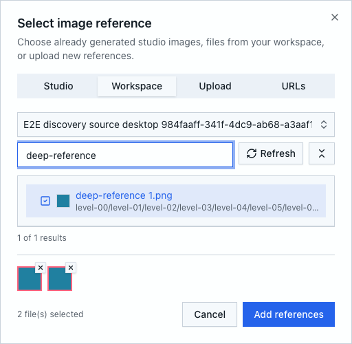
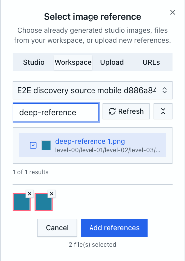

# Workspace file discovery verification

Verified on 2026-10-15 against this worktree's production build and the managed
local PostgreSQL environment. No container build or external AI generation was
used.

## Checks

- `npm run build` passed. Build-time OAuth/base-URL warnings remain environment
  warnings; the running host loaded the managed private environment and passed
  `/api/health` before testing.
- `npm run test:files:discovery` passed: complete catalogue, shallow navigation,
  query/workspace isolation, pagination, shrinking snapshots, denied access,
  unreadable subtrees, empty directories, email attachment selection, automation
  directory selection, mobile listings and source-preserving Model imports.
- Existing destination-folder, Studio workspace-hydration, file-watcher and
  file-operation-preview tests passed. Focused ESLint checks passed.
- `npm run test:files:discovery:e2e -- --max-failures=1` passed both Chromium
  scenarios: 390x844 with touch emulation and 1440x960 desktop.

Each browser scenario creates its own source and target workspaces. It browses
18 directory levels, searches past 505 non-media files, loads all 105 matching
images, retains selections across searches, imports into a new and existing
Model in another workspace, renders a local Resize crop, and reaches all 610
Explorer search results. Real mobile file and Notebook endpoints find the deep
image and Markdown document. Dialog bounds and usable search-input width are
asserted. The exact owned Models and workspaces are deleted in cleanup.

The automation directory chooser is currently unused by application routes; its
mounted component tests cover empty-folder search and selection. Native mobile
APIs were tested over HTTP; no physical-device test was performed. Notebook
content search retains its bounded scan and reports incomplete coverage, while
filename and path discovery use the complete catalogue.

An older fixture, `codex-image-picker-67c4-20261015.png` in Shared Test Workspace,
still receives `409 PREVIEW_BLOCKED` from the guarded deletion API. It was left
in place without changing unrelated documents or bypassing the guard.

## Reviewed screenshots

