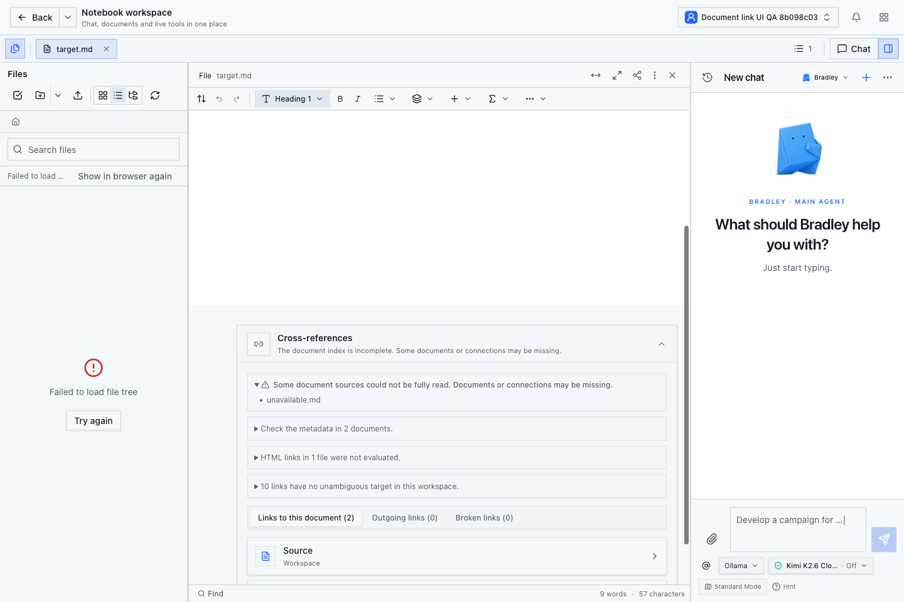
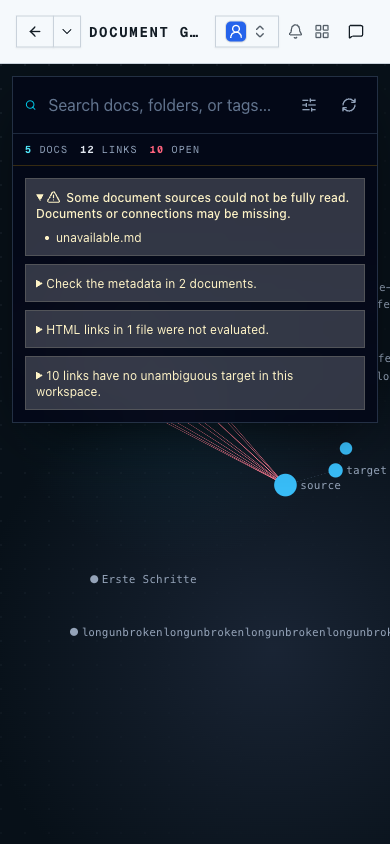
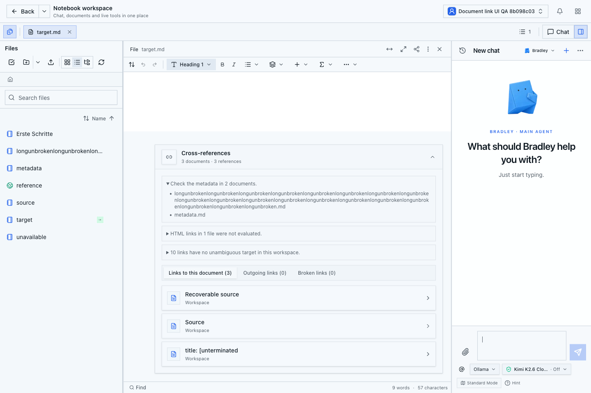
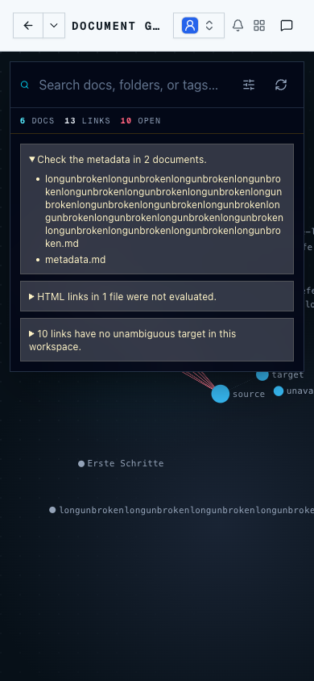

# Dokumentindex: einzelne native Quellenfehler

Stand: 26.10.2026. Abnahme von Paket 0 des zentralen Dokument-/Linkserviceplans.
Dies ist kein Abschluss des Performanceumbaus und keine Produktionsfreigabe.

## Fehler und Korrektur

Ein inaktiver nativer Zustand bei weiterhin aktiver Registry ließ den gesamten
lesenden Index leer werden. Beschädigte native Bytes hatten denselben Effekt.

Der Dokumentkatalog erhält einen ausdrücklich nicht ausführenden
`document-index`-Lesemodus. Ein inaktiver Zustand darf darin nur dann als einzelne
unverfügbare Quelle diagnostiziert werden, wenn Registry, Pfad, Workspace,
Organisation und Generation weiterhin geprüft sind. Der Standardmodus bleibt
streng. Es gibt keinen Rückfall auf eine möglicherweise veraltete physische Datei.

Der gebündelte native Leser begrenzt die Metadaten und Binärzustände weiterhin vor
dem Dekodieren. Dokumentbezogene Metadaten-, Größen- und Inspektionsfehler werden
im Lesemodus der tatsächlich geprüften Quelle zugeordnet. SQL-Fehler, fremde oder
uneindeutige Identitäten, inkohärente globale Beobachtungen und Gesamtbudgets
werden nicht als lokale Parserfehler behandelt. Die abschließende Quellenprüfung
und der nicht ausführbare Status der Leseprojektion bleiben erhalten.

## Automatische Nachweise

- Echte PostgreSQL-18-Fixture und tatsächliche Cookie-HTTP-Route:
  `scripts/document-link-index-route-postgres-test.ts`.
- Vor der Korrektur: inaktiver Zustand liefert 0 statt 201 weiterhin lesbare
  Dokumente. Nach der Korrektur: inaktiver Zustand und angehängte ungültige native
  Bytes lassen jeweils dieselben 201 anderen Dokumente und ihre Linksemantik
  verfügbar. Kalter, warmer und erzwungener vollständiger Neuaufbau stimmen überein.
- Dieselben beschädigten Daten bleiben im strengen Quellenmodus gesperrt. Ein
  tatsächlicher Organisationskonflikt liefert auch bei warmen Projektionen keine
  Dokumente oder Kanten. Entzogene Mitgliedschaft liefert weiterhin 401.
- Lesen verändert keine Registry-, Lineage-, Zustands-, Metadaten-, Revisions-
  oder Projektionszeilen. Nach Rücksetzen der gezielt veränderten Felder stimmt
  der vollständige Originaldatensatz wieder überein.
- 59 vorhandene Quellen-/Index-/Projektionsprüfungen und 53 Prüfungen des strengen
  SQL-Quellenlesers bestehen. Darunter sind Duplikate, Bytegrenzen und Veränderungen
  zwischen Metadaten-, Binär- und Abschlussprüfung.
- Eine zusätzliche Grenzprüfung weist nach, dass bereits geladene, danach wegen
  ungültiger nativer Bytes verworfene Quellen weiterhin das gemeinsame Bytebudget
  belegen. Eine physische Datei, die das verbleibende Budget um ein Byte überschreitet,
  wird vor dem Lesen abgewiesen. Auch die zweite native Prüfung berücksichtigt diese
  Reservierung. Der Test reproduzierte die Lücke zunächst und besteht nach der Korrektur.
- Release-Typprüfung, ESLint und vollständiges `npm run build` bestehen. Der Build
  prüft zusätzlich die tatsächlichen Produktionsmodule für Kollaboration.
- Der gesunde warme HTTP-Index benötigt bei 10 und 200 nativen Dokumenten weiterhin
  jeweils 36 SQL-Anweisungen und sieben Pool-Ausleihen. Diese lokale Messung ist
  kein Produktionsbenchmark und kein Abschluss der übrigen Leistungsbudgets.

Die PostgreSQL-Fixture benötigt die verwaltete lokale Testkonfiguration. Ein neuer
absoluter Ausgabepfad ist erforderlich:

```sh
NODE_ENV=test CANVAS_DOCUMENT_OPERATION_BASELINE_OUTPUT=/absolute/new-report.json \
  node scripts/run-document-read-tool-dispatch-test.mjs \
  scripts/document-link-index-route-postgres-test.ts
```

Der geprüfte Produktionsbuild stammt von `8d445461d628a4f315e7309a3559fa5bd4ee0414`
mit der damaligen Änderungssumme
`ffe0c93fa088ca6878c8c5f557e49dda5d2c4e44a06fdef32e58ffbfaf6ac732`.
Die private Buildprovenienz enthält die Inhaltsprüfsummen der drei Produktdateien
und des Regressionstests. Ein erster Build scheiterte an einer TypeScript-
Zuweisungsprüfung; die explizite Fehlerauslösung behebt dies. Der nachfolgende
vollständige Build und die separate Typprüfung sind erfolgreich.

## Tatsächliche UI-Abnahme

Gebauter Produktionsserver mit separatem lokalem PostgreSQL-Datenbestand und
echtem Bootstrap-Login. Eigene generische Testdateien, sechs native Dokumente,
drei Backlinks zum Testziel, zwei Metadatenfehler, eine HTML-Quelle und zehn
unaufgelöste Links. Review Center bleibt in den tatsächlichen Einstellungen
deaktiviert. Es wurden keine Produktionsdaten verändert.

Die nie geöffnete Testquelle `unavailable.md` wurde nur für den Negativtest auf
inaktiv gesetzt. Der Originaldatensatz und die Dateiprüfsumme wurden vorher
dauerhaft privat gesichert. Eine geschützte Rücksetzung im `finally`-Pfad prüft
alle nativen Felder einschließlich Binärzustand und Zustandsvektor sowie die
unveränderten physischen Bytes.

| Zustand | Index | Backlinks zum Ziel | Oberfläche |
| --- | --- | --- | --- |
| Gesund | 6 Dokumente, Quellen vollständig | 3 | Keine Warnung über fehlende Quellen; andere Diagnosen bleiben getrennt. |
| Eine inaktive Quelle | 5 Dokumente, genau `unavailable.md` als Quellenlücke | 2 | Bestehendes Ziel bleibt geöffnet; Querverweise und Graph bleiben verfügbar. |
| Exaktes Original wiederhergestellt | Wieder 6 Dokumente, Quellen vollständig | Wieder 3 | Quellenwarnung verschwindet; Dateibaum lädt wieder vollständig. |

Die absichtlich widersprüchliche Lebenszykluslage wird vom bestehenden strengen
Dateilistenleser abgewiesen. Seine Lockerung ist nicht Bestandteil dieser Korrektur.
Der Fehlerfall wurde deshalb im bereits tatsächlich geöffneten Zieldokument
geprüft; nach Wiederherstellung wurde der vollständige Dateibaum ausdrücklich
kontrolliert. Dieser Nachweis behauptet keine allgemeine Verfügbarkeit der
Dateiliste bei widersprüchlicher Speicheridentität.

Querverweis-Tabs sowie Auf-/Zuklappen der Quellenangabe wurden auf 1440×960 und
390×844 über echte UI-Eingaben geprüft. Eine 231 Zeichen lange ununterbrochene
Metadaten-Dateibezeichnung bleibt innerhalb der Diagnoseliste und bricht vollständig
um. Der vorhandene horizontal verschiebbare Graph behält seine bisherigen
Canvas-Labels; die Diagnosekarten passen in beide Ansichten.





