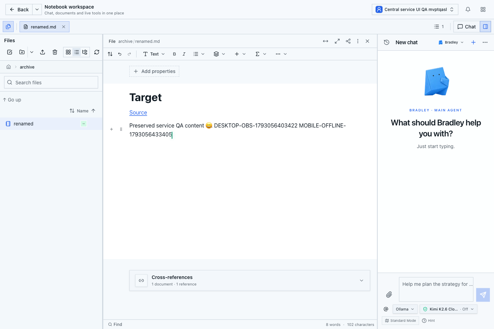
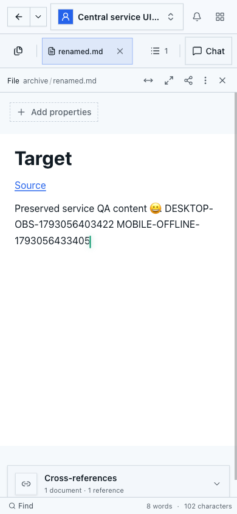
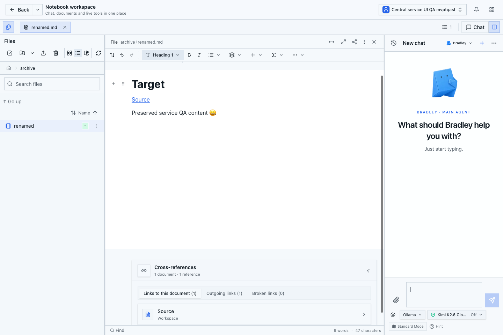
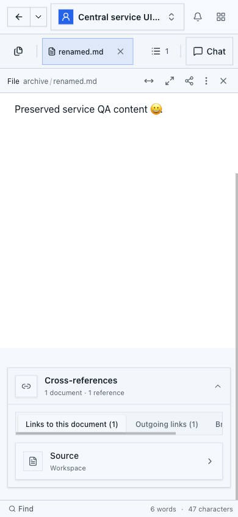

# Editor: feste Statusbeobachtung ohne doppelte Rechteprüfungen

Stand: 27.10.2026. Produktstand: `7ba5b704f7c4e9b1e7a6a3ebd45e90731b5fd36b`.
Teil des [Plans für den zentralen Dokument- und Linkservice](../document-write-database-performance-plan.md).

## Ursache und Änderung

Ein bereits zugelassener Editor-Peer führte seine Statusprüfung über eine
allgemeine Callback-Schnittstelle aus. Diese muss vor und nach fremdem Code erneut
vollständig prüfen, ob der Principal noch aktuell ist. Der konkrete Editor-Peer
liest dort jedoch nur unveränderliche Statusdaten oder bestätigt den Schreibzugriff;
er braucht keinen Callback mit einer lebenden Berechtigungsfassade.

Die bestehende Transportfunktion bietet deshalb zusätzlich eine feste Beobachtung
ohne Callback an. Nur diese Variante wird im Editor-Peer verwendet. Sie führt
dieselben festen Identitäts- und Zustandsabfragen zwischen der echten initialen
und abschließenden Principal-Prüfung aus. Das Ergebnis enthält Daten und keine
Funktion, Datenbankverbindung oder weiterverwendbare Berechtigung. Die Variante
mit einem fremden Callback behält ihre bisherigen zusätzlichen Prüfungen.

Jede Phase authentifiziert weiterhin die ursprünglichen Request-Header frisch.
Sitzung, Benutzer, Seat, Workspace, ursprünglicher Realm, tatsächliche Verbindung,
Transaktion, Dokument-ID, Lineage, Generation und Owner-Sperre bleiben geprüft.
Die letzte native Beobachtung bestimmt den zurückgegebenen Quarantänestatus.
Eine Lesephase darf einen quarantänisierten Stand diagnostizieren; eine
Schreibphase darf ihn nicht autorisieren. COMMIT und Schließen müssen weiter vor
einer Änderung am lebenden Y.Doc erfolgreich abgeschlossen sein.

## Messung

Die feste Prüfung auf der tatsächlich gehaltenen Verbindung B benötigt im
isolierten Team-Fixture **43 statt 79 SQL-Anweisungen**, für Lesen und Schreiben.
Das sind rund 46 Prozent weniger. Die daneben weiterhin frisch ausgeführte
Request-Authentifizierung ist in diesem direkten B-Zähler nicht enthalten.

Der bestehende Editor-Profiler umfasst zusätzlich die wirklichen HTTP-/WebSocket-
Handler, direkte Owner-Verbindungen und laufende Hintergrundarbeit:

| Prozessfenster | SQL vorher | SQL danach | Pool-Ausleihen vorher / danach |
| --- | ---: | ---: | ---: |
| Kalte Session, Socket und erste Projektion | 1.219 | 1.117 | 112 / 103 |
| Geöffneter Editor ohne Eingabe, 6,1 Sekunden | 2.117 | 1.524 | 233 / 244 |
| Erster warmer Save bis Datei-Checkpoint | 1.244 | 609 | 136 / 99 |
| Zweiter warmer Save bis Datei-Checkpoint | 1.167 | 719 | 134 / 116 |
| Warme Session mit zweitem wirklichem Peer | 1.319 | 1.255 | 119 / 126 |

Der Leerlauf benötigt in diesem Vergleich rund 28 Prozent weniger SQL. Die
Verbindungszahl ist damit **nicht** gelöst: Im Leerlauf steigen die gemessenen
Pool-Ausleihen, der abgetastete Spitzenwert steigt von acht auf neun Backends.
Die Save-Fenster dauern weiterhin etwa 2,7 bis 2,9 Sekunden. Unterschiede in
parallel laufenden Hintergrundzyklen verhindern eine exakte Zuordnung dieser
Fensterzahlen zu einer einzelnen Statusprüfung oder Nutzereingabe.

Die direkte B-Messung ist der deterministische Vergleich der beiden Varianten.
Die Prozessfenster bleiben eine Messung an einem kleinen Workspace mit zwei
nativen Dokumenten, keine Produktions- oder Groß-Workspace-Abnahme.

## Prüfung und Grenzen

- 35 PostgreSQL-Transport-Testgruppen bestehen, einschließlich echter Änderungen
  an Konto, Sitzung, Token, Seat, Namespace und Schreibrecht innerhalb derselben
  gehaltenen Phase. Quarantäne beim Abschluss bleibt für Leser sichtbar und
  verwirft die Schreibautorisierung.
- 23 tatsächliche WebSocket-Testgruppen bestehen. Verlorene COMMIT-/Close-Antwort,
  Owner-Verlust, Widerruf und Abbruch veröffentlichen keine unbestätigte Änderung.
  Echte inkompatible SQL-Sperren erzwingen die begrenzten Busy-Wiederholungen;
  nach deren Ausschöpfung verbindet ein frisches Mobile-Ticket die erhaltene
  lokale Änderung erneut und speichert sie.
- 13 vorhandene Busy-/Ingress-Testgruppen bestehen.
- Die gemeinsame Transport-Runtime besteht zusätzlich in beiden tatsächlichen
  Modul-Ladereihenfolgen mit jeweils 15 Admission-Testgruppen. Der Fixture nutzt
  die aktuelle Runtime-Version 3, unveränderte echte Migrations-SQL und eine
  zur gehaltenen SHARE-Sperre tatsächlich inkompatible ROW-EXCLUSIVE-Sperre.
- Fünf Bootstrap-Negativfälle prüfen getrennt die alte Runtime-Version 2 sowie
  unvollständige, veränderliche, als Getter hinterlegte und erweiterte Runtime-
  Objekte. Sie werden vor einem Aufruf ihrer Methoden abgewiesen; die übrigen
  Fälle verwenden Version 3, damit jeweils tatsächlich die geprüfte Abweichung
  zum Ausschluss führt. Diese fünf Fälle führen keine SQL-/Auth-Callbacks aus.
- Release-TypeScript, die beiden geänderten Testdateien und gezieltes ESLint
  bestehen. Es wurden keine neuen Testfilter oder Überspringungen eingeführt.

Der WebSocket-Fixture überwacht jetzt den tatsächlichen Admission-Owner seiner
Verbindungen. Sein alter Schalter zum Abschalten der inzwischen dauerhaft aktiven
nativen Integration wurde durch einen echten Test mit unpassendem, nicht
autorisierendem Repräsentationsselektor ersetzt. Ein nur parallel gehaltener
SHARE-Leser war kein Sperrkonflikt; der Test verwendet jetzt eine tatsächliche
FOR-UPDATE-Tupelsperre und verlangt die gezählte Ablehnung.

## Tatsächlicher Produktionsbuild und Desktop/Mobil

`npm run build` besteht am sauberen, unveränderten Produktstand `7ba5b704f`.
Der vollständige Build beendet sich mit Exit 0 und bestätigtem identischem
Quellstand. Der anschließend gestartete eigene QA-Server verwendet genau dieses
Build-Ergebnis; sein Health-Endpunkt antwortet mit 200 und `healthy`.
Der folgende Commit `1ad28df8a` ändert ausschließlich den zusätzlichen Test-Fixture.

Die tatsächliche App nutzt den echten Bootstrap-Login und die vorhandene lokale
Development-Team-Lizenz. Desktop (1440 × 960) und Mobil (390 × 844) öffnen dasselbe
native Dokument am aktuellen, zuvor verschobenen Pfad. Eine Desktop-Tastatureingabe
erscheint auf Mobil und im gespeicherten nativen Markdown. Beim Offline-Test meldet
der mobile Browser `navigator.onLine=false`: Die lokale Änderung ist im Editor
vorhanden, im unabhängig gelesenen Serverzustand noch nicht. Nach Wiederverbindung
erscheint sie im anderen Peer und wird gespeichert.

Die temporären Eingaben wurden durch normale Tastatureingaben entfernt. Nativer
Markdown und die physische Datei entsprechen wieder exakt den Originalbytes.
Dokument-ID, Lineage und Generation bleiben erhalten; Sequenz und Checkpoint sind
aktuell. Schließen und Wiederöffnen funktionieren; beide alten Pfade antworten mit
404. Der Linkindex ist vollständig, ohne ausgelassene Quellen oder unaufgelöste
Links. Beide Ansichten zeigen einen eingehenden und einen ausgehenden Verweis sowie
null defekte Links. Das tatsächliche Setting `documentReviewEnabled` bleibt false.
Die Dokument-Peers wurden zum Abschluss geordnet geschlossen.

Die vier Screenshots wurden visuell geprüft. Beide Seiten passen horizontal exakt
in ihren Viewport; das mobile Register der Linkarten ist innerhalb seines Bereichs
horizontal scrollbar.

Die reguläre Gesamtsuite am endgültigen Stand bleibt offen.
Auch die übrige Bündelung der Verbindungsausleihen, die vollständige inkrementelle
Linkauflösung, die gemeinsame Speicherung, die ursprüngliche Dokument-Recovery
und die abgesicherte Produktionseinführung sind weiterhin Teil des Gesamtplans.
Review Center und Undo werden dafür nicht weiterentwickelt.
