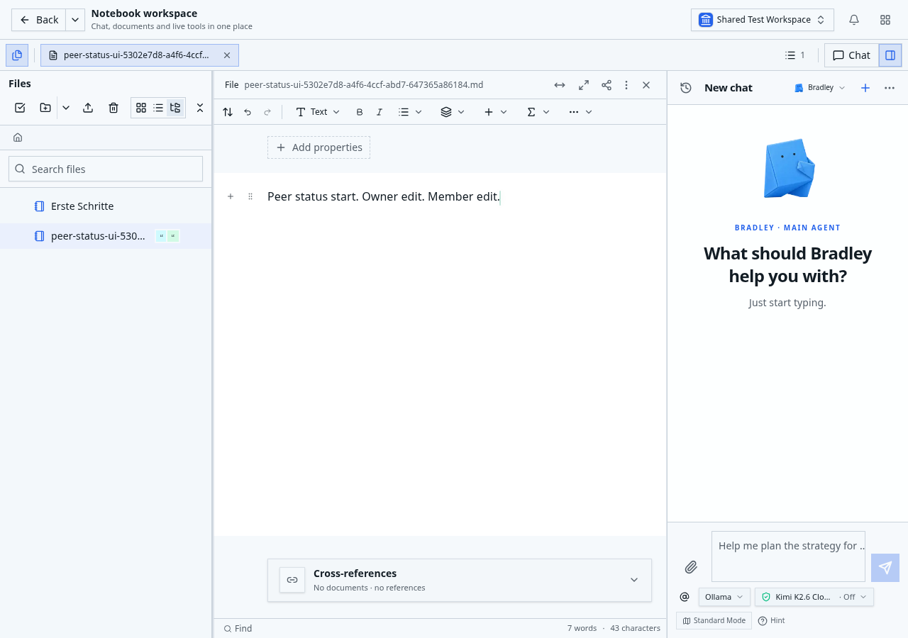
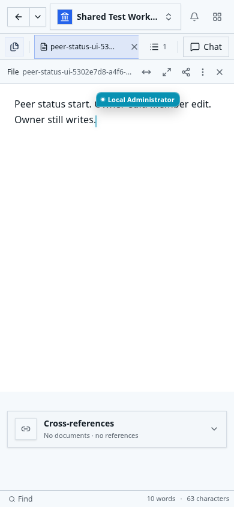

# Erste Workspace-Fakten beim HTTP-Dokumentlesen

Der HTTP-Dokumentleser liest die Einrichtung, den aktuellen Benutzer, den
Organisationseigentümer und den gewählten Workspace einschließlich seiner
Rechte jetzt gemeinsam. Der reguläre erste Workspace-Schritt benötigt eine
SQL-Abfrage statt fünf; Team-/Projektmitgliedschaften sind ebenfalls enthalten.

Nur der feste HTTP-Leseweg verwendet dieses Profil. Die gemeinsame
Anmeldeprüfung über Better Auth einschließlich Account-/Seat-Prüfung bleibt
erhalten. Andere Request-Principals und der Kollaborationszutritt verwenden
weiterhin den bisherigen initialen Resolver. Herkunftserfassung nach der
Lizenzprüfung, aktuelle Rechte während der Dokumentphase, native Identität,
Bindings, Metadaten und die abschließenden Prüfungen bleiben erhalten.

Die Abfrage übernimmt die vorhandene skalare Workspace-Projektion und deren
Entscheidung. Sie erzeugt weder eine Berechtigung noch einen Cache und führt
keine Bootstrap-Schreibvorgänge aus. NUMERIC-Werte werden weiterhin als echte
Treiberwerte ausgewertet. Fehlender Benutzer, fehlende Organisation,
Umgebungskonflikt und fehlender Eigentümer behalten ihre bisherige Priorität.

Ein älteres Schema kann getrennt gebundene IDs unterstützen, obwohl ein Join
zwischen zwei Spaltentypen nicht funktioniert. Für benannte PostgreSQL-
Parse-/Typfehler wird deshalb der bestehende sequenzielle Resolver auf derselben
Verbindung ausgeführt. Dies ist etwa mit UUID-Eigentümer und Text-Benutzer-ID
sowie fehlenden optionalen Mitgliedstabellen geprüft. Dieser Ausnahmeweg
benötigt sechs statt fünf Abfragen. Verbindungsausfälle, Zeitüberschreitungen
und unklare Bestätigungen lösen keinen solchen Wiederholungsversuch aus.

## Nachweise am Quellstand

Die Ausgangsbasis ist `820341269`, einschließlich des CLI-Lockfile-Fixes und der
Release-Metadaten für 2026.10.31.1. Eine neue Installation und der tatsächliche
HTTP-/Agent-/MCP-Vergleich auf dieser Basis bestehen. Für die Änderung bestehen:

- Vier bestehende PostgreSQL-Suiten: Request-Principal (66 Gruppen),
  authentifizierter nativer Sitzungsleser (24), öffentlicher Dokumentleser (23)
  und registrierter Agent-/MCP-Dispatch (15).
- 34 neue Fälle mit echten PostgreSQL-Ergebnissen und echter Cookie-Anmeldung:
  persönliche, Organisations-, Team- und Projekt-Workspaces, Widerrufe,
  Archivierung, fehlende Einrichtung, Fehlerpriorität, Schema-Kompatibilität,
  genaue NUMERIC-Werte sowie verlorene Bestätigung und Timeout ohne Wiederholung.
- Fünf frische Vergleichs-Fixtures mit 15 vollständig beobachteten Fenstern.
  SQL- und Verbindungsmessung stimmen mit den tatsächlichen Aufrufen überein;
  die ursprünglichen Daten, Operationsbelege, Dateianker und Container bleiben
  unverändert.
- Vollständige gezielte TypeScript-Prüfung mit 5.119 Importdateien und null
  Fehlern sowie ESLint für die geänderten Dateien.

| Warmer Abruf | SQL vorher | SQL danach | Verbindungsausleihen |
| --- | ---: | ---: | ---: |
| HTTP, 10 und 200 Dokumente | 59 | 55 | 8 |
| Hauptagent, 10 Dokumente | 99 | 99 | 3 |
| Organisationsagent, 10 Dokumente | 117 | 117 | 3 |
| MCP, 10 Dokumente | 74 | 74 | 19 |

Beim ersten HTTP-Einstieg sinkt die Anzahl von 62 auf 58, bei weiterhin elf
Ausleihen. Der neue Fehlerfalltest erwartete zunächst einen rohen
Verbindungsfehlercode; der bestehende Datenbankadapter liefert dafür korrekt
`postgres_unavailable`. Nach Korrektur dieser Erwartung bestehen alle 34 Fälle.
Die Produktquellen der vier zuvor erfolgreichen Suiten sind bytegleich geprüft.

Private Messbelege liegen in `http-initial-facts-1793435466204` (Ausgangsbasis),
`http-initial-facts-1793435867498` (bestehende Suiten) und
`http-initial-facts-1793436049088` (Vergleich und abschließender Fehlerfalltest)
im bestehenden privaten Dokument-Service-Abnahmeverzeichnis.

Die GitNexus-Prüfung vor dem Commit stuft den Umfang als hoch ein; die anfängliche
Analyse des gemeinsamen Request-Principals war kritisch. Die betroffenen echten
Anmelde-/Dateiaufrufer sind geprüft. Sechs zusätzlich als berührt gemeldete
Nachbarsymbole sind anhand ihrer vollständigen TypeScript-Definitionen bytegleich
zum Basiscommit; die Zeilenverschiebung erweitert den tatsächlichen Umfang nicht.

## Build und Browserabnahme

Der vollständige Host-Produktionsbuild am unveränderten Produktcommit
`6bb4d6ff61ef72d1316b8aeb4c1e5de3639a6901` besteht einschließlich Kompilierung,
Release-Typecheck, Generierung und Browser-ESM-/Modulidentitätsprüfung. Das danach
aus exakt diesem Stand gebaute Linux-Image ist
`sha256:ec80b3ed51dced623d03ed1fc158ccd8b94417534e21af414758551dc7502592`.
Der einzige verwaltete Notebook-Testcontainer wurde damit frisch erstellt;
Datenbank, Daten-/Home-Volumes und die elf übrigen Container bleiben erhalten.

Der tatsächliche Start meldet Anwendung, Anmeldung, Datenbank und Zusammenarbeit
gesund, mit null Identitätskonflikten, null Quarantänen und null ausstehenden
Projektionen. Originale Operationsbelege, Dokument-/Native-Zeilen einschließlich
`xmin`, Dateibytes und die drei persistenten Dateianker sind vor und nach der
Browserabnahme unverändert. Ausgelieferte Laufzeitquellen und Image-Revision sind
zusätzlich gegen den Produktcommit geprüft.

15 Linux-Speicherfälle und neun echte Browserfälle bestehen ohne Retries, Skips
oder Flaky-Ergebnisse (Browserlauf 264,9 Sekunden): erster unterbrochener
Editorzutritt, verlorene Create-Antworten aus Home und Dateibrowser, mobiles
Speichern mit Exportfehler und neueren Peer-Änderungen, HEIF-Konvertierung sowie
Rich-/Markdown-Links nach Rename und Move. Der zusätzliche Live-Fall verwendet
zwei echte Editor-/Benutzersitzungen mit 23 beziehungsweise 16 empfangenen
WebSocket-Frames. Beide führen echte kompilierte HTTP-Dokumentabrufe aus. Nach
realem Rechteentzug erhält die alte Sitzung 401 `AUTHENTICATION_REQUIRED`; eine
frische Anmeldung liest denselben aktuellen Inhalt schreibgeschützt. Der Owner
kann weiterhin schreiben. Die Screenshots wurden visuell geprüft.

Zwei Annahmen in den übernommenen Prüfscripten wurden korrigiert: Der Host- und
Linux-Stand sind hier exakt gleich, und die Root-Lockdatei ist ein Build-Eingang,
den das finale Docker-Image nicht ausliefert. Die erste Vorbedingung stoppte vor
dem Imagebau; die zweite stoppte die Nachprüfung des bereits gesunden neuen
Containers. Separate vollständige Leseprüfungen bestätigen die ausgelieferten
Dateien, Container-/Image-Identität, unveränderte Daten und Dateianker. Anwendung
und Image wurden für diese Korrektur nicht überlagert.

Private Belege: `http-initial-facts-host-build-1793436255945-result.json`,
`http-initial-facts-linux-image-1793436679266-result.json`,
`http-initial-facts-linux-verification-20261031.json`,
`http-initial-facts-linux-post-ui-verification-20261031.json` und
`http-initial-facts-acceptance-linux-1793437417883-result.json`.

Am Produktcommit bestehen alle sechs GitHub-Checks. Die vier Runner-Notices
betreffen den Ubuntu-Imagewechsel und enthalten keine Codebefunde. Der
[PR #194](https://github.com/canvascoding/canvas-notebook/pull/194) enthält die
aktuellen Check-/Review-Ergebnisse; vor dem Merge wird dessen endgültiger Head
erneut geprüft.

Die reguläre vollständige `test:all`-Suite wurde für diesen Schritt nicht erneut
ausgeführt; ihr letzter dokumentierter Stand ist die Abnahme des vorherigen
HTTP-Verbindungsschritts. Sie bleibt ein Gate vor dem späteren Produktionsdeploy.
Direct MCP ist in dieser Linux-Fixture ausgeschaltet; die echten registrierten
Host-/PostgreSQL-Kontrollen ersetzen keine neue kompilierte OAuth-/MCP-Abnahme.
Review Center bleibt in den tatsächlichen UI-Einstellungen ausgeschaltet.
Kein neues Release oder Produktionsdeployment dieses Schritts wurde ausgeführt.

Dies ist ein weiterer Teil von Paket 2. Gemeinsame Fakten in den übrigen Phasen,
selektive Body-Lesungen, gemeinsame Schreibmechanik und die abschließenden
Leistungsbudgets bleiben offen. Review Center und Undo sind nicht Bestandteil
dieser Änderung.
