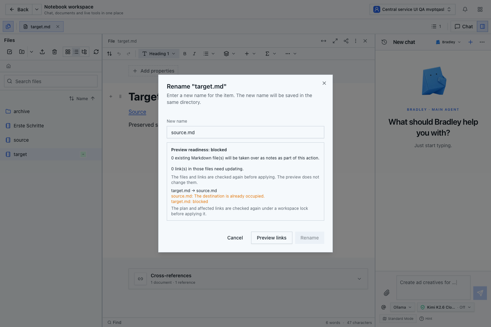
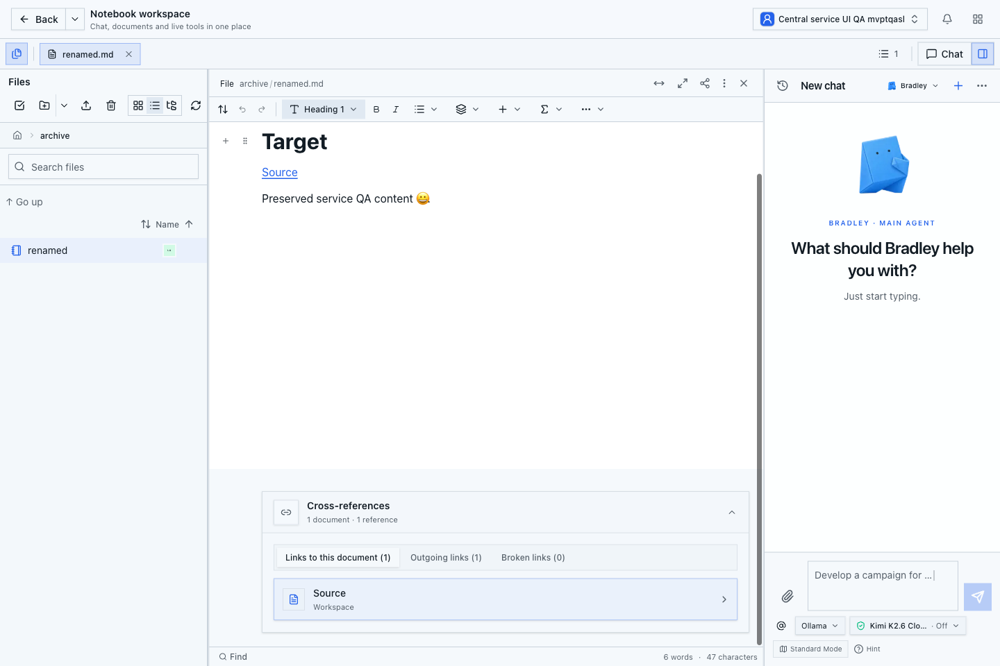
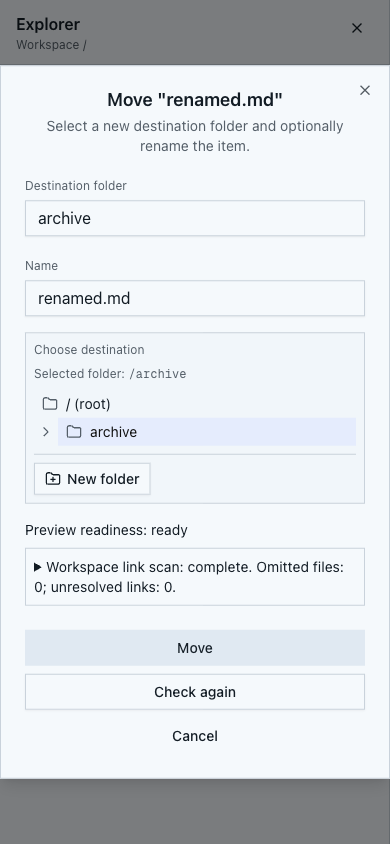

# Abnahme: gemeinsame Leser für native Move-/Rename-Aufträge

Geprüfter Produktstand: `d11028296a0094bda9cdbeccded54abfbfef1945`.
Die Änderung verwendet bei normalen direkten Benutzeraufträgen für native
Dateioperationen die vorhandenen gebündelten Konto-/Workspace-Leser. Jede Current-
Prüfung liest weiterhin frisch; Claim, Realm, Scope, Sperren und finale Prüfungen
bleiben erhalten. Review Center und Undo werden nicht weiterentwickelt.

## Datenbank- und Buildnachweise

| Fester Original-Owner-Messbereich | Vorher | Nachher | Pool-Ausleihen |
| --- | ---: | ---: | ---: |
| Native Datei, eingehender nativer Link und Metadaten | 2.342 SQL | 2.027 SQL | unverändert 29 |
| PDF-Datei mit nativem eingehendem Link | 2.431 SQL | 2.101 SQL | unverändert 31 |

Die vollständigen jeweiligen Owner-Fixtures einschließlich Vorbereitung werden
gemessen. Die Reduktion beträgt jeweils rund 13 Prozent; daraus wird keine
entsprechende Produktionslatenz- oder Editor-Leerlaufverbesserung abgeleitet.
SQL-Budgets von 2.100 beziehungsweise 2.200 sichern die festen Fixtures ab.

- Alle 22 bestehenden echten PostgreSQL-Move-Fälle bestehen einschließlich
  Konflikten, unbestätigten Ergebnissen, Wiederholung und Ressourcenbereinigung.
- Alle 30 Fälle des echten Job-Principals bestehen, einschließlich nachträglich
  entzogener Rechte, Claims und Agenten-Grants.
- Die öffentlichen Cookie-Rename-/Move-Handler bestehen mit dem tatsächlichen
  Worker und Projektor bis zu übereinstimmendem nativen und physischem Checkpoint.
- Release-TypeScript und ESLint bestehen. Der vollständige `npm run build`
  besteht am oben genannten unveränderten Commit, einschließlich der Prüfung
  der tatsächlich gebauten Kollaborationsmodule und gemeinsamen Yjs-Instanz.
- Alle sechs GitHub-Prüfungen dieses Commits sind erfolgreich: Linux-Sandbox,
  vier CodeQL-Sprachen und die zusammengefasste CodeQL-Prüfung.

## Tatsächliche Desktop-/Mobiloberfläche

Die gebaute Anwendung läuft über Loopback mit einer eigenen PostgreSQL-Datenbank
und eigenen Dateien. Anmeldung und Workspace-Erstellung erfolgen über die echten
HTTP-Endpunkte mit den lokalen Bootstrap-Zugangsdaten. Die Umgebung besitzt die
zuvor tatsächlich aktivierte lokale Development-Team-Lizenz. Der Server meldet
`documentReviewEnabled: false`. Es werden keine Produktionsdaten verändert und
keine Lizenz-, Rollen- oder Principal-Datensätze für diese UI-Abnahme erzeugt.

Ein neuer persönlicher Testworkspace enthält zwei native Markdown-Dateien mit
gegenseitigen relativen Links und das reguläre Starterdokument. In Chromium mit
1440 × 960 sowie mobiler Touch-Emulation mit 390 × 844 sind geprüft:

1. Aktive Notiz öffnen und einen bereits belegten Namen als Ziel wählen. Die
   Vorschau blockiert und deaktiviert Rename; die nativen Identitäten bleiben gleich.
2. Dieselbe geöffnete Notiz regulär umbenennen. Vorschau, Filetree und offener Tab
   folgen dem Ergebnis; der eingehende Link wird korrekt geändert.
3. Die Notiz zusätzlich mobil öffnen und über den tatsächlichen Move-Dialog nach
   `archive/` verschieben, während die Desktop-Ansicht weiterhin geöffnet ist.
4. Beide Ansichten übernehmen den neuen Pfad. Der ausgehende relative Link lautet
   danach `../source.md`; der eingehende Link `archive/renamed.md`.
5. Die tatsächliche Indexroute liefert drei Dokumente, vollständige Quellen,
   keine Quellenlücken und beide korrekt aufgelösten Kanten. Alle drei mobilen
   Link-Tabs sind bedienbar: ein eingehender, ein ausgehender, null defekte Links.
6. Die tatsächliche Dokumentlese-API liefert sämtliche erwarteten Markdown-Bytes.
   Beide ursprünglichen Dokument-IDs sind unverändert.
7. Eine ausschließlich lesende Kontrolle der eigenen QA-Datenbank bestätigt die
   ursprünglichen Lineages anhand der unveränderlichen Upload-Belege, gleiche
   Dokument-/Checkpoint-Sequenzen und exakt passende physische Dateien.
8. Die alten Pfade liefern keinen erfolgreichen veralteten Inhalt. Schließen und
   erneutes Öffnen über den aktuellen Filetree-Pfad funktionieren.

Die Screenshots wurden visuell geprüft. Beide Viewports haben keine horizontale
Dokumentüberbreite. Längere Dokumentbereiche sind regulär vertikal scrollbar;
die mobilen Link-Tabs bleiben über ihren eigenen horizontalen Bereich erreichbar.

## Verbleibender Umfang

Dies ist die Abnahme dieses Leserumbaus und seiner normalen Dateioperationen.
Die [Messbasis](document-service-database-baseline.md) dokumentiert weiterhin die
hohe Editor-Leerlauflast und die verzögerte physische Projektion beim regulären
Wiederherstellungsscan. Der vollständige zentrale Serviceumbau, die endgültige
reguläre Gesamtsuite, Produktions-Backup/-Restore und ursprüngliche Daten-Recovery
sowie Release und Deployment bleiben Anforderungen des
[Gesamtplans](../document-write-database-performance-plan.md).
