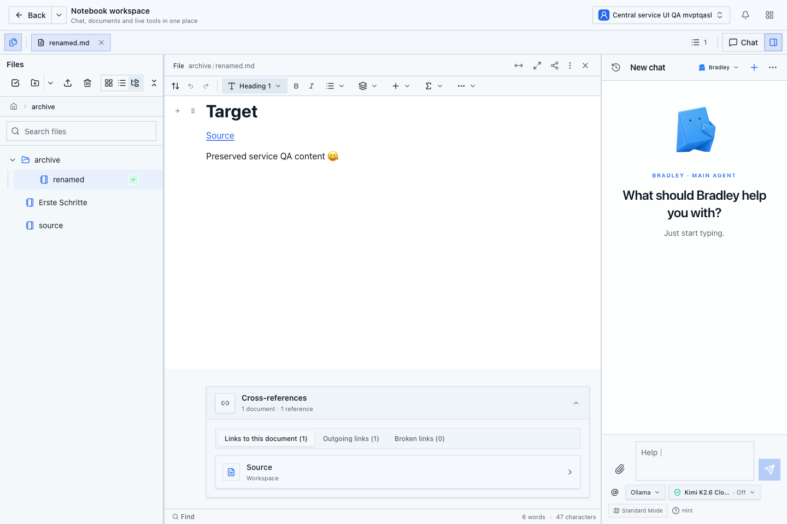
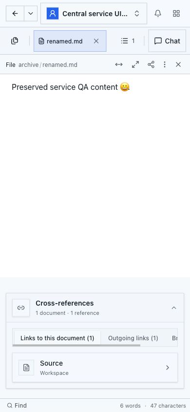

# Native Pfadaktionen: aktuelle Desktop- und Mobilprüfung

Stand: 27.10.2026. Geprüfter Produktstand: `f927ae6b15fb12ed142ab5f6f1e31fefd962ed8b`.
Teil des [zentralen Dokument- und Linkservice](../document-write-database-performance-plan.md).

## Build und Umfang

Der saubere Produktionsbuild besteht mit Exit 0 und unverändertem Quellstand sowie
Git-Tree `231f8002cf88bc36296846370cb41f4dddb9c14e`.
Der eigene lokale QA-Server wurde an genau dieses Build-Ergebnis und den Hash des
App-Manifests gebunden. Alle sieben CI-Prüfungen dieses Heads sind erfolgreich.
Die App verwendet den tatsächlichen Bootstrap-Login, PostgreSQL und die vorhandene
lokale Development-Team-Lizenz. Es wurde kein Container neu gebaut.

Diese Prüfung nimmt die umgestellten nativen Rename-/Move-Abläufe ab. Sie ersetzt
weder die reguläre Gesamtsuite am endgültigen Stand noch die verbleibenden Pakete
des Gesamtplans oder eine Produktionsprüfung.

## Tatsächliche Abläufe

18 UI-Prüfpunkte bestehen. Die Interaktionen verwenden die echte Oberfläche;
API- und Dateileser bestätigen zusätzlich den gespeicherten Zustand.

- Desktop und Mobil öffnen dasselbe native Dokument. Eine Tastatureingabe am
  Desktop erscheint im anderen Peer und im gespeicherten nativen Markdown.
- Der mobile Browser geht tatsächlich offline. Seine neue Eingabe ist lokal
  sichtbar, im unabhängig gelesenen Serverzustand und Desktop noch nicht.
  Nach Wiederverbindung erscheint sie im anderen Peer und wird gespeichert.
- Desktop-Rename erhält Inhalt, Dokument-ID, Lineage und Generation. Der eingehende
  relative Link wird angepasst; beide geöffneten Editoren übernehmen den neuen Pfad.
- Der mobile Move-Dialog blockiert den belegten Zielnamen mit einer sichtbaren
  `destination-collision`-Diagnose und deaktivierter Aktion. Inhalte und Pfade
  bleiben erhalten. Im langen Diagnosedialog ist Close zunächst sichtbar;
  Cancel und das deaktivierte Move sind nach normalem Scrollen vollständig erreichbar.
- Der anschließende mobile Move aktualisiert eingehende und ausgehende relative
  Links. Beide Peers behalten die Eingaben; Öffnen am neuen Pfad funktioniert.
- Rückverschieben und Umbenennen stellen die ursprünglichen Pfade und Links wieder
  her. Die temporären Eingaben werden durch normale Tastatureingaben entfernt.
  Beide vorübergehenden Pfade antworten danach mit 404.
- Der vollständige Index enthält drei Dokumente, zwei gerichtete Links, keine
  ausgelassenen Quellen und keine defekten Links. Beide Ansichten zeigen einen
  eingehenden und einen ausgehenden Verweis. Das tatsächliche Setting
  `documentReviewEnabled` bleibt false. Undo wird nicht verwendet.

Der Zieltext entspricht wieder exakt den ursprünglichen 69 UTF-8-Bytes;
SHA-256 `aac3c89988e03f277085c41e86b1a7ada18ab1f69d8544715201ad3e91bbb60b`.
Die Quelle entspricht ihren ursprünglichen 39 Bytes;
SHA-256 `90315602854bc477283eeca239ed1d7a51ec888c6ab53cb2313db05ff1a9cf0c`.
Beide physischen Dateien stimmen bytegenau mit den nativen Originaltexten überein.
Das Ziel behält Identität, Lineage und Generation; Sequenz und bestätigter
Datei-Checkpoint stehen gemeinsam auf 12. Eine unveränderte Sequenz wird nach
absichtlichen Editier- und Rückführungsoperationen nicht behauptet.

## Sichtprüfung und Bedienung

Desktop 1440 × 960 und Mobil 390 × 844 wurden gesondert visuell geprüft.
Beide Seiten passen horizontal genau in den Viewport. Die aufgeklappte
Verweisliste ist nach normalem Scrollen vollständig sichtbar; ihre Grenzen liegen
innerhalb des Viewports. Die mobilen Linktyp-Reiter scrollen in ihrem eigenen
horizontalen Bereich. Es wurden keine überlappenden Pflichtbedienelemente oder
verdeckten Linkeinträge in diesen abgenommenen Zuständen gefunden.

Ein zusätzlicher 74-Sekunden-Durchlauf umfasst Datei-Ansichtswechsel am Root,
Ordnernavigation, Wiederöffnen und den Rundlauf durch eingehende, ausgehende und
defekte Links. Die eigentlichen Prüfungen nutzen beobachtete Dateizeilen und
begrenzte Wartezeiten. Ein vorheriger zusätzlicher Navigationshelfer nahm einen
anderen gespeicherten Ordnerzustand an und lief in sein Harness-Zeitlimit; der
abschließende Durchlauf korrigiert diese Annahme ohne Produktänderung oder
Entfernung von Datenprüfungen. Beide Editor-Peers, der Testbrowser und anschließend
der eigene QA-Server wurden geordnet geschlossen.

## Noch offen

Der große öffentliche 200-Dokumente-Ablauf besteht, benötigt aber weiterhin rund
90 Sekunden pro Pfadaktion. Das ist keine endgültige Leistungsabnahme. Die
vollständige vergleichbare Kalt-/Warm-Matrix, weitere Bündelung, inkrementelle
Zielauflösung und gemeinsame Schreibwege bleiben Teil des ursprünglichen Plans.
Ebenso offen bleiben die ursprüngliche LinkedIn-Dokumentanlage, Produktionsreparatur,
reguläre Gesamtsuite am endgültigen Stand, PR-Abschluss, geprüfte Sicherung und
Wiederherstellung, Release und kontrollierte Prüfung aller fünf Workspaces.
Review Center und Undo erhalten dafür keine neue Implementierung.
