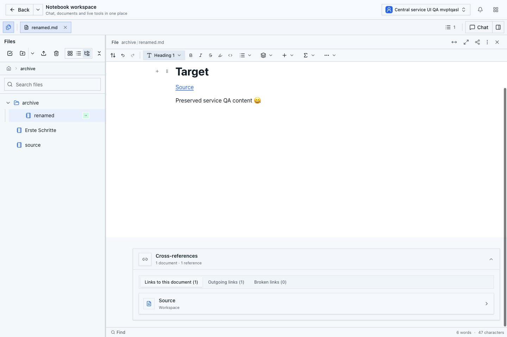
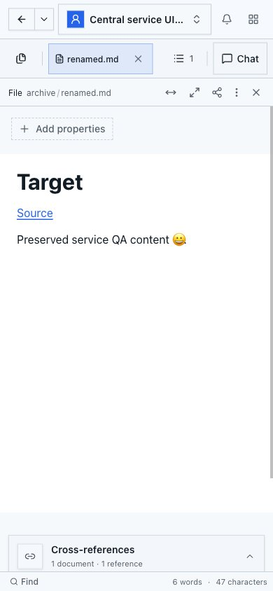
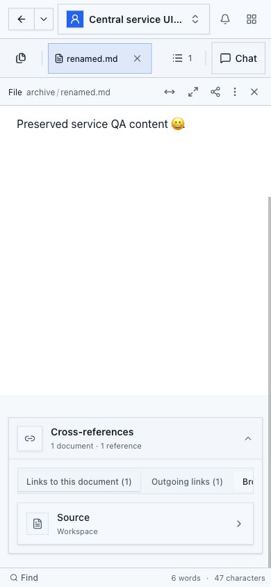

# Native Pfadaktionen: aktuelle Desktop- und Mobilprüfung

Stand: 27.10.2026. Geprüfter Produktstand: `f927ae6b15fb12ed142ab5f6f1e31fefd962ed8b`.
Teil des [zentralen Dokument- und Linkservice](../document-write-database-performance-plan.md).

## Build und Umfang

Der saubere Produktionsbuild besteht mit Exit 0 und unverändertem Quellstand sowie
Git-Tree `231f8002cf88bc36296846370cb41f4dddb9c14e`.
Der eigene lokale QA-Server wurde an genau dieses Build-Ergebnis und den Hash des
App-Manifests gebunden. Alle sieben CI-Prüfungen dieses Heads sind erfolgreich.
Die App verwendet den tatsächlichen Bootstrap-Login, PostgreSQL und die vorhandene
lokale Development-Team-Lizenz. Es wurde kein Container neu gebaut.

Diese Prüfung nimmt die umgestellten nativen Rename-/Move-Abläufe ab. Sie ersetzt
weder die reguläre Gesamtsuite am endgültigen Stand noch die verbleibenden Pakete
des Gesamtplans oder eine Produktionsprüfung.

## Tatsächliche Abläufe

18 UI-Prüfpunkte bestehen. Die Interaktionen verwenden die echte Oberfläche;
API- und Dateileser bestätigen zusätzlich den gespeicherten Zustand.

- Desktop und Mobil öffnen dasselbe native Dokument. Eine Tastatureingabe am
  Desktop erscheint im anderen Peer und im gespeicherten nativen Markdown.
- Der mobile Browser geht tatsächlich offline. Seine neue Eingabe ist lokal
  sichtbar, im unabhängig gelesenen Serverzustand und Desktop noch nicht.
  Nach Wiederverbindung erscheint sie im anderen Peer und wird gespeichert.
- Desktop-Rename erhält Inhalt, Dokument-ID, Lineage und Generation. Der eingehende
  relative Link wird angepasst; beide geöffneten Editoren übernehmen den neuen Pfad.
- Der mobile Move-Dialog blockiert den belegten Zielnamen mit einer sichtbaren
  `destination-collision`-Diagnose und deaktivierter Aktion. Inhalte und Pfade
  bleiben erhalten. Im langen Diagnosedialog ist Close zunächst sichtbar;
  Cancel und das deaktivierte Move sind nach normalem Scrollen vollständig erreichbar.
- Der anschließende mobile Move aktualisiert eingehende und ausgehende relative
  Links. Beide Peers behalten die Eingaben; Öffnen am neuen Pfad funktioniert.
- Rückverschieben und Umbenennen stellen die ursprünglichen Pfade und Links wieder
  her. Die temporären Eingaben werden durch normale Tastatureingaben entfernt.
  Beide vorübergehenden Pfade antworten danach mit 404.
- Der vollständige Index enthält drei Dokumente, zwei gerichtete Links, keine
  ausgelassenen Quellen und keine defekten Links. Beide Ansichten zeigen einen
  eingehenden und einen ausgehenden Verweis. Das tatsächliche Setting
  `documentReviewEnabled` bleibt false. Undo wird nicht verwendet.

Der Zieltext entspricht wieder exakt den ursprünglichen 69 UTF-8-Bytes;
SHA-256 `aac3c89988e03f277085c41e86b1a7ada18ab1f69d8544715201ad3e91bbb60b`.
Die Quelle entspricht ihren ursprünglichen 39 Bytes;
SHA-256 `90315602854bc477283eeca239ed1d7a51ec888c6ab53cb2313db05ff1a9cf0c`.
Beide physischen Dateien stimmen bytegenau mit den nativen Originaltexten überein.
Das Ziel behält Identität, Lineage und Generation; Sequenz und bestätigter
Datei-Checkpoint stehen gemeinsam auf 12. Eine unveränderte Sequenz wird nach
absichtlichen Editier- und Rückführungsoperationen nicht behauptet.

## Sichtprüfung und Bedienung

Desktop 1440 × 960 und Mobil 390 × 844 wurden gesondert visuell geprüft.
Beide Seiten passen horizontal genau in den Viewport. Die aufgeklappte
Verweisliste ist nach normalem Scrollen vollständig sichtbar; ihre Grenzen liegen
innerhalb des Viewports. Die mobilen Linktyp-Reiter scrollen in ihrem eigenen
horizontalen Bereich. Es wurden keine überlappenden Pflichtbedienelemente oder
verdeckten Linkeinträge in diesen abgenommenen Zuständen gefunden.

Ein zusätzlicher 74-Sekunden-Durchlauf umfasst Datei-Ansichtswechsel am Root,
Ordnernavigation, Wiederöffnen und den Rundlauf durch eingehende, ausgehende und
defekte Links. Die eigentlichen Prüfungen nutzen beobachtete Dateizeilen und
begrenzte Wartezeiten. Ein vorheriger zusätzlicher Navigationshelfer nahm einen
anderen gespeicherten Ordnerzustand an und lief in sein Harness-Zeitlimit; der
abschließende Durchlauf korrigiert diese Annahme ohne Produktänderung oder
Entfernung von Datenprüfungen. Beide Editor-Peers, der Testbrowser und anschließend
der eigene QA-Server wurden geordnet geschlossen.

## Noch offen

Der große öffentliche 200-Dokumente-Ablauf besteht, benötigt aber weiterhin rund
90 Sekunden pro Pfadaktion. Das ist keine endgültige Leistungsabnahme. Die
getrennte Kalt-/Warm-Matrix ist inzwischen im [Messbericht](document-service-path-cold-warm-2026-10-27.md) abgeschlossen. Weitere Bündelung, inkrementelle
Zielauflösung und gemeinsame Schreibwege bleiben Teil des ursprünglichen Plans.
Ebenso offen bleiben die ursprüngliche LinkedIn-Dokumentanlage, Produktionsreparatur,
reguläre Gesamtsuite am endgültigen Stand, PR-Abschluss, geprüfte Sicherung und
Wiederherstellung, Release und kontrollierte Prüfung aller fünf Workspaces.
Review Center und Undo erhalten dafür keine neue Implementierung.

## Integration nach gebündelten Agenten-Scope-Lesern

Der saubere Produktstand `f17b175ef92061cf635ee87d2c33c79202dc982c`
(Tree `86c05a0e3bfc3cdb7c4451fdecfdbb953259ba91`) besteht erneut `npm run build`.
Der gestartete QA-Server ist an diesen tatsächlichen Build und unveränderten
Quellstand gebunden. Diese Prüfung umfasst 14 dokumentierte Merkmale der normalen
Notebook-Oberfläche nach der [Agenten-Scope-Bündelung](document-service-agent-create-facts-2026-10-27.md).
Die registrierte Agenten-Neuanlage selbst wird durch die dortigen tatsächlichen
PostgreSQL-/PI-Werkzeugläufe geprüft; ein Modellaufruf ist kein Teil dieses UI-Laufs.
Die 18 älteren Rename-/Move-Merkmale oben werden dadurch nicht als erneut ausgeführt bezeichnet.

Desktop 1440 × 960 und Mobil 390 × 844 verwenden echte getrennte Bootstrap-
Anmeldungen und zwei offene native Editor-Peers. Der Filetree öffnet die vorhandene
Quelle. Eine Desktop-Tastatureingabe erreicht den zweiten Peer und den vollständigen
nativen Inhalt. Mobile Offline-Eingaben bleiben bei vier tatsächlichen Beobachtungen
lokal: native Sequenz 13 und der andere Peer ändern sich nicht. Reconnect speichert
exakt beide Eingaben bei Sequenz 14. Normales Entfernen ausschließlich der Testzeichen
über die Tastatur stellt wieder die ursprünglichen Inhalte her; Undo wird nicht benutzt.

Native und physische Ziel-/Quelldatei entsprechen danach wieder exakt 69/39 Bytes.
Identität, Lineage und Generation bleiben erhalten; Sequenz und Datei-Checkpoint
stehen beim Ziel gemeinsam auf 15, bei der Quelle auf 5. Die unveränderte Quelle
behält ihre vollständigen Registry- und Native-Zeilen. Der aktuelle Index enthält
weiterhin drei Dokumente, zwei Links, keine Lücken und keine defekten Verweise.
Die Warnung zum unvollständigen Index erscheint nicht. Das tatsächliche Runtime-
Setting `documentReviewEnabled` ist false. Unangemeldetes Lesen wird mit HTTP 401
abgelehnt; der Notebook-Einstieg führt zur Anmeldung.

Alle drei Linktyp-Tabs werden auf beiden Viewports durchlaufen. Die zusätzliche
110-Sekunden-Navigation umfasst Grid/List/Tree am Root, Schließen/Wiederöffnen
und den mobilen Rundweg Archiv/Root/Archiv/Dokument. Die Sichtprüfung unterscheidet
Dokumentanfang und gescrollten Linkbereich. Die bewusst horizontal scrollbare
mobile Tab-Leiste (`overflow-x-auto`, 338/435 Pixel) wird mit normaler Eingabe
bedient; jeder ausgewählte Tab ist vollständig sichtbar. Es gibt keinen horizontalen
Seitenüberlauf. Die relevanten Dokument- und Linkzustände sind separat visuell geprüft.

Testhelfer-Annahmen zu asynchronem Öffnen, Dateirollen, dem tatsächlichen JSON-
Antwortumschlag, Markdown-Escaping und vorgesehenen Scrollbereichen wurden anhand
der DOM-/API-Belege korrigiert. Die endgültigen Prüfungen vergleichen weiterhin
vollständige native Inhalte, Originalbytes und Identitäten; es wurde dafür kein
Produktcode geändert. Beide Peers, der Browser, der nur lesende SQL-Beobachter und
der eigene QA-Server sind geschlossen; dessen Unix-Socket-Verzeichnis ist entfernt.

Dieser Integrationsnachweis ersetzt weiterhin weder die übrigen Architekturpakete,
die reguläre Gesamtsuite am endgültigen Produktstand noch Backup/Restore und
Produktionsabnahme in allen fünf Workspaces.

