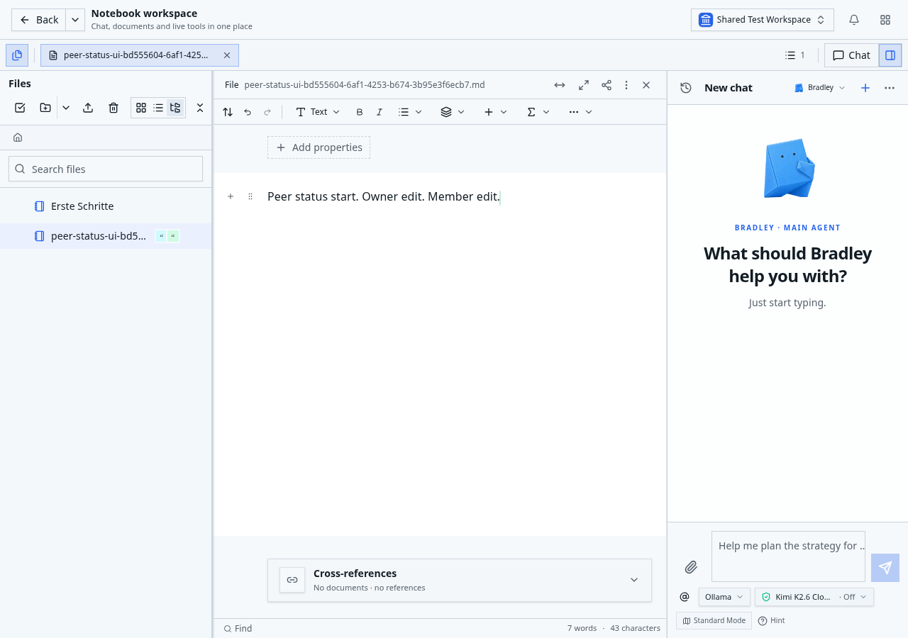
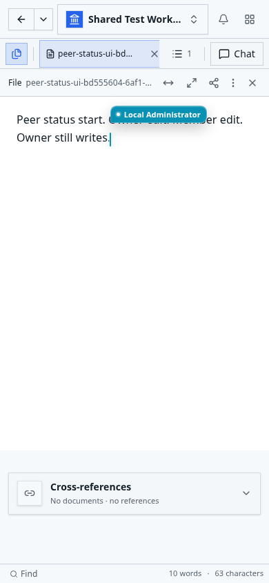

# Gemeinsame Herkunfts- und Leseverbindung

Dieser kleine erste Schritt in Paket 2 ist lokal implementiert und gegen echtes
PostgreSQL 18 geprüft. Er ist keine Abnahme des gesamten Bündelungspakets.
[Messdaten und Quellenbelege](document-service-request-source-connection-2026-10-30.json)
halten den getesteten Basisstand `8a381dc73`, den Arbeitspatch und die tatsächlichen
Quellhashes fest.

Der HTTP-Dokumentleser gibt die Verbindung seiner tatsächlichen Herkunftsabfrage
nicht mehr zurück, um unmittelbar danach eine neue für die native Transaktion
auszuleihen. Seine feste `canRead`-Factory übergibt dieselbe Verbindung an den
Transaktionshelfer. Vor dieser Übergabe räumt die Factory selbst auf; danach
übernimmt der Helfer BEGIN, COMMIT bzw. ROLLBACK und die vollständige Freigabe.
Eine fehlgeschlagene Freigabe wird nicht durch einen zweiten Freigabeversuch
verdeckt. Die vorhandene Transaktionslogik wird gemeinsam weiterverwendet.

Anmeldung, Seat-Prüfung, Workspace-Auflösung, Lizenz und Herkunftsabfrage behalten
ihre Reihenfolge. Die ursprünglichen aktuellen Rechteprüfungen vor und nach dem
nativen Lesen, Bindungsprüfungen und Abschlussbelege bleiben erhalten. Agent,
MCP, Suche und andere Request-Principal-Aufrufer verwenden ihren bestehenden
Eingangsweg. Es gibt keinen gespeicherten positiven Berechtigungsentscheid und
keine verlängerte Gültigkeit.

| Tatsächlicher Leseweg | Warme SQL-Aufrufe vorher → jetzt | Warme Pool-Ausleihen vorher → jetzt |
| --- | ---: | ---: |
| HTTP, 10 Dokumente | 59 → 59 | 9 → 8 |
| HTTP, 200 Dokumente | 59 → 59 | 9 → 8 |
| Hauptagent, 10 Dokumente | 99 → 99 | 3 → 3 |
| Organisationsagent, 10 Dokumente | 117 → 117 | 3 → 3 |
| MCP, 10 Dokumente | 74 → 74 | 19 → 19 |

Auch beim ersten HTTP-Aufruf bleibt SQL bei 62; die Ausleihen sinken von zwölf
auf elf. Alle fünf frischen Fixtures schließen je drei Messfenster. Die
Treiber-/Callsite-Zähler stimmen exakt überein, die Beobachtung physischer
Verbindungen ist vollständig, und keine Abfrage oder eigene Ausleihe bleibt offen.
Die Zahl physisch bereiter Verbindungen sinkt in diesen HTTP-Fenstern nicht;
es wird kein allgemeiner Laufzeitgewinn behauptet.

Sechs zusätzliche echte PostgreSQL-Suiten bestehen: Request-Principal,
authentifizierter nativer Leser, nativer ID-Leser, öffentlicher Dokumentleser,
Dokumentsuche und registrierte Agenten-/MCP-Dispatchwege. Der öffentliche Leser
enthält jetzt 23 Gruppen. Die neuen Fälle bestätigen dieselbe tatsächliche
Verbindung vor und nach BEGIN, Freigabe bei fehlgeschlagener Herkunftsbeobachtung
vor der Übergabe und einmaliges Verwerfen bei unbestätigtem BEGIN. Die bestehenden
Fälle für Rechteentzug, COMMIT-/ROLLBACK-Antwortverlust und fehlerhafte Freigabe
bleiben erhalten. Originalzeilen einschließlich `xmin`, native Bytes,
Operationsbelege, Dateianker und sämtliche zwölf laufenden Container sind erhalten.
Typprüfung des tatsächlichen Importgraphen mit 5.117 Dateien sowie gezieltes
Lint und Diff-Prüfung bestehen.

Eine zusätzliche ältere Ablaufprüfung wartete noch auf `SELECT expires_at FROM`.
Der unveränderte Main-Produktstand scheitert ebenfalls an diesem Testauslöser:
Die aktuelle Member-Prüfung liefert die Sitzungsdaten längst in der gemeinsamen
Antwort. Der Test beobachtet nun diese tatsächliche Antwort. Beide bisherigen
Abschlussfenster und alle sechs Missbrauchsvarianten bleiben geprüft; die
24 Gruppen des authentifizierten Lesers bestehen. Ein anfänglicher zu breiter
Beobachter der neuen Verbindungsprüfung und ein falscher temporärer Runner-Eintrag
wurden ebenfalls korrigiert; die fehlgeschlagenen privaten Berichte bleiben erhalten.

Der vollständige Host-Produktbuild des Commits `23c58fbc3` besteht mit unverändertem
Quellstand: Kompilierung, Release-Typprüfung, Artefakterzeugung und gemeinsame
Yjs-/Browser-ESM-Prüfung sind erfolgreich. Die bekannten Better-Auth-Meldungen
über die während des Builds ausdrücklich gesperrte Datenbank entsprechen dem
vorherigen erfolgreichen Build; sie belegen keinen Runtime-Start.

Der anschließende Linux-Build und gesunde Neustart am Produktstand `04332be41`
bestehen. Gegenüber dem Hostbuild ändern sich nur drei Dokumentationsdateien;
Runtime-, Test- und Paketquellen sind identisch. 15 Linux-Speicherfälle und das
tatsächliche `npm run test:all` bestehen mit 331 erfolgreichen Fällen, null
Fehlern und 269 vorgesehenen bedingten Skips. Der reguläre Browserlauf braucht
47,6 Minuten und verwendet keine automatischen Wiederholungen.

Die anschließende echte Browserabnahme besteht mit neun Fällen ohne Skips oder
Retries: erste unterbrochene Editorsitzung, beide Varianten der manuellen
Neuanlage mit verlorener Antwort, mobiler Speicherabschluss, zwei Live-Editoren
mit Rechteentzug und frischer schreibgeschützter Anmeldung, HEIF-Upload sowie
Frontmatter-/Wiki-/Markdown-Linknavigation nach Rename und Move. Die beiden
Editoren und die neue Lesesitzung rufen den kompilierten Dokument-Endpunkt mit
echten Cookies auf. Die widerrufene Sitzung erhält dort ausdrücklich HTTP 401
mit `AUTHENTICATION_REQUIRED`; die verbleibenden Leser erhalten den aktuellen
vollständigen Inhalt. Die echten WebSocket-Verbindungen, ursprünglichen
Dokument-IDs und physischen Inhalte bleiben geprüft.

Der abschließende unabhängige Vergleich bestätigt denselben gesunden Container,
die erwarteten Runtime-Quellen, erhaltene Originalzeilen/`xmin`, native Bytes,
Operationsbelege und Dateianker sowie elf unveränderte andere Container.
Temporärer Testproxy und Testprozesse sind beendet. Die sechs CI-Prüfungen des
geprüften Produktstands sind erfolgreich; Reviews, allgemeine und Inline-
Kommentare sowie Review-Threads enthalten keine offenen Punkte. Die drei
Runner-Hinweise betreffen ausschließlich den angekündigten Ubuntu-Imagewechsel.
Der abschließende Dokumentationscommit ändert keine Runtime- oder Testquellen;
seine PR-CI wird vor einem Merge gesondert vollständig geprüft.

Der Linux-Teststack hat Direct MCP deaktiviert. Die ausgewiesenen Agenten-/MCP-
Kontrollen stammen aus den separaten echten registrierten PostgreSQL-Dispatch-
Fixtures; dieser Schritt behauptet keine neue kompilierte OAuth-/Connectorabnahme.

Die SQL-Ziele, weitere gemeinsame Fakten, selektive native Body-Lesungen und
Schreibmechanik sowie die gemeinsame Schlussabnahme und das abschließende Release
bleiben offen. Diese bestandene lokale Abnahme schließt Paket 2 noch nicht ab.
Review Center und Undo erhalten keine Funktionserweiterung.
