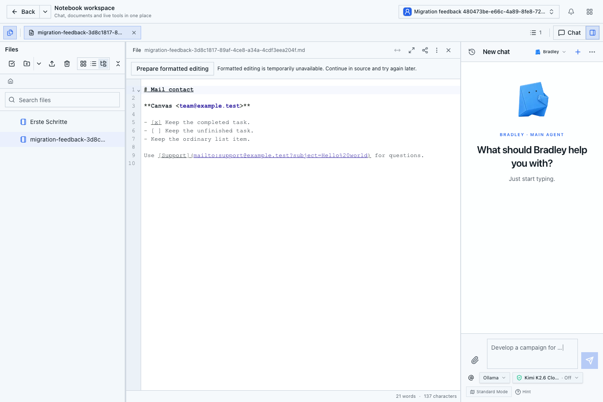
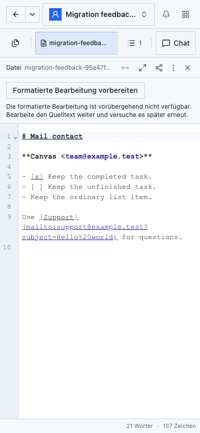

# Rich migration feedback acceptance

The editor previously attributed every failed Rich preparation to other editors
or pending changes. It now distinguishes confirmed service unavailability,
checkpoint lag, changed document state, unsupported content, access failure,
rate limiting and an unconfirmed outcome. Only a matching document, generation
and request receipt can resume the source provider. An ambiguous result retains
the original request for retry/cancellation. Raw server errors are not displayed.

Product and browser-test commit: `53973c5b5fdfa93fd2bb65cc181b559cb08e2446`.
The subsequent acceptance documentation and screenshots do not change those
product/test sources.

Validation on 6 November 2026:

- `npm run test:editor:migration-feedback`: 16 rendered component cases passed.
  This is a JSDOM test with injected responses, not server authorization proof.
- Targeted TypeScript with transitive dependencies and repository declarations,
  ESLint and `npm run build` passed. Static generation emitted build-time
  Auth/DB configuration warnings; runtime login and database access were checked
  separately in the compiled fixture.
- Linux image `sha256:31265cab511c9a05f0dcd5ee9f818b59251fc75dd25dcd72f355c72bbb614a0d`
  built successfully from that exact commit. Runtime source hashes were verified.
- Compiled Playwright run: **4 passed, 0 failed, 0 skipped, 0 flaky** in 47.8 s.
  `tests/markdown-rich-migration-feedback.spec.ts` injects only a scoped
  `runtime_unavailable` migration response. On English desktop and German mobile,
  the UI shows the specific message and retains the exact source and native ID.
  The subsequent retry uses the real server and completes the Rich migration;
  the same native ID remains after reload. The injected failure does not prove
  server-side failure admission or production recovery.
- The two existing `tests/markdown-mailto-normalization.spec.ts` cases pass on
  the same image without fault injection: real native migration, mailto links,
  checked/unchecked tasks and reload on desktop/mobile.
- Regular local bootstrap login, bounded Development Team fixtures and two-user
  collaboration preflight pass. Review Center and Undo remain outside scope.
  Only one managed Notebook ran; the original runtime was restored healthy,
  with protected rows/xmin, file bytes and native anchors unchanged.

Private controller evidence:
`compiled-rich-migration-feedback-1793979845484-result.json`,
`rich-migration-feedback-build-only-1793979320985-result.json` and
`api-sdk-acceptance-linux-image-1793979322826-result.json`.
This focused run is not a new full `test:all` acceptance and does not establish
the underlying cause of the production document's migration/access failure.

## Desktop

## Mobile

