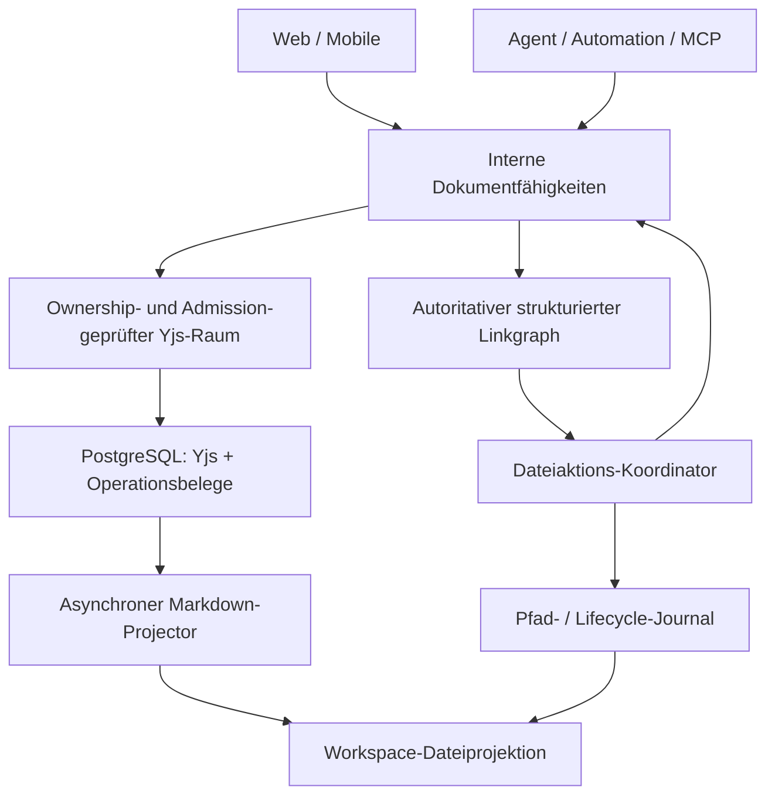

# Plan: Yjs-Dokumentautorität und sichere Dateiaktionen konsolidieren

**Status:** Umsetzung am 13. Oktober 2026 freigegeben; Arbeitspakete und Abnahmen werden unten fortgeschrieben.

**Stand:** 13. Oktober 2026.

**Quellcode-Basis:** `84f12e4ea7b541fc53d535fb0e0f857597c02e23`.

**Ziel:** Verwaltete Dokumente bleiben unabhängig von ihrer Markdown-Dateiprojektion korrekt lesbar, bearbeitbar, verlinkbar und wiederherstellbar. Berechtigte Nutzer bearbeiten den sichtbaren Editorinhalt unmittelbar, ohne Read/Edit-Auswahl.

Dieser Plan ergänzt den [Live-Dokument- und Agentenplan](live-document-agent-editing-plan.md), den [Dateilink- und Dateioperationsplan](architecture/canvas-notebook/workspace-file-links-and-operations-plan.md) und die [Collaboration-Policy](architecture/canvas-notebook/team-workspace/18-collaboration-and-file-conflict-policy.md). Deren bereits implementierte Grundlagen werden weiterverwendet. Neue Vertragsnamen, Statusfelder und Aufgaben in diesem Dokument sind Vorschläge, bis wir sie gemeinsam festgelegt haben.

Die Konsolidierung betrifft vor allem die verbliebenen Übergänge zwischen Dokumentzustand, Linkplanung, Pfadoperationen, Sicherung und Dateiausgabe. Hinzu kommt die ausdrücklich gewünschte Vereinfachung der Editoroberfläche: Read/Edit-Auswahl entfernen, direktes Bearbeiten als Standard und verbleibende Ansichtssteuerung platzsparend anordnen. Die vorhandenen Editoren und der Collaboration-Server werden weiterverwendet. Öffentliche REST-API und Python-SDK folgen erst nach der internen Stabilisierung.

## 1. Ausgangspunkt und überprüfter Fehlerfall

### 1.1 Was in dieser Untersuchung bestätigt wurde

Am 13. Oktober 2026 wurde die Blockade von Verschieben/Löschen an `test_core_bearbeitungsfeatures.md` untersucht. Die Dateiaktion meldete `PREVIEW_BLOCKED` mit `uninspected-source` für `ek-fuchs-transkript.md`.

Die Produktionslogs und anschließend die angemeldete Browserprüfung bestätigten:

- Die wiederholt fehlschlagende Dokument-ID gehört zu `ek-fuchs-transkript.md`.
- Im Rich-Editor sind ungefähr 21.800 Zeichen vorhanden; die Dateiinformation meldet für die physische `.md`-Datei 0 Bytes.
- Die autorisierte Lese-API liefert `COLLABORATION_ROUNDTRIP_UNSTABLE` und `validationCode: roundtrip_unstable`.
- Die Repräsentation ist `tiptap_blocks`.
- Der angehängte Inhalt des Testdokuments lässt sich lokal in beiden Rich-Repräsentationen stabil umwandeln. Daraus folgt keine Aussage über den vollständigen gespeicherten Yjs-Zustand des Transkripts.
- Es wurden keine Produktionsinhalte repariert, gelöscht oder überschrieben.

Die konkrete Struktur, die den Roundtrip des Transkripts scheitern lässt, wurde noch nicht aus einem vollständigen Yjs-Snapshot isoliert. Sie ist eine offene Diagnoseaufgabe. Insbesondere ist weder ein Größenproblem noch ein bestimmter Mark-Konflikt belegt.

### 1.2 Was dieser Fall architektonisch zeigt

Ein Dokument kann im nativen Yjs-Editor verfügbar sein, während seine Markdown-Projektion fehlt oder unzulässig wäre. Der heutige Linkplaner braucht für diesen Zustand trotzdem eine erfolgreich validierte Markdown-Serialisierung. Scheitert diese, wird die Quelle als ungeprüft behandelt; die strikte Linkprüfung blockiert weitere Dateiaktionen.

Zwei Probleme sind deshalb getrennt zu bearbeiten:

1. **Konkreter Codec-/Exportfehler:** Den verlustfreien Export des Transkripts untersuchen und gegebenenfalls korrigieren.
2. **Abhängigkeit der Dateiaktionen:** Verhindern, dass ein reiner Exportfehler die Prüfung eines strukturell gültigen, dauerhaft gesicherten Dokumentzustands unnötig unmöglich macht.

Die zweite Aufgabe darf die erste nicht durch eine verlustbehaftete Umwandlung verdecken. Eine tatsächlich unlesbare, unvollständig untersuchte oder strukturell ungültige Quelle bleibt ein Sicherheitsproblem.

## 2. Zielbild und verbindliche Invarianten

Für ein initialisiertes verwaltetes Dokument ist Yjs die führende Inhaltsquelle. PostgreSQL bestätigt die Dauerhaftigkeit dieses Zustands. Die Workspace-Datei ist eine nachgelagerte, interoperable Projektion. Ein geschlossener Browser oder entladener Raum ändert die Autorität nicht.

| Dimension | Maßgeblicher Nachweis | Darf nicht daraus abgeleitet werden |
| --- | --- | --- |
| Aktuell sichtbarer Dokumentzustand | Zuständiger Yjs-Raum mit gültiger Ownership und Identität | Bereits dauerhafte Sicherung allein wegen Sichtbarkeit |
| Dauerhafter Dokumentzustand | Persistierter Yjs-Snapshot und passender Zustands-/Operationsbeleg | Aktuelle Markdown-Datei allein wegen erfolgreicher Persistenz |
| Vollständig geprüfte Links | Vollständige Prüfung der maßgeblichen Dokumentrepräsentation und des Zielkatalogs | Vollständigkeit aus leeren oder ausgelassenen Quellen |
| Pfadmutation | Lifecycle-, Dateisystem- und Journalschritt-Belege | Inhaltsänderung allein wegen erfolgreichem Rename |
| Dateiprojektion | Passende Generation, Sequenz, Identität und bestätigter Export | Dokumentautorität aus Dateigröße, mtime oder einem alten Hash |
| Wiederherstellbarkeit | Verifizierte Sicherung des maßgeblichen Inhalts und der Pfad-/Lifecycle-Zuordnung | Wiederherstellbarer Editorinhalt aus einer reinen `.md`-Sicherung |

Folgende Regeln sollen durch alle Phasen erhalten bleiben:

1. Initialisierte Dokumente werden nicht aus älteren Datei-Bytes neu aufgebaut. Fehlende Yjs-Daten sind ein Fehler, kein Anlass für stillen Import.
2. Inhaltsmutationen erfolgen im zuständigen Collaboration-Raum über die bestehenden Autorisierungs-, Ownership- und Admission-Verfahren.
3. Pfadoperationen behalten ihre Workspace-Sperren, Lifecycle-Prüfungen, Backups, Journale und Wiederanlaufgrenzen.
4. Erfolgreiche Yjs-Persistenz wird durch einen späteren Exportfehler nicht zurückgenommen oder erneut ausgeführt.
5. Markdown-Export bleibt streng auf Verlustfreiheit geprüft. Strukturlesen und gezielte Linkoperationen erhalten einen eigenen, ebenfalls vollständigen Prüfvertrag.
6. StateVector allein reicht bei Löschungen nicht aus. Belege müssen auch DeleteSet/Inklusion und die passende Dokumentgeneration berücksichtigen.
7. Gleichnamige Pfade, Dokumentkopien und wiederangelegte Dateien übernehmen keine fremde Dokumentidentität oder Operationsbelege.
8. Unabhängige Nutzeränderungen bleiben erhalten. Ein Undo stellt nicht pauschal ein altes Gesamtdokument wieder her.
9. Fehlende Rechte, Ownership-Verlust, unbekannter Zustand, unvollständige Linkabdeckung und unbewiesene Teilergebnisse bleiben sichtbar und blockieren die betroffene Ausführung.
10. Ein abgeschlossener Inhaltsschritt, eine abgeschlossene Pfadoperation und ein noch ausstehender Export werden getrennt dargestellt.

## 3. Bestandsaufnahme: vorhandene Grundlagen und Lücken

Die Quellen in dieser Tabelle beziehen sich auf die oben genannte Basis. Zeilennummern sind Rechercheanker, keine dauerhaft stabilen API-Verträge.

| Bereich | Heutiger Stand | Geplanter Anschluss |
| --- | --- | --- |
| Dokumentlesen | [document-access.ts](../app/lib/collaboration/document-access.ts) liest den zuständigen Raum oder persistiertes Yjs. Die bestehende Reader-Brücke berücksichtigt die Raum-Ownership. | Einheitlicher Read-Vertrag mit explizitem Zweck und Frischenachweis; keine parallele Reader-Infrastruktur. |
| Dokumentmutation | [direct-connection.ts](../app/lib/collaboration/direct-connection.ts), [agent-operations.ts](../app/lib/collaboration/agent-operations.ts) und [agent-file-edits.ts](../app/lib/collaboration/agent-file-edits.ts) besitzen bestehende autorisierte Edit-Wege. | Link-Worker und weitere Writer auf diese Mechanik führen; Domain-Policy bleibt beim aufrufenden Workflow. |
| Dauerhaftigkeit/Export | [projection-runtime.ts](../app/lib/collaboration/projection-runtime.ts), [persistence.ts](../app/lib/collaboration/persistence.ts), [failure.ts](../app/lib/collaboration/failure.ts) und [checkpoint.ts](../app/lib/collaboration/checkpoint.ts) trennen Yjs-Persistenz und Projektionsfehler bereits. | Bestehende Trennung bis in Dateioperationsbelege, Recovery und öffentliche Statusprojektionen durchziehen. |
| Rich-Validierung | [markdown-state.ts](../app/lib/collaboration/markdown-state.ts), insbesondere `validateRichMarkdownYDoc`, verbindet Strukturgültigkeit und Markdown-Roundtrip-Prüfung. | Vorhandene Strukturvalidierung für native Operationen nutzen/ergänzen; Exportvalidierung unverändert streng halten. |
| Autoritativer Link-Snapshot | [workspace-authoritative-planner-snapshot.ts](../app/lib/markdown/workspace-authoritative-planner-snapshot.ts), Zeilen 34–108, liest persistiertes Yjs, ersetzt Dateiinhalt aber nur bei relevanten HTML-Fällen. | Alle initialisierten Dokumente aus ihrer maßgeblichen Repräsentation prüfen; auch ordinary Markdown-, Wiki- und Bildlinks. |
| Linkabdeckung | [workspace-file-operation-link-assessment.ts](../app/lib/markdown/workspace-file-operation-link-assessment.ts), Zeilen 116–120, blockiert ausgelassene Quellen ausdrücklich. | Diese Ehrlichkeit behalten; Exportfehler, Strukturfehler und fehlende Linkabdeckung auseinanderhalten. |
| Linkmutation | [workspace-link-yjs-edits.ts](../app/lib/markdown/workspace-link-yjs-edits.ts), Zeilen 181–230 und 298–306, prüft den Gesamthash und ersetzt bei Rich den Markdown-Inhalt im Y.Doc. | Zielstellen und betroffene Attribute/Shared-Text-Spannen direkt verändern; unabhängige Absätze behalten. |
| Link-Executor | [workspace-link-write-executor.ts](../app/lib/markdown/workspace-link-write-executor.ts) kennt `active-yjs`/`plain-file` und prüft weiterhin physische Quellbytes. | Initialisierung von laufender Mutation trennen; kein Datei-Fallback für initialisierte Ziele. |
| Batch-Abschluss | [workspace-operation-batch-executor.ts](../app/lib/files/workspace-operation-batch-executor.ts), Zeilen 93–107 und 511–579, materialisiert Checkpoints, wartet auf Dateihashes und prüft einen abschließenden Dateilinkindex. | Gesamten Abschlussnachweis ersetzen, nicht lediglich die Zehn-Sekunden-Wartezeit entfernen. |
| Sicherung/Copy | [workspace-operation-backup.ts](../app/lib/files/workspace-operation-backup.ts) sichert physische Bäume; [workspace-files.ts](../app/lib/filesystem/workspace-files.ts) besitzt physische Copy-Wege. | Binären Yjs-Inhalt zusätzlich sichern; verwaltete Dokumentkopien aus dem autoritativen Zustand initialisieren. |
| Lifecycle | [lifecycle-repository.ts](../app/lib/files/collaboration-repository/lifecycle-repository.ts) führt Move, Archivierung und Restore mit Identität/Generation. | Mechanik beibehalten und an neue Inhalts-/Projektionsbelege anbinden. |
| Undo | [workspace-operation-batch-executor.ts](../app/lib/files/workspace-operation-batch-executor.ts), unter anderem Zeilen 638–648 und 677–685, baut inverse Markdown-Gesamtergebnisse und benötigt Checkpoints. | Bedingte inverse Zieloperationen plus eigenständige Lifecycle-/Pfadbelege. |
| Web-Lesen | [files/read](../app/api/files/read/route.ts) nutzt [collaborative-read-snapshot.ts](../app/lib/files/collaborative-read-snapshot.ts); Textausgabe verlangt einen sicheren Export, Bootstrap kann unprojektierbare Metadaten liefern. | Native Struktur-/Metadatenansicht und Text-/Exportansicht explizit unterscheiden. |
| Mobile | [notebook.ts](../app/lib/mobile/notebook.ts) enthält Datei-Reads und dateibasierte Revisionserfassung vor optionaler Yjs-Ausgabe. | Repräsentation und Revision aus autoritativer Identität wählen; Altclients separat berücksichtigen. |
| MCP/Agent | [workspace-tools.ts](../app/lib/mcp/server/workspace-tools.ts) nutzt für direkte Text-Reads/Edits schon den Live-Pfad, besitzt aber vorgeschaltete Datei-Reads/Revisionseffekte; Suche liest Dateiinhalt. | Vorhandene Live-Reads erhalten, Such-/Metadaten-/Revisionsecken vervollständigen. |
| Exporte | [download](../app/api/files/download/route.ts), Markdown-/PDF-/Share-Wege und ZIP-Ausgabe haben unterschiedliche Frischemechanismen. | Jeder Export benennt Snapshot und Frische; leere/veraltete Markdown-Dateien dürfen nicht als aktueller Inhalt ausgeliefert werden. |
| Shell | [agent-shell-sandbox.ts](../app/lib/pi/agent-shell-sandbox.ts) beschränkt Schreibzugriffe bereits auf Scratch und verweigert einen unsandboxed Fallback. | Bestehenden Schutz nachweisen; noch mögliche rohe Lesewege und andere Prozess-/Mount-Grenzen inventarisieren. |

### 3.1 Vorläufige Auswirkungsanalyse

GitNexus meldet für `buildWorkspaceAuthoritativePlannerSnapshot` und `authoritativeCollaborationSnapshot` **CRITICAL**. Der kanonische Index nennt beim zweiten Symbol 14 direkte Abhängigkeiten und 18 betroffene Prozesse; die transitive Ausgabe ist teilweise begrenzt. Die direkte Snapshot-Abhängigkeit wird im Graph unvollständig erfasst, unter anderem wegen indirekter Default-/Dependency-Verwendung.

Beim Erstaudit besaß der Worktree noch keinen eigenen Index; die damals abgefragte kanonische Checkout-Basis war außerdem nicht exakt dieselbe Commit-Basis. Diese ursprünglichen Zahlen sind eine Warnung vor breiter Wirkung, keine abgeschlossene Auswirkungsanalyse. Die spätere Umsetzung verwendet den eigenen Root-Index `canvas-yjs-authority-824c` und symbolgenaue Prüfungen auf dem bearbeiteten Stand. Direkte lokale Quellen zeigen betroffene Bereiche in Files, Collaboration, Editor, Agent/MCP und Mobile.

Vor jeder späteren Symboländerung: Index für den tatsächlich bearbeiteten Checkout prüfen/aktualisieren, upstream impact ausführen, direkte Aufrufer verifizieren und HIGH/CRITICAL vor der Änderung berichten. Vor jedem Implementierungscommit folgt `detect_changes()`; bei Integration zusätzlich Vergleich gegen `main`.

## 4. Geltungsbereich und Abgrenzung

### 4.1 Bestandteil der Konsolidierung

- `.md` und `.markdown` in verwalteten Workspaces; initialisierte `plain_text`, `tiptap_blocks` und kompatible Legacy-Repräsentationen.
- Initialer Import, Create/Upload/Overwrite und vorhandene Agenten-/MCP-Ingest-Wege.
- Manuell erstelltes leeres Dokument, normales Text-Paste, ausdrücklich als Markdown eingefügter Inhalt und Import einer vorhandenen Markdown-Datei; vollständige Abnahme vom tatsächlichen UI-Einstieg bis zum erneuten Öffnen.
- Linkindex, Backlinks, Graph, Diagnostics, Preview, Rename, Move, Delete, Copy und vorhandene Undo-/Restore-Wege.
- Autoritative Reads, gezielte Writer, Revisionen, Cache-Invalidierung und Such-/Knowledge-Zulieferung.
- Web, Mobile-Serververträge, Agenten, Automation, MCP, Public Shares und Exporte an den jeweiligen Anschlussstellen.
- Betriebszustände, Backups, Neustart, Wiederanlauf und kompatible historische Operationsjournale.
- Direkte Bearbeitung ohne Read/Edit-Auswahl; kompakte Dokumentkopfzeile für Dokumentbreite und Vollbild/Fokus. Gemeinsame Markdown-Formularfelder und Gasteditoren werden mitgeprüft.

### 4.2 Eigenständige Verträge, die erhalten bleiben

Binärdateien verwenden weiterhin den File Service. Office-Dokumente und Excalidraw behalten ihre eigenen Dokument- und Lifecycle-Regeln. Der neue Markdown-Pfad darf sie nicht unbeabsichtigt verändern. Verwaltete Textdateien werden bei gemeinsamen Read-/Write-Gates berücksichtigt; ein neuer Linkvertrag für beliebige Textdateien gehört nicht automatisch zu diesem Vorhaben.

`.mdx`, Plugins mit eigenen Dateien, spezielle Studio-Artefakte und externe Mounts werden im Inventar erfasst. Ihre Aufnahme in den neuen Linkvertrag wird ausdrücklich entschieden; eine bislang nicht unterstützte Syntax wird nicht still als vollständig geprüft behandelt.

### 4.3 Nicht Bestandteil der ersten Umsetzung

- Öffentliche neue REST-API, Python-SDK oder frei eingebbare Yjs-Updates durch externe Clients.
- Neubau des Collaboration-Servers, Editors oder Version-/Review-Centers.
- Automatische Reparatur historischer Dokumentzustände, fehlender Yjs-Daten oder unbekannter Mark-Konflikte.
- Freigabe neuer Cross-Workspace-Move- oder Undo-Varianten, die heute bewusst nicht unterstützt werden.
- Produktionseingriffe, Releases, Push auf `main` oder Deployments ohne eigenen Auftrag.

## 5. Gemeinsame interne Document-Service-Fähigkeiten

Der Service ist eine interne Fassade über vorhandene Mechanik, kein zweiter Raum und keine eigene CRDT-Persistenz. Kleine Fähigkeiten werden von den bestehenden Datei-, Agenten- und Review-Flows orchestriert.



### 5.1 Vorgeschlagene Fähigkeiten

| Fähigkeit; Namen zunächst Arbeitstitel | Aufgabe | Voraussetzung/Ergebnis |
| --- | --- | --- |
| `resolveDocumentAuthority` | Identität, Repräsentation und Autoritätsklasse bestimmen | Rechte, Workspace/Organisation, Pfad/Generation, Initialisierungsstatus |
| `readDocumentSnapshot` | Einen konsistenten Snapshot für den gewünschten Zweck lesen | Versionierter Snapshot mit Dokumentnachweis, kein unmarkierter Dateifallback |
| `inspectDocumentLinks` | Struktur/Text vollständig auf vertraglich unterstützte Verweise prüfen | Linkinventar, stabile Referenzen und explizite Coverage |
| `prepareDocumentMutation` | Zielstellen, Policy und Vorschlagsbindung vorbereiten | Geprüfte lokale Vorbedingungen, kein clientseitiger Binärpatch |
| `applyDocumentMutation` | Synchron im autorisierten Raum mutieren | Operations-ID, eindeutiger Teilzustand, dauerhafte Bestätigung separat |
| `confirmDocumentDurability` | Genau diesen Mutationsbeleg im gesicherten Zustand nachweisen | Inklusion samt DeleteSet, Identität und Generation |
| `captureDocumentRecovery` | Autoritativen Inhalt und seine Wiederherstellung sichern | Verifizierbarer binärer Snapshot und Scope-Metadaten |
| `requestDocumentProjection` | Passenden Export nachführen oder dessen Status lesen | Eigene Projektionsquittung; kein erneutes Anwenden der Mutation |
| `importDocument` / `cloneDocument` | Einmalige Aufnahme oder neue Kopie erzeugen | Neue/zulässige Identität; erster Yjs-Stand atomar gesichert |

Zugriff, Actor-Provenienz, Review-Policy und Workspace-Grenzen bleiben bei den bestehenden autorisierten Einstiegspunkten und werden vor Apply erneut geprüft. Der Service darf diese Regeln nicht über interne Default-Actors umgehen. Mechanik erhält explizite Eingaben und strukturierte Ergebnisse; ein universeller `doEverything`-Service ist nicht vorgesehen.

### 5.2 Snapshot- und Frischevertrag

Ein Snapshot muss mindestens Workspace/Organisation, Dokument-ID, aktuellen Pfad, Lifecycle-Generation, Repräsentation, Schema-/Codec-Version sowie Version und Zustandsbeleg der tatsächlich gelesenen Fassung tragen. Beobachteter Live-Stand und zuletzt bestätigter dauerhafter Stand erhalten getrennte Sequenz-/Proof-Felder. Eine persistierte Sequenz darf neuere Raum-Inhalte nicht scheinbar als dauerhaft bestätigen. Für native Rich-Inhalte kommt die geprüfte Struktur hinzu; für `plain_text` der autoritative Shared-Text-Inhalt. Dateimetadaten werden getrennt geführt.

Der Read-Zweck ist ausdrücklich wählbar:

- **Native Struktur:** Ohne Pflicht zum Markdown-Roundtrip, aber mit vollständiger Struktur-, Identitäts- und Zustandsprüfung.
- **Dauerhafte Planbasis:** Konsistenter persistierter Stand nach dem geeigneten Raum-/Store-Barrier-Verfahren; ein noch nicht gesicherter Live-Stand darf nicht als dauerhaft gelten.
- **Text/Markdown:** Nur sichere, als solche validierte Serialisierung. Bei Exportfehler kein leerer Ersatztext.
- **Export:** Ein bestimmter geprüfter Snapshot oder bestätigte Projektion dieses Stands; Frische und Fehler bleiben sichtbar.

Im offenen Raum muss eine geeignete Barrier den Reader mit laufenden Stores/Edits koordinieren. Außerhalb des Raums wird der persistierte Snapshot geladen. Eine bloße Datenbanktransaktion macht mehrere gleichzeitig bearbeitete Räume nicht automatisch zu einem gemeinsamen aktuellen Workspace-Snapshot.

Kein neuer Weg darf laufende Reader-Handoffs, Owner-Leases oder Repeatable-Read-Loader umgehen. Mutationen aus separaten Workern werden zum zuständigen Raum geleitet. Ist dieser Zugang nicht verfügbar, lautet das Ergebnis unavailable/retry/review gemäß bestehender Policy; direkte Datenbank- oder Dateiänderung ist kein Ersatz.

Paginierte Struktur-, Such- und spätere API-Reads binden jede Folgeseite an denselben unveränderlichen Snapshot-Token. Truncation, noch fehlende Seiten und abgelaufene Tokens werden ausdrücklich ausgewiesen. Ein Wechsel auf einen neueren Stand darf nicht unbemerkt zwischen Seiten erfolgen.

Das Dokumentinventar vereinigt den autoritativen Registry-/Lifecycle-Katalog mit dem physischen Pfadkatalog. Initialisierte Dokumente ohne vorhandenen `.md`-Eintrag bleiben im Inventar und werden geprüft. Fehlende Projektion und fehlendes Dokument sind verschiedene Zustände. Doppelte aktive Zuordnungen, verwaiste Identitäten und ungeklärte Abweichungen bleiben Konflikte; daraus folgt keine automatische Dateiwiederanlage.

### 5.3 Autoritätsklassen und Initialisierung

| Zustand | Erlaubtes Verhalten |
| --- | --- |
| Neue, nachweislich noch nie initialisierte Datei | Einmaliger kontrollierter Import aus exakt geprüften Bytes unter Initialisierungs-/Lifecycle-Admission |
| Registriert, nachweislich pristine/uninitialized | Bestehenden expliziten Initialisierungsvertrag anwenden; kein Schluss allein aus `state_version === 0` |
| Initialisiert, Raum offen | Zuständigen Raum verwenden; aktuellen Stand für die jeweilige Operation passend sichern/nachweisen |
| Initialisiert, Raum geschlossen | Persistiertes Yjs laden bzw. vorhandenen Raum-on-demand-Weg verwenden |
| Initialisiert, Projektion ausstehend/fehlerhaft | Native Struktur und Yjs-Dauerhaftigkeit beurteilen; Exportstatus separat melden |
| Yjs fehlt, obwohl Initialisierung/Historie bekannt ist | Blockieren und Recovery anbieten; keine Wiederaufnahme aus der Datei |
| Legacy-Status unklar | Als unklar behandeln; kontrollierte Diagnose/Migration erforderlich |
| Archiviert, Generation gewechselt, Rechte verloren oder quarantiniert | Entsprechenden Lifecycle-/Recovery-Vertrag anwenden; kein Disk-Fallback |

Registry, Initialisierungshistorie, persistierter State, Archiv-/Trash-Lineage und Operationshistorie sind zusammen zu betrachten. Der neue Vertrag darf vorhandene strengere Lifecycle-Informationen nicht auf eine schwächere Versionszahl reduzieren.

Bestehendes `degraded` wird zusammen mit dem konkreten Fehler und dessen Generation bewertet. Projektionsbezogene Ausgabeprobleme unterscheiden sich von beschädigtem oder unbewiesenem Yjs. Das Flag wird weder pauschal ignoriert noch beim Restore zurückgesetzt, um natives Lesen freizuschalten; Struktur, Persistenz und Ownership müssen jeweils bewiesen sein.

## 6. Linkprüfung ohne Pflicht zur Markdown-Projektion

### 6.1 Repräsentationsspezifische Prüfung

Für `plain_text` bleibt der bewährte Markdown-/Wiki-Parser Grundlage, liest aber den maßgeblichen Y.Text-Stand. UTF-16- und UTF-8-Spannen müssen weiterhin exakt stimmen.

Für `tiptap_blocks` entsteht ein strukturierter Walker über die validierte Rich-Struktur. Er erfasst mindestens Linkmarks, Wiki-Links/Embeds, Bilder/Assets, Referenzformen soweit in der Repräsentation vorhanden, Frontmatter-Aliase/Titel sowie eingebettete HTML-Knoten und deren geprüfte lokale Ziele. Tabellen, Listen, Callouts und verschachtelte Blöcke dürfen nicht ausgelassen werden.

Unbekannte Knoten/Attribute oder nicht vollständig bewertbare HTML-/CSS-Ziele erzeugen Coverage-Lücken. Aus fehlendem Markdown-Export darf weder ein leerer Linkgraph noch ein pauschal vollständiger Rich-Linkgraph entstehen. Alle vom vorhandenen Codec erhaltenen Verweisformen müssen vor Freigabe entweder unterstützt oder ausdrücklich als ungeprüft klassifiziert sein.

Legacy-`tiptap_xml` erhält nur dann native Linkmutationen, wenn der bestehende Adapter die gleiche Sicherheit nachweist. Andernfalls bleibt eine konkrete Einschränkung bestehen; keine stille Repräsentationsmigration.

### 6.2 Link-Referenzen und Vorbedingungen

Die Link-ID benennt Dokument, Generation und die tatsächlich betroffene Zielstelle: stabiler Block-/Node-Identifier, Mark/Attribut oder relative Yjs-Textanker. Sie bindet alten Zielwert, Zielsyntax, Auflösung und gegebenenfalls Definition-/Alias-Bezug.

Vor Apply werden diese Stellen erneut geprüft. Eine Änderung im anderen Absatz ist kein pauschaler Gesamtdokumentkonflikt. Eine Änderung am Linkziel, an seiner Bedeutung, am Alias-Katalog oder an der Pfadidentität verlangt einen neuen Plan oder einen gezielten Konflikt.

Auflösung bleibt identitäts- und katalogbasiert. Basename-Kollisionen, Aliase, Titeländerungen und eine neu entstandene Datei können unveränderte Linkliterale anders auflösen. Deshalb genügt die Prüfung eines einzigen Textspans nicht als Workspace-Sicherheitsnachweis.

### 6.3 Vollständigkeit und betroffene Quellen

Coverage wird mindestens in Dokumentinventar, Strukturprüfung, Linkextraktion und Zielauflösung getrennt ausgewiesen. Exportfähigkeit ist ein eigenes Merkmal.

Eine Quelle darf nur als nachweislich unbetroffen behandelt werden, wenn ihr maßgeblicher Inhalt vollständig geprüft und die Auflösung im geplanten Endzustand bewertet wurde. Der Dateiname, ein alter Index, eine leere Projektion oder eine scheinbar fehlende eingehende Referenz reichen nicht.

Tatsächlich unlesbare oder übersprungene Quellen können unbekannte Links und Wiki-Aliase enthalten und bleiben blockierend, solange ihre Unbetroffenheit nicht bewiesen ist. Bestehende Grenzen für Größe, HTML und mehrdeutige Ziele bleiben ehrliche unavailable/incomplete-Ergebnisse. Eine Erhöhung der bisherigen 4-MiB-Grenze ist kein automatischer Bestandteil der Reparatur; benötigte Binär-/Struktur-/Scan-Budgets werden gesondert festgelegt.

### 6.4 Gezielte Mutation

- Rename/Move verändert nur betroffene Zielattribute oder genau adressierte Shared-Text-Zielspannen.
- Beim Move einer Quelle werden deren relative ausgehende Ziele semantisch erhalten.
- Beim Delete gilt der bestehende Vertrag zum Entfernen betroffener Linksyntax und Erhalten von Label/Alias/Alttext; Rich-Strukturoperationen müssen diesen Vertrag ausdrücklich abbilden.
- Referenzdefinitionen und ihre Verwendungen werden als zusammengehörige Gruppe behandelt.
- Ganze Rich-Dokumente werden nicht für gewöhnliche Linkkorrekturen als Markdown neu geparst/ersetzt.
- Eine synchrone Yjs-Transaktion bildet die atomare Gruppe innerhalb eines Dokuments. Mehrere Dokumente bilden weiterhin eine koordinierte Operation mit sichtbaren Teilergebnissen, keine behauptete gemeinsame CRDT-Transaktion.

## 7. Dateiaktions-Koordinator: sicherer Zielablauf

### 7.1 Planen

1. Session/Actor, Workspace-Grenzen und Rechte prüfen; Operation, Auswahl und Zielkanonisierung validieren.
2. Namespace-/Pfadkatalog und maßgebliche Dokumentidentitäten aus Registry und physischem Baum gemeinsam erfassen, einschließlich fehlender Projektionen.
3. Autoritative Linkinventare und ihre Coverage lesen; Exportfähigkeit separat vermerken.
4. Virtuellen Endzustand mit Pfadabbildung, Alias-/Zielauflösung, Kollisionen und gezielten Inhaltsoperationen berechnen.
5. Wiederherstellungsbedarf, erforderliche Dokumentfähigkeiten und bekannte Einschränkungen prüfen.
6. Unveränderlichen versionierten Plan, Vorbedingungen, Umfang und Review-/Direktmodus speichern.

Reine Planung initialisiert nicht heimlich neue Dokumente und erzeugt keine historischen Revisionen aus alten Dateiprojektionen. Ein notwendiger Import ist als eigener, nachvollziehbarer Ausführungsschritt im Plan enthalten.

### 7.2 Ausführen und bestätigen

1. Operation und Actor erneut autorisieren; benötigte Workspace-/Lifecycle-/Raum-Admissions in festgelegter Ordnung erhalten.
2. Aktuelle Pfadidentitäten, Dokumentgenerationen, Zielstellen und relevante Katalogänderungen mit dem freigegebenen Plan vergleichen.
3. Verifizierte Sicherungen und Schritt-Intents dauerhaft ablegen, bevor destruktive Schritte beginnen.
4. Bestehende Pfad-/Lifecycle-Mutation durchführen; Dokumentidentität und Ort passend aktualisieren und quittieren.
5. Betroffene Linkoperationen im weiterhin zuständigen Raum synchron und mit aktuellen lokalen Vorbedingungen anwenden.
6. Genau diese Operationen in persistiertem Yjs nachweisen und ihre dauerhaften Receipts im Journal sichern.
7. Autoritativen Endzustand der Linkauflösung und die finalen Pfad-/Lifecycle-Belege prüfen.
8. Koordinator abschließen und Sperren/Admissions ordnungsgemäß freigeben.
9. Projektionsauftrag bzw. aktuelles Projektionsergebnis getrennt weiterführen.

Die Reihenfolge wird gegen vorhandene Lifecycle-Admission und Lock-Ordnung implementierbar geprüft. Lange Datenbanktransaktionen dürfen nicht beim Warten auf Raum-RPC, Dateisystemaktionen oder den unabhängigen Projector offen bleiben. Der heutige reentrante Checkpoint im Batch existiert gerade wegen dessen Workspace-Sperre; sein Ersatz braucht einen nachgewiesenen Ablauf ohne Deadlock.

### 7.3 Abschlussvertrag

Ein neuer Dateiaktions-Abschluss gilt erst dann als erfolgreich, wenn alle geplanten Pfad-/Lifecycle-Schritte, alle verpflichtenden Linkmutationen, ihre Yjs-Dauerhaftigkeit und der autoritative Endzustand bewiesen sind. Eine nur ausgeführte Mutation oder ein unvollständiger finaler Index genügt nicht.

Ein noch ausstehender oder fehlerhafter Markdown-Export darf dann separat ausgewiesen werden. Das ist kein Grund, den gesicherten Inhalt erneut anzuwenden. Explizite Download-/Exportanforderungen können trotzdem weiterhin wegen fehlender verlustfreier Ausgabe scheitern.

Für jede Dokumentmutation braucht der Receipt mindestens Operations-/Teiloperations-ID, Actor-/Freigabebindung, Dokument-ID, Workspace/Organisation, Generation, Repräsentation/Schema, Zielreferenzen, gesicherte Sequenz und den passenden Inklusionsbeleg. Vorher-/Nachher-Dateihashes sind für neue native Mutationen kein alleiniger Wiederanlaufnachweis.

### 7.4 Retry, Konflikte und unklarer Ausgang

| Situation | Verhalten |
| --- | --- |
| Gleicher Job nach bestätigter Mutation | Receipt verifizieren; Mutation nicht erneut anwenden |
| Absturz nach Yjs-Persistenz, vor Journal-Receipt | Gesicherten operationsgebundenen Beleg suchen/verifizieren; fehlender Beweis bleibt unklar |
| Pfadmutation erfolgt, Quittung fehlt | Bestehende Pfad-/Lifecycle-Beweise prüfen; kein blindes `rename`, `cp` oder Delete-Replay |
| Unabhängiger neuer Absatz | Zieloperation gegen aktuellen Stand neu prüfen; keine alte Gesamtausgabe schreiben |
| Linkziel/Katalog/Generation verändert | Gezielter Konflikt oder neuer prüfbarer Plan; ursprüngliche Freigabe nicht still erweitern |
| Rechte entzogen/Owner verloren | Vor weiterer Mutation stoppen; bereits gesicherte Schritte und Recovery sichtbar lassen |
| Projector verspätet | Eigenen Exportstatus aktualisieren; abgeschlossene Mutation nicht zurücksetzen |
| Tatsächlicher Persistenzfehler | Kein dauerhafter Erfolg; vorhandenen Storage-/Recovery-Vertrag erhalten |

Die Idempotenzschlüssel werden an Workspace, Actor, Planversion und Teiloperation gebunden. Zwei verschiedene Operationen mit zufällig identischem Ergebnisinhalt dürfen nicht allein wegen eines gleichen Hashes als dasselbe Ergebnis gelten.

## 8. Backup, Copy, Delete, Undo und Restore

### 8.1 Autoritative Recovery-Artefakte als P0-Voraussetzung

Vor der Entkopplung des Batch-Abschlusses muss jede destruktive Aktion sowohl die benötigten physischen Dateien als auch den maßgeblichen Dokumentinhalt wiederherstellbar sichern.

Für initialisierte Dokumente enthält eine verifizierbare Sicherung zusätzlich:

- Originale binäre Yjs-Daten, StateVector und geeigneten vollständigen Zustandsbeleg einschließlich DeleteSet.
- Dokument-ID, Workspace/Organisation, Pfad, Generation, Status, Repräsentation, Schema- und Vertragsversion.
- Frontmatter, BOM-/Newline-Profil und alle weiteren separat gespeicherten Dokumentmetadaten.
- Bezug zu Operation, Teiloperation, Actor, Snapshot-Stand und gegebenenfalls Trash-/Lineage-Eintrag.
- Integritäts- und Ladeprüfung sowie Nachweis, welche Restore-Variante daraus tatsächlich möglich ist.

Die physische Dateisicherung bleibt für Binärdateien, Verzeichnisbäume, Pfadwiederherstellung und alte Journale nötig. Sie wird durch die Yjs-Sicherung ergänzt. Rohzustände und private Recovery-Daten sind nicht Teil öffentlicher API-/Logantworten.

### 8.2 Copy und initialer Import

Eine Kopie eines initialisierten Dokuments übernimmt den geprüften autoritativen Inhalt und erhält eine neue Dokument-/Lineage-Identität. `fs.cp` einer möglicherweise leeren Markdown-Projektion genügt nicht als Inhaltsquelle.

Die Entscheidung über neue Yjs-Client-IDs und stabile Block-IDs der Kopie wird explizit dokumentiert; die Kopie darf keine späteren Updates oder Operationsbelege des Originals übernehmen. Interne kopierte Ziele werden passend umgebogen. Bestehende Quellen bleiben unverändert. Cross-Workspace-Copy benötigt Rechte in beiden Scopes und behält die bestehenden Grenzen bei nicht mitkopierten Zielen.

Ein initialer Upload/Import wird nur einmal aufgenommen. Wiederholte Requests müssen denselben geprüften Import bestätigen oder einen klaren Konflikt liefern. Overwrite eines bereits verwalteten Ziels ist eine Dokument-/Lifecycle-Operation mit Sicherung und Policy, kein erneuter Rohimport.

### 8.3 Delete und Papierkorb

Delete sichert und archiviert die maßgebliche Dokumentgeneration samt zugehöriger Lineage. Die bestehende 30-Tage-Papierkorbsemantik und laufende Restore-Grenzen bleiben erhalten. Überlebende Quellen erhalten gezielte Linkbereinigungen aus ihrem aktuellen Zustand.

Ein Projector darf nach Delete weder den alten Pfad wieder anlegen noch ein später dort neu erstelltes Dokument überschreiben. Archivierung, Generation und Pfadbelegung müssen vor Schreiben und Quittierung erneut überprüft werden.

### 8.4 Undo und Restore

Undo ist eine neue auditierte Operation mit aktuellem Actor, aktuellen Rechten und neuen Receipts. Inhalts-Undo wendet bedingte inverse Zieloperationen an; Pfad-Undo benutzt die bestehenden Identitäts-/Namespace-Belege. Unabhängige spätere Nutzeränderungen bleiben bestehen.

Veränderte Linkziele, entfernte Blöcke, neue Backlinks, Pfadkollisionen, alte oder fehlende Belege können Undo blockieren. Eine komplette historische Markdown-Fassung darf nicht als bequemer Ersatz über einen aktuellen Rich-Zustand geschrieben werden.

Restore an den ursprünglichen oder einen freien neuen Pfad wird nach bestehender Produktsemantik gewählt und erzeugt eine passende aktive Generation. Alte Räume/Tickets und verspätete Projectors dürfen diese neue Generation nicht verändern. Ein historisches Backup ohne ausreichenden Yjs-/Operationsbeleg erhält eingeschränkte, ausdrücklich sichtbare Restore-Fähigkeiten.

### 8.5 Neues Dokument, Text einfügen und Markdown importieren

**Bestätigte Ergänzung:** Ein Nutzer erstellt manuell ein Dokument und möchte dort sofort Text oder vorhandenen Markdown-Inhalt einfügen. Dieser Alltagsweg erhält einen eigenen Produkt- und Testvertrag; der allgemeine Create-/Upload-Vertrag allein genügt nicht.

| Nutzungsfall | Zielablauf im UI | Inhaltlicher Vertrag |
| --- | --- | --- |
| Neues leeres Dokument mit normalem Text | „Neue Datei/Neues Dokument“ wählen, Namen und Ziel bestätigen, Dokument öffnen, in den Inhalt klicken und mit Cmd+V/Ctrl+V bzw. mobiler Einfügeaktion einfügen | Ohne Edit-Auswahl unmittelbar bearbeitbar. Absätze, Unicode, Sonderzeichen und fachlich relevante Leerzeichen bleiben erhalten; kein Speichern in einer zweiten Rohdatei. |
| Markdown-Text aus Zwischenablage | Neues oder vorhandenes Dokument öffnen, Zielposition/Auswahl festlegen und die klar benannte Aktion „Markdown einfügen“ verwenden | Bestehenden nativen Einfügeweg weiterverwenden. Unterstützte Überschriften, Listen, Links, Tabellen und Code werden als bearbeitbare Struktur eingefügt; anschließende Bearbeitung und ein getrenntes Undo funktionieren. |
| Eine vorhandene `.md`-/`.markdown`-Datei als neues Dokument übernehmen | Datei über den bestehenden Upload-/Importweg wählen, Workspace/Ziel prüfen und importiertes Dokument öffnen | Vollständiges Dokument einschließlich Frontmatter, Newline-/Encoding-Profil und unterstützter Syntax kontrolliert initialisieren. Neue Identität, keine Wiederverwendung fremder Operationsbelege. |
| Ganze Markdown-Datei in ein bereits leeres Dokument übernehmen | Bewusster vollständiger Dokumentimport statt gewöhnlicher Body-Einfügung; Eingabe/Datei prüfen, Zielbindung und Inhalt bestätigen | Metadaten werden ausdrücklich als Dokumentmetadaten übernommen; eine inzwischen gefüllte oder durch einen Peer geänderte Zielinstanz darf nicht unbemerkt überschrieben werden. |
| Inhalt in einem bestehenden Dokument ergänzen/ersetzen | Zielposition oder Auswahl festlegen; Einfügen ersetzt nur die ausdrücklich ausgewählte Spanne | Umliegender Inhalt und unabhängige Peer-Edits bleiben erhalten. Gesamtdokumentersetzung ist ein eigener, gesicherter und konfliktgeprüfter Vorgang. |

Der einfache Textweg verlangt keinen Importdialog. Die bestehende Markdown-Aktion ist im Web der eindeutige Weg für eine bewusste Strukturübernahme; sie muss nach Entfernung der Read/Edit-Leiste im vorhandenen Kontext-/Mehr-Menü gut erreichbar bleiben. Gewöhnliches Paste und ausdrücklicher Markdown-Import werden getrennt getestet. Ob normales Paste eindeutige Markdown-Syntax zusätzlich automatisch formatiert, wird unter D-15 entschieden und nicht aus dem Vorhandensein einer Markdown-Extension als bereits bewiesenes Verhalten abgeleitet. Literaler Code, Markdown-Beispiele und unklare Textsyntax dürfen nicht überraschend umgedeutet werden. Einzelne bestehende Wiki-/Mention-Paste-Regeln und HTML-Paste bedeuten weder garantiertes Literal-Paste noch einen vollständigen Markdown-Dateimport.

**Create-Inventar:** [CreateItemDialog.tsx](../app/components/file-browser/CreateItemDialog.tsx) im Dateibrowser und [HomeNewNoteDialog.tsx](../app/components/home/HomeNewNoteDialog.tsx) auf der Homepage sind beide reale Einstiege. Die [Create-Route](../app/api/files/create/route.ts) legt eine leere Datei exklusiv an; [document-state-service.ts](../app/lib/collaboration/document-state-service.ts) initialisiert sie beim ersten Sessionzugriff kontrolliert. Die beiden Dialoge besitzen heute unterschiedliche Regeln zur Ergänzung der `.md`-Endung; Namen, Ziel, Kollision und direktes Öffnen werden in beiden Wegen geprüft. Native Create über [notebook.ts](../app/lib/mobile/notebook.ts), ab Zeile 594, erzeugt bereits `# Titel` und behandelt Namenskollisionen eigenständig. Der erste native Paste muss diesen definierten Anfangszustand erhalten. Ein generischer Markdown-Einfügedialog ist in Native Mobile bislang nicht als vorhandene Funktion belegt; dessen gewünschte Parität wird gesondert geplant und getestet.

**Vorhandene Grundlage:** [MarkdownInsertDialog.tsx](../app/components/editor/MarkdownInsertDialog.tsx) und [markdown-insertion.ts](../app/lib/editor/markdown-insertion.ts) prüfen den Einfügetext und die aktuelle Zielspanne vor einer nativen Edit-Transaktion. Der Body-Einfügeweg lehnt Dokument-Frontmatter und nicht sicher unterstützte Inhalte bewusst ab. Deshalb wird eine vollständige Markdown-Datei nicht einfach durch diesen Dialog geschleust und dabei um ihre Metadaten gekürzt. Der vorhandene [Browser-Test](../tests/editor-markdown-insertion.spec.ts), Zeilen 82–139, prüft reale Zwischenablage im Dialog, Formatierung, getrenntes Undo, zwei Nutzer, Persistenz und Reload. Er erzeugt die Datei jedoch per API und ist noch kein Nachweis für manuelles Erstellen über das UI oder gewöhnliches Paste in ein frisches Dokument.

Zusätzliche Anforderungen:

1. **Erster Inhalt und Initialisierung:** Create öffnet die nachweislich richtige Dokument-ID/Generation. Der erste eingefügte Inhalt landet genau einmal in dieser autoritativen Instanz. Verzögerte Bootstrap-, IndexedDB-, Session- oder Projector-Ergebnisse dürfen ihn nicht durch einen alten leeren Stand ersetzen. Vor Bereitschaft erfasste Eingaben werden entweder eindeutig an das Ziel gebunden erhalten oder verständlich noch nicht angenommen; kein abgefangener und still verlorener Paste.
2. **Zwischenablagevertrag:** `text/plain`, Rich-Clipboard mit `text/html` und verfügbarer Markdown-MIME-Typ werden einzeln und in Kombination untersucht. Priorität, Formatübernahme und „als reinen Text einfügen“ sind ausdrücklich festgelegt. Das vorhandene URL-Paste, Codeblock-Paste, Block-/Bild-Paste und mobile Einfügen werden nicht durch einen allgemeinen Markdown-Handler verschluckt. Fremdes HTML wird nur durch den vorhandenen sicheren Parser-/Schemaweg übernommen; vorhandene Workspace-Bilder werden nicht durch kaputte oder fremde Verweise ersetzt.
3. **Nicht verlustfrei unterstützter Inhalt:** Keine still entfernten Frontmatter-Felder, HTML-/MDX-/Marp-/Obsidian-Strukturen, Tabellenzellen oder Codezeichen. Vollständiger Dateimport wählt einen zulässigen Source-Vertrag, wenn Rich den Inhalt nicht sicher übernehmen kann. Bei Body-Einfügung bleibt der Entwurf erhalten und die Einschränkung verständlich. Rich-Yjs wird dafür nicht ohne eigene Migration in eine zweite `plain_text`-Autorität umgeschrieben.
4. **Explizite Normalisierung:** Zulässige Markdown-Normalisierung wird vor bewusster Import-/Einfügeausführung erklärt und getestet. Vergleiche unterscheiden erhaltene native Struktur, texttreue Source-Ausgabe und ausdrücklich akzeptierte Normalisierung; sie verlangen nicht fälschlich identische Markdown-Bytes trotz erlaubter Formatnormalisierung.
5. **Identität, Rechte und Retry:** Gleichnamiges Ziel, bestehendes Dokument, zwischenzeitlicher Nutzeredit, Auswahländerung, Rechteentzug und wiederholter Upload/Import haben definierte Konflikt-/Deduplizierungsregeln. Ein automatischer Retry eines Imports wird dedupliziert; zwei eigenständige Paste-Aktionen bleiben zwei eigenständige Nutzereingaben.
6. **Ergebnis:** Nach Einfügen kann der Nutzer sofort weiterarbeiten, formatieren und Undo/Redo verwenden. Der Inhalt bleibt nach Tabwechsel, Schließen, Reload und erneutem Öffnen aus serverseitigem Yjs vollständig vorhanden. Verlustfreier Markdown-Export wird separat geprüft; ein fehlgeschlagener Export behauptet weder leeren Inhalt noch erfolgreichen Dateidownload.
7. **Dateiverweise:** Importierte relative Links, Bilder und Wiki-Verweise werden gegen das gewählte Workspace-Ziel aufgelöst. Fehlende Assets bleiben erkennbar; Einfügen der Markdown-Datei lädt nicht heimlich beliebige externe Dateien nach. Importiert wird nur die ausgewählte Datei beziehungsweise ein ausdrücklich gewähltes Paket.

## 9. Writer, Reader und abgeleitete Verbraucher vereinheitlichen

| Oberfläche/Workflow | Geforderter Vertrag | Besonderer Abnahmepunkt |
| --- | --- | --- |
| Web Rich/Source und tatsächliche Leserechte | Native Struktur und sichere Textansicht getrennt; berechtigte Nutzer bearbeiten direkt ohne Read/Edit-Auswahl | Wiederöffnung und zulässiger Darstellungswechsel ohne Überschreiben bei Exportfehler; Rechte bleiben wirksam |
| Mobile/Widget/Automation | Gleiche Identitäts-, Repräsentations-, Read- und Mutationsregeln | Altclient-Kompatibilität und tatsächliche native Abnahme separat |
| Agenten-Read/Edit/Patch | Bestehende gezielte Tools und `persisted_yjs`-Ergebnisse wiederverwenden | Closed-document und unabhängig weiterbearbeiteter Absatz |
| Link-Worker | Vollständiger autoritativer Graph, gezielte Mutation, dauerhafter Teilreceipt | Kein Datei-Fallback, kein blindes Replay |
| MCP direkte Reads/Edits | Bereits vorhandenen Live-Weg erhalten; vorgeschaltete alte Disk-Revisionen entfernen | Genau eine passende Version pro bestätigter Operation |
| MCP-/Workspace-Suche, RAG/Knowledge | Autoritative Extraktion oder explizit versionierter/frisch geprüfter abgeleiteter Index | Veraltete Projektion wird nicht als aktueller Treffer ausgegeben |
| Download/ZIP/Markdown/PDF | Aktuellen geprüften Snapshot exportieren oder Exportfehler ehrlich melden | Kein stiller 0-Byte-Download eines vorhandenen Rich-Inhalts |
| Public Share/Studio/Attachments | Scope und konsistenten Snapshot beibehalten; Exportfehler separat | Keine neue Veröffentlichung älterer oder fremder Inhalte |
| Dateimetadaten/Revisionen | Physische Größe und Dokumentinhalt unterscheiden; Reads schreiben keine alte Historie | Keine new→old-Revision durch verspätete Dateiprojektion |
| Create/Paste/Markdown-Import/Upload/Ingest | Kontrollierte Initialisierung; nativer Paste und vollständiger Dateimport nach §8.5 | Echter UI-Create, erster Paste, Frontmatter, Retry und vorhandenes verwaltetes Ziel |
| Shell/Skill/Scratch | Bestehende OS-Schreibbegrenzung erhalten; Dokumentzugriff über Tools | Child-Prozess, Symlink, direkter Pfad und fehlende Sandbox |
| Restore/Recovery/Operator | Verifizierte autoritative Sicherung und ausdrücklicher Reparaturumfang | Keine Startup-/Routine-Reparatur historischer Zustände |

File-Watcher dürfen externe Dateidrift melden und Projektionen invalidieren; sie dürfen ältere Workspace-Dateien nicht automatisch zurück in initialisierte Yjs-Dokumente importieren. Admin-/Host-Dateischreiber, Sidecars und lokale Prozesse außerhalb der Agent-Sandbox werden ebenfalls inventarisiert. Eine REST-Fassade allein verhindert deren direkte Writes nicht.

Die bereits vorhandene Agent-Sandbox ist kein Netzwerk- oder externer MCP-Schutz. Zusätzliche Mount-/Berechtigungsänderungen erfolgen erst nach einer konkreten Lückenanalyse, damit Projector, binäre Workflows und kontrollierte Importe weiterhin funktionieren.

## 10. UI, Fehlerverträge und Observability

### 10.1 Nutzerverständliche Zustände

Die Dokumentoberfläche unterscheidet einen verfügbaren und gesicherten Editorinhalt von dessen Dateiausgabe. Dateiinformationen dürfen die physische Größe zeigen, müssen eine ausstehende/fehlerhafte Projektion aber erklären können. 0 Bytes auf der Festplatte sind kein Nachweis für ein leeres Dokument.

Die bestehende Entscheidung für einen ruhigen Editor bleibt erhalten: keine routinemäßige Save-/Projektionsanzeige, Statuszeile oder Toast. Projektionsdetails gehören in Dateiaktionsdetails oder bewusst geöffnete Diagnostics/Dateiinformationen. Eine Meldung im normalen Editor erscheint nur bei einem tatsächlichen Problem, das eine Nutzerhandlung erfordert.

Dateiaktionen zeigen die tatsächlich abgeschlossenen Schritte. Ein künftiger vollständig bestätigter Batch kann als angewendet erscheinen und zusätzlich „Dateiausgabe ausstehend“ melden. Ein teilweise ausgeführter oder unbewiesener Batch bleibt `needs_recovery`/Konflikt gemäß Vertrag.

Die heutige pauschale Meldung „Datei lesbar oder kleiner machen“ wird für bekannte Exportfehler präzisiert. Der Nutzer erhält die betroffene Datei und eine verständliche Ursache. Interne Zustandsbelege, private Texte und ungeprüfte technische Detailfelder werden nicht öffentlich durchgereicht.

Ein zuvor blockierter Auftrag wird nach einer Reparatur weiterhin nicht automatisch ausgeführt. Ein neuer Request oder ausdrücklich freigegebener neuer Plan bleibt erforderlich.

### 10.2 Direkt editierbarer Inhalt als Standard

**Bestätigte Produktvorgabe vom 13. Oktober:** Die wählbaren Funktionen „Read“ und „Edit“ entfallen. Wer Schreibrechte und eine nutzbare Sitzung besitzt, kann das sichtbare Dokument unmittelbar bearbeiten. Dafür wird keine zusätzliche Modusleiste, Schaltfläche zum Aktivieren oder neue Systemeinstellung eingeführt.

Die Quellenprüfung zeigt, dass diese Änderung mehr als das Ausblenden zweier Buttons umfasst:

| Quelle | Aktueller Zusammenhang | Geplante Änderung |
| --- | --- | --- |
| [MarkdownDocumentModes.tsx](../app/components/editor/MarkdownDocumentModes.tsx), Zeilen 87–116 | Gemeinsame eigene Zeile mit Read/Edit/Source, Breite und Fokus | Wählbaren Read-Zustand entfernen; verbleibende Fähigkeiten an kompakte Kopfzeilen anbinden. |
| [MarkdownEditor.tsx](../app/components/editor/MarkdownEditor.tsx), Zeilen 5893–5948 und 6033–6122 | Startmodus, Fallbacks, statischer Reading-Renderer, Migration und Editable-Status hängen am Modus | Autoritative Repräsentation und echte Nutzbarkeit bestimmen den Editor; alter Read-Modus darf keinen berechtigten Nutzer im statischen Renderer halten. |
| [MarkdownField.tsx](../app/components/editor/MarkdownField.tsx), Zeilen 21–44 | Bereits gefüllte Formularfelder starten heute in Read; Leerfelder in Rich | Gefüllte und leere schreibbare Felder direkt bearbeiten; Expand-Aktion unabhängig von einer Modusleiste erhalten. |
| [GuestMarkdownEditor.tsx](../app/components/file-guests/GuestMarkdownEditor.tsx), Zeilen 58–106 | Eigener Requested-Mode und gemeinsame Modusleiste; tatsächliche Gastrechte separat geprüft | Gast mit Schreibrecht direkt bearbeiten; Gast mit Leserecht weiterhin geschützt anzeigen; Download-/Asset-Scope erhalten. |
| [markdown-mode-availability.ts](../app/lib/editor/markdown-mode-availability.ts) | Kollaborativer Rich-Quelltext ist kein schreibbares `Y.Text('content')`; Source nur für zulässige Repräsentationen | Keine Rich-Projektion durch Entfernen eines `readOnly`-Flags scheinbar editierbar machen. |

**Native Mobile ist ein eigener Repository-Anschluss:** Im separat geprüften Checkout `canvas-notebook-mobile` bei `3ba1eb92dee91c198265403d09395bd1e3a8fff8` besitzt `src/features/notebook/notebook-document-screen.tsx`, Zeilen 2895–2902, ebenfalls eine Preview/Edit-Auswahl. Schreibfähigkeit/Admission werden bereits getrennt geprüft; Rich-Live-Source bleibt dort eine lesende Projektion. Die gleiche Produktvorgabe wird für die native Dokumentfläche aufgenommen, mit eigener Implementierung und Geräteabnahme. Web-Viewport-Tests ersetzen diese Abnahme nicht. Bestehende keyboardabhängige Kopfzeilen dürfen beim direkten Editieren keine ungefragte Tastaturöffnung oder verlorene Auswahl verursachen.

Verhaltensvertrag:

1. `tiptap_blocks` und zulässige Rich-Dokumente öffnen in ihrem nativen bearbeitbaren Rich-Editor. Reiner Exportfehler führt nicht zu einer künstlichen statischen Leseansicht, sofern Struktur und Sitzung Bearbeitung erlauben.
2. `plain_text` und Dokumente mit ausschließlich sicherem Quelltextvertrag öffnen direkt im bearbeitbaren Source-Editor. Der unterstützte Inhalt bleibt erhalten; kein automatisches Normalisieren oder Migrieren nur für eine einheitliche Darstellung.
3. „Source“ bleibt eine besondere Darstellung/Fähigkeit, soweit sie sicher unterstützt wird. Empfehlung: Zugang im bestehenden Mehr-Menü, Rückkehr zum formatierten Dokument im selben Kontext; keine neue permanente Read/Edit/Source-Zeile. Native Markdown-Einfügung und bestehende gezielte Edit-Wege bleiben nutzbar.
4. Tatsächliche Leserechte, entzogene Rechte, fehlende Bereitschaft, Admission-/Strukturprobleme und migrationsbedingte Sperren bestimmen die reale Editierbarkeit. Berechtigung und Schutzstatus werden vom ehemaligen Präsentationsmodus getrennt. Ein bekannter Exportfehler wird gemäß dem gemeinsamen Fehlervertrag klassifiziert; dauerhafte Quarantäne wird nicht zum Ermöglichen der Eingabe aufgehoben.
5. Reines Öffnen, Fokussieren, Wechseln der Breite oder Vollbild erzeugt keine Inhaltsmutation, Revision, Normalisierung oder Migration. Ein fertig nutzbarer Editor setzt beim Öffnen nicht automatisch den Cursor und öffnet mobil nicht ungefragt die Tastatur.
6. Links, Wiki-Verweise, Bilder, Tabellen, Callouts, Checkboxen, aufklappbare Details, Codeblock-Kopieren, Metadaten, Inhaltsverzeichnis, Backlinks und Navigation funktionieren in der standardmäßigen Editieransicht. Bisher nur im Reading-Renderer vorhandene Darstellung oder Navigation wird ausdrücklich inventarisiert und sinnvoll in den direkten Editor übernommen. Geschützte Nodeviews und Medien-Atome werden dafür nicht pauschal `contenteditable=true`. Breite Tabellen bleiben innerhalb des Dokuments mit Tastatur/Touch scrollbar.
7. Ein Dokument behält beim Wechsel der Darstellung, Breite oder Fokussierung seine Sitzung, Identität, Auswahl, Scrollposition und Undo-Historie. Inline-/Expanded-Formularfeld besitzt weiterhin genau einen aktiven Draft-Owner.
8. Wirklich lesende Oberflächen wie Public Shares, Revision-/Review-Vorschauen und Binärvorschauen behalten ihren fachlichen Zweck. Die Entfernung des Read/Edit-Wahlschalters vergibt keine neuen Rechte und entfernt keine fachlich eigenständige HTML-/Folienvorschau.

### 10.3 Platzierung von Dokumentbreite und Vollbild/Fokus

**Begriffsklärung aus dem aktuellen Code:** Der horizontale Pfeil `MoveHorizontal` schaltet zwischen begrenzter Seitenbreite und voller Dokumentbreite um. Er verändert keine horizontale/vertikale Panelanordnung. Die Vollbild-Schaltfläche aktiviert heute den Dokumentfokus über [NotebookFocusContext.tsx](../app/components/notebook/NotebookFocusContext.tsx) und [DashboardShell.tsx](../app/components/DashboardShell.tsx), Zeilen 457–490; Explorer, Chat und Terminal werden temporär ausgeblendet. Sie verwendet keine Browser-Fullscreen-API. Dieser Plan optimiert diese vorhandenen beiden Funktionen.

**Empfohlener Platz:** Die beiden Ansichtsaktionen rechts in die bestehende Dokumentkopfzeile von [FileEditor.tsx](../app/components/editor/FileEditor.tsx), Zeilen 1072–1265, integrieren. Links bleiben Dokumentname/Pfad; rechts folgt eine kompakte zusammenhängende Gruppe für Breite und Fokus neben den vorhandenen Dateiaktionen. Damit entfällt die gesamte zusätzliche Moduszeile, statt sie durch eine leere oder anders beschriftete Leiste zu ersetzen.

Schematischer Zielzustand für die normale Desktop-Dokumentansicht; konkrete Abstände und Overflow werden anhand der realen Kopfzeile abgenommen:

```text
Datei / Ordner / Dokument.md          [Breite] [Fokus] [Dateiaktionen …]
───────────────────────────────────────────────────────────────────
Direkt bearbeitbarer Dokumentinhalt
```

Die Skizze lässt bestehende Freigabe-, Versions- und Review-Aktionen zur Übersicht aus. Sie bleiben erreichbar; das Layout darf die schon vorhandene Aktionsgruppe nicht einfach unbeschränkt verbreitern.

| Oberfläche/Zustand | Vorgeschlagene Platzierung | Platz- und Bedienungsregel |
| --- | --- | --- |
| Desktop mit ausreichender Breite | Dokumentbreite und Fokus als Icon-Gruppe rechts in der vorhandenen Dateikopfzeile | Tooltip plus eindeutiger zugänglicher Name und gedrückter Zustand; keine doppelte Aktion in der Formatierungsleiste. |
| Schmaler Desktop, angedockter Chat/Explorer oder hoher Zoom | Eine kompakte Ansichtsaktion öffnet Breite/Fokus im Menü der Kopfzeile, sobald direkte Icons den Dokumentnamen oder wichtige Aktionen verdrängen | Nach tatsächlich verfügbarem Platz reagieren; Dateiname bleibt erkennbar, keine abgeschnittenen Buttons oder zweite Zeile. Bestehende Rechte-/Fehlerhinweise bleiben sichtbar. |
| Dokumentfokus aktiv | Fokus-Icon wechselt zur sichtbaren Aktion „Fokus verlassen“ an derselben Stelle | Kopfzeile bleibt erreichbar; Escape schließt zuerst das aktive Menü/den Dialog, danach den Fokus; IME-Komposition beendet den Fokus nicht. Vorherige Panels, Größen, Terminalinstanz und ungesendeter Chatentwurf bleiben erhalten. |
| Mobile Dokumentansicht | Breite nur anbieten, wenn beide Einstellungen sichtbar verschiedene und sinnvolle Ergebnisse liefern; dann im Kopfzeilenmenü | Kein Desktop-Fokus-Button ohne nutzbare Funktion. Die bestehende mobile Vollflächenansicht erhält bei Bedarf eine klare Rückkehraktion; keine zusätzliche Leiste über der Tastatur. |
| Inline-Markdown-Formularfeld | Expand-Icon in der vorhandenen Feldkopfzeile oder am oberen rechten Rand innerhalb des Feldcontainers | Keine Notebook-Breite-/Fokusaktionen. Touch-/Fokusziel darf Text und Auswahl nicht überdecken. |
| Erweitertes Formularfeld | Bereits vorhandene Dialogtitelzeile trägt Schließen/Verkleinern | Keine zweite Modus-/Vollbildleiste; Entwurf, Auswahl und Fokus-Rückgabe bleiben korrekt. |
| Gasteditor | Dokumenttitel/Download-Zeile erhält gegebenenfalls Breitenaktion | Notebook-Fokus nur bei tatsächlich vorhandenem Host-Vertrag; kein funktionsloses Vollbild-Icon für eine eigenständige Gastseite. |
| Source-Editor | Nutzt bereits die verfügbare Breite; Breitenaktion wird nicht angeboten, wenn sie dort wirkungslos ist | Unterstützter Darstellungswechsel im Mehr-Menü; Fokus betrifft weiterhin nur das Layout. |

Breiten-/Fokuszustand erhält einen klaren Owner und wird als reine Präsentation an den Editor weitergereicht. Das Entfernen der Modusleiste darf den bisherigen lokalen `wide`-State nicht versehentlich zurücksetzen oder die Collaboration-Sitzung neu montieren. Eine Darstellungseinstellung wird nicht in Yjs-Dokumentinhalt oder Dokumentrevisionen gespeichert. Keine neue persistente Präferenz wird ohne bewusste Produktentscheidung eingeführt.

Die standardmäßige Editieransicht soll dieselbe angenehme Lesbarkeit bieten: passende Textbreite, gleichwertige Blockdarstellung und Formatierungswerkzeuge nur im bestehenden Kontext. Keine zusätzliche dauerhafte Formatierungsleiste als Ersatz für die entfernte Zeile. Tastaturbedienung, deutsche/englische zugängliche Namen, Tooltip-/Menü-Fokus, ausreichend große Touch-Ziele, Browserzoom, lange Dateinamen und mobile Safe Areas gehören zur Abnahme. Ein zusätzlich gewünschter Wechsel zwischen nebeneinander/untereinander angeordneten Panels wäre ein eigener Layoutauftrag und würde getrennt von der Dokumentbreite spezifiziert.

### 10.4 Fachliche Fehlerklassen

Mindestens getrennt behandeln: fehlende Autorität/Initialisierung unklar, ungültige Struktur, unvollständige Linkprüfung, geänderter Link/Katalog, Lifecycle-/Pfadkonflikt, fehlende Berechtigung/Ownership, Persistenzfehler, unklarer Mutationsausgang, ausstehende Projektion und fehlgeschlagener verlustfreier Export.

Neue Fehlercodes/Statusfelder werden versioniert. Alte Clients dürfen einen neuen Dauerhaftigkeitsstatus nicht als alten Dateicheckpoint interpretieren. Der öffentliche Receipt-Parser, Recovery-Consumer, Agentenresultat und Mobile-Parser werden zusammen angepasst.

### 10.5 Messbarkeit

Vorgeschlagene Messgrößen: Projektionsrückstand/-alter, Codec-Fehler nach begrenztem Fehlercode, strukturelle Coverage-Lücken, Retry/Deduplizierung, Recovery-Rückstand, Read-/Planlatenz und Größe der autoritativen Sicherungen. Metriklabels enthalten keine Dateipfade, Dokumenttexte, Tokens oder unbeschränkte Actor-/Operations-IDs.

Private Audit-/Diagnosebelege binden Operation und Scope mit kontrollierter Retention. Wiederholte Exportfehler werden dedupliziert sichtbar; unbegrenztes Routine-Logging ersetzt keine Fehlerklassifikation. Bereits gesicherte Mutationen dürfen durch Monitoring/Projektionsretry nicht nochmals angewendet werden.

## 11. Leistungs- und Konsistenzoptimierung

Zuerst Korrektheit und Nachweise, anschließend Messung und Optimierung:

- Workspace-Katalog und Autoritätsmetadaten gebündelt lesen; unnötige pro-Datei-DB-Abfragen vermeiden.
- Unveränderte Linkinventare mit Dokument-ID, Generation, Repräsentation, Schema-/Parser-Version und gesichertem Snapshot-Beleg cachen.
- Pfad-, Alias-/Titel-, Lifecycle- und Dokumentupdates invalidieren die jeweils betroffenen Inventare und Auflösungen.
- Coalescing des Projectors beibehalten; spätere sichere Sequenzen können ältere Projektionsziele enthalten, müssen deren korrekte Generation/Identität nachweisen.
- Räume nur für benötigte Operationen öffnen; vorhandene Ownership-/Idle-Release-Regeln verwenden.
- Speicher, CPU, Scan-Dauer, Binärsnapshotgröße und Retention begrenzen. Größere Dokumente erhalten explizite Budgets; Pagination darf keine erfolgreiche vollständige Abdeckung vortäuschen.
- Shadow-Vergleiche beziehen sich auf denselben nachgewiesenen Stand. Ein alter Disk-Graph gegen einen neuen Yjs-Graph ist erwartete Drift, kein automatischer Parserfehler.

Zielwerte für p95-Planlatenz, maximalen Projektionsrückstand und Scan-/Backup-Budgets werden nach einer Baseline-Messung festgelegt. Vor dieser Messung werden keine erfundenen Leistungszusagen in das Produkt aufgenommen.

## 12. Umsetzung im Worktree mit Abhängigkeiten und Abschluss-Gates

Gemäß ergänztem Nutzerauftrag wird ausschließlich in Git-Worktrees gearbeitet und unabhängige Arbeit wird, wo sinnvoll, parallel delegiert. Ein abhängiger Schritt beginnt erst nach Abschluss, Prüfung und Commit seiner Voraussetzungen. Die ID-Reihenfolge allein ist kein globales Parallelisierungsverbot; wichtige unvollständige Grundlagen werden durch parallele Folgearbeit nicht übersprungen. Vorarbeiten zur gemeinsamen Planprüfung sind noch keine begonnenen Implementierungs-To-dos. Den aktuellen Abschlussstand führt §12.1; Teilnachweise stehen in §16.2.

| ID | Priorität | Arbeitspaket | Abgeschlossen, wenn … |
| --- | --- | --- | --- |
| YD-00 | P0 | Entscheidungen, Inventar und Regression festlegen | Autoritäts-/Erfolg-/Coverage-/Recovery-Verträge beschlossen; alle Eintrittspunkte und bestehende Einschränkungen dokumentiert; synthetischer Fehlerfall definiert. |
| YD-01 | P0 | Konkreten Roundtrip-Fehler isolieren | Privater vollständiger Snapshot geprüft, minimaler anonymisierter Reproducer erstellt, Ursache belegt; notwendige Codec-Korrektur validiert oder sichere Einschränkung beschrieben. Keine automatische Produktionsreparatur. |
| YD-02 | P0 | Gemeinsame Snapshot-/Autoritätsfähigkeiten | Initialisierte und pristine/legacy Zustände sicher getrennt; Live-/Persisted-Read mit vollständigen Identitäts-/Frischebelegen; Exportfehler verhindert zulässiges natives Strukturlesen nicht. |
| YD-03 | P0 | Autoritative Recovery-/Clone-/Import-Verträge | Binäre Sicherung plus Pfadartefakte tatsächlich wiederherstellbar; Copy verliert keine Inhalte bei leerer Projektion; vollständiger Markdown-Dateimport einschließlich Metadaten, Import/Retry/Generation und Manifestversion getestet. |
| YD-04 | P0 | Strukturierter Linkgraph und autoritative Planung | Alle vertraglichen Linkformen aus Yjs oder kontrolliertem pristine Text erfasst; vollständige Coverage und virtuelle Auflösung; Roundtrip-unabhängiger synthetischer Fall korrekt behandelt. |
| YD-05 | P0 | Gezielte Linkmutationen und dauerhafte Receipts | Native Zieloperationen statt gewöhnlicher Rich-Gesamtersetzung; unabhängige Edits erhalten; StateProof/DeleteSet, Rechte und Retry/Deduplizierung nachgewiesen. |
| YD-06 | P0 | Dateiaktions-Abschluss entkoppeln | Pfad-/Lifecycle-, Link- und Persistenzbelege ersetzen alle bisherigen diskabhängigen Abschlussannahmen; finale Graphprüfung autoritativ; Projector läuft außerhalb der Batch-Sperre sicher weiter. |
| YD-07 | P0 | Undo/Restore und historische Journale | Sichere inverse Zieloperationen, kompatible alte Manifeste, wiederangelegte Pfade und späte Projektionen; kein Whole-document-Overwrite aktueller Nutzeränderungen. |
| YD-08 | P0 | Alle verbleibenden Writer anschließen | File-/MCP-/Agent-/Upload-/Overwrite-/Restore-Wege können initialisierte Dokumente nicht roh ersetzen; Sandbox-/Host-Ausnahmen konkret erfasst; keine Policy-/Actor-Umgehung. |
| YD-09 | P1 | Reader, Suche, Revisionen und Exporte vervollständigen | Web/Mobile/MCP/Knowledge/ZIP/Share-Verträge frisch und ehrlich; alte Dateiprojektionen erzeugen keine aktuelle Ausgabe oder falsche Revision. |
| YD-10 | P1 | UI, direktes Editieren, öffentliche Verträge und Betrieb | Read/Edit-Auswahl entfernt; Rich/zulässiges Source unmittelbar editierbar; neues Dokument + Text-/Markdown-Einfügen und Import gut erreichbar; kompakte Breiten-/Fokusaktionen ohne zusätzliche Zeile; echte Rechte und Sitzungsschutz erhalten. Status-/Fehlerdarstellung sowie Recovery/Notification/Agent/Mobile kompatibel. |
| YD-11 | P1 | Integrierte Konkurrenz-/Crash-/Browser-Abnahme | Verpflichtende Matrix und tatsächliches UI-Create/Paste/Import nach §13.3 bestanden, Build/Checks dokumentiert, Ebenen der Evidenz getrennt; keine offenen Datenverlust-/Scope-/Wiederanlaufbefunde. |
| YD-12 | P1 | Gemessene Optimierung und kontrollierter Rollout | Baseline/Shadow-Vergleich, Lastgrenzen, historische Rückstände, Aktivierungs-/Stop-/Rollback-Regeln nachgewiesen; Rollout separat beauftragt. |
| YD-13 | P2 | Öffentliche API/Python-SDK planen | Interner Vertrag stabil und versioniert; Auth/Scopes, Idempotenz, Lesepagination, strukturierte Edits und Exportstatus können darauf aufgebaut werden. |

### 12.1 Checkliste für die gemeinsame Fortschreibung

- [x] YD-00: Planentscheidungen und Inventar akzeptiert; Umsetzungsvorgaben und bestehende synthetische Regression festgelegt (§16.1).
- [ ] YD-01: Roundtrip-Ursache und Reproducer belegt.
- [ ] YD-02: Snapshot-/Autoritätsvertrag umgesetzt und geprüft.
- [ ] YD-03: Autoritative Sicherung, Clone und Import geprüft.
- [ ] YD-04: Linkinventar und Planer vollständig autoritativ.
- [ ] YD-05: Gezielte Linkmutation dauerhaft und idempotent.
- [ ] YD-06: Batch-Abschluss mit unabhängiger Projektion.
- [ ] YD-07: Undo/Restore und Altjournal-Kompatibilität.
- [ ] YD-08: Writer-Inventar abgeschlossen und zentrale Gates nachgewiesen.
- [ ] YD-09: Reader-/Export-/Such-/Revisionsecken abgeschlossen.
- [ ] YD-10: Direktes Editieren, kompakte Ansichtsaktionen, öffentliche Verträge und UI/Betrieb geprüft.
- [ ] YD-11: Integrierte Abnahme abgeschlossen.
- [ ] YD-12: Optimierung und separat freigegebener Rollout abgeschlossen.
- [ ] YD-13: Separater API-/SDK-Plan akzeptiert.

Zu jedem Haken gehören Commit, betroffene Verträge, konkrete Tests/Evidenz, verbleibende Grenzen und gegebenenfalls ein neuer Entscheidungseintrag. Ein bestandener Unit-Test allein schließt kein integriertes Arbeitspaket ab.

**Aktivierungsgate:** YD-06 wird zunächst hinter einem deaktivierten, versionierten Vertrag integriert. Der neue Erfolgspfad wird erst allgemein aktiviert, nachdem YD-07, YD-08, die betroffenen Consumer aus YD-09 und YD-10 sowie die integrierte Abnahme YD-11 abgeschlossen sind. Die Parallelisierung lockert dieses gemeinsame Gate nicht. Bis dahin dürfen keine neuen Receipts mit altem Undo/Recovery oder alten öffentlichen Parsern kombiniert werden. Ein Produktionsrollout ist zusätzlich an YD-12 und einen eigenen Auftrag gebunden.

Dabei werden Testaktivierung und allgemeine Freigabe unterschieden: Nach Abschluss der kompatiblen YD-07/08- und betroffenen YD-09/10-Verträge darf der neue Pfad ausschließlich im isolierten synthetischen Test-Scope gezielt aktiviert werden, damit YD-11 genau diesen Pfad real prüft. Außerhalb dieses Test-Scopes bleibt er standardmäßig deaktiviert. Allgemeine Aktivierung verlangt bestandene YD-11-Abnahme; Produktion zusätzlich den separat beauftragten Rollout. So entsteht kein Zirkelschluss zwischen Aktivierung und Abnahme.

### 12.2 Konkrete UI-Liefergegenstände innerhalb YD-10

Diese Teilschritte besitzen ein gemeinsames Editor-/Header-Modell und werden pro betroffener Fläche koordiniert und fokussiert committet. Der Modellvertrag wird zuerst festgelegt; unabhängige Web-/Formular-/Gast-/Native-Mobile-Anschlüsse dürfen anschließend nach §12.3 parallel bearbeitet werden. Die Entfernung der Read/Edit-Auswahl ist bereits als Produktanforderung gesetzt; ihre Umsetzung beginnt nach gemeinsamer Prüfung des Plans.

1. **Modell und Oberflächeninventar:** Präsentationsmodus von Berechtigung/Schutzstatus trennen; alle Aufrufer, Default-/Fallback-Zustände, Rich-/Source-Fähigkeiten und Reading-only-Funktionen erfassen. Keine editierbare Disk-/Projektionskopie als Abkürzung.
2. **Direktes Editieren:** Haupteditor, Markdown-Felder und Gasteditoren auf direkte native Bearbeitung für Berechtigte umstellen; Native-Mobile-Anschluss im eigenen Repository nach derselben Produktvorgabe führen. Öffnen ohne Mutation/ungefragten Autofokus, Rechtewechsel, Migration, lokale Entwürfe und unterstützten Source-Pfad prüfen.
3. **Kompakte Steuerung:** Read/Edit-Leiste vollständig entfernen; Breite/Fokus in die bestehende Kopfzeile integrieren, Feld-Expand und Gast-Download korrekt anbinden. Overflow, Fokus-Rückkehr, State-Owner und mobile Darstellung fertigstellen.
4. **UI-Abnahme und Vertragsanschluss:** Tatsächliches manuelles Erstellen, erster Paste, Markdown-Einfügung/Dateimport, Eingabe/Formatierung/Undo, Navigation/Links/Backlinks, Zwei-Nutzer-Änderungen, schmale Ansichten, Tastatur/Touch und Fehler-/Rechtestatus nachweisen. Veraltete Tests für Read/Edit-Auswahl gezielt auf die neue Produktvorgabe umstellen; verbleibende Source-/Berechtigungsprüfungen erhalten.

### 12.3 Worktree-Regeln und parallelisierbare Pakete

**Arbeitsort dieses Plans:** Git-Worktree `/Users/frankalexanderweber/.codex/worktrees/824c/canvasstudios-notebook`, Branch `codex/yjs-document-authority-plan`. Auch spätere Umsetzung erfolgt in geeigneten Worktrees; die kanonische Checkout-Arbeitskopie wird nicht zum gemeinsamen Schreibplatz mehrerer Agenten. Vor Beginn und Integration werden absoluter Pfad, Branch, HEAD, Dirty-/Staged-Zustand und passende Quellcode-Basis überprüft.

Für parallele Implementierungen werden geeignete vorhandene verwaltete Worktrees wiederverwendet oder neue mit eigenen `codex/`-Branches angelegt und der Aufgabe zugeordnet. Der konkrete Basis-Commit folgt aus den abgeschlossenen Voraussetzungen; ein standardmäßig von älterem `main` gestarteter Worktree besitzt diese Änderungen nicht automatisch. Pro Datei beziehungsweise gemeinsamem Vertrag gibt es einen verantwortlichen Writer. Rein lesende Recherche/Review kann denselben Stand parallel prüfen. Eine Aufgabe delegieren heißt nicht, ihr einen zweiten unkoordinierten Schreibzugriff auf den Haupt-Worktree zu geben.

| Paket | Minimale abgeschlossene Voraussetzungen für Implementierung/Integration | Mögliche Parallelität bei getrennten Dateien und festgelegtem Vertrag |
| --- | --- | --- |
| YD-00 | Gemeinsame Planprüfung/Scope | Inventare und Testlücken parallel erheben; Verträge anschließend gemeinsam festlegen. |
| YD-01 / YD-02 | YD-00 | Konkrete Codecdiagnose und Autoritätsfähigkeiten parallel; gemeinsame Validierungs-/Fehlerdateien besitzen einen Owner. Diagnosebefunde vor Integration des betroffenen Vertrags abgleichen. |
| YD-03 / YD-04 | YD-02 | Recovery/Clone/Import und strukturierter Linkgraph parallel entwickeln. End-to-End-Abnahme kopierter interner Links aus YD-03 benötigt zusätzlich den fertigen Graph-/Mutationsvertrag YD-04/05. |
| YD-05 | YD-04 und YD-02 | Gezielte Linkmutation neben Reader-/Writer-Anschlüssen entwickeln; Schnittstellenänderungen vorher abstimmen. |
| YD-08 | YD-02 und YD-03 | Verbleibende Writer einschließlich Create/Upload/Import neben YD-04/05 anschließen; Link-Worker-Abnahme benötigt zusätzlich YD-05. |
| YD-09 | YD-02; Clone-/Importverbraucher zusätzlich YD-03 | Reader/Suche/Export parallel zu unabhängigen Link-/Writer-Flächen anschließen; gemeinsame Mobile-/MCP-Dateien nicht gleichzeitig ändern. |
| YD-06 | YD-03 und YD-05; finaler Linkgraph aus YD-04 | Deaktivierten versionierten Abschluss integrieren, während unabhängige Consumer-/UI-Anschlüsse fertiggestellt werden. Keine vorgezogene allgemeine Aktivierung. |
| YD-07 | YD-03, YD-05 und YD-06 | Undo/Altjournal-Kompatibilität neben unabhängigen Consumer-/UI-Arbeiten; gemeinsamer Batch-Executor wird koordiniert bearbeitet. |
| YD-10 | Je Teilfläche der abgeschlossene relevante Vertrag: native Bearbeitung YD-02, vollständiger Import YD-03/08, neue öffentliche Batch-Statusfelder YD-06/09 | Web-Editor/Header, Formular-/Gastadapter, Native Mobile und Betrieb/Übersetzungen nach gemeinsamer Modellentscheidung parallel; erst mit allen Teilabnahmen abgeschlossen. |
| YD-11 | YD-01 bis YD-10 abgeschlossen; YD-00-Verträge weiterhin erfüllt | Reine Reviews und isolierte Tests können parallel erfolgen; integrierte UI-/Prozessprüfungen am selben verwalteten Stack werden seriell koordiniert. |
| YD-12 | YD-11 | Messauswertung und Betriebsreview parallel; Aktivierung/Rollout geordnet und separat beauftragt. |
| YD-13 | Stabiler intern abgenommener Vertrag nach YD-12 | API-/SDK-Plan als separates Folgepaket, ohne die offenen internen Grundlagen zu umgehen. |

Die Tabelle nennt Startvoraussetzungen und Teilabhängigkeiten; ein Paket gilt erst mit seinem vollständigen Abschlusskriterium als fertig. Jeder Agent liefert einen fokussierten Commit, Nachweise, Grenzen und eine kurze Übergabe. Der Integrationsverantwortliche übernimmt fertige Commits gezielt, prüft Vertrag/Scope und führt erforderliche Regressionen auf dem tatsächlichen integrierten Stand aus. Unfertige Arbeit oder ein Worker-Status „idle“ ersetzt keinen Abschlussnachweis. Konflikte in gemeinsamem Code werden vor weiterer abhängiger Implementierung aufgelöst.

Parallelität gilt für Entwicklung, Recherche und passende isolierte Tests. Es läuft weiterhin höchstens ein verwalteter lokaler Test-Stack: kein zweiter Test-Container für einen zweiten Agenten. Build/Recreate, Serverzustand, Fixture-/Workspace-Identitäten, Fault Injection und Browserläufe an diesem Stack besitzen einen gemeinsamen Test-Owner. Parallele Unit-Tests brauchen getrennte temporäre Dateien und Daten; globale Auth-/ENV-/DB-Zustände werden nicht unkoordiniert geteilt. Containerbau bleibt an ausdrücklichen Auftrag und vorher bestandenes `npm run build` gebunden.

## 13. Verpflichtende Abnahmematrix

Die Produktionsdatei wird nicht als öffentliche Testfixture kopiert. Ein privater Snapshot dient der Diagnose; eine minimale synthetische Struktur reproduziert die relevante Eigenschaft ohne persönliche Inhalte.

| Fall | Erwartetes Ergebnis | Erforderliche Evidenz |
| --- | --- | --- |
| Gültiges Rich-Yjs, physische `.md` leer, verlustfreier Export scheitert | Native Linkprüfung kann vollständig sein; Operation nur bei sicherem strukturellem Nachweis; Exportfehler bleibt sichtbar | Struktur-/Linktests, persistierte Operation, Browser |
| Derselbe Zustand enthält tatsächlich ungeprüfte Struktur/HTML | Konkrete Coverage-Blockade; keine Mutation und kein behaupteter vollständiger Graph | Negativtest plus UI/Agentenresultat |
| Schema-/Stable-ID-/Identitätsfehler oder historische Quarantäne | Reconnect, neuer Binärstore und alter Checkpoint-Ack heben die Sperre nicht auf; bekannter nichtpermanenter Exportfehler bleibt getrennt | Quarantäne-/Admission-/Recovery-Negativtests |
| Initialisiertes Dokument ohne physische Datei oder doppelte aktive Zuordnung | Dokument bleibt im vollständigen Inventar; fehlende Projektion wird geprüft, Identitätskonflikt blockiert ohne Reinitialisierung | Registry-/Snapshot-/Coverage-Negativtests |
| Nutzer editiert Quelle, Dateiprojektion laggt; verlinktes Ziel wird umbenannt | Richtiger Link aktualisiert; Nutzertext bleibt; dauerhafte Bestätigung unabhängig vom Export | Zwei Sessions, echte PostgreSQL-Persistenz, Browser |
| Dokument geschlossen/Raum entladen | Gleiches Ergebnis aus persisted Yjs; keine Disk-Reinitialisierung | Raum-on-demand-/Reader- und Integrationstest |
| Änderung in anderem Absatz nach Planung | Lokale Linkvorbedingungen erneut geprüft; unabhängige Änderung erhalten | Konkurrenztest mit block-/ankerbezogenen Assertions |
| Zielspan, Alias oder neuer gleichnamiger Kandidat ändert sich | Neuer Plan/gezielter Konflikt; kein alter globaler Hash-Overwrite | Parser-/Resolver-/Apply-Negativtests |
| Mehrere Linkstellen/Referenzdefinitionen in einem Dokument | Genau die gebundene Gruppe wird atomar verändert; Labels/Fragmente erhalten | Struktur- und Mutationsvergleich |
| Tabelle/Callout/Liste/HTML/Frontmatter, Emoji und CRLF/BOM | Vollständige Prüfung und exakte Ziel-/Encoding-Semantik | Syntaxmatrix, UTF-16-/UTF-8- und Schema-/Codec-Tests |
| Neustart nach Mutation vor Persistenz | Kein vorgetäuschter dauerhafter Erfolg; definierter Retry-/Recovery-Ausgang | Prozess-/Storage-Fault-Test |
| Neustart nach Persistenz vor Receipt | Genaues gesichertes Ergebnis wird erkannt; kein zweites Anwenden | PostgreSQL-/Journal-Crash-Test mit DeleteSet |
| Tatsächlicher Serverneustart nach Persistenz vor Projektion; frischer Browser ohne IndexedDB | Vollständiger Inhalt aus Serverpersistenz, exakter ursprünglicher Receipt, kein Replay, später passende Projektion | Prozessneustart und frischer Browserkontext; kein Cache-Nachweis als Ersatz |
| Absturz nach Pfadmutation vor Quittung | Belegbarer Wiederanlauf oder `needs_recovery`; kein blindes Replay | Lifecycle-/Filesystem-Fault-Test |
| Pfad-/Lifecycle- und Yjs-Linkschritte bestätigt, finaler autoritativer Graph vollständig; Projector fehlerhaft/verzögert | Neue Operation fachlich vollständig, Export separat pending/failed; Retry dedupliziert | Batch-/öffentlicher Status-/Browser-Test |
| Später Export nach Move/Delete/Restore oder Neuerstellung am alten Pfad | Nur aktuelle Identität/Generation wird geschrieben; kein wiederbelebter Pfad | Projektions-/Lifecycle-/Crash-Tests |
| Copy bei leerer Projektion, auch mit internen Links | Vollständiger Rich-Inhalt in neuer Identität; Original unverändert | Binär-/Strukturvergleich und Copy-/Browser-Test |
| Delete/Trash/Restore bei fehlender Projektion | Maßgeblicher Inhalt tatsächlich wiederherstellbar; neue aktive Generation korrekt | Lade-/Restore-Probe, aktueller Snapshotvergleich |
| Undo nach erfolgreicher Linkänderung und späterem unabhängigem Edit | Inverse Linkwirkung, Nutzeredit bleibt; Kollisionen blockieren sicher | Zieloperations-/Lifecycle-/Browser-Test |
| Offline-Peer liefert später Edit oder Löschung | CRDT-Update erhalten; bewiesener Receipt korrekt eingeordnet; fachlicher Konflikt sichtbar | Zwei Peers, IndexedDB-/Reconnect- und DeleteSet-Test |
| Rechte entzogen, Workspace gewechselt, Owner-Lease verloren | Keine weitere unautorisierte Mutation; sichere Teilstatus-/Recovery-Anzeige | Auth-/Admission-/UI-Negativtests |
| Wiederholter Job, Cancel/Timeout, konkurrierender Worker | Eine bestätigte Mutation; alte/unklare Belege nicht übernommen | Deduplizierungs-/Lease-/Crash-Test |
| Unreadable/too-large/Legacy-unknown Quelle oder DB-Ausfall | Honest unavailable/incomplete; keine falsche `coverage.complete` | Parser-/Snapshot-/Plan-/Status-Negativtests |
| Search/Read/ZIP/Public Share/Mobile bei alter Datei | Aktueller definierter Snapshot oder ausdrücklicher Frische-/Exportfehler; keine falsche Revision | Consumer-/Route-/Browser-/native Tests nach Scope |
| Historischer Batch ohne neue Belege | Alte Semantik kompatibel; keine automatische Hochstufung auf neuen Erfolg | Versionierte Manifest-/Replay-Fixtures |
| Binär-/Office-/Excalidraw-Aktion | Bestehender eigener Vertrag unverändert korrekt | Gezielt gewählte Nicht-Markdown-Regressionen |
| Schreibbares gefülltes/leeres Rich-Dokument und Markdown-Formularfeld | Inhalt unmittelbar editierbar; keine Read/Edit-Wahl; Öffnen verändert keinen Inhalt und öffnet mobil keine Tastatur | Realer Editor-/Formulartest plus Desktop-/Mobile-Browser; Native-Mobile-Abnahme separat |
| Nur sicherer Source-Vertrag oder Rich-Exportfehler | Native zulässige Bearbeitung ohne Normalisierung/Dateifallback; Rich-Source nicht scheinbar freigeschaltet | Repräsentations-/Codec-Negativtest und echte Eingabe |
| Gast mit Read/Write, laufender Rechteentzug, Migration oder Quarantäne | Nur Berechtigte bearbeiten; Schutzsperre bleibt wirksam und verständlich; Download/Assets behalten ihren Scope | Gast-/Admission-/UI-Negativtest, zwei Sessions |
| Breite/Fokus wechseln, Dokument schließen/öffnen, Formular expandieren | Eine aktive Editor-/Draft-Sitzung; Inhalt, Auswahl, Scrollanker und Undo erhalten; Fokus stellt vorheriges Layout wieder her | Komponententest plus reale Browserinteraktion |
| Schmale Kopfzeile, lange Pfade, Browserzoom, Mobile/Softkeyboard | Keine zusätzliche Moduszeile, verdeckten Aktionen oder Textüberlagerung; sinnvolle Breitenaktion und zugängliche Rückkehr | Screenshots und Tastatur-/Touch-Abnahme über Viewports |
| Links, Tabellen, Metadaten, Inhaltsverzeichnis und Backlinks in direkter Editieransicht | Navigation und Inhalte behalten die benötigte Qualität; kein künstlicher Read-Modus als Voraussetzung | Gezielte Navigations-/Darstellungs-/Formatierungs-E2E |
| Tatsächlich per UI erstelltes leeres Dokument, erster normaler Text-Paste | Inhalt ohne Edit-Klick genau einmal in korrekter Yjs-Identität; Absätze, Unicode und relevanter Text erhalten | Reale Clipboard-/UI-E2E; serverseitiger Snapshot und frischer Browser |
| Manuell erstelltes Dokument, Markdown-Einfügeaktion und anschließender Edit | Unterstützte Struktur direkt bearbeitbar; Paste und folgende Änderung getrennt rückgängig; Peer/Reopen erhält Ergebnis | Bestehende Insertion-E2E auf tatsächlichen UI-Create erweitern |
| Vollständige Markdown-Datei mit Frontmatter, BOM/CRLF und relativen Assets importieren | Metadaten und definierte Syntax erhalten; Source-Vertrag bei nicht sicherem Rich-Import; Ziel-/Assetauflösung korrekt | Tatsächlicher Upload-/Import-UI-Test plus native Struktur-/Textvergleiche |
| Rich-Clipboard mit HTML/plain, Markdown-MIME, Codeblock, URL, Bild/Block oder mobiler Einfügeaktion | Festgelegte MIME-Priorität und kontextabhängiges Verhalten; keine stille Umdeutung oder verlorenen Inhalte | Reale Browser-Clipboard-Testmatrix; OS-/Gerätenachweis separat |
| Bootstrap-/Sessionverzögerung, Peer füllt gerade leeres Dokument, Importretry oder Rechteentzug | Kein Empty-Overwrite, keine zweite Initialisierung oder doppelte Anwendung; Zielkonflikt und erhaltene Eingabe | Verzögerungs-/Konkurrenz-/Retrytests plus reale UI |

### 13.1 Bestehende Testgrundlagen

Diese Befehle existieren in der Quellcode-Basis und werden je Arbeitspaket gezielt erweitert. Die Aufzählung behauptet nicht, dass sie für diesen Plan neu ausgeführt wurden.

```sh
npm run test:files:html-link-safety
npm run test:markdown:links
npm run test:markdown:link-contract
npm run test:markdown:file-operation-planner
npm run test:files:operation-preview
npm run test:files:operation-executor
npm run test:files:operation-batches
npm run test:files:operation-backup
npm run test:files:operation-undo
npm run test:files:lifecycle:postgres
npm run test:files:lifecycle:writer:postgres
npm run test:collaboration:durability
npm run test:collaboration:persistence
npm run test:collaboration:projection
npm run test:collaboration:admission:postgres
npm run test:collaboration:location-integration
npm run test:mcp:server-document-edits
npm run test:mobile:notebook
npm run test:editor:field
npm run test:editor:mode-position
npm run test:editor:mode-position:e2e
npm run test:editor:mobile-viewport
npm run test:editor:mobile-viewport:e2e
npm run test:editor:presentation
npm run test:markdown:navigation-client
npm run test:file-guests
npm run test:editor:markdown-insertion
npm run test:editor:block-clipboard
npm run test:notebook:uploads
npm run test:upload:storage
```

Besonders relevante vorhandene Fixtures: [autoritativer Planner](../scripts/workspace-authoritative-planner-snapshot-test.ts), [Batch-Executor](../scripts/workspace-operation-batch-executor-test.ts), [Link-Yjs-Edits](../scripts/workspace-link-yjs-edits-test.ts), [Link-Write-Executor](../scripts/workspace-link-write-executor-test.ts), [StateProof](../scripts/collaboration-state-proof-test.ts), [Projection-Runtime](../scripts/collaboration-projection-runtime-test.ts), [Agent-Block-Admission](../scripts/collaboration-agent-block-admission-test.ts), [Read-Snapshot](../scripts/collaborative-file-read-test.ts) und [Undo](../scripts/workspace-operation-undo-test.ts).

Die vorhandene Batch-Regression für alle angewandten Linkschritte bei anschließend ausstehendem Checkpoint muss als alte Vertragsevidenz erhalten bleiben und für den neuen versionsgebundenen Abschluss gezielt weiterentwickelt werden. Die bisherigen HTML-Snapshot-Tests erwarten teilweise unveränderte Disk-Semantik; das ist eine bewusst zu ändernde Vertragsannahme, kein beliebig anzupassender Testfehler.

Für die Editorvereinfachung besonders relevant: [Markdown-Feld-UI](../scripts/markdown-field-ui-test.tsx), [Feldinhalt](../scripts/markdown-field-content-test.tsx), [Fokus/Breite](../tests/editor-focus-width.spec.ts), [lokale Positions-/Modus-E2E](../tests/editor-mode-position-local.spec.ts), [kollaborative Positions-/Modus-E2E](../tests/editor-mode-position.spec.ts), [Offline-Kollaboration](../tests/editor-offline-collaboration.spec.ts), [Gast-Kollaboration](../tests/editor-guest-collaboration.spec.ts), [mobile Viewports](../tests/editor-mobile-viewport.spec.ts) und [Workspace-Navigation](../scripts/workspace-markdown-navigation-client-test.ts). Bestehende Read/Edit-Button-Assertions beschreiben den bisherigen Vertrag und werden durch direkte Eingabe ersetzt; Positions-/Undo-, Source- und Berechtigungsnachweise werden weiterhin benötigt.

Für Create/Paste/Import: [native Markdown-Insertion](../scripts/markdown-insertion-test.ts), [Einfügedialog](../scripts/markdown-insertion-dialog-test.tsx), [reale Markdown-Insertion-E2E](../tests/editor-markdown-insertion.spec.ts), [UI-Dateierstellung](../tests/destination-folder-creation.spec.ts), [URL-Paste](../tests/editor-url-paste.spec.ts), [Block-Clipboard](../scripts/markdown-block-clipboard-test.ts) und [Initialisierungsprüfung](../scripts/collaboration-initialization-admission-postgres-test.ts) weiterverwenden. Die vorhandene UI-Dateierstellung prüft bisher noch nicht den verbundenen ersten Paste. Eine API-erzeugte Datei, ein mit `.fill()` gefülltes Feld oder synthetisches JSDOM-Paste belegt nicht allein den vollständigen manuellen UI-/Zwischenablageweg.

### 13.2 Integrierte Prüfungen und Umgebungsregeln

- Unit-/Komponententests beweisen keine Prozess-, PostgreSQL-, Browser- oder Produktionssicherheit.
- Die Pflichtfälle für Admission, Ownership, parallele Stores und Crash-Recovery verwenden echte getrennte Prozesse/Sessions und PostgreSQL.
- UI/E2E prüfen Dateibrowser, Drag/Move/Delete, Review an/aus, Notifications, Wiederherstellung, direktes Rich-/Source-Editieren, echte Leserechte, kompakte Breiten-/Fokusaktionen, mobile Viewports und die betroffenen Cross-Workspace-Oberflächen.
- Die vorhandenen `test:files:operation-batches:e2e`, `test:files:operation-direct:e2e`, `test:files:operation-notifications:e2e`, `test:files:operation-review-toggle:e2e` und HTML-Link-E2E sind Anschlussstellen; konkrete Auswahl hängt vom fertigen Änderungsumfang ab.
- Für das lokale Dev-Setup gilt der Skill `canvas-local-team-seat-dev`; keine parallelen Test-Stacks. Ein neuer Containerlauf verwendet den aktuellen Stand per Recreate/Rebuild.
- Containerbau erfolgt nur nach ausdrücklichem Auftrag und vorher bestandenem `npm run build`. Die aktuelle Browserfreigabe betraf die lesende Produktionsdiagnose und ist kein Auftrag zu Produktionsmutationen.
- Vor Integrationsabschluss: relevante Tests, Typecheck/Lint, `npm run build`, Diff-/GitNexus-Scopeprüfung und passende UI-Abnahme. Vor Produktionsdeployment zusätzlich die Repository-Vorgabe `npm run test:all`.
- Native iOS-/Android-Akzeptanz, Remote-CI und Produktionsnachweis werden getrennt vom lokalen Browsernachweis dokumentiert.

### 13.3 Verbindlicher manueller Create/Paste/Import-Abnahmelauf

Dieser Ablauf wird nach Umsetzung tatsächlich durchgeführt und durch wiederholbare Browser-E2E ergänzt. Auszuführen auf dem integrierten Worktree-Stand; Testergebnis nennt Commit, Umgebung, Browser/Viewport beziehungsweise Gerät und verwendete synthetische Fixture. Die vollständige Matrix enthält weiterhin geplante Prüfungen. Der [lokal bestandene V20-Kernlauf](./yjs-editor-browser-acceptance-evidence.md) belegt sechs Create-/Paste-/Importfälle, Fokus/Breite, Rich-Links und beide tatsächlichen Hostneustarts; er ersetzt nicht die übrigen nachstehenden Varianten.

1. Im UI den richtigen Workspace und einen Zielordner wählen, eine neue `.md`-Datei über die reale Create-Aktion anlegen und öffnen; sowohl Homepage als auch Dateibrowser prüfen. Ohne Read/Edit-Auswahl in den leeren Inhalt klicken; klaren Text mit Umlauten, Emoji, mehreren Absätzen und Sonderzeichen aus echter Zwischenablage einfügen. Weiter tippen, Auswahl ersetzen und Undo/Redo prüfen. Parallel laufenden gleichnamigen Create sowie Workspace-Wechsel während des Requests als negative Zielbindungsfälle prüfen.
2. Eine zweite neue Datei ebenfalls ausschließlich über das UI anlegen. Eine Markdown-Fixture mit Überschriften, fett/kursiv, Liste/Checkboxen, Links, Tabelle und Code über die erreichbare Markdown-Einfügeaktion übernehmen. Darstellung, tatsächliche Editierbarkeit und getrennte Undo-Einheit prüfen.
3. Eine vollständige `.md`-Fixture mit Frontmatter sowie definiertem Newline-/Encoding-Profil über den echten Upload-/Import-UI-Weg übernehmen. Eine zusätzliche Fixture enthält bewusst nicht sicher Rich-importierbare Syntax. Unterstützte Struktur beziehungsweise texttreuen Source-Vertrag prüfen; Metadaten und Draft dürfen nicht verschwinden.
4. Je nach festgelegtem Paste-Vertrag normales Paste mit plain-only, HTML+plain und verfügbarem Markdown-MIME prüfen; „als reinen Text“ sowie Einfügen innerhalb eines Codeblocks testen. URL-, Bild- und interne Block-Einfügewege gezielt als Regression prüfen. `navigator.clipboard.writeText` beweist plain-only; es beweist weder Rich-MIME noch systemweites mobiles Paste.
5. Mit einem zweiten echten Nutzer denselben Inhalt bereits während des initialen Öffnens und erneut nach Import/Eingabe öffnen; Identität/Generation, eindeutige Block-IDs, Konvergenz und empfangene Änderungen prüfen. Ziel-/Auswahlkonflikt, zwischenzeitlichen Peer-Inhalt im vermeintlich leeren Dokument, verzögerten oder fehlgeschlagenen Sessionstart und Berechtigungswechsel prüfen. Ein fehlgeschlagener bewusster Markdown-Import erhält den Entwurf und eine verständliche Ursache.
6. Auf serverseitig nachgewiesene Persistenz prüfen, danach Tab wechseln, Dokument schließen/wieder öffnen und Seite neu laden. Zusätzlich in einem frischen Browserkontext ohne vorherigen IndexedDB-Inhalt öffnen. Bei dafür vorgesehenem Prozess-Test Server neu starten und erneut aus dem serverseitigen Zustand lesen; kein lokaler Cache als Persistenzbeweis.
7. Bei verlustfrei exportierbaren Fixtures Markdown herunterladen und Struktur/Text/Frontmatter gemäß Vertrag vergleichen. Verzögerte Projektion und Exportfehler mit eigenem Fall prüfen: vorhandenen Inhalt weiterhin nativ lesen/bearbeiten, ausdrücklich fehlgeschlagenen Export nicht als erfolgreichen Download ausgeben. Importierte relative Links/Bilder und späteres Move/Rename gezielt prüfen.
8. Dieselben Kernwege im mobilen Web mit Touch-Einfügeaktion, Softkeyboard und Rotation prüfen. Native iOS-/Android-Wege im separaten Mobile-Repository/Gerät prüfen, sofern die Fläche betroffen ist; fehlende OS-/Geräteevidenz ausdrücklich offen halten. Screenshots, Fehler und Ergebnisse im Arbeitspaket dokumentieren.

## 14. Migration, Rückstände und Rollout

### 14.1 Additive Verträge zuerst

Neue Snapshot-/Receipt-/Recovery-/Manifestfelder erhalten eine explizite Version. Alte und neue Operationsjournale bleiben lesbar, ohne alten Dateihash-Belegen neue Yjs-Garantien zuzuschreiben. Schemaänderungen sind zunächst additiv; alte Worker dürfen neue Manifeste nicht versehentlich bearbeiten.

Die Aktivierung wird pro gemeinsamem Vertrag vorgenommen. Planer v2 mit Executor v1, neuer Erfolgsstatus mit altem Recovery-Parser oder neue Kopien mit altem Backupformat dürfen nicht als kompatible Kombination angenommen werden. Laufende Batches werden vor einem Wechsel entweder unter ihrem ursprünglichen Vertrag beendet oder ausdrücklich übernommen.

### 14.2 Vor dem Rollout lesen und messen

Inventar erfassen: initialisierte/uninitialisierte/unklare Dokumente, aktive Räume, pending/failed Projectors, fehlende Zustände, leere/alte Projektionen, offene Dateioperationen und verfügbare Backups. Das Inventar ist eine Diagnose, keine automatische Reparaturliste.

Optionaler Shadow-Modus vergleicht alte und neue Planung ohne Writes und bindet beide Ergebnisse an denselben Snapshot. Dokumenttexte und private Yjs-Daten bleiben außerhalb öffentlicher Logs.

### 14.3 Kontrollierte Aktivierung

Zuerst Tests und privater Klon, dann eine separat freigegebene kleine reale Scope-Aktivierung. Nachweisbar geprüft werden persistierte Inhalte, Operationsreceipts, Pfad-/Lifecycle-Zuordnung, Wiederherstellung und Projektionsrückstand. Ein grüner Health-Endpoint allein reicht nicht.

Stop-Kriterien: unbewiesener Mutationserfolg, Inhalte-/Scope-Verlust, doppelte Anwendung, fehlerhafte Restore-Probe, nicht begrenzter Export-/Recovery-Rückstand oder inkompatible Client-/Worker-Verträge.

### 14.4 Rollback ohne zweite Wahrheit

Ein Feature-Schalter oder Code-Rollback darf nicht auf rohe Datei-Writes für initialisierte Dokumente zurückfallen. Falls die alte Version neue Belege nicht sicher versteht, werden betroffene Mutationen gestoppt; Reads und Recovery bleiben kontrolliert verfügbar. Ein Forward-Fix kann sicherer sein als ein Downgrade.

Bestätigte Yjs-Inhalte werden bei Rollback nicht aus alten `.md`-Dateien überschrieben. Neue Journale und binäre Recovery-Artefakte werden aufbewahrt. Kompatible Rollback-Version, Worker-Drain und Wiederanlaufverfahren sind vor Aktivierung festzulegen.

## 15. Separate Behandlung des aktuellen Transkripts

Die Produktionsreparatur von `ek-fuchs-transkript.md` ist ein eigenes, später ausdrücklich beauftragtes Vorgehen:

1. Vollständigen aktuellen Yjs-/Identitäts-/Projektionsstand privat und lesend sichern; keine Diagnose allein aus Editor-Text oder leerer Datei.
2. Aktuellen verifizierten Backup-/Restore-Nachweis und vorhandenen [Recovery-Operator-Vertrag](architecture/canvas-notebook/collaboration-recovery-2026-10.md) prüfen.
3. Fehler im isolierten Klon reproduzieren und anonymisierten Minimalfall erstellen.
4. Codec-Korrektur von einer gegebenenfalls notwendigen Zustandsreparatur unterscheiden. Eine Zustandsnormalisierung benötigt einen konkreten verlustfreien Vergleich und behält Originalbytes.
5. Nach freigegebenem Fix/gegebenenfalls Reparatur den aktuellen Zustand erneut prüfen; keine alte Diagnose oder alte Plan-ID als Apply-Beleg verwenden.
6. Neuer Dateiaktions-Request nach vollständigem aktuellen Linknachweis. Die bereits blockierte Anfrage läuft nicht automatisch an.

Die bestehende historische `bold`/`code`-Reparatur ist kein Beleg dafür, dass dieser Fall denselben Fehler hat, und wird nicht automatisch angewendet. Schließen des Editors, Neueinlesen der 0-Byte-Datei oder Abschalten der Roundtrip-Prüfung sind keine sichere Reparatur.

## 16. Offene Entscheidungen für unsere gemeinsame Prüfung

Die folgenden Empfehlungen sind mit dem Umsetzungsauftrag als Ausgangsentscheidungen übernommen. §16.1 konkretisiert ihre operative Ausführung; neue Tatsachen oder notwendige Vertragsänderungen werden dort nachvollziehbar ergänzt. Ressourcen-/Retention-Zielwerte entstehen weiterhin aus der vorgesehenen Messung und werden nicht erfunden.

| ID | Entscheidung | Empfehlung | Folge/noch benötigte Klärung |
| --- | --- | --- | --- |
| D-01 | Ist der maßgebliche Planstand live oder gesichert? | Gesicherter Yjs-Stand mit geeignetem Raum-/Store-Barrier; Apply revalidiert aktuelle Ziele. | Snapshot-Frische und Namespace-Konsistenz über mehrere Dokumente präzisieren. |
| D-02 | Strukturierter Linkgraph sofort oder Export-Fix allein? | Strukturgraph und gezielte Rich-Linkmutation als P0; konkreten Codecfehler zusätzlich beheben. | Sonst bleibt Exportfähigkeit eine globale Voraussetzung für Dateiaktionen. |
| D-03 | Was heißt „Dateiaktion erfolgreich“? | Pfad/Lifecycle + verpflichtende Yjs-Mutationen + dauerhafte Receipts + autoritativer Endzustand; Export separat. | Öffentliche API/UI und Altclients versioniert anschließen. |
| D-04 | Neue interne Service-Fassade? | Kleine Fähigkeiten über vorhandene Reader/Writer/Admission; keine neue Persistenz. | Modulgrenzen, Loader und Cross-Process-Aufruf genau bestimmen. |
| D-05 | Legacy-`tiptap_xml`, `.mdx` und große Dokumente? | Nur nach vollständig geprüftem Adapter/Vertrag freigeben; sonst konkrete Einschränkung. | Syntaxinventar, Ressourcenbudgets und Migrationspfad entscheiden. |
| D-06 | Copy-Identitäten und Block-IDs? | Neue Dokumentidentität und isolierte CRDT-Lineage; keine Belegübernahme. | Clone-/Importformat und Umgang mit stabilen Block-IDs definieren. |
| D-07 | Undo bei unabhängigen späteren Änderungen? | Gezielte bedingte Inverse; keine alte Gesamtausgabe. | Welche Ziel-/Namespace-Konflikte blockieren, welche lokal neu geprüft werden können? |
| D-08 | Umfang der Backups und Retention? | Yjs + physische Artefakte + Lineage/Receipts; tatsächliche Restore-Probe. | Speicherbudgets, Trash-/Operations-Retention und GC-Abhängigkeiten festlegen. |
| D-09 | Search/Export bei fehlender Projektion? | Autoritative native Extraktion für Suche; Export nur verlustfrei, Frische ausdrücklich. | Altclient-/RAG-/ZIP-/Public-Share-Verträge und Produkttexte abstimmen. |
| D-10 | Automatische Neuplanung bei unabhängigen Edits? | Nur innerhalb unveränderter autorisierter Zielwirkung; sonst neuer Plan. | Bindung an Review-Version/Plan-ID und sichtbares Ergebnis festlegen. |
| D-11 | Reader- und Mutations-Reihenfolge unter Locks? | Bestehende Admission-/Ownership-Mechanik; kein Warten auf Projector unter Batch-Sperre. | Konkrete Lock-Ordnung, Drain, Lease-Verlust und Timeout-Ausgänge beweisen. |
| D-12 | Einführung/Abschaltung des neuen Vertrags? | Additive Versionen, geordneter Worker-Drain, keine unsichere Disk-Rückfalloption. | Kompatibler Rollback/Forward-Fix und Betriebs-Stop-Kriterien entscheiden. |
| D-13 | Wo liegt der verbleibende zulässige Source-Zugang? | Im bestehenden Mehr-Menü; direktes Source bei source-only Dokumenten. Die Read/Edit-Auswahl entfällt gemäß Nutzerauftrag. | Rückkehr zum formatierten Dokument, Auffindbarkeit und Formular-/Gast-Kontext konkret abnehmen. |
| D-14 | Welche Ansichtsaktionen bleiben bei engem Platz sichtbar? | Breite/Fokus auf Desktop direkt in der Dokumentkopfzeile; bei Platzmangel im Kopfzeilenmenü; mobil nur sinnvolle Funktionen. | Breakpoints anhand verfügbarer Breite und realer Aktionen festlegen; Dokumentfokus von Browser-Vollbild und Panelorientierung unterscheiden. |
| D-15 | Soll normales Paste automatisch Markdown erkennen? | Text direkt einfügen; ausdrücklich gewünschte Strukturübernahme über gut erreichbare „Markdown einfügen“-Aktion. Automatische Erkennung nur für klar definierte, verlustfrei geprüfte Fälle. | Literaltext/Code, HTML+plain-Priorität, Markdown-MIME und mobile Clipboard-Unterschiede festlegen und real testen. |
| D-16 | Wie wird eine vollständige Datei samt Frontmatter in ein leeres Dokument übernommen? | Vollständiger kontrollierter Import mit Metadaten-/Zielbindung; Body-Einfügung übernimmt keine Dokumentmetadaten stillschweigend. | Bestehenden Upload-/Import-Einstieg bevorzugen; Bedarf für zusätzlichen Einstieg im leeren Editor, Konflikte und sichere Source-Auswahl festlegen. |

Diese Entscheidungen werden vor Beginn der jeweils abhängigen Implementierung geschlossen. Der Plan kann um weitere Nutzungsfälle erweitert werden, ohne seine bisherigen offenen Aufgaben als erledigt zu markieren.

### 16.1 Umsetzungsvorgaben und YD-00-Nachweis

- **Autorität:** Native Reads und strukturierte Linkprüfung auf validiertem Yjs; Text-/Export-Reads behalten strenge Verlustfreiheitsprüfung. Keine Disk-Reinitialisierung initialisierter Dokumente. Der Planstand benennt persistierte Sequenz/StateProof; Live-Inhalt erhält keinen älteren Persistenzbeleg.
- **Mechanik:** Vorhandene Reader-, Admission-, Owner-, Persistenz- und Lifecycle-Verfahren weiterverwenden. Native Snapshot-Fähigkeit und Exportfähigkeit werden getrennt; keine zweite CRDT-Persistenz. Dauerhafte Mutation, Lifecycle/Pfad und Dateiprojektion tragen eigene Belege.
- **Recovery/Copy/Undo:** Binäre Sicherung plus vorhandene physische Artefakte; neue Copy-Identität/isolierte CRDT-Lineage; bedingte inverse Zieloperationen. Alte Journale bleiben versionsgebunden lesbar. Bestehende Retention wird zunächst beibehalten; Änderungen benötigen gemessene Kosten und Restore-Nachweis.
- **Editor:** Direktes natives Bearbeiten für Berechtigte; keine Read/Edit-Auswahl und kein ungefragter Autofokus. Source nur für tatsächlich unterstützte Repräsentation. Breite/Fokus in bestehende Kopfzeile, kompakter Menüzugang bei Platzmangel; Rechte-/Recovery-Gates bleiben wirksam. Web-, Formular-, Gast- und Native-Mobile-Flächen erhalten separate Nachweise.
- **Paste/Import:** Normales Paste verwendet den sicheren nativen Clipboard-Vertrag. Explizite Markdown-Einfügung bleibt der eindeutige Weg zur Strukturübernahme; keine neue heuristische Gesamtdokument-Konvertierung bei gewöhnlichem Paste. Vollständige Dateimporte über den bestehenden Upload-/Importweg erhalten Metadaten und wählen vor Erstinitialisierung Rich oder texttreues Source. Übernahme in eine bereits initialisierte leere Datei benötigt gebundene Zielprüfung statt Rohdatei-Overwrite.
- **Syntax und Budgets:** Vorhandene Markdown-/Struktur-/Ressourcenlimits weiterverwenden und Coverage ehrlich ausweisen. `.mdx` und unbekannte Rich-/HTML-Strukturen werden nicht ohne geprüften Adapter freigegeben. Legacy-XML behält seine bestehenden Migrations-/Undo-Grenzen. Neue Budgets folgen YD-12-Messung.
- **Synthetische Baseline:** Der vorhandene native-only Fall in `scripts/collaborative-file-read-test.ts` (Code-Mark mit `odd\\|pipe` in einer Tabellenzelle) belegt strukturell darstellbaren Inhalt bei `roundtrip_unstable`; er ist die Regression für unabhängige native Reads/Graphprüfung. Schema-/ID-/Vector-/Scope-Negativfälle bleiben zusätzlich verpflichtend. Das ist ausdrücklich kein Nachweis der unbekannten konkreten Transkript-Ursache.
- **Abschluss/Rollout:** Versionierte neue Belege und gemeinsames Aktivierungsgate; keine Disk-Rückfalloption. Rollout/Produktionsreparatur bleibt ein eigener Auftrag. YD-13 liefert den gesonderten API-/SDK-Plan nach internem Abnahmevertrag.
- **Arbeitsstand:** Implementierung startet von `59886de5b` im Worktree `824c`. Rein lesende Codec-/Test-/Linkinventare laufen parallel; Implementierung folgt den fertigen Voraussetzungen und eindeutigen File-Ownern aus §12.3. GitNexus-Index und Dependencies werden für diesen tatsächlichen Checkout hergestellt. Bereits laufende fremde Testserver/Container werden nicht unkoordiniert gestoppt oder als aktueller Goal-Stand gewertet.

YD-00 ist damit als Vertrags-/Inventarentscheidung abgeschlossen, nicht als bestandene Anwendungscode-/Browserabnahme. Alle folgenden Implementierungs- und Abnahmepakete bleiben offen.

### 16.2 Implementierungsnachweise und verbleibende Abnahmen

**YD-02, native Lesegrundlage:** `document-snapshot.ts` trennt gültige native Struktur von strengem Markdown-Export. Der persistierte Snapshot prüft Dokumentidentität, Lebenszyklus, unterstützte Schema-Version, vollständiges Yjs-Binary ohne angehängte Bytes, StateVector und löschungsinklusive StateProof. Permanente Quarantäne bleibt gesperrt. Eine temporäre synchrone Inspektion liefert Struktur und Anker aus demselben Binärstand und lehnt Inhaltsmutation ab. Der bestehende besitzgeprüfte Room-Reader liefert die zu diesem Read gehörenden persistierten Metadaten; neuere Live-Inhalte erhalten keinen alten Dauerhaftigkeitsbeleg. Diese Grundlage ist noch kein angeschlossener nativer Dateiaktionsplaner oder ein Beleg für vollständige Writer-/Reader-Abdeckung.

Die neun nativen Tests prüfen unter anderem valide Tabellenbreiten mit fehlgeschlagenem Markdown-Export, Texttreue, reine Löschungen, Pending-Updates, falsche Repräsentation, fremde Identität, alte Generation, Schema-Version, Quarantäne sowie mutierende/asynchrone Inspektion. Bestehende scoped Reads (10 Fälle), collaborative File Reads (8 Fälle), Durability-/Checkpoint-Tests und Room-Owner-Runtime-Tests wurden lokal erfolgreich ausgeführt. Die fünf früheren TypeScript-Diagnosen wurden in einem eigenen Commit behoben: Testimports verwenden weiterhin den echten Control-Plane-Code zur Laufzeit, benötigen aber keinen künstlichen Nachbarcheckout zum Typprüfen. Der vollständige TypeScript-Lauf nach Build des internen Decision-Models-Pakets ist inzwischen bestanden. Die interne Loader-Option hält bei transaktionalen nativen Reads dieselbe SQL-Verbindung und vermeidet einen zweiten Pool-Checkout.

**YD-01, synthetische Codecdiagnose:** Die private Offline-Diagnose prüft das unveränderte Yjs-Binary und gibt ausschließlich begrenzte Hash-/Zähl-/Statusdaten aus. Kontrollzeichen in Text, markiertem Text, TaskItems und Details-Summaries wurden im Markdown-Codec abgesichert. Die lokale Kontrollzeichenmatrix umfasst 1.540 Varianten; Diagnose- und Codec-Tests sowie bestehende Mark-Whitespace-Tests bestehen. Tabellenbreiten, bestimmte Code-/Tabellenfälle und Frontmatter-Fixedpoints bleiben benannte Grenzen des Markdown-Exports. Der private konkrete Produktionssnapshot fehlt weiterhin; diese synthetischen Fälle beweisen dessen Ursache nicht.

**YD-03, Recovery-/Copy-Grundlagen:** Der private binäre Recovery-Container prüft Identitäten, Byteprofile, Hashes, vollständige Updates, Vektoren und StateProofs. Ein unabhängiger semantischer Clone erzeugt frische CRDT-/Blockidentitäten und behält unterstützte native Attribute; unbekannte Attribute blockieren den Clone und bleiben im privaten Backup erhalten. Neun lokale Recovery-Fälle bestehen. V2-Backup/Restore und der Copy-Einstieg sind im Hauptworktree integriert (`e693cd965`, `e48f348d4`): Fehlende Projektionen bleiben native Dokumente; Zielidentität und Wiederanlaufbeleg werden atomar gespeichert. Die physische Veröffentlichung prüft ihr eigenes Inventar und synchronisiert gefüllte Verzeichnisse vor dem Abschlussbeleg. Reale isolierte PostgreSQL-18-Fixtures sowie Backup-/Copy-Serviceprüfungen bestehen auch im Hauptworktree. Native Undo über alte V1-Manifeste bleibt ausdrücklich nicht verfügbar. Der bisherige V1-Dateiaktionsplaner und vollständige Batch-/Wiederanlaufabnahme sind noch offen.

Die vollständige Markdown-Importgrundlage ist integriert (`fe1f6d23e`), ihre private Receipt-DDL im globalen Migrationslauf registriert (`c5c7467b0`), aber noch nicht in UI/API aktiviert. Sie erhält die originalen Frontmatter-/BOM-/LF-/CRLF-Bytes, verwendet Rich nur bei exakt quelltexttreuem Roundtrip und prüft ein vorhandenes leeres Ziel anhand seiner nativen Identität. Ein fehlendes natives Ziel allein autorisiert keine Ersetzung vorhandener physischer Dateien. Byteprofil-/Repräsentationswechsel, gemischte Zeilenenden und aktive Rooms benötigen weiterhin einen eigenen Lebenszyklusvertrag; weder leere Diskbytes noch ein allgemeiner Upload-Schalter dürfen diese Prüfung ersetzen. Der [Create-/Paste-/Vollimport-Anschlussplan](./markdown-create-paste-full-import-integration-plan.md) beschreibt die vorhandenen Einstiege, den noch offenen dauerhaften Koordinator und die Abnahmefälle. Manuelles erstes Paste und ausdrückliche Markdown-Einfügung bleiben eigenständige Abnahmefälle aus §13.3.

**YD-02/03, rohe Schema-Prüfung:** Der gemeinsame Codec prüft native Felder vor der ProseMirror-Normalisierung (`30cf2a28e`). Unbekannte Node-/Mark-/Block-/Receipt-Felder bleiben binär gesichert und dürfen nicht still in Markdown oder einen Clone verschwinden. 15 neue Schemafälle, neun Recoveryfälle, 26 Kontrollzeichenfälle, 224 Mark-Whitespace-Roundtrips, 42 bestehende Blockoperationen sowie die native Datei-Lesematrix bestehen. TypeScript und ESLint bestehen. Native Struktur-/Backupverfügbarkeit und verlustloser Markdown-Export bleiben getrennte Aussagen.

Ein tatsächlicher Browserlauf zeigte anschließend einen gültigen leeren XML-Seed, den die Inspektion bislang abwies: Ein benannter leerer Yjs-XML-Root ohne Items ist im Binary nicht enthalten. `e604524ee` erkennt vollständig leere Seeds und ausschließlich legale Plain-Metadata-Roots, ohne Inhalte oder Historie aus Markdown neu aufzubauen. Echte Body-Tombstones bleiben erhalten; reine GC-Historie ohne Roottypbeleg, falsche Roottypen, konkurrierende Inhalte und Mapfelder am XML-Fragment bleiben abgewiesen. Zehn Empty-State-Fälle und die bestehenden Schema-, Import-, Recovery-, Reader-, Link- und Downloadmatrizen bestehen lokal. Der tatsächliche Focus-/Breitentest auf diesem korrigierten integrierten Stand bleibt bis V5 offen.

**YD-08, Writer-Klassifizierung und Projektion:** Der Katalog unterscheidet ausdrücklich nie initialisierte, initialisierte und fehlende native Zustände (`04110e1cb`), unabhängig von Dateiendung oder Systemakteur. Die gemeinsame Pending-Prüfung erkennt auch neue Dokumente bei Sequenz null ohne veröffentlichte Projektion (`0a7a8676e`). Eine erste fehlende Dateiprojektion kann exklusiv geschrieben und bei fehlgeschlagenem Abschluss nur anhand des eigenen Inode-/Bytebelegs kompensiert werden; ein späterer fremder Ersatz bleibt erhalten. Reale Dateisystem-Negativfälle und bestehende Projektions-/Checkpointprüfungen bestehen. Die zentrale Aktivierung der Raw-Writer-Sperre mit präzisen Projector-/Lifecycle-Freigaben bleibt offen.

**YD-04/05, native Linkbausteine:** Der Katalog nimmt initialisierte Dokumente ohne Dateiprojektion auf und weist verwaiste oder widersprüchliche Zustände zurück. Der native Linkgraph prüft echte Marks, Wiki-/Bildattribute und Textanker statt abgeleitetem Markdown. Der Namespace wird vor und nach dem transaktionalen DB-Snapshot geprüft. 16 lokale Graph-/Planfälle bestehen. `.mdx`, unbekannte Linkträger und noch nicht kontrolliert importierte pristine Quellen bleiben als Coverage-Lücken sichtbar. Elf lokale Mutations-/Inverse-Fälle prüfen gezielte Zieländerungen und bewahren spätere unabhängige Absätze beim Undo. Die Service-Bindung an autorisierten Graph-Effekt, dauerhafte Receipts, präzisen Rebase und Batch-/Undo-Routen steht noch aus; diese Hilfsfunktionen aktivieren keinen neuen Erfolgspfad.

Der Mixed-Batch-Compiler (`42a8db79e`) bindet native und physische Zielwirkungen ohne Exportzwang. Die native Linkpersistenz (`5e7074360`) besitzt dauerhafte private SQL-Receipts und eine eigene Transaktion; sie darf nicht in eine bereits exklusive DA04-Transaktion über eine zweite Verbindung verschachtelt werden. Das Quellenstaging (`bddd73de2`) liest Originalbytes nie initialisierter Quellen unter einer gemeinsamen Read-only-Fence, inventarisiert native-only Verzeichnisse und bestätigt Katalog, native Beweise sowie physische Inodes vor und nach der Inspektion. 18 echte Dateisystem-/Yjs-Fälle bestehen. Dessen SQL-Trace-Fixture ist kein PostgreSQL-Rennnachweis. Pristine Quellen bleiben bis kontrolliertem Import und Rebinding nicht ausführbar; vollständiger V2-Koordinator, Sideeffects, Journal, Restore und Undo sind noch offen.

Die [Combined-Handoff-Grundlage](../app/lib/markdown/native-file-operation-handoff.ts) verwendet dieselbe echte DA04-Verbindung und genau einen Dokumentclaim für Linkänderung plus Move/Rename/Archive. Private begrenzte Intents binden Actor/Session, Request, Review und den vollständigen Mutationssatz; Registry, Lineage, natives Binary und Pending-Projektion werden zusammen mit unveränderlichen Receipts gespeichert. Zusätzliche echte Guards bleiben unverändert und erhalten keinen fingierten Claim. Deferred SQL prüft den vollständigen Outcome einschließlich dieser Guards vor COMMIT. Der Wiederanlauf trennt den historischen Receipt vom aktuellen beobachteten Dokumentstand und erhält spätere Peer-Edits. Reale isolierte PostgreSQL-18-Prüfungen für dieselbe Connection, fehlende/alte/fremde Membership, kombinierte Mutation, Rollback, verlorene COMMIT-Antwort, Guard-Drift und private Allokationsgrenzen bestehen im Integrationsworktree; die Graph-/Mutationsmatrix bleibt grün. Die [Receipt-DDL](../app/lib/db/native-file-operation-handoff-migration.ts) ist nach ihren Admission-Abhängigkeiten im regulären Startmigrationslauf registriert. `executionReady:false` bleibt verbindlich: aktueller Graph/Review, kooperative Writer-Fences, Nebenwirkungen, physisches Journal/Trash, Gesamtkoordinator und Restore/Undo sind vor Produktaktivierung weiterhin nötig.

Das [native Nebenwirkungsmodul](../app/lib/markdown/native-file-operation-side-effects.ts) nimmt auf derselben DA04-Verbindung einen privaten Before-Satz auf und verändert nach den Combined-Mutationen exakt Titel/Nutzerzustände, aktive Gast-/Public-Freigaben und belegte eigene Locks. Move erhält Metadaten und Lockinhaber/TTL; Archive entfernt die gebundenen Metadaten und gibt Locks frei. Freigaben werden widerrufen, Policy-Revisionen erhöht und Gast-Challenges unbrauchbar; Restore reaktiviert hier keine Rechte. Actor/Session, tatsächliches Backend/XID, Schema, native Receipts und Gesamt-Outcome bleiben gebunden. Unveränderte private Felder einschließlich Credentials werden durch vollständige opaque Zeilenbeweise geprüft, ohne sie im öffentlichen Ergebnis auszugeben. Grenzen sind 16 Pfadwirkungen, 64 Mutationen, 256 Zeilen je Tabelle, 2048 Zeilen insgesamt und 8 MiB private Quellfelder; Stage/Receipt bleiben gesondert begrenzt. Die reale isolierte PostgreSQL-18-Matrix im Integrationsworktree prüft Rowlocks, Scope-Phantoms vor/nach Receipt, unerlaubte Credentialänderungen, falsche Autorität, Bounds und verlorene COMMIT-Antwort. TypeScript und ESLint bestehen. Die [additive private DDL](../app/lib/db/native-file-operation-side-effects-migration.ts) ist im selben Startlauf nach der Combined-Grundlage registriert. Kooperative Standalonewriter, physische Veröffentlichung und Gesamtkoordinator bleiben offene Aktivierungsgates; `executionReady:false` gilt weiterhin.

Der tatsächliche vollständige Startmigrationslauf besteht eine isolierte PGlite-Prüfung einschließlich zweier Wiederholungen: vorhandene Titel/Pfade bleiben unverändert, alle vier privaten Tabellen und acht immutability-/Endstate-Guards werden genau einmal installiert, ungebundene Stages vor FK-Verarbeitung abgewiesen. Die vorhandene Collaboration-Schema-Matrix besteht ebenfalls. Diese Prüfung verwendet PGlite und ist kein neuer PG18-Start- oder Browsernachweis; die oben genannten echten PG18-Domainprüfungen und die spätere frische Hostabnahme bleiben getrennt. Die DDL-Registrierung aktiviert keinen Koordinator oder normalen Writer.

Der [Anschlussplan für SQL-Nebenwirkungen und Veröffentlichung](./yjs-native-file-lifecycle-side-effects-plan.md) hält die vollständige Lifecycle-, Journal-, Trash- und Undo-Grenze fest. Der [Plan für kooperative Writer-Fences](./yjs-native-side-effect-writer-fences-plan.md) inventarisiert auch die normalen Metadata-, Guest-, Public- und Lock-Schreiber samt verzögerten Schreibzweigen. Beide Dokumente bewahren ihre ursprüngliche Quellenbasis; die integrierten Implementierungs- und Testnachweise werden hier fortgeschrieben.

Der [Owned-Subwrite-/Metadata-Zielplan](./yjs-owned-lifecycle-subwrites-and-metadata-targets-plan.md) konkretisiert die separate Anschlussstelle für tatsächlich exklusiv gehaltene Legacy-Lifecycle-Callbacks über deren vorhandene Connectionfactory. Er unterscheidet diese von kernel-only Upload-/Office-Aufrufen, verlangt privates idempotentes Disposal bei unbekanntem COMMIT und führt die noch fehlenden physischen/pristine/Ordner- sowie Client-Zielreferenzen auf. Dieser Sourceaudit ist kein Laufzeitnachweis oder aktivierter normaler Writer.

Die additive [Shared-Writer-Grundlage](../app/lib/files/workspace-side-effect-writer-fence.ts) bindet einen kurzen caller-eigenen READ-COMMITTED-Schreib-TX an dieselbe Connection, tatsächliches Backend/XID/Schema und den vorhandenen gemeinsamen Admission-Key. Exakte native Zielidentität wird nach Sperraufnahme und vor/nach dem engen Schreibcallback erneut geprüft; Dokumentsequenz und Roomowner sind keine Metadaten-CAS. Die echte isolierte PostgreSQL-18-Matrix besteht im Integrationsworktree: ein tatsächlicher Owner persistiert Yjs-Inhalt während des Shared-Writers; konkurrierender Reserve/Exclusive, aktive Pfad-/Dokumentreservation, Identity-/Schema-/Backend-/XID-Drift und abgefangene oder detached Fehler werden korrekt behandelt. TypeScript und ESLint bestehen. Dies ist eine intern ungenutzte Grundlage: bestehende Productwriter sind nicht angeschlossen; physische/pristine/Ordnerziele, aktuelle Principalrechte, Zeilen-CAS, owned-exclusive Subwrites und COMMIT-Recovery bleiben eigene Verträge. Der Writer öffnet oder beendet selbst keine Transaktion und gewährt keine native Inhalts-, Room- oder Dateisystemautorität.

Die additive [Owned-Subwrite-Grundlage](../app/lib/files/workspace-owned-lifecycle-subwrite.ts) benutzt für einen äußeren Legacy-Lifecycle-Einstieg die tatsächliche unveränderte Guard-Connectionfactory. Kurze serielle READ-COMMITTED-Schreibphasen bleiben auf dieser einen exklusiven Owner-Verbindung, deren Backend, XID, Schema, Admission-Key, vorhandener Pfadlock und exakte Lock-/Lineage-/Actor-/Session-/native Zielbindung erneut geprüft werden. Fehler einschließlich abgefangener, detached oder nicht bestätigter COMMITs bleiben fatal; unbekannte COMMITs zerstören die Verbindung einmalig vor weiterem Callback-Publish. Die echte isolierte PG18-Matrix besteht im Integrationsworktree einschließlich Room-/Reservationskonkurrenz, SAME-Workspace-DA04-Nesting, Drift, tatsächlichem Rollback und COMMIT-Antwortverlust. TypeScript und ESLint bestehen. Die Grundlage bleibt intern ungenutzt. Der ursprüngliche Anschluss ließ die Cross-Workspace-Handoff-Kontexterkennung als Aktivierungsgate offen, weil die vorhandene DA04-Connection-WeakMap keinen beliebigen fremden Caller-Kontext beweist. Dieses engere Gate ist mit dem folgenden tatsächlichen Ausführungskontext geschlossen. Frühere bestätigte Phasen sind selbständige COMMITs und können durch einen späteren Fehler nicht zurückgerollt werden. Aktuelle Principalrechte, enge Writer-SQL/Zeilen-CAS, Terminal-Lockübergänge, physische/pristine/Ordnerziele, Journal und Wiederanlauf bleiben separate Pflichten; es werden keine normalen Writer, Grants oder Dateisystem-Publikationen aktiviert.

Der [Handoff-Ausführungskontext](../app/lib/collaboration/handoff-execution-context.ts) markiert ausschließlich tatsächliche `execute`-/`abort`-Aufrufe des bestehenden DA04-Service einschließlich Autorisierung, Vorbereitung, Mutation, COMMIT-Recovery und abgeschlossenem Retry. Die Owned-Grundlage lehnt darunter jeden neuen äußeren Einstieg vor dem Connectioncheckout ab, auch in einem anderen Workspace und in einer nach Callbackende fortgesetzten Aufgabe. Die prozessweite Markierung ist ausschließlich ein Ablehnungsgrund; sie gewährt keine SQL-, Lock-, Principal- oder Mutationsfähigkeit und ersetzt die private SAME-Connection-Authority nicht. Die echte isolierte PG18-Matrix bestätigt alle Phasen, unveränderten normalen äußeren Einstieg außerhalb des Kontextes und null Nested-Checkouts; vorhandene 21 Handoff-Fälle sowie Combined-/Supplemental-Matrizen bestehen ebenfalls. TypeScript und ESLint bestehen. Der erste zusätzliche Abbruch-Testseed benötigte wie jeder echte Abbruch einen eigenen Quiescence-Beleg; dieser wurde ergänzt, ohne Geschäftsassertions oder Autoritätsprüfungen zu lockern. V7 wurde bereits auf dem davor eingefrorenen `d6bc8b780` gebaut und enthält diesen späteren Anschluss nicht. Normale Writer und allgemeine Dateiaktions-Aktivierung bleiben weiter offen.

**YD-09, Lesen/Suche:** Initialisierte MCP-Reads erzeugen keine Revision aus einer alten oder leeren Dateiprojektion; vier Adapterfälle bestehen. Die MCP-Suche vereinigt Dateibaum und Dokumentkatalog, liest native Suchtexte ohne Markdown-Serializer und setzt keinen alten Dauerhaftigkeitszeitpunkt auf neuere Live-Edits. Sie initialisiert keine Dokumente und berücksichtigt echte Leserechte. Sieben Reader- und drei echte Routing-Adapterfälle bestehen. Der gemeinsame Textreader verwendet die zum selben Read gehörenden Metadaten (`63df89dff`). Der Datei-API-Reader (`647183ef1`) liefert initialisierte Dokumente für den Editor als native Metadaten, auch bei fehlgeschlagenem Markdown-Export; ein ausdrücklicher Textexport bleibt streng. Pristine/gewöhnliche Reads erzeugen keine native Identität oder Revision, verlorene initialisierte Zustände bleiben Konflikte. Physischer Fallback wird innerhalb derselben Read-only-Admission-Fence ausgeführt. Fünf Helperfälle, acht API-Adapterfälle und die readonly Metadatenprüfung bestehen. Einzeldownload verwendet denselben nativen Vertrag (`aed9e95b7`). Knowledge/RAG und weitere Export-/Versionsverbraucher sind weiterhin offen.

Ordner-/Mehrfachdownload verwendet nun [workspace-download-archive.ts](../app/lib/files/workspace-download-archive.ts): Dateibaum, Katalog und native-only Verzeichnisse werden unter derselben gemeinsamen Read-only-Fence inventarisiert; das vollständige private ZIP entsteht vor deren Freigabe. Initialisierte Inhalte kommen aus strengem nativem Textexport, nie aus veralteten Projektionen. Pfad-/NFC-/Case-Konflikte, fehlender Zustand, Symlinks, Hardlinks, geänderte Inodes/Eltern und Namespace-Drift blockieren das ganze Archiv. Native Ausgabebytes einschließlich BOM/CRLF werden vor dem Ausgabe-Buffer gegen Einzel-/Restbudget geprüft; das ist keine harte Größenbegrenzung der zuvor geladenen DB-/Yjs-Binaries. Der DB-Katalog erhält für diesen Leser ein SQL-LIMIT; gewöhnliche Katalogaufrufe behalten ihr bisheriges Verhalten. Fehlerhafte, bereits erledigte Reads bleiben fatal, auch wenn der Callback sie abgefangen hat. Neun Route-Adapterfälle, 13 echte Dateisystem-/Yjs-/ZIP-Fälle und die erweiterte reale PostgreSQL-18-Prüfung bestehen. Parent-Alias-Checks sowie große Binaries/Arbeitsmengen benötigen weiterhin YD-12-Messung. Das Archiv enthält jeweils beobachtete Dokumentstände und behauptet keinen atomaren kollaborativen Gesamtsnapshot; Recovery-Backup und Browserabnahme bleiben eigene Verträge.

Die echte isolierte PostgreSQL-18-Fixture (`728b548d8`) prüft denselben Read-Helper mit separater konkurrierender Verbindung: Die exklusive Workspace-Sperre ist während des Reads nicht verfügbar und nach COMMIT wieder erhältlich; ein Lifecycle-Writer unter dem Read wird vor Mutation abgewiesen. Read-only-Mutation rollt tatsächlich zurück, fehlende Berechtigung öffnet keine Verbindung, verlorener nativer Zustand erhält keinen physischen Fallback. Native-only Dateien, Sequenz null und nicht exportierbare Rich-Attribute sind abgedeckt. Die reguläre App konfiguriert INT8 bereits als Number; die Fixture verwendet diesen tatsächlichen Adapter. Zusätzlich akzeptiert der Katalog sichere kanonische Dezimalstrings und weist Überlauf ab. Der frühere Befund beim direkten unkonfigurierten PG-Testadapter war kein bestätigter Fehler der regulären App. Dieser SQL-Nachweis ist noch kein Browserbeleg für den neuen Reader.

Der [Dateiinfo-Endpunkt](../app/api/files/info/route.ts) verwendet für exakte native Dateien ebenfalls denselben Metadata-Read-Fence. Native Autorität wird vor Dateiendung geprüft, auch bei einem nativen Dokument mit `.docx`-Namen; bekannte dauerhafte Zeiten bleiben Epoch-Sekunden. Größe, Erstellungszeit und Dateisystemmodus werden aus alten oder fehlenden Projektionen nicht übernommen. Physische Dateien und vorhandene Ordner behalten echte Dateisystemwerte im Fallback; Aliase werden dort abgewiesen. Der physische Root wird separat behandelt, virtuelle native-only Ordner bleiben hier 404. Zehn API-Adapterfälle mit echten Yjs-/Dateisystembausteinen und SQL-Trace-Fixture sowie sechs echte React-/Radix-Dialogfälle einschließlich HTTP-Metadatenersetzung bestehen lokal; dies ist kein neuer PG-Renn- oder Browsernachweis. Die gemeinsame typisierte Katalogfehlerklasse meldet nun 409 für Identity-Konflikt oder verwaisten Zustand; zwei zusätzliche entsprechende Szenarien in der bestehenden Dateiinfo-Matrix bestätigen Rollback, keinen physischen Fallback und keine fremden IDs/Pfade in der Antwort. Die bestehende native Reader-Matrix, TypeScript und ESLint bestehen ebenfalls. Native Ordneraggregate und der breitere Titelpfad-Normalizer bleiben getrennte Reader-Gates. Der folgende Anschluss schließt den Office-vor-Native-Dispatch des API-Readers; die Editor-Auswahl bleibt separat.

Der [native DOCX-API-Readeranschluss](./yjs-native-docx-reader-evidence.md) prüft vorhandene native Autorität vor dem Office-Suffix. Bei `.docx` wird der Workspace-Kernel vor dem Shared-SQL-Read-Fence aufgenommen; normaler Office-Fallback und bestehende Journal-Recovery laufen ausschließlich beim ausdrücklich pristine/unregistrierten Ergebnis innerhalb desselben Fence. Die tatsächliche isolierte PG18-/Yjs-/DOCX-/Dateisystem-/Journalmatrix besteht im Integrationsworktree, einschließlich Kernel-/SQL-Reihenfolge, konkurrierender Initialisierung, freiem Lifecycle-Gate nach dem Read, nativer DA04-Reservation sowie privatem Schema-/Connection-Cleanup. Native Helper-/Route-/Read-only-Regressionen, Office-Kernassertions, TypeScript und ESLint bestehen ebenfalls. Bestehende asynchrone PGlite-Audit-/Public-Share-Warnungen sind getrennt dokumentiert. Dies ist API-Evidenz: suffixbasierte Provider-/Editor-Auswahl, native `.docx`-UI, normale Office-Writerfences und Browserabnahme dieses Anschlusses bleiben offen.

Der [Plan für den nativen Sessionbootstrap](./yjs-native-session-bootstrap-plan.md) erfasst die noch vorhandene Diskabhängigkeit beim echten Web-/Mobile-Sessiongrant und der WebSocket-Identitätsprüfung. Erfolgreiche native API-Reads sind dafür kein Nachweis. Bestehende native Authority wird in einem neuen strikt existing-only Reader ohne Seed/Initialisierung geprüft; pristine Lazy-Erstinitialisierung benötigt separat atomaren Marker-/Historien-/Originalbyte- und Publikationsbeleg. Bedeutungsvolle Namensspaces, unexportierbares Rich, aktuelle Session-/Roomrechte und Representation-/Migrationgrenzen bleiben verpflichtend. Der Sourceaudit verändert keine vorhandenen Resolver-/Persistenz-/Policy-Hubs und ist keine neue Server-/Browserabnahme. Die folgende additive Reader-Grundlage ist einzeln integriert und geprüft; ihr Session-/Auth-Anschluss bleibt deaktiviert.

**YD-10/11, Editor und manuelles Create/Paste/Import:** Die Read/Edit-Auswahl ist auf Web-Dokument-, Formular- und Gastflächen entfernt; Schreibberechtigte gelangen direkt in den passenden Editor. Source bleibt repräsentationsabhängig. Dokumentbreite und Fokus sitzen in der vorhandenen Kopfzeile; eigenständige Editoren erhalten kompakte Steuerelemente. Mobile Fokussteuerung berücksichtigt Safe Areas. Rich-Links verwenden bei Modifier-/Open-Aktionen dieselbe scoped Navigation wie die übrigen Dateilinks (`c4ae9e0b9`). Lokale echte React-/Editor-Lifecycle-, Formular-, Gast- und Linkprüfungen bestehen. `tests/editor-create-paste-import.spec.ts` enthält manuelles UI-Create, tatsächliche Zwischenablage, Plain-/HTML-Paste, ausdrückliche Markdown-Einfügung und vollständigen Dateiupload.

Die frühen eigenen Hostläufe verwendeten jeweils einen eingefrorenen Build, eigene PostgreSQL-Datenbank/DATA und reale Control-Plane-Teamlizenz. V2 scheiterte vor der ersten Browserinteraktion am regulären Benutzerrechte-PATCH; null von neun Browserfällen starteten. Die SQL-Platzhalterkorrektur `32c689588` besteht echte isolierte PG18-Prüfungen. In V3 bestanden zwei der fünf gestarteten Create-/Pastefälle; drei weitere schlugen fehl. Die Untersuchung trennte einen ungenauen Peer-Textlocator von einem tatsächlichen Verlust der Dokumentauswahl bei Reload/History.

V4 auf dem eingefrorenen Stand `78149802542a7e502699d1aec0d5b448265b14d9` bestand anschließend alle fünf gestarteten manuellen Create-/Paste-/Uploadfälle: Homepage und Dateibrowser, echte Zwischenablage, Plain-/HTML-Paste, Markdown-Insertion, Upload/Source-Fallback, Undo/Redo, Peeredit und frisches Wiederöffnen. Der nächste Focus-Fall scheiterte vor UI-Interaktion am oben beschriebenen leeren XML-Seed; Link- und Restart-Suites starteten nicht. Eigene Prozesse wurden beendet und private Fixtures erhalten; fremde Dienste blieben unverändert.

Der integrierte Stand enthält scoped Preview-URLs, Reload/Back/Forward/Escape und frisches History-Reopen mit Save-/Rechte-/Race-Prüfung (`cdc3ab959`), den Empty-State-Fix und eine zusätzliche gewöhnliche `.log`-History-Abnahme (`d9a802b9a`). V5 auf `f0bf56f27b31d38dc226fd941dc393f36b9b8040` wurde erneut echt gebaut und mit eigener DB/DATA ausgeführt. Von den sechs Create-/Pastefällen bestand der gewöhnliche `.log`-History-Fall; fünf schlugen fehl. Bei nativen Reopens erschien der globale App-Fehlerbildschirm, unter anderem beim Peer-Reopen nach erfolgreichem Home-Create/Plain-Paste/Undo/Redo. Focus, Links und beide Restart-Fälle starteten nicht. Die eigenen Prozesse/Locks wurden anschließend geschlossen und private Nachweise erhalten.

Die separate passive Browserdiagnose auf `3aa988639fc96a13739e2980484c2abbc1dd144c` mit unverändertem V5-Appcode reproduzierte denselben Peer-Reopen-Fehler (ein gestarteter Fall, fehlgeschlagen). Die echte Peer-Konsole bestätigte `RangeError: Invalid time value`: `/api/files/read` antwortete mit HTTP 200 und einem ISO-String in `stats.modified`; der immer gemountete `FileInfoDialog` erwartet Epoch-Sekunden. Quellframes und der echte Formatter bestätigen denselben Pfad. Eigene Prozesse, Port und Lock wurden geschlossen; beide eigenen Datenbanken und erhaltene ältere Fehlerfixtures hatten anschließend null Sessions und passende Eigentumsmarker. Die Diagnose verwendet begrenzte private Metadaten ohne Inhalte, Headers oder Credentials.

Der Native-Read-Vertrag ist korrigiert: bekannte dauerhafte Zeiten bleiben Epoch-Sekunden; unbekannte Größe, Zeit und Dateisystemrechte werden ausgelassen. Ein echter Export kann weiterhin null Bytes als bekannte Größe liefern. `FileReadStats` erlaubt diese teilweisen Read-Metadaten; der physische `FileStats`-Vertrag bleibt streng. Eine ausdrücklich fehlende aktuelle Revision wird beim Load/Refresh nicht durch einen alten Projektionscheckpoint ersetzt. Fünf Readerfälle, zehn API-Adapterfälle, readonly Metadaten- und History-/Race-Prüfungen bestehen lokal. Die anfänglichen vier echten React-/Radix-Dialogfälle sind inzwischen um zwei tatsächliche Metadatenersetzungen mit HTTP-Transportfixture ergänzt; der oben beschriebene native Dateiinfo-Endpunkt besteht ebenfalls seine lokale Matrix. Eine Browserabnahme des geöffneten Info-Dialogs, Focus/Links/Restart und Native-Mobile stehen weiterhin aus. Jeder Build-/Browsernachweis gilt nur für seinen dokumentierten Stand und ersetzt keinen abschließenden Build oder E2E-Lauf des vollständigen integrierten Hauptworktrees.

V6 wurde auf `b7f165c83f8c6957df292ce54ea0ce82f9d2f566` frisch gebaut (Source-Digest `21e26cdb51dda2d3d64e2e6bd607aa9060b26aba90902904fd63cb93163befa3`, Build-Digest `c3951ab12fde833db084c16a36fb47b20e3f99c6069e12b51a21cec315de2e4a`) und in der eigenen PostgreSQL-/DATA-Fixture ausgeführt. Alle sechs unveränderten Create-/Paste-/Importfälle bestanden: manuelle Homepage-/Dateibrowser-Erstellung, echte Zwischenablage, Plain-/HTML-Paste, Markdown-Body-Insertion, Dateiupload/Source-Fallback, Undo/Redo, Peer-Edit, Speichern und frisches Wiederöffnen sowie gewöhnliche History. Der Focus-Fall scheiterte bereits bei seiner vorbereitenden Mobile-Save-Anfrage; die UI-Prüfung wurde nicht erreicht. Das Hostlog enthält `ROOM_OWNER_BUSY` bei der zweiten Direct-Phase, nachdem die Vorbereitung der dauerhaften Mobile-Operation gespeichert war. Der Fehler stammt aus der lokalen Activity-Zulassung vor dem PG-Ownerclaim; er belegt keinen fremden PG-Owner. Der genaue HTTP-Status und der ursprüngliche Gate-Grund wurden in diesem Lauf nicht aufgezeichnet. Links und beide Restart-Fälle starteten wegen des frühen Suite-Abbruchs nicht. Insgesamt: sieben gestartete Fälle, sechs bestanden, einer fehlgeschlagen, drei weitere nicht gestartet, keine Skips oder Timeouts. Eigene Prozesse, Port und Lock wurden geschlossen; die erhaltenen eigenen Datenbanken hatten danach null Sessions. Die spätere Dateiinfo-Korrektur und die folgende Activity-Session-Korrektur sind nicht Bestandteil dieses V6-Builds.

V7 wurde auf dem integrierten `d6bc8b78027ebacef31062b2f7dbf1f1a8886435` frisch gebaut (Source `38aa849fc54afc3f0b9253bfc55c7892776c8c704817c6384238d2d44c13186b`, Build `61ac16d03a58b393957b1a18276226dde8717f21178419543871ef00fece5e3c`). Root bestätigte den Seal vor START in einem unabhängigen Prozess. Die vier Original-Suites und Seeds blieben unverändert. Alle sechs Create-/Paste-/Importfälle bestanden erneut in 45,6 Sekunden. Die Focus-Fixture konnte nun erfolgreich vorbereiten und die tatsächliche Desktop-UI einschließlich Breite, Undo/Redo, Escape, Panel-/Chatentwurferhaltung und horizontaler Tabellen-Tabnavigation erreichen. Der Fall scheiterte nach sieben Sekunden an der DOM-Identitätsprüfung nach Resize auf 390×844 und mobilem Fokus; die mobile Abschlussprüfung wurde nicht beendet. Die Source zeigt unterschiedliche Mobile-/Desktop-Elternbäume des Editors in `DashboardShell`; der vorhandene Lauf allein isoliert den genauen Resize-vs-Focus-Zeitpunkt nicht. Links und beide Neustartfälle starteten aufgrund des Suite-Abbruchs nicht. Ergebnis: sieben begonnen, sechs bestanden, einer fehlgeschlagen, drei nicht begonnen, keine Skips/Timeouts/Unterbrechungen. Eigene Prozesse, Port und Lock sind geschlossen; Root bestätigte unabhängig beide Eigentumsmarker, null DB-Sessions und erhaltene DATA-Identität. Der spätere Handoff-Kontextanschluss und folgende responsive Layoutfix sind nicht Bestandteil dieses V7-Builds. Ein Gesamtpass wird daraus nicht abgeleitet.

Die [gebundene Direct-Activity-Session](../app/lib/collaboration/direct-activity-session.ts) hält beim Mobile-Save eine lokale Aktivität über Vorbereitung, dauerhafte Operationszeile, Apply, Durability und Readback. Der Server prüft weiterhin tatsächliche User-Session, Workspace/Org, exakte Dokument-/Operation-/Generation-/Repräsentationsbindung und frische Admission; die Aktivität verleiht keine Mutationserlaubnis. Ein prozessweiter Kontext erhält die widerrufene Bindung auch nach Server-/Handlerwechsel oder detached Fortsetzung. Die echte Hocuspocus-Serverfixture reproduziert die ursprüngliche Zweiphasen-Race ohne Peer und besteht anschließend beide gebundenen Direct-Phasen. Der tatsächliche Mobile-Service persistiert seine private vorbereitete Operationszeile in isolierter SQLite vor realer Anwendung und dauerhaftem Rücklesen; Plain und leeres Rich mit Sequenz null bestehen. Im zusätzlich authored Rich-Testseed war zunächst die Editor-Capability-Version als persistierte Schemaversion eingetragen; die Fixture verwendet nun die echte `COLLABORATION_SCHEMA_VERSION` und beide Seeds bestehen vor dem Test zusätzlich den tatsächlichen nativen Snapshot-Validator. Der Owner-Serverlauf, TypeScript und ESLint wurden auf diesem korrigierten Teststand erneut erfolgreich ausgeführt; dies war kein Anwendungscodefehler. Drain, Reservation, Rechteentzug, Identitäts-/Ownerverlust, Kapazität, fehlende Runtime, Async-Inputänderung und Serverwechsel blockieren. Die vollständige gezielte Runtime-Gate, Mobile-Operations- und Ticket/Session/Checkpoint-Matrix, TypeScript und ESLint bestehen im Integrationsworktree. Vier zusätzlich untersuchte ältere Servertest-Fixtures scheitern unverändert auf ihrer Ausgangsbasis: Receipt-Gate-Timeout, zweimal fehlendes `openDb` und fehlende History-`boundary`. Ihre Assertions, Timeouts und Geschäfts-Abhängigkeiten wurden nicht abgeschwächt; nur der echte neue Transportimport ist angeschlossen. Eine neue PG-Host-/Browserabnahme sowie Native-Geräteprüfung dieser Korrektur stehen aus.

Die Arbeit erfolgt im Hauptworktree `824c` und den getrennten Worktrees `yjs-native-links`, `yjs-codec-diagnosis` und `yjs-direct-editor`. Nur geschlossene, geprüft commitierte Teilkomponenten werden integriert. Es wurde kein neuer Container gebaut und kein fremder Testserver umgestellt. Ein eigener Testprozess benötigt den Eigentums-/Build-/DB-Nachweis des vorbereiteten Runners. Integrierte Browser-, Crash-, Rollout- und Produktionsabnahmen sind weiterhin getrennt und nicht als bestanden markiert.

Der [responsive Layoutfix](./notebook-responsive-surface-lifecycle-evidence.md) hält genau einen gemeinsamen React-Elternbaum für Dokument, Chat, E-Mail und Browser. Eine neue tatsächliche Dashboard-/AppLayout-Prüfung mit dem realen Viewport-Controller reproduzierte auf der unveränderten Ausgangsbasis den Editor-Neuaufbau bereits beim Resize, vor dem mobilen Fokus. Nach der Korrektur bleiben über Desktop → Mobile → Desktop dieselben Surface-Instanzen, lokale DOM-Eingabe/Auswahl und korrekte ARIA-Zuordnungen erhalten. Verstecktes Terminal-Vollbild sperrt den Dokumentbereich nicht; Fokus erhält die offene Terminalinstanz, während die bestehende mobile Terminal-Schließregel unverändert bleibt. Root bestätigt im Integrationsworktree die neue React-Regression, die bestehenden Location-/Navigationsprüfungen, vollständiges TypeScript mit 8 GiB und fokussiertes ESLint. Die Stand-in-Kinder dieser neuen Prüfung belegen React-/DOM-Lifetime; tatsächliche Tiptap-Auswahl, Undo, Socket- und Persistenzabnahme bleiben an die unveränderten Original-Browsersuites auf einem neu gebauten, unabhängig versiegelten Stand gebunden. V7 enthält diesen Fix noch nicht.

Die neue [existing-only Session-Lesegrundlage](../app/lib/collaboration/native-session-state-reader.ts) liest vorhandene Plain-/XML-/Blocks-Authority ohne Datei oder Markdown-Export. Sie bindet ihre private Capability an dieselbe READ-COMMITTED-Read-only-Connection, tatsächliches Backend/virtualXID/Schema/search_path, bestehenden Shared-Admission-Key und frische Registry-/Lineage-/Status-/Generationidentität. Ein gewöhnlicher aktiver Roomowner bleibt erlaubt, echte Reservierungen bleiben Busy. Raw-Schema-Prüfung auf demselben Binary verhindert die stille Normalisierung unbekannter Felder; bewiesene PostgreSQL-BIGINT-Flags erhalten BOM und Quarantäne. Abgefangene falsche, alte oder detached Capabilities vergiften die tatsächliche aktive Phase; private Snapshotreferenzen verfallen nach Callbackende. Root bestätigt [20 echte isolierte PG18-/Yjs-Testgruppen](../scripts/native-session-state-reader-postgres-test.ts), einschließlich fehlender/staler Projektionen, leerer Seeds, BOM/CRLF/Frontmatter, Löschungen, Backendwechsel, Raw-Schema-Corruption und SQL-Größenprüfung vor Binaryauswahl. Der bekannte Node-localStorage-Hinweis blieb eine Warnung. Dies ist keine Sessionroute-, Erstinitialisierungs-, Guest-/Provider- oder Browseraktivierung: aktuelle Principalrechte, atomarer pristine-only Bootstrap und die bestehenden Migration-/Auth-Anschlüsse bleiben gesonderte Gates. Der eingefrorene V8-Build auf `3f0ea1dfb` enthält diese spätere Grundlage nicht.

Die [native Restore-Grundlage](../app/lib/markdown/native-file-operation-restore.ts) bindet einen privaten Intent vor Reservation an das tatsächlich bestätigte ursprüngliche Archive, dessen vollständige native und Supplemental-Receipts, Actor/Session, Lineage und Trash-Zuordnung. Unter der echten SAME-Connection-DA04-Autorität stellt sie ausschließlich Binary, Registry und Lineage wieder aktiv und erhöht die Generation; CRDT-/Blockidentitäten, Sequenz und dauerhafter Zeitpunkt bleiben erhalten, die Projektion wird pending. Ein alter historischer Receipt bestätigt keine aktuelle Pfadzuordnung: Recovery prüft aktuelle State-/Registry-/Lineage-Zeilen unter Row-SHARE-Locks und folgt einem späteren legitimen Move/Archive, ohne ein altes Restore erneut anzuwenden. Der [Archiv-Inspector](../app/lib/collaboration/archived-native-snapshot.ts) prüft unbekannte Root-/Node-/Mark-/Operationsfelder vor der Normalisierung auf demselben decodierten Yjs-Doc; archivierter Status und Originalbytes bleiben unverändert. Root bestätigt elf echte Yjs-Archivfälle und die vollständige [isolierte PG18-Restore-Matrix](../scripts/native-file-operation-restore-postgres-test.ts), einschließlich 15 aktueller Drift-/Orphan-Fälle, echter Rowlock-Konkurrenz, späterem Combined-Move/Archive, Guard-Supersets, Rollback und verlorener COMMIT-Antwort mit Peer-Edits. Vollständiges TypeScript mit 8 GiB und fokussiertes ESLint bestehen; Node-localStorage bleibt eine bekannte Warnung. Die [private Restore-DDL](../app/lib/db/native-file-operation-restore-migration.ts) wurde an diesem Foundationstand nur ausdrücklich in den eigenen Testschemata installiert; ihr anschließender globaler Startanschluss ist unten gesondert belegt. Aktuelle Principalrechte bleiben beim Koordinator; gezielte Metadateninverse mit vorab gebundenem Gesamtvertrag, Links, physischer Trash/Publikation, Undo und API/UI bleiben offen. `executionReady:false` gilt weiter. V8 auf `3f0ea1dfb` enthält diese später integrierte Grundlage nicht.

V8 wurde auf dem integrierten Layoutfix `3f0ea1dfb81be2c1178c3733ef513782205ca303` frisch gebaut (Source `eca8f679829afb3d75120ddf231024a3106cc448729fefbd129dd226a87a9c98`, Build `a82378acd189dbdf6ce11ebba5356cc21909b70b85f8ce989ba5733f113edae6`). Root bestätigte den Seal vor START und nach Laufende in unabhängigen Prozessen. Alle sechs unveränderten Create-/Paste-/Importfälle bestanden erneut. Im tatsächlichen Focus-Fall bestehen jetzt die alte DOM-Identitätsprüfung nach Resize, der erste mobile Fokus, Safe Areas und die Rückkehr per Exit-Button einschließlich Kopfzeile/Toolbar. Der zweite mobile Fokus-Aufruf per Dokumentkopfzeile mit anschließendem Escape scheitert an der unveränderten Sichtbarkeitsprüfung in `tests/editor-focus-width.spec.ts:128` nach 30 Sekunden Assertion-Wartezeit; der gesamte Fall dauerte 38,6 Sekunden und erreichte seinen ursprünglichen 90-Sekunden-Testtimeout nicht. Der erhaltene Screenshot liegt vor dem mobilen Resize; Error-Context enthält ausschließlich Assertion/Testsource. Ohne aufgezeichneten mobilen DOM-/Event-/Popupzustand wird daraus keine konkrete Escape-Ursache abgeleitet. Links und beide Neustartfälle starteten nicht. Ergebnis: sieben gestartet, sechs bestanden, einer fehlgeschlagen, drei nicht gestartet, keine Skips, Testtimeouts oder Unterbrechungen. Die eigene Runtime ist geschlossen; Root prüfte unabhängig die drei abwesenden ursprünglichen PIDs, freien eigenen Port, fehlenden Lock, erhaltene DATA-Identität und beide exakten DB-OIDs mit passenden Eigentumsmarkern und null Sessions. Dies belegt keinen vollständigen Zehn-Fälle-Pass und keine Abnahme der später integrierten Session-/Restore-Grundlagen.

Die [Menü-Fokuskorrektur](./notebook-editor-bubble-focus-evidence.md) schließt anschließend eine separat reproduzierte lokale Ursache des mobilen Escape-Problems: Sieben tatsächliche Tab-Ereignisse wählen den Text der letzten Tabellenzelle. Der bestehende Body-Portal-Elterncheck ließ deren Auswahlmenü nach Fokuswechsel zur Kopfzeile sichtbar; die unveränderte Dashboard-Escape-Behandlung erkannte ein offenes Menü, während dessen eigener Tastaturhandler das Kopfzeilen-Escape nicht empfing. Dasselbe wurde für das Tabellenmenü mit echtem portaliertem Radix-Untermenü reproduziert. Die gemeinsame kurze Fokusprüfung besitzt nur Editor, eigenes Menü und ausdrücklich referenzierte eigene Untermenü-Portale. Fremder Fokus verbirgt das Menü über vorhandene Präsentationsmetadaten ohne erzwungenen Editorfokus oder Inhalts-/Auswahlmutation. Root bestätigt die tatsächliche lokale Dashboard-/MarkdownEditor-/BubbleMenu-Regression einschließlich Header-Escape, erster Popup-/zweiter Caret-Taste, Alt+F10, Untermenü-Fokus, gleicher Editor-DOM-/Auswahl-/Dokumentidentität und echtem Undo/Redo. JSDOM stellt lediglich Geometrie bereit; Socket-, Geräte- und ursprüngliche Browserabnahme bleiben separat. Die vier Original-E2Es, Dashboard-Handler, Layout-Reducer und Controller bleiben unverändert. V8 enthält diesen anschließenden Sourcefix noch nicht; ein neuer eingefrorener Build und eigener Browserlauf sind weiterhin nötig.

Die [gemeinsame Originaldatei-Lesegrundlage](../app/lib/files/workspace-original-file-source.ts) extrahiert anschließend die vorhandene SourceStage-Dateisystemprüfung, ohne Erstinitialisierung oder Schreibrechte freizugeben. Sie liest opaque Originalbytes mit ausdrücklich gewähltem Budget bis 5 MiB; die SourceStage behält ihre bisherige 4-MiB-Grenze, Shared-Fence, Syntaxprüfung und `executionReady:false`. Historische Root-/Ancestor-/File-Beobachtungen werden vor dem ersten Await kopiert und vor/nach dem echten FD-Read geprüft. Exakte Namen, Groß-/Kleinschreibung und bedeutende Spaces bleiben erhalten; Datei-Symlinks, Hardlinks, nicht reguläre Dateien und Ersetzung durch ein FIFO werden abgewiesen. Der Nonblock-/NoFollow-Read allokiert nur die begrenzte beobachtete Größe; Datei- und gestreamte Directory-Handles schließen auch bei Fehlern. Root bestätigt [13 echte FS-Testgruppen](../scripts/workspace-original-file-source-test.ts) sowie 18 unveränderte SourceStage-Fälle. Letztere verwenden echte FS-/Yjs-Prüfungen mit SQL-Tracefixture und liefern keinen PostgreSQL-Nachweis. Die FD-Prüfung ist nur eine punktuelle Dateisystembeobachtung; aktuelle Principalrechte, gehaltene Admission und abschließende Quelle-/Registryprüfung bleiben Pflicht des jeweiligen Callers. Der atomare pristine-only Session-Bootstrap und Anschluss an die vorhandene Importpersistenz bleiben offen.

Die vorhandene private Restore-DDL ist anschließend im tatsächlichen globalen PostgreSQL-Migrationslauf registriert: genau ein Import und ein Aufruf unmittelbar nach Combined- und Supplemental-Storage, ohne Änderung der DDL oder übrigen Dispatchersemantik. Die Hub-Auswirkungsanalyse bleibt CRITICAL mit 57 direkten und 418 insgesamt erfassten Aufrufern; der fokussierte Diff besitzt einen wesentlich kleineren geprüften Umfang. Root bestätigt den vollständigen [PGlite-Startlauf](../scripts/native-file-operation-storage-migration-test.ts) sowie den [tatsächlichen PostgreSQL-18-Startlauf](../scripts/native-file-operation-storage-migration-postgres-test.ts), jeweils dreimal in richtiger Abhängigkeitsreihenfolge, mit unveränderten bestehenden Metadaten und privatem Intent, drei lokalen FKs, drei tatsächlichen Triggern, UPDATE-/DELETE-Immutability und echter Deferred-COMMIT-Ablehnung. Der PG-Lauf verwendet dieselbe Connection mit explizit eigenem zufälligem Schema, `pg_catalog` ohne public-Fallback und prüft Schema/search_path/Backend um jeden unveränderten Dispatcherquery. Öffentliche Epoch-Backfills und datenbankweite Extension-Erstellung sind vor Connect gesperrt; ausschließlich das eigene Schema wird bereinigt, beide Clients schließen auch bei Fehlern. Diese Migration installiert private Storage-Bausteine. `executionReady:false`, Koordinator, native Restore-Route, Metadateninverse, Links, physischer Trash/Publikation und Undo bleiben offene Anschlussgates; eine Migrationsprüfung liefert keine Browser- oder Produktionsabnahme.

V9 wurde auf dem integrierten Stand `4d618ec38b870e36e98e98e9476922e3911fa772` frisch gebaut (Source `834ff3b21912b0ae29950af392fb099eba29da49bf03568ec2e2feec18e338de`, Build `098e296fa4498dedcfb4cf4c6ae07aef2aa72d2453c93b6391f0b881b298ab64`). Der echte Build einschließlich unveränderter Prebuild-Schritte besteht; Root bestätigt unabhängig Seal, Originalspecs, eigenen sauberen Control-Plane-Stand und physische Worktree-Abhängigkeiten vor START. In der unveränderten Create-/Paste-/Import-Suite bestehen fünf von sechs Fällen: beide ersten Plain-Pastes, Markdown-Body, vollständiger Source-Import und gewöhnlicher Text mit History-Reopen. Der HTML-/Plain-Clipboardfall besteht zunächst Rich-Paste, Undo/Redo, dauerhafte Textleseprüfung und Session-/Tree-Erfassung. Erst nach `page.reload()` in der Dateivorschau fehlt der Editor (`tests/editor-create-paste-import.spec.ts:266`, unveränderte 30-Sekunden-Assertion; Fall 34,8 Sekunden). Der erhaltene Accessibility-Snapshot zeigt die Dateiliste. Ein genauer Reload-URL-/HTTP-/Eventablauf ist daraus nicht belegt; eine mögliche Workspace-Hydration-/Preview-Race wird separat untersucht. Focus, Links und beide Neustartfälle starten nach dem Suite-Abbruch nicht. Ergebnis: sechs gestartet, fünf bestanden, einer fehlgeschlagen, vier nicht gestartet, keine Skips, Testtimeouts oder Unterbrechungen; Runner Exit 1. Root bestätigt nach Laufende erneut exakt Source/Build sowie unabhängig drei abwesende ursprüngliche PIDs und Prozessgruppen, freien eigenen Port, fehlenden Lock, erhaltene Root-/DATA-Identität und beide exakten DB-OIDs mit Eigentumsmarkern und null Sessions. Die private Fixture bleibt für Diagnose erhalten. Dieser Lauf bestätigt weder die Menükorrektur im ursprünglichen Focus-Browserfall noch die komplette Zehn-Fälle-Abnahme.

Der bestehende [vollständige Import](../app/lib/collaboration/markdown-file-import-persistence.ts) besitzt anschließend zwei private Funktionen für seine bisherige Mutation und COMMIT-Recovery. Der exportierte Owner behält Capture, echte exklusive Lifecycle-Lease und unveränderten Transaktionsservice. Root bestätigt per unabhängigem AST-/Printervergleich beide ausführbaren Bodys sowie den bytegleichen Capture-/Empty-/Retry-Präfix; SQL, einzige öffentliche Funktion, `canRead` plus `canWrite`, `.md/.markdown`, 8-MiB-Grenze und bestehender Ledger bleiben erhalten. Die erweiterte [echte PG18-Importmatrix](../scripts/markdown-file-import-postgres-test.ts) belegt Registry, Lineage, Binary und Receipt auf demselben Backend/XID und anhand tatsächlicher committed `xmin`-Werte. Ein echter Receipt-Constraintfehler rollt alle vier Zeilen zurück. Bei COMMIT-Antwortverlust wird die Mutation-Connection vor frischem read-only Ledgerread aus dem tatsächlichen Pool entfernt; historische Receipt-/Snapshot-/Binarybelege bleiben bei späteren Peeränderungen in allen drei Repräsentationen unverändert, die aktuelle Observation wird getrennt gelesen. Root bestätigt diese Matrix sowohl im isolierten Autorenworktree als auch nach Integration, die acht bestehenden Compilerfälle, vollständiges TypeScript mit 8 GiB und fokussiertes ESLint. Dies ist eine reine Umstrukturierung: kein neuer OnConnection-Mutations-Export, keine neue DDL oder Request-/Session-/Bootstrap-Aktivierung. Der spätere Originaldatei-Bootstrap verlangt weiterhin echte Request-Authentisierung, aktuelle SAME-Connection-Rechte und den pristine-/Quell-/Ghost-Room-Vertrag; die bisherige Lineage-Reparaturmechanik darf eine bloße Leseberechtigung nicht ungeprüft übernehmen.

Die neue [Request-Principal-Grundlage](../app/lib/workspaces/request-principal.ts) authentisiert ausschließlich einen tatsächlichen NextRequest über den bestehenden BetterAuth-/Workspace-Pfad und bindet Cookie-/Bearer-Session, Tokenhash, aktuelle Rechte und echte Auth-Datenbank/Schema an eine private kurzlebige Capability. Auf der caller-eigenen RC/RW-Verbindung prüft sie Backend/XID, Searchpath, aktive rohe Workspace-Zeile, Session, unveränderte Seat-/Workspace-Regeln sowie echte validierte FK-/Triggerbedingungen. Begrenzte Org-/Member-/User-/Permission-Locks verhindern auch neue Predicate-Zeilen; Tabellenlocks sichern die geprüften Trigger gegen konkurrierende DDL. Eintritt und SQL-Phase sind auf jeweils fünf Sekunden begrenzt; abgefangene, retained, detached und nullish Fehler bleiben fatal. Root bestätigt nach bytegleicher Integration die [37 tatsächlichen PG18-Testgruppen](../scripts/workspace-request-principal-postgres-test.ts) mit echten Cookie-/Bearer-Sitzungen, verifizierten Team-/Solo-Zertifikaten, Rechteentzug, Seat-Rangänderung, Raw-Workspace-Korruption, echten Rowlock-/Trigger-DDL-Gegenproben, Budgetgrenzen und vollständiger eigener Schema-/Client-/DATA-Bereinigung. TypeScript mit 8 GiB, fokussiertes ESLint und der unveränderte Seat-Guard bestehen. Bestehende Auth-/Seat-/Workspace-Hubs, DDL, Endpoints und UI bleiben unangetastet; die Grundlage ist noch nicht aktiviert und erteilt keine Admission-, Datei-/Inhaltsmutations- oder COMMIT-Autorität. Der Original-Bootstrap braucht weiterhin pristine-/FS-/Ghost-Room-Beweise; Metadata braucht eine konkrete stabile Producer-Zielreferenz. Nach unbekanntem Bootstrap-COMMIT muss die frische Request-Authentisierung außerhalb der neuen RC/RW-Recoveryphase erfolgen; der bisherige allgemeine Import mit RR-read-only-Recovery bleibt unverändert. Kosten der starken begrenzten Locks müssen vor Aktivierung unter YD-12 gemessen werden.

Die anschließende [Korrektur temporärer nativer Lesesperren](./yjs-native-read-busy-evidence.md) schließt einen unabhängig nachgewiesenen HTTP-Vertragsfehler. Der echte Room-Reader konnte beim finalen Unload `ROOM_OWNER_BUSY` werfen; daraus wurde bisher ein untypisierter Fehler 500 und ein einziger erfolgloser Vorschau-Leseversuch. Nur dieser genaue vertrauenswürdige Fehler ergibt jetzt 503 mit Code und no-store. Innerhalb der vorhandenen gemeinsamen Document-Query werden höchstens vier frische Requests mit abbrechbaren Wartezeiten wiederholt; nach zwei Sekunden seit erster Busy-Antwort startet keiner mehr. Rechte-, Identitäts-, Quarantäne-, andere HTTP- und Networkfehler behalten ihr Verhalten. Die letzte echte Fehlerresponse bleibt lesbar; es gibt weder persistierten/Disk-Fallback noch einen festhängenden Shared-SQL-Fence während der Wartezeit. Root bestätigt nach Integration tatsächliche FileBrowser-/Explorer-/Store-/Query-Tests für erfolgreiche Wiederholung, Exhaustion, Consumer-/Query-/Authabbruch, überholte Pfad-/Workspaces und erwartete Doc-ID-Ersetzung mit erhaltenem Draft. Die eigene PG18-/Hocuspocus-Prüfung bestätigt acht native GETs, vollständigen SQL-Rollback/Close vor Busy, eine dazwischen tatsächlich erwerbbare exklusive Fence sowie neue native Bytes nach dem finalen Store; Schema und Sessions/Fences sind bereinigt. Der OwnerSession-Teil der bestehenden Hocuspocus-Fixture ist weiterhin simuliert, also kein zusätzlicher echter PG-Room-Akquisitionsbeweis. Root bestätigt außerdem die gesamte 43-PASS-Serverauswahl, Native-/Info-/Office-/Query-/Open-/Identity-/History-/Offline-Regressionen, TypeScript mit 8 GiB und scoped ESLint. Die genaue V9-Reloadursache bleibt mangels ursprünglicher Requestkorrelation unbekannt; die getestete verzögerte Workspace-Hydration öffnete korrekt. Originalspecs, Seeds und Zeitlimits bleiben erhalten. Der nächste eigene frische Build/Browserlauf soll die Korrektur prüfen; private fehlgeschlagene Browsertraces bleiben ausschließlich in der synthetischen eigenen Fixture, damit bei erneutem Reloadfehler HTTP-Korrelation vorliegt. Dies ist weiterhin kein vollständiger Zehn-Fälle-Browserpass oder Produktionsnachweis.

Die [authentisierte existing-only Readernaht](../app/lib/collaboration/native-session-state-reader.ts) ergänzt denselben privaten Readerkern um einen Eingang mit echter Request-Principal-Capability auf der caller-eigenen RC/RW-Verbindung. Die ursprüngliche RO-API lehnt RW weiterhin ab; sie lädt keine Auth-/Lizenz-Runtime. Eingabe und erwartete Identität werden vor dem ersten Await erfasst, tatsächliche aktuelle Rechte vor und nach nativen Reads geprüft. Native Capabilities schließen mit dem Readercallback; ihre private Fehlerbindung bleibt bis zum tatsächlichen finalen SQL-Abschluss des Principal-Service erhalten. Abgefangene falsche/alte Capabilities und geschlossene Getter können auch dort keinen erfolgreichen äußeren Abschluss erzeugen. Root bestätigt bytegleiche Integration und [24 echte PG18-/BetterAuth-/Team-/Solo-Testgruppen](../scripts/authenticated-native-session-reader-postgres-test.ts), die unveränderten 20 RO- und 37 Principal-Gruppen, TypeScript mit 8 GiB und scoped ESLint. Der normale tatsächliche Roomowner-Store einschließlich einer Löschung mit unverändertem StateVector bleibt erlaubt. Der erste RO-Regressionsaufruf fehlte vor Connect die vorgeschriebene ENV-Dateireferenz; mit dieser Referenz besteht die unveränderte Fixture. Diese Grundlage aktiviert weiterhin keine Sessionroute, Erstinitialisierung, Datei-/Inhaltsmutation, Room-/Ticket- oder COMMIT-Autorität. V10 läuft separat auf dem davor eingefrorenen `8cf79496b`.

Der [pristine-only Originalbootstrap](../app/lib/collaboration/markdown-file-import-persistence.ts) übernimmt unter der tatsächlichen exklusiven A-Lease ausschließlich sicher beobachtete Originalbytes in den ersten nativen Zustand. Echte Requestrechte werden auf derselben kurzen RC/RW-Mutationsconnection B geprüft; Registry, gegebenenfalls neue Lineage, Binary und vorhandener Importledger erhalten dieselbe XID. Marker, vollständige Historienabwesenheit, Originalquelle sowie Ghost-/Pending-Room- und Reservationgrenzen bleiben Pflicht. 5 MiB, BOM/CRLF/Frontmatter und exakte Namensspaces sind erhalten; bestehende ungebundene nullable Lineagezeilen werden weder repariert noch mit Revisionen aufgefüllt. Unbekanntes COMMIT verwirft B vor frischer tatsächlicher Anmeldung und echter neuer C-Connection; Backend-Aliase, fehlerhafte SQL-Flags/Clocks, Raw-Schema und Quarantäne können keine Bestätigung erzeugen. Historischer Receipt und aktuelle Peer-Observation bleiben getrennt, ohne Originalbyte-Replay. Root bestätigt [29 echte Auth-/PG18-/FS-Testgruppen](../scripts/workspace-pristine-original-bootstrap-postgres-test.ts), den unveränderten allgemeinen Import-PG-Vertrag, acht Compilerfälle, TypeScript mit 8 GiB und fokussiertes ESLint. Acht Bestandsfunktionen sind bytegleich; vier ausschließlich private Bootstrapalternativen bewahren den allgemeinen Mutationskern AST-äquivalent. Die neue Requestfunktion bleibt inaktiv. Spätere externe absent/pristine-Aufrufe gegen einen initialisierten Gewinner liefern Konflikt; dessen existing-only Übernahme, Web-/Mobile-/Guest-Anschluss und Session-/Ticket-Abnahme bleiben Aktivierungsgates. V10 auf `8cf79496b` enthält weder diesen Bootstrap noch die spätere authentisierte Readernaht.

V10 auf `8cf79496bb64c371f3ea2618e58de1c887221dc7` besteht anschließend alle sechs ursprünglichen Create-/Paste-/Importfälle sowie erstmals den ganzen ursprünglichen Focus-/Breitenfall. Der [erhaltene Linktrace](./yjs-rich-links-fixture-evidence.md) belegt einen Testaufbaufehler: Upload speichert `A|B.md` als `A_B.md`, der unveränderte Link erwartet jedoch `A|B.md`. Beide tatsächlichen Indexantworten markieren das Ziel als fehlend; kein Ziel-Read findet statt. Am Ende der fehlgeschlagenen ersten Strg-Klick-Assertion bleibt der Ausgangseditor vorhanden. Die spätere Aufräumansicht belegt keinen Editorverlust beim Klick. Ein zusätzlicher Klickhandlerfehler ist damit noch nicht ausgeschlossen, weil keine Missing-Target-Toast aufgezeichnet ist. Ergebnis: acht gestartet, sieben bestanden, einer fehlgeschlagen, zwei Neustartfälle nicht gestartet; Runner Exit 1, keine Skips oder Testtimeouts. Root bestätigt nach Laufende erneut denselben Build sowie unabhängig geschlossene eigene Prozesse/Port/Lock und erhaltene DB-/DATA-Identitäten mit null Sessions. Die Fixturekorrektur erzeugt ausschließlich das exakte Pipe-Ziel über bestehende JSON-Create-/revisionierte Dokument-APIs und prüft seinen Pfad/Inhalt vor Browserinteraktion. Linkassertions, Inhalte, Workspaces und Zeitlimits bleiben erhalten; die Produkt-Uploadregel bleibt unverändert. Eine neue tatsächliche Browserabnahme steht aus. V10 enthält weder die spätere AuthReadernaht noch den pristine-Bootstrap.

Die anschließende [private Rohdatenkonsistenzprüfung](./yjs-native-session-raw-consistency-evidence.md) schließt eine unabhängig in echtem PG18 nachgewiesene Readerlücke: Ohne Fehlercode konnte ein permanentes Flag beim bestehenden Mapper verschwinden. Root reproduziert auf unveränderter Quelle 126 unerlaubte Zugänge in 270 echten RO-/Cookie-/Bearer-Aufrufen über alle drei Repräsentationen und beide tatsächlichen BIGINT-Datentypen. Nach der eng privaten Validation bestehen dieselben 270 Aufrufe mit null unerlaubten Zugängen und exakten INVALID-/QUARANTINED-Codes. Gültige historische nichtpermanente Fehler und bekannte Binary-Persistenz-Retries bleiben erlaubt. Root bestätigt außerdem die bytegleichen ursprünglichen 20/24/37/29-PG-Fixtures, TypeScript und scoped ESLint. Gesamter Reader außerhalb des Validators, Mapper, Failure-/Persistence-/Authhubs und APIs bleiben unverändert. Keine Sessionaktivierung; der eingefrorene V11-Browserstand `6cee66086` enthält diese spätere Korrektur nicht.

V11 auf `6cee66086` besteht erneut alle sechs Create-/Paste-/Importfälle und den Fokus-/Breitenfall. Trotz vorab tatsächlich bestätigtem Pipe-Ziel und aufgelöstem Index scheitert die erste Strg-Linknavigation; die zwei Neustartfälle starten nicht. Der [separate native Ereignisnachweis und enge Editorfix](./yjs-rich-links-macos-evidence.md) zeigen die macOS-Lücke: Strg-Linksklick erzeugt `contextmenu` ohne `click`, während der bisherige Handler nur `click` beobachtet. Derselbe geschützte Open-Handler erhält deshalb zusätzlich ausschließlich Strg-/Button-0-Kontextmenüs. Normale Writer-/Reader-Kontextmenüs, Gast-/Protokollgrenzen, Inhalt, Undo und Listenercleanup bestehen lokal. Root bestätigt V11-Cleanup und unverändertes Build-Siegel unabhängig. Eine neue vollständige Browserabnahme des Fixes bleibt erforderlich; alle vier ursprünglichen Suites bleiben bytegleich.

Die [additive Erstformatwahl](./yjs-pristine-bootstrap-initial-format-evidence.md) erhält explizites Plain auch bei Rich-fähiger Markdownquelle, bindet XML/Blocks ohne stillen Fallback und bewahrt bisheriges Auto-Verhalten. Root bestätigt zwölf neue echte Auth-/PG18-/FS-Fallgruppen, 29 unveränderte ursprüngliche Bootstrapgruppen, allgemeine Import-PG-Matrix, acht Compilerfälle, TypeScript und ESLint. Die integrierte Produktdatei und neue Fixture sind bytegleich zum geprüften Agentcommit; 24 andere Persistenzfunktionen bleiben unverändert. Diese Grundlage aktiviert weiterhin keine Sessionroute. Der [Anschlussplan](./yjs-native-session-bootstrap-plan.md#42-geschlossene-grundlagen-und-offene-rechtebindung) hält zusätzlich getrennte Callback-Lifetime und finale tatsächliche Schreibrechtsbindung fest; ein eingefrorenes Schreibflag einer Lesephase reicht nicht für einen Schreibgrant.

Die [callbackgebundene native Requestrechte-Fassade](./yjs-native-session-callback-access-evidence.md) liefert ausschließlich echte SAME-B-Principalwerte und bindet Getter sowie gespeichertes `assertCurrent` an die native Capability. Root bestätigt bytegleiche Integration, 16 neue echte Cookie-/Bearer-/PG-Fallgruppen und die unveränderten RO20/Auth24/Principal37/Raw270-Matrizen, TypeScript und ESLint. Der reine Write-Loss bei weiter erlaubtem Read ist jetzt tatsächlich reproduziert: Ein früheres Entry-Schreibflag einer `canRead`-Phase darf keinen Schreibgrant bilden. Genuine `canWrite`-Phasen lehnen denselben Verlust einschließlich Finalprüfungen ab. Native Reader-, Callback- und Principal-Lifetimes bleiben erhalten. Das Paket ist weiterhin inaktiv; V12 auf `f1813c898` enthält diese spätere Änderung nicht.

Der [V12-Reloadbefund und die begrenzte Startup-Diagnose](./yjs-editor-reload-startup-evidence.md) halten den nächsten tatsächlichen Browserfehler fest: fünf Create-/Paste-/Importfälle bestehen, im HTML-Fall bleibt der Inhalt erhalten, der Editor wird aber bereits nach Reload schreibgeschützt. Der Socket bestätigt zunächst `read-write` und lehnt erst den anschließenden Aufbau pauschal ab. Erfolgreiche HTTP-Sessionantworten beweisen keine Roomaufnahme; die konkrete Setup-Ausnahme bleibt offen. Die neue Phase-/Code-Diagnose erhält Rechte-, Quarantäne- und Cleanupgrenzen. Lokale Privacy-/Serverhook-/Ownerprüfungen bestehen; Fokus, Linkfix und Neustarts sind im V12-Lauf nicht erreicht. Die vollständige Browserabnahme bleibt erforderlich.

Der folgende [V13-Fragmentbefund und enge Rich-Viewfix](./yjs-rich-heading-navigation-evidence.md) bestätigt alle sechs ursprünglichen Create-/Paste-/Importfälle und Fokus/Breite auf exakt `a465b5bb0`. Strg-Linknavigation besteht einschließlich Fragmentviewport; nach erneutem Öffnen erreicht Cmd-Klick das richtige Dokument und Heading, aber nicht dessen Viewport. Acht Fälle starten, sieben bestehen, einer scheitert; Menüiteration und zwei Neustartfälle werden nicht erreicht. Root bestätigt den unveränderten Build und Own-Cleanup unabhängig, mit ausdrücklich begrenzter numerischer Browserprozessbeobachtung. Die separate echte React-/Tiptap-/Yjs-Gegenprobe beweist eine fehlende Wiederholung der Fragmentanfrage nach nativer Viewprojektion; Root reproduziert das alte Fehlverhalten und bestätigt nach der engen Korrektur alle sechs lokalen Fälle, einschließlich sofortigem Requestwechsel und Unmount vor dem wartenden Microtask. Full TypeScript, scoped ESLint und unabhängige Source-Review bestehen. Die genaue V13-Timeline-Ursache und die frühere V12-Startupursache werden dadurch nicht behauptet. Eine neue unveränderte vollständige Browserabnahme steht aus; keine Session-/Writer-/Dateioperations- oder Produktionsaktivierung.

Der anschließende [V14-Neustart-Locatorbefund](./yjs-restart-native-paragraph-target-evidence.md) bestätigt erstmals alle acht Fälle der ersten drei ursprünglichen Suites auf exakt `6007e1adf`, einschließlich der vollständigen Link-/Fragmentnavigation. Beide gestarteten Neustartfälle scheitern vor Peeredit, SQL-Durability und Hostneustart am exakten Peer-Absatz-Locator; `restartCount=0`. Root rekonstruiert beide Peer-DOMs vor und nach Timeout unabhängig: richtiger Autorabsatz, zwei getrennte Paragraphen, zusätzliche Cursorbeschriftung als Dekoration und deshalb kein exakter vollständiger DOM-Texttreffer. Die bestandenen JSON-Gleichheitsassertions sind belegt; vollständige JSON-Rückgaben sind im Trace nicht enthalten. Die vorhandene nativeParagraph-Strategie ist als gemeinsamer Testhelper umgesetzt: Sie prüft den exakten nativen Absatz und dessen stabile ID und erlaubt weiterhin tatsächliches Klicken und Tippen. Root bestätigt unveränderte Caseblöcke und Prüfungen, Full TypeScript mit 8 GiB Heap, scoped ESLint und unabhängige Source-Review. Keine Produkt-, Seed-, Zeitlimit-, Skip- oder Persistenzlockerung. Root bestätigt den unveränderten Build und Own-Cleanup unabhängig; alle vier Browser-CLI-PIDs werden vom passiven QA-Observer erfasst, Root beobachtet direkt nur den Restart-CLI. Die erneute vollständige Browser-/Neustartabnahme und weitere Matrixfälle nach §13.3 bleiben offen.

Der [V15-Storage-Testreaderbefund](./yjs-owned-storage-bigint-adapter-evidence.md) bestätigt erneut alle acht Fälle der ersten drei Suites auf exakt `3857ce3d6`. Beide Restartfälle bestehen nun nativen Absatznachweis, Peer-Klick und Tastatureingabe sowie Owner-/Peer-Konvergenz. Der erste SQL-Durability-Poll scheitert an einem bestätigten fehlgeschlagenen Childexit; stderr wurde nicht erhalten. Kein Hostneustart, `restartCount=0`. Root bestätigt unveränderten echten Build und vollständige eigene Closure unabhängig. Separate Read-only-Prüfung der beiden tatsächlichen PG18-Zeilen beweist den Testadapterfehler: String-Null wird durch Boolean zu wahr und erzeugt über das echte Quarantäneprädikat einen falschen Reject vor Dekodierung. Dies beweist nicht den erfolgreichen vorgeschalteten Live-Guard im ursprünglichen Child. Die strikte testinterne SQL-Flagkorrektur ist integriert; Root bestätigt zehn echte Native-/PG-Gegenprobegruppen, TypeScript mit 8 GiB, scoped ESLint, bytegleiche bestehende Guards und unabhängige Source-Review. Die vollständige Browser-/Neustartabnahme bleibt offen; keine Produkt-, Session- oder Dateioperationsaktivierung.

Der [V16-Befund des vorbereitenden Linkreads](./yjs-link-fixture-temporary-read-evidence.md) bestätigt auf exakt `81f33e86a` erneut alle sechs Create-/Paste-/Importfälle und den vollständigen Fokus-/Breitenfall. Der Linkfall scheitert diesmal vor jeder Linkinteraktion: Nach erfolgreichem exaktem JSON-Create und revisioniertem PUT antwortet der unmittelbare Fixture-GET tatsächlich mit 503/`ROOM_OWNER_BUSY`. Root bestätigt diese Networkantwort, alle Reporter, den unveränderten echten Build und die vollständige eigene Closure unabhängig. Ergebnis: acht gestartet, sieben bestanden, einer fehlgeschlagen, zwei Neustartfälle nicht gestartet; kein Skip, Testtimeout oder Hostneustart. Die enge testinterne Wiederverwendung des unveränderten begrenzten Readvertrags ist anschließend integriert. Root bestätigt vier echte APIRequestContext-/HTTP-Adaptergruppen, TypeScript mit 8 GiB, scoped ESLint, die ansonsten bytegleiche ganze Linkspec und unabhängige Source-Review. Die SQL-Flagkorrektur ist in diesem Lauf noch nicht durch die Neustart-Durability-Abfragen erreicht. Die korrigierte vollständige Browser-/Neustartabnahme, weitere Fälle nach §13.3 und Produktaktivierung bleiben offen.

Der [V17-Befund beim ersten Fokus-Dokumentöffnen](./yjs-editor-join-authentication-evidence.md) bestätigt auf exakt `a5f4160b8` erneut alle sechs Create-/Paste-/Importfälle. Der nächste Fall scheitert vor jeder Fokus-/Breiteninteraktion: Nach erfolgreicher XML-zu-Blocks-Migration und frischer Blocks-Session wird Generation 2 mit `COLLABORATION_AUTHENTICATION_FAILED` gesperrt; der Editor bleibt hinter einer Zugriffsmeldung ohne ProseMirror. Der zwischenzeitliche native Busy-Read wird durch einen tatsächlich erfolgreichen neuen Request behoben. Im separaten Anwendungslog liefert die bereits bestehende Startupdiagnose zeitgleich `claim_owner/ROOM_OWNER_BUSY` und die übergeordnete Create-Grenze. Die noch blockierende konkrete Roominstanz oder SQL-Fence bleibt offen; ein zusätzliches Authdiagnosepaket wird vor jeder Sourceänderung angehalten. Root bestätigt Trace/DOM/Anwendungslog, unveränderten echten Build und vollständige eigene Closure unabhängig. Ergebnis: sieben gestartet, sechs bestanden, einer fehlgeschlagen, drei ungestartet; keine Link-/Neustartabnahme, kein Skip oder Hostneustart. Die Migrationübergabe und Ownerfreigabe sind jetzt gezielt zu prüfen. Das vollständige Browsergate, weitere Fälle nach §13.3 und Produktaktivierung bleiben offen.

Der [enge Reader-/Room-Admission-Fix](./yjs-native-reader-room-admission-evidence.md) beseitigt anschließend einen separat mit echtem PostgreSQL reproduzierten Konflikt: Der gehaltene gemeinsame native Metadatenread kollidiert auf dem alten Stand mit der exklusiven Owneraufnahme. Die bytegleiche neue Matrix besteht dort acht Schutzgruppen und scheitert ausschließlich am positiven Reader-/Ownerfall. Mit der korrigierten gemeinsamen Admission für Text-Roomjoins und Ownerclaims bestätigt Root alle neun Gruppen. Reservierungen, exklusiver Dokumentlock, exakte Identität und Lease-Lifetime bleiben erhalten; native Bytes und alle bisherigen Directwriter bleiben unverändert. Root bestätigt außerdem die bisherigen realen PG-/Runtime-/Servermatrices, vollständiges TypeScript mit 8 GiB, scoped ESLint und unabhängige Source-Review. Der konkrete ursprüngliche V17-Lockhalter ist damit nicht nachgewiesen. Ein frischer Build und die vollständige unveränderte Browser-/Neustartmatrix bleiben das nächste Gate; weitere Abnahmelücken und native Produktaktivierung bleiben offen.

Der [V18-Befund der Neustart-Cleanup-Voraussetzung](./yjs-restart-active-editor-cleanup-evidence.md) bestätigt auf exakt `27f7b8713` alle acht Fälle der ersten drei Suites und erstmals beide tatsächlichen Hostneustarts mit bestandenen vorgeschalteten Native-Durability-/Freshbrowser-/Identitäts-/Inhalts-/Reloadprüfungen. Beide Restartfälle scheitern erst am abschließenden DELETE bei noch geöffnetem frischem Editor. Root bindet die originalen Tracepfade an jeweils genau eine native Registry-/State-Identität und bestätigt die tatsächlichen gespeicherten Batches `failed / COLLABORATION_FILE_LIFECYCLE_BUSY / preparing / 0`, ohne Trash. Originaler HTTP-Status und Body sind im separat gestarteten Browser nicht erhalten. Der Produktschutz bleibt erhalten; eine ausdrückliche Busy-Negativprüfung, echte UI-Schließung und positive exakte Owner-/Receipt-/PG-Lock-Freigabe müssen die anschließende unveränderte positive DELETE-Assertion vorbereiten. Ergebnis bleibt acht bestanden/zwei fehlgeschlagen, null Skips; Root bestätigt echten Build, vier Reporter mit acht bestandenen Fällen, Fokus-Screenshot, eigene Runtimeclosure und beide erhaltenen eigenen PG18-Identitäten unabhängig. Aktuelle Produktions-Roundtriplogs sind separat gelesen, aber weder kanonischer Dateipfad noch Originalbinary oder Codecursache belegt. Vollständiges Browsergate und native Produktaktivierung bleiben offen.

Die [gezielte Neustart-Cleanup-Korrektur](./yjs-restart-cleanup-release-fixture-evidence.md) erhält alle ursprünglichen Seeds, Limits und Assertions einschließlich positivem DELETE bytegleich außerhalb des additiven Vorbedingungsblocks. Sie prüft ausdrücklich die Busy-Ablehnung beim aktiven Editor, unveränderte Native-Version und anschließend echte UI-Schließung mit normaler, exakt Scope-/Epoch-/Receipt-/PG-Lock-gebundener Freigabe. Root bestätigt unabhängig 13 echte PG18-Gruppen, vollständiges TypeScript mit 8 GiB, scoped ESLint und den Bytevergleich; unabhängige Source-Review hat keine offenen Befunde. Produktcode und Lifecycle-Schutz bleiben unverändert. Frischer Build und vollständige zehn Browserfälle einschließlich beider Hostneustarts bleiben das nächste Gate; weitere Abnahmelücken und native Produktaktivierung sind weiterhin offen.

Der [V19-Befund der Evidence-Child-Frist](./yjs-evidence-child-deadline-evidence.md) bestätigt auf exakt `70dedc26d4` neun bestandene von zehn gestarteten Fällen, null Skips oder Playwright-Testtimeouts. Der geregelte Neustart besteht erstmals einschließlich ausdrücklicher Busy-Negativprüfung, normaler exakt gebundener UI-/Ownerfreigabe und ursprünglichem positivem DELETE; erfolgreiche Antwortbody-/Room-Proof-Dateien sind nicht erhalten und werden nicht rekonstruiert. Der Crashfall scheitert vor seinem Hostneustart am 30-Sekunden-Limit des zweiten separaten Durable-Childs nach einem zuvor in 26,7 Sekunden bestandenen Poll. Root bestätigt tatsächliche Reporter, Live-/Closure-/DB-Eigentumsbeweise, erhaltene erste Fehlerbelege und unveränderten echten Build unabhängig. Der erforderliche frische volle Build-Proof allein dauert gemessen 32,4 Sekunden; ein enger vollständiger bytegleicher I/O-Fix wird deshalb vorbereitet. Der interne ursprüngliche Timeoutort ist nicht aufgezeichnet. Genau ein Hostneustart wurde ausgeführt; vollständiges Browsergate, weitere Abnahmelücken und native Produktaktivierung bleiben offen.

Die [unabhängige vollständige I/O-Gegenprobe](./yjs-evidence-child-deadline-evidence.md) erhält danach alle Source-/Build-Hashes, Paketbytes, ursprünglichen Schutzfunktionen und alten Browserassertions. Begrenzte parallele Dateilesung bringt Roots einmaligen ursprünglichen 30-Sekunden-Child auf 7,46 Sekunden; unabhängige Serial-/Hash-Framing-/Fehlerfalltests und bisherige QA-Guards bestehen. Diese Helferprüfung ersetzt nicht den noch ausstehenden frischen Build und vollständigen Browserlauf mit beiden tatsächlichen Hostneustarts. Weitere Abnahmelücken und native Produktaktivierung bleiben offen.

Die [lokale V20-Editor-Abnahme](./yjs-editor-browser-acceptance-evidence.md) besteht anschließend auf exakt `90a8be406`: zehn gestartet, zehn bestanden, null Fehler/Skips/Testtimeouts/Unterbrechungen; beide tatsächlichen Hostneustarts. Root bestätigt frischen Build, originale Reporter, aktuellen Fokus-Screenshot, echte Live-/Scope-/PG-Identitäten und den vollständigen eigenen Abschluss unabhängig. Geregelter Neustart und Crash bestehen jeweils mit Busy-Schutz, normaler Freigabe und ursprünglicher positiver Cleanup-Assertion. Damit ist dieses lokale Editor-Gate abgeschlossen. Die weitere Matrix nach §13.3, native Produktaktivierung, übrige Architekturarbeitspakete und der ursprüngliche Produktionsfehler bleiben offen.

Die [unabhängig geprüften nativen Auth-Grundlagen](./yjs-native-auth-foundations-evidence.md) liefern danach privaten Sessiontransport und echte Migrations-Write-Requests. Root bestätigt vier bytegleiche neue Dateien, 31 beziehungsweise 25 tatsächliche PG18-Testgruppen, vollständiges TypeScript und scoped ESLint. Der anschließende feste Writebootstrap besteht unabhängig zehn zusätzliche echte Auth-/Team-/PG18-/FS-Gruppen einschließlich finalem Write-Verlust, COMMIT-Recovery und unverändertem konkurrierendem Gewinner; der Read-Vertrag bleibt erhalten. Ticket-/Monitor-Lifetimes sind separat integriert (`d368abd39`), mit elf echten PG-Gruppen und Callback-/Shutdown-Prüfung. Die folgende Ownerphase (`8690c5ff5`) besteht 25 echte PG-Gruppen einschließlich privater Busy-Klassifikation, Reserve/Drain, ursprünglicher Organisation, Rohdaten und finalem Ownerfenster. Moderne und Legacy-Migrationen sind anschließend vollständig an aktuelle echte Write-Phasen gebunden (`21f25842f`); Root bestätigt 61 echte PG18-/FS-Familien, TypeScript und Lint sowie elf bytegleiche Kernmodule und acht Persistence-Körper. Protected Projektion und verlorene Read-COMMITs besitzen eigene Grenzen. Die neuen Eingänge bleiben ohne Produktaktivierung. Existing-native vor Disk/Seed und der tatsächliche Socketanschluss werden parallel verbunden; ihre gemeinsame HTTP-/Ticket-/WS-/Browserabnahme und weitere Writer-/Batch-/Undo-Pakete bleiben offen.

Der folgende Textsession-Anschluss ist als eigenes Source-TODO integriert: [Web-/Mobile-Service](../app/lib/collaboration/authenticated-text-session-service.ts), existing-native vor Disk/Seed, kontrollierter pristine Originalbootstrap, getrennte Quarantänediagnose und Ticketpublikation erst nach bestätigtem COMMIT/Close. Root bestätigt 24 echte PG18-/Auth-/FS-Familien mit direkt aufgerufenen exportierten POST-Handlern, TypeScript, Lint und exakte Autorenbytes. Der erste Abbruchlauf mit 409 statt 200 bleibt mangels damaligem Code/Body unaufgeklärt; der zweite vollständige Lauf besteht nach ausschließlich sicherer Testdiagnose mit unveränderter Produktquelle. [Präzise Evidenzgrenzen](./yjs-native-auth-foundations-evidence.md). Der gemeinsame Produktschalter bleibt `false`; Socketintegration, gemeinsame Netzwerk-/Browserabnahme und übrige Architekturpakete bleiben offen.

Der [POST-Schutz vor Datei-/Office-Dispatch](./yjs-native-file-write-predispatch-evidence.md) ist separat integriert und unabhängig mit 22 echten PG18-/Auth-/Office-/FS-/Kernel-Familien, TypeScript und Lint geprüft. Initialisierte native Dokumente können über diesen Speicherendpunkt nicht durch Gesamtdaten ersetzt werden; normale pristine/physische DOCX- und leere Markdown-Erstellung bleiben erhalten. Zwölf Kernmodule und zwei bestehende Funktionskörper sind bytegleich. Dies ist eine begrenzte Ablehnungsprüfung: SQL→FS-Publikation, andere Writer, dauerhafter Create-/Vollimport-Koordinator, Batch/Trash/Undo und deren gemeinsame UI-Abnahme bleiben offen.

## 17. Änderungs- und Nachweisprotokoll

| Datum | Änderung | Nachweis/Status |
| --- | --- | --- |
| 2026-10-13 | Erstentwurf aus Architekturvorschlag, bestätigter Transkript-Diagnose und aktuellem Quelleninventar. Strukturierter Linkgraph, autoritative Backups/Copy/Undo und versionierte Batch-Belege als zusätzliche P0-Abhängigkeiten aufgenommen. | Plan erstellt; keine Anwendungscode- oder Produktionsänderung. |
| 2026-10-13 | Nutzerergänzung: Read/Edit-Auswahl entfernen und sichtbaren Inhalt direkt editierbar machen. Platzierung von Dokumentbreite und Vollbild/Fokus, gemeinsame Formular-/Gastflächen, Source-/Rechtegrenzen und konkrete UI-Abnahme ergänzt. | Aktuelle UI-Quellen gelesen; konkrete Platzierung vorgeschlagen. UI-Implementierung und visuelle Browserabnahme stehen noch aus. |
| 2026-10-13 | Nutzerergänzung: Manuelles Create, erster Text-Paste, Markdown-Einfügung und vollständiger Dateimport einschließlich echter Browser-/Persistenzabnahme ergänzt. Umsetzung im Worktree und parallele unabhängige Arbeit mit expliziten Abhängigkeiten statt pauschal serieller Reihenfolge festgelegt. | Bestehende Insertion-Fixtures geprüft; API-Create und Dialog-Paste als engeren bisherigen Nachweis ausgewiesen. Plan erweitert; Anwendung/Browser-Abnahme noch ausstehend. |
| 2026-10-13 | Umsetzung freigegeben; YD-00-Verträge nach §16.1 festgelegt. Bestehende native-only Regression als synthetische Baseline gewählt; Codecdiagnose, Linkadapter- und Testinventar parallel delegiert. | Aktueller Worktree/Branch/HEAD geprüft; YD-00 abgeschlossen, YD-01/02 in Arbeit. Keine Produktionsmutation oder neue Testcontainer. |
| 2026-10-13 | Frischer V9-Build mit Menü-, Originaldatei-Lese- und globaler Restore-DDL-Grundlage geprüft; Original-Browserlauf und isolierte Cleanup unabhängig bestätigt. | Create/Paste/Import fünf bestanden, HTML-Preview-Reopen nach Reload fehlgeschlagen; vier weitere Fälle nicht gestartet. Kein vollständiger Browserpass; Ursachenprüfung vor Wiederholung. |
| 2026-10-14 | V10 und erhaltenen tatsächlichen Linktrace geprüft; exakte Pipe-Linkfixture über bestehende JSON-APIs korrigiert. | Sechs Create-/Paste-/Importfälle und Focus bestanden; erster Strg-Linkfall fehlgeschlagen, zwei Neustartfälle nicht gestartet. Aufbaufehler belegt; Handlerprüfung und neue Browserabnahme bleiben nötig. |
| 2026-10-14 | V11 geschlossen und macOS-Ereignislücke separat bestätigt; geschützten Open-Handler um Strg-Linksklick-Kontextmenü ergänzt. | V11 sieben bestanden/einer fehlgeschlagen/zwei nicht gestartet. Echte Browser-Ereignisprobe sowie Komponenten-/Navigation-/TypeScript-/Lint-Prüfungen bestehen; neue Anwendungs-Browserabnahme noch offen. |
| 2026-10-14 | V12 auf f181 geschlossen; post-auth WebSocket-Ablehnung beim HTML-Reload durch erhaltene Frames/DOM korreliert. Begrenzte Startupdiagnose mit ursprünglichem Cleanup ergänzt. | Fünf bestanden/einer fehlgeschlagen/vier nicht gestartet. Cause und kompletter Browserpass offen; Diagnose-/Hook-/Owner-/TypeScript-/Lintnachweise lokal, Runtimecleanup unabhängig bestätigt. |

| 2026-10-14 | V20 auf `90a8be406` vollständig lokal abgenommen und die geprüften Kernfälle von der übrigen manuellen Matrix getrennt. | Zehn echte Browserfälle bestanden, beide Hostneustarts ausgeführt; Build, Originalreporter, Live-/PG-Identitäten und eigener Abschluss unabhängig bestätigt. Weitere Matrix, native Aktivierung und ursprünglicher Produktionsfehler bleiben offen. |
| 2026-10-14 | Ticket-/Monitor-Lifetimes, gehaltene native Owner und authentisierte moderne/Legacy-Migrationen als drei getrennte Source-Todos integriert. | Root bestätigt unabhängig elf, 25 und 61 echte PG-Gruppen sowie TypeScript/Lint und genaue Sourcevergleiche. Session-/Socket-Aktivierung, Writer-/Batch-/Undo-Anschlüsse und gemeinsame Browserabnahme bleiben offen. |
| 2026-10-14 | Web-/Mobile-Textsession-Anschluss mit tatsächlicher Originalanmeldung und bestätigtem Transportpublisher integriert; Create/Paste/Import-Vertrag aus §8.5/§13.3 bleibt verpflichtend. | Zweiter Rootlauf 24/24 echte PG18-/Auth-/FS-Familien, TypeScript/Lint und Autorenbytes bestätigt. Erster 409-Abbruchlauf unaufgeklärt; Produktschalter false, echte Socket-/Netzwerk-/Browseraktivierung offen. |
| 2026-10-14 | Native Autoritätsprüfung vor dem Suffix-/Office-Dispatch am Datei-Speicherendpunkt integriert. | Root bestätigt 22 echte PG18-/API-/Office-/FS-/Kernel-Familien, TypeScript/Lint und zwölf bytegleiche Kernmodule plus zwei Körper. Allgemeine Writer-/Publikations-, Vollimport- und Lifecycle-Anschlüsse bleiben offen. |

Für spätere Einträge: Entscheidung/Arbeitspaket, relevante Commit-Basis, Begründung, geprüfte Ebenen, Ergebnis und bekannte Grenzen aufnehmen. Historische Aussagen in den bisherigen Plänen werden nicht rückwirkend als neue Produktionsabnahme interpretiert.
